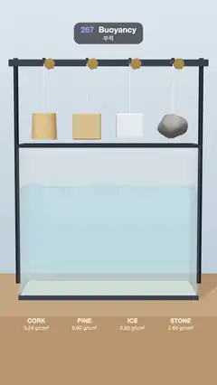

# 267 · Buoyancy · 부력



**EN** Cork, pine, ice and stone drop from reels into a glass tank, splash and bob, then float 24 %, 60 % and 92 % under as the stone sinks, and reel back up.  
**KO** 코르크·소나무·얼음·돌이 줄에서 풀려 유리 수조에 떨어져 출렁이다가 각각 24 %·60 %·92 % 잠긴 채 멈추고 돌은 가라앉으며, 다시 감겨 올라간다.

[Video (mp4)](https://sueun-dev.github.io/motion-effects/videos/267-buoyancy.mp4) · [Code](../effects/267-buoyancy.js) · Physics & characters · 물리·캐릭터

## Prompt (English)

```text
Create a "Buoyancy" motion effect: four blocks of different density are dropped into a glass tank of water; they plunge, bob on the ripples they make and settle with exactly their density's share under water, while the stone sinks.

Look
- A clean science-demo set: a background gradient #DCE6EE → #AFC2D1, a brown table #8C6A4A, and on it a glass tank 3.6 wide, 1.4 deep and 3.05 tall (clear walls, opacity 0.18, a dark #2C3440 base and rim, a sand floor #D8C7A2) filled 2.2 deep with water (#4FAFDC at opacity 0.34, a lighter #8FD3F2 surface).
- Above it a dark beam at height 4.75 on two posts, with four brass hexagonal reels; from each a white thread runs down to its block.
- The blocks, 0.55 tall, at x = −1.35, −0.45, 0.45, 1.35: a cork stopper (cylinder, speckled #C9965E), a pine block (wood grain), an ice cube (translucent #EAF8FF with a cool glow) and a rough grey stone #6E6A66. A thin white waterline is painted on each block where the surface cuts it.
- Labels on the table front under each block: "CORK 0.24 g/cm³", "PINE 0.60 g/cm³", "ICE 0.92 g/cm³", "STONE 2.60 g/cm³". In the water below each block, dark pill badges "24% under", "60% under", "92% under" and "sinks".
- Light: room environment (0.7), a soft key light from the upper left with shadows. Camera: perspective 30° at (0, 3.4, 15.2) looking at (0, 2.05, 0), straight at the tank.

Motion (0–5 s)
- 0–0.15 s: the four blocks hang still 1.25 above the water.
- Released at 0.15, 0.30, 0.45 and 0.60 s: each falls, plunges, tips a little as it meets the water, and bobs; ripples run out from each splash, bounce off the glass and die away by about 2.4 s.
- The floating blocks settle with 24 %, 60 % and 92 % of their height under water; the stone sinks to the sand. By about 3.6 s all are at rest, exactly still. The badges fade in from 2.6 to 3.1 s and out from 3.8 to 4.1 s.
- 3.85–4.7 s: the reels wind the blocks back up (ease in-out) to where they hung, and they hang still until 5 s, so 5 s matches 0 s.

Technique
- Each block moves up and down and rocks. Per unit mass: buoyancy g · s / ρ (s = submerged share of its height, ρ its density, g = 24 units/s²) minus gravity minus water drag s · (4.5 v + 3.5 v|v|) / ρ. Meeting the water gives it a small rocking kick; the rocking is a damped spring that only acts in water.
- The surface is a 1D wave equation across the tank (168 cells, wave speed 2.6, damping 3.9 and a slow pull back to flat, walls at both ends; the mean level is held). The water a block pushes aside (the change of its submerged volume) rises in a ring of 6 cells either side of it, and the blocks feel the local surface height, so they bob on their own and each other's ripples.
- Once the surface is nearly flat (< 0.001) after 2 s it is set exactly flat; a block that moves less than 0.004 units/s for 0.3 s is put to sleep, so resting blocks never jitter.
- 600 steps a second; the whole loop is simulated once in setup and played back. The water's top, front and back faces follow the wave heights every frame.

Output and rules
- One self-contained HTML file with no external assets (three.js from a CDN is fine if you use it), drawing on a 1080 × 1920 canvas (9:16) scaled to fit the window.
- Write a function renderFrame(t) that draws the frame for time t in seconds, and preview it with requestAnimationFrame. Everything must be a pure function of t and fixed seeds: no Math.random(), Date or state carried between frames, so frame i = renderFrame(i / 30) can be exported to a 30 fps video.
- Loop seamlessly every 5 seconds: renderFrame(5) must look exactly like renderFrame(0).
- No flicker of any kind: no noise or grain that changes from frame to frame, no strobing or blinking, no z-fighting, no shimmering 1 px lines. Any grain or texture stays fixed to the screen or to the object.
- Keep the top 280 px free of important content (a title label goes there) and fill the whole frame with a designed background.
```

## 프롬프트 (한국어)

```text
"부력" 모션 효과를 만들어 줘: 밀도가 다른 블록 넷이 물이 담긴 유리 수조에 떨어져 잠겼다가 스스로 만든 물결 위에서 출렁이고, 정확히 밀도만큼 물에 잠긴 채 멈추며 돌은 가라앉는 효과.

모양
- 깔끔한 과학 실험 장면: 배경 그라디언트 #DCE6EE → #AFC2D1, 갈색 탁자 #8C6A4A, 그 위에 너비 3.6, 깊이 1.4, 높이 3.05의 유리 수조(투명 벽 불투명도 0.18, 어두운 #2C3440 받침과 테두리, 모래 바닥 #D8C7A2)에 물을 2.2 깊이로 채운다(#4FAFDC 불투명도 0.34, 더 밝은 #8FD3F2 수면).
- 위에는 기둥 둘에 걸린 높이 4.75의 어두운 들보와 황동 육각 릴 넷. 릴마다 흰 실이 블록까지 내려간다.
- 높이 0.55의 블록, x = −1.35, −0.45, 0.45, 1.35: 코르크 마개(원기둥, 점박이 #C9965E), 소나무 블록(나뭇결), 얼음 큐브(반투명 #EAF8FF, 차가운 빛), 거친 회색 돌 #6E6A66. 수면이 블록을 가르는 자리에 가는 흰 흘수선을 그린다.
- 탁자 앞면, 블록마다 아래에 라벨: "CORK 0.24 g/cm³", "PINE 0.60 g/cm³", "ICE 0.92 g/cm³", "STONE 2.60 g/cm³". 블록 아래 물속에 어두운 알약 배지 "24% under", "60% under", "92% under", "sinks".
- 조명: 룸 환경맵(0.7), 왼쪽 위의 부드러운 키 라이트와 그림자. 카메라: 원근 30°, (0, 3.4, 15.2)에서 (0, 2.05, 0)을 정면으로 본다.

움직임 (0–5초)
- 0–0.15초: 블록 넷이 수면 1.25 위에 가만히 매달려 있다.
- 0.15, 0.30, 0.45, 0.60초에 차례로 풀려 떨어지고, 잠겼다가 물에 닿으며 살짝 기울고 출렁인다. 물결이 첨벙인 자리에서 퍼져 유리에 튕기고 약 2.4초까지 잦아든다.
- 뜨는 블록은 높이의 24 %, 60 %, 92 %가 잠긴 채 자리 잡고 돌은 모래까지 가라앉는다. 약 3.6초엔 모두 정확히 멈춰 있다. 배지는 2.6–3.1초에 나타나고 3.8–4.1초에 사라진다.
- 3.85–4.7초: 릴이 블록을 원래 매달렸던 자리까지 감아올리고(ease in-out), 5초까지 가만히 매달려 있어 5초가 0초와 맞물린다.

기법
- 블록마다 위아래로 움직이고 기울어 흔들린다. 질량당 힘: 부력 g · s / ρ(s = 높이 중 잠긴 비율, ρ 밀도, g = 24 units/s²) − 중력 − 물 저항 s · (4.5 v + 3.5 v|v|) / ρ. 물에 닿을 때 작은 기울임 충격을 받고, 기울기는 물속에서만 작동하는 감쇠 스프링이다.
- 수면은 수조를 가로지르는 1D 파동 방정식(셀 168개, 파속 2.6, 감쇠 3.9와 평평하게 돌아가는 느린 복원, 양 끝은 벽, 평균 수위 유지). 블록이 밀어낸 물(잠긴 부피의 변화)은 그 양옆 6셀 고리로 솟고, 블록은 자기 자리의 수면 높이를 느끼므로 자신과 서로의 물결 위에서 출렁인다.
- 2초 뒤 수면이 거의 평평해지면(< 0.001) 정확히 평평하게 둔다. 0.3초 동안 0.004 units/s보다 덜 움직인 블록은 잠재워, 쉬는 블록이 절대 떨리지 않는다.
- 초당 600스텝. 루프 전체를 설정 단계에서 한 번 시뮬레이션해 재생한다. 물의 윗면·앞면·뒷면은 매 프레임 물결 높이를 따른다.

출력과 규칙
- 외부 파일 없는 HTML 파일 하나(three.js를 쓴다면 CDN은 괜찮다). 1080 × 1920(9:16) 캔버스에 그리고 창 크기에 맞춰 보이게 한다.
- 시간 t(초)의 프레임을 그리는 renderFrame(t) 함수를 만들고, 미리보기는 requestAnimationFrame으로 돌린다. 모든 것은 t와 고정 시드만으로 정해진다: Math.random(), Date, 프레임 사이에 쌓이는 상태 금지. 그래야 i번째 프레임 = renderFrame(i / 30)으로 30fps 영상을 뽑을 수 있다.
- 5초마다 끊김 없이 반복: renderFrame(5)는 renderFrame(0)과 똑같아 보여야 한다.
- 어떤 깜빡임도 금지: 프레임마다 바뀌는 노이즈·그레인, 번쩍임·깜빡임, z-fighting, 반짝이며 떨리는 1px 선 모두 금지. 그레인·질감은 화면이나 물체에 고정한다.
- 위쪽 280px에는 중요한 내용을 두지 않고(제목 라벨 자리), 화면 전체를 디자인된 배경으로 채운다.
```
