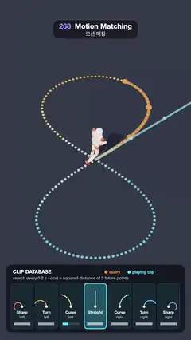

# 268 · Motion Matching · 모션 매칭



**EN** A runner circles a figure-eight while motion matching compares where the path is heading (orange) with seven clips' trajectories and lights the closest card.  
**KO** 달리는 사람이 8자 길을 돌고, 모션 매칭이 길이 향하는 미래 궤적(주황)을 클립 일곱 개의 궤적과 비교해 가장 가까운 클립 카드를 밝힌다.

[Video (mp4)](https://sueun-dev.github.io/motion-effects/videos/268-motion-matching.mp4) · [Code](../effects/268-motion-matching.js) · Physics & characters · 물리·캐릭터

## Prompt (English)

```text
Create a "Motion Matching" motion effect: a character runs a curvy path while a small motion-matching search picks, every 0.2 s, the animation clip whose future trajectory best matches where the path wants it to go. The query, the chosen clip and the clip database are all shown.

Look
- A dark stage: background #151A24, a round floor (radius 9) #232A38. The path, a figure eight x = 1.95 · sin 2u, z = −(3.35 · sin u − 0.23 · sin 3u) (22.7 m long), is drawn as 160 dots; each dot is coloured by the clip that plays when the runner passes it.
- The runner: a jointed mannequin (cream capsules #E9DCC8, red ball joints #C44E3A, a red nose dot that shows where the head looks), about 1.8 m tall.
- On the floor in front of the runner: the query, three orange #FF8A3D dots and an orange strip along the path 1 s ahead; and the playing clip's own 1 s trajectory, three cyan #48E0FF dots and a thinner cyan strip.
- Camera: perspective 32°, high, at (0, 18, 10) looking at (0, 0, 0.4), so the whole eight fits between the title and the panel.
- Panel at the bottom (x 36–1044, y 1494–1878, rgba(10, 13, 20, 0.78), radius 30): "CLIP DATABASE", "search every 0.2 s · cost = squared distance of 3 future points", a legend (orange query, cyan playing clip) and seven cards 126 × 256: each draws its clip's 1 s arc from a white start dot upwards in its own colour (Sharp left #FF7A59, Turn left #FFB04D, Curve left #FFE07A, Straight #E8ECF2, Curve right #8EE3D0, Turn right #5CC8FF, Sharp right #8E9BFF), its name, and a cost bar (√cost / 3, short = close). The playing card glows cyan and crossfades when the clip changes.

Motion (0–5 s)
- The runner covers the eight once, at a steady 4.55 m/s, with 16 running steps (8 cycles), so 5 s meets 0 s.
- Along the straight crossing the Straight clip wins; into each lobe the search switches to Curve, Turn and Sharp clips of the right side, then back out.
- The pose: hips swing ±0.75 rad, knees 0.25 + 0.95 · max(0, sin(a + 1.2))^1.5, arms swing 0.6 rad with elbows bent 1.45 rad, a 5 cm bounce and a 0.22 rad chest twist; the playing clip adds a lean into the turn of 0.075 rad per rad/s and turns the head 0.09 rad per rad/s.

Technique
- The database: seven clips, each a running turn at a fixed rate (+4, +2.6, +1.3, 0, −1.3, −2.6, −4 rad/s). A clip's future position after τ seconds in the runner's own frame is (v · sin(ωτ) / ω forward, v · (1 − cos ωτ) / ω to the left).
- The query: the path's position 1/3, 2/3 and 1 s ahead, transformed into the runner's frame (forward along the path's tangent).
- Every 6 frames the cost of each clip is the sum of squared distances between its three points and the query's; the cheapest wins only if it is 20 % cheaper than the playing clip (so it does not flicker between two). The pose and the cyan trajectory crossfade over 0.25 s.
- The search is run over two laps in setup and the second is kept, so the choices repeat every loop.

Output and rules
- One self-contained HTML file with no external assets (three.js from a CDN is fine if you use it), drawing on a 1080 × 1920 canvas (9:16) scaled to fit the window.
- Write a function renderFrame(t) that draws the frame for time t in seconds, and preview it with requestAnimationFrame. Everything must be a pure function of t and fixed seeds: no Math.random(), Date or state carried between frames, so frame i = renderFrame(i / 30) can be exported to a 30 fps video.
- Loop seamlessly every 5 seconds: renderFrame(5) must look exactly like renderFrame(0).
- No flicker of any kind: no noise or grain that changes from frame to frame, no strobing or blinking, no z-fighting, no shimmering 1 px lines. Any grain or texture stays fixed to the screen or to the object.
- Keep the top 280 px free of important content (a title label goes there) and fill the whole frame with a designed background.
```

## 프롬프트 (한국어)

```text
"모션 매칭" 모션 효과를 만들어 줘: 캐릭터가 굽은 길을 달리는 동안, 작은 모션 매칭 검색이 0.2초마다 길이 가려는 곳과 미래 궤적이 가장 잘 맞는 애니메이션 클립을 고른다. 쿼리, 고른 클립, 클립 데이터베이스가 모두 보인다.

모양
- 어두운 무대: 배경 #151A24, 둥근 바닥(반지름 9) #232A38. 길은 8자 x = 1.95 · sin 2u, z = −(3.35 · sin u − 0.23 · sin 3u)(길이 22.7m)를 점 160개로 그리고, 점마다 달리는 사람이 지날 때 재생되는 클립의 색을 칠한다.
- 달리는 사람: 관절 마네킹(크림색 캡슐 #E9DCC8, 빨간 공 관절 #C44E3A, 머리가 보는 쪽을 알려 주는 빨간 코 점), 키 약 1.8m.
- 사람 앞 바닥에: 쿼리 — 주황 #FF8A3D 점 셋과 길을 따라 1초 앞까지의 주황 띠; 재생 중인 클립 자신의 1초 궤적 — 청록 #48E0FF 점 셋과 더 가는 청록 띠.
- 카메라: 원근 32°, 높이 (0, 18, 10)에서 (0, 0, 0.4)를 내려다보아 8자 전체가 제목과 패널 사이에 들어온다.
- 아래 패널(x 36–1044, y 1494–1878, rgba(10, 13, 20, 0.78), 반지름 30): "CLIP DATABASE", "search every 0.2 s · cost = squared distance of 3 future points", 범례(주황 query, 청록 playing clip), 126 × 256 카드 일곱 장. 카드마다 그 클립의 1초 호를 흰 시작점에서 위로 제 색으로 그리고(Sharp left #FF7A59, Turn left #FFB04D, Curve left #FFE07A, Straight #E8ECF2, Curve right #8EE3D0, Turn right #5CC8FF, Sharp right #8E9BFF), 이름과 비용 막대(√cost / 3, 짧을수록 가깝다)를 단다. 재생 중인 카드는 청록으로 빛나고 클립이 바뀌면 교차 페이드된다.

움직임 (0–5초)
- 사람은 8자를 일정한 4.55m/s로 한 바퀴 돌고 16걸음(8주기)을 뛰어 5초가 0초와 맞물린다.
- 가운데 교차하는 직선에서는 Straight가 이기고, 고리로 들어가면 그쪽의 Curve, Turn, Sharp로 바뀌었다가 다시 돌아온다.
- 자세: 엉덩이 ±0.75 rad, 무릎 0.25 + 0.95 · max(0, sin(a + 1.2))^1.5, 팔 0.6 rad 흔들기와 1.45 rad 굽힌 팔꿈치, 5cm 들썩임, 가슴 0.22 rad 비틀기. 재생 중인 클립이 회전 속도 1 rad/s마다 0.075 rad 안쪽으로 기울이고 머리를 0.09 rad 돌린다.

기법
- 데이터베이스: 클립 일곱 개, 각각 일정한 회전 속도(+4, +2.6, +1.3, 0, −1.3, −2.6, −4 rad/s)로 도는 달리기. τ초 뒤 클립의 위치는 사람 기준으로 (앞으로 v · sin(ωτ) / ω, 왼쪽으로 v · (1 − cos ωτ) / ω).
- 쿼리: 1/3, 2/3, 1초 뒤 길 위의 위치를 사람 기준 좌표로(앞 = 길의 접선 방향).
- 6프레임마다 클립의 비용은 세 점과 쿼리 세 점 사이 거리 제곱의 합. 가장 싼 클립은 재생 중인 클립보다 20 % 싸야만 이긴다(둘 사이를 오가지 않게). 자세와 청록 궤적은 0.25초에 걸쳐 교차 페이드한다.
- 검색을 설정 단계에서 두 바퀴 돌리고 두 번째 바퀴를 써서, 선택이 루프마다 똑같이 반복된다.

출력과 규칙
- 외부 파일 없는 HTML 파일 하나(three.js를 쓴다면 CDN은 괜찮다). 1080 × 1920(9:16) 캔버스에 그리고 창 크기에 맞춰 보이게 한다.
- 시간 t(초)의 프레임을 그리는 renderFrame(t) 함수를 만들고, 미리보기는 requestAnimationFrame으로 돌린다. 모든 것은 t와 고정 시드만으로 정해진다: Math.random(), Date, 프레임 사이에 쌓이는 상태 금지. 그래야 i번째 프레임 = renderFrame(i / 30)으로 30fps 영상을 뽑을 수 있다.
- 5초마다 끊김 없이 반복: renderFrame(5)는 renderFrame(0)과 똑같아 보여야 한다.
- 어떤 깜빡임도 금지: 프레임마다 바뀌는 노이즈·그레인, 번쩍임·깜빡임, z-fighting, 반짝이며 떨리는 1px 선 모두 금지. 그레인·질감은 화면이나 물체에 고정한다.
- 위쪽 280px에는 중요한 내용을 두지 않고(제목 라벨 자리), 화면 전체를 디자인된 배경으로 채운다.
```
