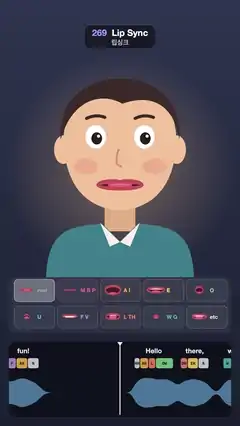

# 269 · Lip Sync · 립싱크



**EN** A cartoon face says "Hello there, watch my mouth. Very fun!" as phonemes on a sliding track blend ten viseme mouth shapes, each lit by its weight.  
**KO** 만화 얼굴이 "Hello there, watch my mouth. Very fun!"을 말하고, 흘러가는 음소 트랙에 맞춰 열 가지 입 모양(viseme)이 섞이며 가중치만큼 켜진다.

[Video (mp4)](https://sueun-dev.github.io/motion-effects/videos/269-lip-sync.mp4) · [Code](../effects/269-lip-sync.js) · Physics & characters · 물리·캐릭터

## Prompt (English)

```text
Create a "Lip Sync" motion effect: a cartoon face speaks a sentence whose phoneme track drives its mouth through viseme shapes with coarticulation. The video is silent, so the track itself is shown, sliding under a playhead.

Look (Canvas 2D, 1080 × 1920)
- Background: a vertical gradient #2E3550 → #1B1F30 with a warm halo (rgba(255, 196, 140, 0.35), radius 520) behind the head.
- The face, flat vector, centred at x 540, head top near y 350: a peach head #F2C29B (a skull curve and a jaw that drops 34 px × jaw open), ears, dark brown hair #3B2A2A, pink cheeks, big white eyes with dark pupils and highlights, thick brows, a curved nose line, a neck and teal shoulders #3E7C8C with a white collar.
- The mouth (drawn from seven controls): lips #C8505C as two bezier curves meeting at the corners, half-width (48 + 52 · width)(1 − 0.35 · rounding), opening (4 + 96 · jaw)(1 − 0.15 · rounding); inside, a dark #4A1D2A cavity, upper and lower teeth #FBF7F2 by the teeth control, a pink tongue #E8667A that rises behind the teeth with the tongue control; the lower lip tucks under the upper teeth with "tucked"; with the mouth closed, one line between the lips, thicker when pressed.
- A viseme chart (panel at y 1250–1500): ten cards 182 × 100 in two rows, each with its mouth drawn small and its name in its colour: rest #9AA3B5, M B P #F2668B, A I #FFB347, E #FFD966, O #7BD389, U #4FC3F7, F V #B39DDB, L TH #FF8A65, W Q #4DB6AC, etc #E0E0E0. A card lights by its current weight (border and fill).
- A track (panel at y 1540–1880): the words in bold white, under them rounded chips for the phonemes (ARPAbet, monospace), each in its viseme's colour and as wide as it lasts, and a mirrored loudness envelope (rgba(126, 200, 255, 0.55)); a white playhead with a small triangle is fixed at x 540.

Motion (0–5 s)
- The sentence: HH AH L OW (Hello, 0.20–0.75 s), DH EH R (there, 0.85–1.25), W AA CH (watch, 1.45–1.85), M AY (my, 1.85–2.15), M AW TH (mouth, 2.15–2.65), V EH R IY (Very, 3.00–3.42), F AH N (fun, 3.42–3.86), then silence to 5 s, so the loop closes at rest.
- The track slides left at 320 px/s under the playhead (the loop is 1600 px and is drawn repeating), so it never jumps.
- The brows lift on "Hello" and "fun", the pupils drift 6 px side to side once per loop, and the head bobs 6 px twice per loop.

Technique
- Ten visemes (after Preston Blair), each a set of seven controls [jaw open, width, rounding, teeth, tongue, lower lip tucked, pressed]: rest [0.04, 0.5, 0, 0, 0, 0, 0.25], M B P [0, 0.44, 0.1, 0, 0, 0, 1], A I [0.9, 0.78, 0, 0.55, 0.15, 0, 0], E [0.42, 1, 0, 0.9, 0.1, 0, 0], O [0.72, 0.4, 0.8, 0.2, 0, 0, 0], U [0.32, 0.25, 1, 0, 0, 0, 0], F V [0.14, 0.62, 0, 1, 0, 1, 0], L TH [0.48, 0.62, 0, 0.7, 1, 0, 0], W Q [0.22, 0.16, 1, 0, 0, 0, 0.2], etc [0.32, 0.68, 0, 0.85, 0.3, 0, 0].
- Each phoneme maps to one viseme (HH, R, CH, N → etc; AH, AA, AY → A I; OW → O; AW → U; DH, TH, L → L TH; EH, IY → E; M → M B P; W → W Q; F, V → F V).
- Coarticulation: every phoneme adds a Gaussian bell exp(−(Δt / σ)²) around its centre with σ = 0.55 × its length + 0.035 s, so neighbours overlap and the next shape starts forming early; rest is added where little is spoken, the weights are normalised, and the seven controls are their weighted mix. Everything is computed from t (times wrapped round 5 s).
- Loudness per phoneme (vowels 0.75–1, nasals and liquids about 0.5, fricatives about 0.3), smoothed the same way and soft-limited with 1 − exp(−1.6 x).

Output and rules
- One self-contained HTML file with no external assets (three.js from a CDN is fine if you use it), drawing on a 1080 × 1920 canvas (9:16) scaled to fit the window.
- Write a function renderFrame(t) that draws the frame for time t in seconds, and preview it with requestAnimationFrame. Everything must be a pure function of t and fixed seeds: no Math.random(), Date or state carried between frames, so frame i = renderFrame(i / 30) can be exported to a 30 fps video.
- Loop seamlessly every 5 seconds: renderFrame(5) must look exactly like renderFrame(0).
- No flicker of any kind: no noise or grain that changes from frame to frame, no strobing or blinking, no z-fighting, no shimmering 1 px lines. Any grain or texture stays fixed to the screen or to the object.
- Keep the top 280 px free of important content (a title label goes there) and fill the whole frame with a designed background.
```

## 프롬프트 (한국어)

```text
"립싱크" 모션 효과를 만들어 줘: 만화 얼굴이 문장을 말하고, 그 음소 트랙이 동시조음을 거쳐 입을 입 모양 단위(viseme) 모양들로 움직인다. 영상에는 소리가 없으니 트랙 자체를 보여 주고, 트랙은 재생 헤드 아래로 흘러간다.

모양 (Canvas 2D, 1080 × 1920)
- 배경: 세로 그라디언트 #2E3550 → #1B1F30, 머리 뒤에 따뜻한 빛무리(rgba(255, 196, 140, 0.35), 반지름 520).
- 얼굴: 평면 벡터, x 540 가운데, 머리 꼭대기는 y 350 근처. 복숭아빛 머리 #F2C29B(두개골 곡선, 턱 벌림 × 34px만큼 내려가는 턱), 귀, 짙은 갈색 머리카락 #3B2A2A, 분홍 볼, 짙은 눈동자와 하이라이트가 있는 큰 흰 눈, 굵은 눈썹, 휘어진 코 선, 목, 흰 깃이 달린 청록 어깨 #3E7C8C.
- 입(일곱 컨트롤로 그린다): 입술 #C8505C는 양 끝에서 만나는 베지어 곡선 둘, 반폭 (48 + 52 · 너비)(1 − 0.35 · 오므림), 벌림 (4 + 96 · 턱)(1 − 0.15 · 오므림). 안쪽은 어두운 #4A1D2A, 치아 컨트롤만큼 보이는 윗니·아랫니 #FBF7F2, 혀 컨트롤에 따라 이 뒤로 올라가는 분홍 혀 #E8667A. "말아 넣기"가 크면 아랫입술이 윗니 밑으로 들어간다. 입을 닫으면 입술 사이 선 하나, 누르면 더 굵어진다.
- 입 모양 차트(y 1250–1500 패널): 182 × 100 카드 열 장, 두 줄. 카드마다 작은 입과 제 색 이름: rest #9AA3B5, M B P #F2668B, A I #FFB347, E #FFD966, O #7BD389, U #4FC3F7, F V #B39DDB, L TH #FF8A65, W Q #4DB6AC, etc #E0E0E0. 카드는 지금의 가중치만큼 밝아진다(테두리와 채움).
- 트랙(y 1540–1880 패널): 굵은 흰 단어, 그 아래 음소(ARPAbet, 고정폭 글꼴)를 입 모양 색의 둥근 칩으로, 길이만큼 넓게. 위아래로 대칭인 소리 크기 엔벨로프(rgba(126, 200, 255, 0.55)). 작은 삼각형이 달린 흰 재생 헤드는 x 540에 고정.

움직임 (0–5초)
- 문장: HH AH L OW (Hello, 0.20–0.75초), DH EH R (there, 0.85–1.25), W AA CH (watch, 1.45–1.85), M AY (my, 1.85–2.15), M AW TH (mouth, 2.15–2.65), V EH R IY (Very, 3.00–3.42), F AH N (fun, 3.42–3.86), 그리고 5초까지 침묵이라 루프는 쉬는 입으로 닫힌다.
- 트랙은 재생 헤드 아래로 초당 320px 왼쪽으로 흐른다(루프는 1600px, 반복해서 그린다). 그래서 절대 튀지 않는다.
- "Hello"와 "fun"에서 눈썹이 올라가고, 눈동자는 루프마다 한 번 좌우로 6px 움직이며, 머리는 루프마다 두 번 6px 끄덕인다.

기법
- 입 모양 열 개(Preston Blair 방식), 각각 일곱 컨트롤 [턱 벌림, 너비, 오므림, 치아, 혀, 아랫입술 말아 넣기, 누름]: rest [0.04, 0.5, 0, 0, 0, 0, 0.25], M B P [0, 0.44, 0.1, 0, 0, 0, 1], A I [0.9, 0.78, 0, 0.55, 0.15, 0, 0], E [0.42, 1, 0, 0.9, 0.1, 0, 0], O [0.72, 0.4, 0.8, 0.2, 0, 0, 0], U [0.32, 0.25, 1, 0, 0, 0, 0], F V [0.14, 0.62, 0, 1, 0, 1, 0], L TH [0.48, 0.62, 0, 0.7, 1, 0, 0], W Q [0.22, 0.16, 1, 0, 0, 0, 0.2], etc [0.32, 0.68, 0, 0.85, 0.3, 0, 0].
- 음소마다 입 모양 하나(HH, R, CH, N → etc; AH, AA, AY → A I; OW → O; AW → U; DH, TH, L → L TH; EH, IY → E; M → M B P; W → W Q; F, V → F V).
- 동시조음: 음소마다 중심에 가우시안 종 exp(−(Δt / σ)²)을 더하고 σ = 길이의 0.55배 + 0.035초라 이웃 음소가 겹치고 다음 입 모양이 미리 만들어진다. 말이 적은 곳엔 rest를 더하고, 가중치를 정규화해 일곱 컨트롤을 가중 평균한다. 모두 t로 계산한다(시간은 5초로 감는다).
- 소리 크기: 음소마다 값(모음 0.75–1, 비음·유음 약 0.5, 마찰음 약 0.3)을 같은 방식으로 부드럽게 하고 1 − exp(−1.6 x)로 부드럽게 제한한다.

출력과 규칙
- 외부 파일 없는 HTML 파일 하나(three.js를 쓴다면 CDN은 괜찮다). 1080 × 1920(9:16) 캔버스에 그리고 창 크기에 맞춰 보이게 한다.
- 시간 t(초)의 프레임을 그리는 renderFrame(t) 함수를 만들고, 미리보기는 requestAnimationFrame으로 돌린다. 모든 것은 t와 고정 시드만으로 정해진다: Math.random(), Date, 프레임 사이에 쌓이는 상태 금지. 그래야 i번째 프레임 = renderFrame(i / 30)으로 30fps 영상을 뽑을 수 있다.
- 5초마다 끊김 없이 반복: renderFrame(5)는 renderFrame(0)과 똑같아 보여야 한다.
- 어떤 깜빡임도 금지: 프레임마다 바뀌는 노이즈·그레인, 번쩍임·깜빡임, z-fighting, 반짝이며 떨리는 1px 선 모두 금지. 그레인·질감은 화면이나 물체에 고정한다.
- 위쪽 280px에는 중요한 내용을 두지 않고(제목 라벨 자리), 화면 전체를 디자인된 배경으로 채운다.
```
