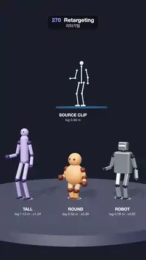

# 270 · Retargeting · 리타기팅



**EN** One step-touch dance from a glowing source skeleton plays on a tall, a round and a robot body; steps scale with each one's legs and IK pins the feet down.  
**KO** 빛나는 원본 골격의 스텝 터치 춤 하나가 키 큰 몸, 둥근 몸, 로봇에 옮겨지고, 다리 길이만큼 보폭이 바뀌며 발은 IK로 바닥에 고정된다.

[Video (mp4)](https://sueun-dev.github.io/motion-effects/videos/270-retargeting.mp4) · [Code](../effects/270-retargeting.js) · Physics & characters · 물리·캐릭터

## Prompt (English)

```text
Create a "Retargeting" motion effect: one dance clip, recorded on a source skeleton, is played on three bodies with very different proportions, with the upper body copied as rotations and the feet kept planted by scaling and IK.

Look
- A dark stage: background #1A1D2B, a round stage (radius 3.4) #2B3045. Light: a warm key light from the upper left with soft shadows, a cool hemisphere fill, room environment 0.55.
- The source: a glowing cyan skeleton (#7DF9FF bones of thin capsules, white glowing joint balls) at 0.8 scale on a floating dark pad with a blue glow, above the middle; under it "SOURCE CLIP" / "leg 0.90 m".
- On the stage, left to right, each turned 0.5 rad towards the camera:
  - TALL: leg 1.12 m, long lavender #B9A7FF capsules, dark purple joints, small eyes;
  - ROUND: leg 0.50 m, a big orange #FF9F5A sphere body, short limbs, brown joints, a big round head with eyes;
  - ROBOT: leg 0.78 m, brushed-metal #B7C0CC rounded boxes, dark joints, a box head with a glowing cyan visor.
  - Labels under them: "TALL leg 1.12 m · ×1.24", "ROUND leg 0.50 m · ×0.56", "ROBOT leg 0.78 m · ×0.87".
- Under every foot a cyan ring on the floor that lights while the foot is planted.
- Camera: perspective 38° at (0, 2.6, 11.2) looking at (0, 2.05, 0).

Motion (0–5 s), eight beats of 0.625 s
- A step-touch: the right foot steps 0.36 leg lengths right, the left closes, the left steps back, the right closes; then the same to the left and back. Feet start 0.13 leg lengths either side of the centre; the moving foot lifts 0.14 leg lengths in an eased arc while the other stays put.
- With it, on a swing that repeats every two beats (a = 2π · t / 1.25): the root follows the middle of the feet plus 0.03 · sin a, bounces 0.035 · (1 − cos 2a) leg lengths, the torso leans 0.09 · sin a and twists 0.22 · sin a, the head nods 0.12 · sin(2a + 0.6), the arms swing ±0.55 · sin a in opposition, spread 0.3 + 0.12 · cos 2a, elbows 1.0 ± 0.45 · cos a.
- Everything returns to the start after eight beats, so 5 s meets 0 s.

Technique
- Retargeting by copying local rotations: every body uses the source's torso lean and twist, head nod, shoulder swing and spread and elbow bend as they are, on its own bone lengths (spine, neck, shoulder width, upper arm, forearm).
- The root path, bounce and the foot targets are in leg lengths, so on each body they are scaled by its leg length (×1.24, ×0.56, ×0.87 against the source): a long-legged body steps wider and bobs higher on the same beat.
- Each leg is solved by two-bone IK from the hip to its foot target (thigh = shin = 0.49 leg; the knee angle from the law of cosines, bending forward), so a planted foot stays exactly where it landed: no sliding, no floating, no sinking into the floor.
- No simulation: every pose is a pure function of t.

Output and rules
- One self-contained HTML file with no external assets (three.js from a CDN is fine if you use it), drawing on a 1080 × 1920 canvas (9:16) scaled to fit the window.
- Write a function renderFrame(t) that draws the frame for time t in seconds, and preview it with requestAnimationFrame. Everything must be a pure function of t and fixed seeds: no Math.random(), Date or state carried between frames, so frame i = renderFrame(i / 30) can be exported to a 30 fps video.
- Loop seamlessly every 5 seconds: renderFrame(5) must look exactly like renderFrame(0).
- No flicker of any kind: no noise or grain that changes from frame to frame, no strobing or blinking, no z-fighting, no shimmering 1 px lines. Any grain or texture stays fixed to the screen or to the object.
- Keep the top 280 px free of important content (a title label goes there) and fill the whole frame with a designed background.
```

## 프롬프트 (한국어)

```text
"리타기팅" 모션 효과를 만들어 줘: 원본 골격에 녹화된 춤 클립 하나를 비율이 아주 다른 세 몸에 재생한다. 윗몸은 회전값을 그대로 복사하고, 발은 스케일과 IK로 바닥에 고정한다.

모양
- 어두운 무대: 배경 #1A1D2B, 둥근 무대(반지름 3.4) #2B3045. 조명: 왼쪽 위의 따뜻한 키 라이트와 부드러운 그림자, 차가운 반구광, 룸 환경맵 0.55.
- 원본: 빛나는 청록 골격(#7DF9FF 가는 캡슐 뼈, 흰 빛 관절 공)을 0.8배로, 가운데 위의 푸른 빛이 도는 어두운 공중 받침 위에. 그 아래 "SOURCE CLIP" / "leg 0.90 m".
- 무대 위 왼쪽부터, 각각 카메라 쪽으로 0.5 rad 돌아서:
  - TALL: 다리 1.12m, 긴 라벤더 #B9A7FF 캡슐, 짙은 보라 관절, 작은 눈;
  - ROUND: 다리 0.50m, 커다란 주황 #FF9F5A 공 몸통, 짧은 팔다리, 갈색 관절, 눈이 달린 큰 둥근 머리;
  - ROBOT: 다리 0.78m, 브러시드 메탈 #B7C0CC 둥근 상자, 어두운 관절, 청록 바이저가 빛나는 상자 머리.
  - 아래 라벨: "TALL leg 1.12 m · ×1.24", "ROUND leg 0.50 m · ×0.56", "ROBOT leg 0.78 m · ×0.87".
- 발마다 바닥에 청록 고리, 발이 디뎌져 있는 동안 켜진다.
- 카메라: 원근 38°, (0, 2.6, 11.2)에서 (0, 2.05, 0)을 본다.

움직임 (0–5초), 0.625초 박자 여덟
- 스텝 터치: 오른발이 다리 길이의 0.36만큼 오른쪽으로 딛고, 왼발이 붙고, 왼발이 돌아가고, 오른발이 붙는다. 그다음 왼쪽으로 같은 동작을 하고 돌아온다. 두 발은 가운데에서 다리 길이의 0.13씩 떨어져 시작하고, 움직이는 발은 다리 길이의 0.14만큼 부드러운 호로 들리며 다른 발은 그대로 있다.
- 함께, 두 박자마다 반복되는 흔들림(a = 2π · t / 1.25): 골반은 두 발의 가운데 + 0.03 · sin a를 따르고 다리 길이의 0.035 · (1 − cos 2a)만큼 들썩이며, 몸통은 0.09 · sin a 기울고 0.22 · sin a 비틀고, 머리는 0.12 · sin(2a + 0.6) 끄덕이고, 팔은 서로 반대로 ±0.55 · sin a 흔들고 0.3 + 0.12 · cos 2a 벌리며, 팔꿈치는 1.0 ± 0.45 · cos a.
- 여덟 박자 뒤 모두 처음으로 돌아와 5초가 0초와 맞물린다.

기법
- 로컬 회전 복사로 리타기팅: 모든 몸이 원본의 몸통 기울기·비틀기, 머리 끄덕임, 어깨 흔들기·벌리기, 팔꿈치 굽힘을 그대로 쓰되 자기 뼈 길이(척추, 목, 어깨 너비, 위팔, 아래팔)에 적용한다.
- 골반 경로, 들썩임, 발 목표는 다리 길이 단위라, 몸마다 자기 다리 길이로 스케일된다(원본 대비 ×1.24, ×0.56, ×0.87). 다리가 긴 몸은 같은 박자에 더 넓게 딛고 더 크게 들썩인다.
- 다리는 엉덩이에서 발 목표까지 2본 IK로 푼다(허벅지 = 정강이 = 다리의 0.49, 무릎 각은 코사인 법칙, 앞으로 굽힘). 그래서 디딘 발은 정확히 그 자리에 머문다: 미끄러지지도, 뜨지도, 바닥에 박히지도 않는다.
- 시뮬레이션 없음: 모든 자세가 t만의 순수 함수다.

출력과 규칙
- 외부 파일 없는 HTML 파일 하나(three.js를 쓴다면 CDN은 괜찮다). 1080 × 1920(9:16) 캔버스에 그리고 창 크기에 맞춰 보이게 한다.
- 시간 t(초)의 프레임을 그리는 renderFrame(t) 함수를 만들고, 미리보기는 requestAnimationFrame으로 돌린다. 모든 것은 t와 고정 시드만으로 정해진다: Math.random(), Date, 프레임 사이에 쌓이는 상태 금지. 그래야 i번째 프레임 = renderFrame(i / 30)으로 30fps 영상을 뽑을 수 있다.
- 5초마다 끊김 없이 반복: renderFrame(5)는 renderFrame(0)과 똑같아 보여야 한다.
- 어떤 깜빡임도 금지: 프레임마다 바뀌는 노이즈·그레인, 번쩍임·깜빡임, z-fighting, 반짝이며 떨리는 1px 선 모두 금지. 그레인·질감은 화면이나 물체에 고정한다.
- 위쪽 280px에는 중요한 내용을 두지 않고(제목 라벨 자리), 화면 전체를 디자인된 배경으로 채운다.
```
