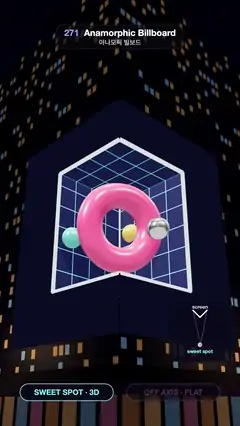

# 271 · Anamorphic Billboard · 아나모픽 빌보드



**EN** A pink ring and three spheres float out of a gridded room on a corner LED screen; off the sweet spot the pixels become a flat picture folded round the corner.  
**KO** 건물 모서리 LED 화면 속 격자 방에서 분홍 링과 구슬 셋이 거리로 떠오르고, 스위트 스폿을 벗어나면 같은 픽셀이 모서리에 접힌 평면 그림이 된다.

[Video (mp4)](https://sueun-dev.github.io/motion-effects/videos/271-anamorphic-billboard.mp4) · [Code](../effects/271-anamorphic-billboard.js) · Spatial illusions · 공간 착시

## Prompt (English)

```text
Create an "Anamorphic Billboard" effect: a 3D scene on an L-shaped LED screen wrapped round a building corner looks solid from one spot on the street and turns into a flat, folded picture when the camera walks away.

Look
- A night street. A dark glass building 40 × 36 × 40 m with its corner at the origin and its faces on the planes z = 0 and x = 0; windows in a 16 × 36 grid per 40 m face, 22 % of them lit in amber #B88A56 or blue #6F96B8; a ground-floor band of dim shop windows; two street lamps (warm #FFD39A point lights); sky gradient #05061A → #191846 → #46285A.
- The screen: two faces 9 m wide, from 8 m to 20 m above the street, meeting at the corner, set in plain cladding #1B1E38 (11.5 × 16 m on each face).
- The content (a separate scene that is never shown directly): a room sunk into the corner, its mouth 6.6 m along each face from 9.4 m to 18.6 m up and 6.6 m deep, lined with a cyan #3FD2FF grid on navy #0E1846, with white glowing beams round the mouth; round the mouth a strip of painted facade in exactly the cladding colour #1B1E38; a glossy pink #FF4F8B torus (radius 2.4, tube 0.95) and three spheres (chrome, teal #2FD4C4, yellow #FFC93C, radius 0.75) circling it at 3.6; a warm key light from the upper right casts their shadows on the room and on the painted facade.
- The sweet spot: (17.5, 1.7, 17.5), eye height across the street.
- Overlay: two pills at the bottom, "SWEET SPOT · 3D" (cyan) and "OFF AXIS · FLAT" (pink), the active one bright; a small plan view at the lower right: the L of the screen, a cyan dot for the sweet spot and a pink dot for the camera with lines to the ends of the screen.

Motion (0–5 s), a = 2π · t / 5
- Camera (52° field of view, always looking at (−0.6, 13.6, −0.6)): at the sweet spot from 0.4 to 1.9 s; eases out to (24, 5, 9.6) from 1.9 to 3.45 s, rising 2.5 m on the way; holds until 3.7 s; eases back from 3.7 s, across the loop point, reaching the sweet spot at 0.4 s.
- The torus floats out of the room to (2.6, 11.9, 2.6), in front of the corner, from 0.4 to 1.5 s and back in from 3.9 to 4.95 s; it bobs by 0.3 · sin(2a), spins once per loop and tilts by 0.2 · sin(a). The spheres orbit it once per loop.

Technique
- three.js. Every frame, render the content scene from a fixed camera at the sweet spot (36° square view) into a 2048 × 2048 mipmapped render target.
- The two screen faces use a shader that multiplies each fragment's world position by that camera's view-projection matrix and samples the image there, so every screen pixel shows what lies behind it on the line to the sweet spot. From the sweet spot the painted facade continues the real cladding, the screen edge vanishes and the torus hangs over the street; from anywhere else the same pixels are a flat image folded round the corner.
- Average the street camera over 16 sub-frames across each 1/30 s so the facade blurs instead of shimmering while the camera moves. ACES tone mapping once at the end.

Output and rules
- One self-contained HTML file with no external assets (three.js from a CDN is fine if you use it), drawing on a 1080 × 1920 canvas (9:16) scaled to fit the window.
- Write a function renderFrame(t) that draws the frame for time t in seconds, and preview it with requestAnimationFrame. Everything must be a pure function of t and fixed seeds: no Math.random(), Date or state carried between frames, so frame i = renderFrame(i / 30) can be exported to a 30 fps video.
- Loop seamlessly every 5 seconds: renderFrame(5) must look exactly like renderFrame(0).
- No flicker of any kind: no noise or grain that changes from frame to frame, no strobing or blinking, no z-fighting, no shimmering 1 px lines. Any grain or texture stays fixed to the screen or to the object.
- Keep the top 280 px free of important content (a title label goes there) and fill the whole frame with a designed background.
```

## 프롬프트 (한국어)

```text
"아나모픽 빌보드" 효과를 만들어 줘: 건물 모서리를 감싼 L자 LED 화면의 3D 장면이 거리의 한 지점에서는 입체로 보이고, 카메라가 그 자리를 벗어나면 접힌 평면 그림으로 바뀌는 효과.

모양
- 밤거리. 모서리가 원점에 있는 어두운 유리 건물 40 × 36 × 40 m, 두 면은 z = 0, x = 0 평면에 있다. 40 m 면마다 창이 16 × 36 격자로 나 있고 22 %가 호박색 #B88A56 또는 파랑 #6F96B8로 켜져 있다. 1층에는 어둑한 상점 창이 띠처럼 이어지고, 따뜻한 가로등 두 개(#FFD39A 점광원), 하늘은 #05061A → #191846 → #46285A 그라디언트.
- 화면: 너비 9 m인 두 면이 거리에서 8 m부터 20 m 높이까지 걸려 모서리에서 만난다. 둘레는 무늬 없는 외장 #1B1E38(각 면 11.5 × 16 m).
- 콘텐츠(따로 만든 장면, 직접 보이지 않는다): 모서리 안으로 파고든 방. 입구는 각 면을 따라 6.6 m, 높이 9.4~18.6 m, 깊이 6.6 m이고 벽은 남색 #0E1846 위 청록 #3FD2FF 격자, 입구 둘레에 하얗게 빛나는 테두리가 있다. 입구 바깥은 외장과 똑같은 색 #1B1E38로 칠한 가짜 벽면이다. 광택 있는 분홍 #FF4F8B 토러스(반지름 2.4, 굵기 0.95)와 그 둘레 3.6 거리를 도는 구슬 셋(크롬, 청록 #2FD4C4, 노랑 #FFC93C, 반지름 0.75). 오른쪽 위의 따뜻한 키 라이트가 방과 가짜 벽면에 그림자를 드리운다.
- 스위트 스폿: (17.5, 1.7, 17.5), 길 건너편 눈높이.
- 오버레이: 아래쪽 알약 두 개 "SWEET SPOT · 3D"(청록)와 "OFF AXIS · FLAT"(분홍), 지금 상태인 쪽이 밝다. 오른쪽 아래 작은 평면도: 화면의 L자, 스위트 스폿 청록 점, 카메라 분홍 점과 화면 양 끝으로 가는 선.

움직임 (0–5초), a = 2π · t / 5
- 카메라(시야각 52°, 항상 (−0.6, 13.6, −0.6)을 본다): 0.4~1.9초에는 스위트 스폿; 1.9~3.45초에 (24, 5, 9.6)으로 부드럽게 옮겨 가며 도중에 2.5 m 올라간다; 3.7초까지 멈춤; 3.7초부터 반복 지점을 넘어 0.4초에 스위트 스폿으로 돌아온다.
- 토러스는 0.4~1.5초에 방에서 나와 모서리 앞 (2.6, 11.9, 2.6)까지 떠오르고 3.9~4.95초에 다시 들어간다. 0.3 · sin(2a)로 오르내리고, 반복마다 한 바퀴 돌며 0.2 · sin(a)로 기운다. 구슬은 반복마다 토러스 둘레를 한 바퀴 돈다.

기법
- three.js. 매 프레임 스위트 스폿에 고정한 카메라(시야각 36°, 정사각형)로 콘텐츠 장면을 2048 × 2048 밉맵 렌더 타깃에 그린다.
- 화면 두 면의 셰이더는 각 프래그먼트의 월드 좌표에 그 카메라의 뷰-투영 행렬을 곱해 그 자리의 이미지를 읽는다. 그래서 화면의 모든 픽셀은 스위트 스폿에서 그 픽셀 너머로 보이는 것을 보여 준다. 스위트 스폿에서는 가짜 벽면이 진짜 외장과 이어져 화면 테두리가 사라지고 토러스가 거리 위에 떠 있다. 다른 곳에서 보면 같은 픽셀이 모서리에 접힌 평면 그림이다.
- 거리 카메라는 1/30초 안의 서브프레임 16개를 평균해, 움직이는 동안 건물이 반짝이지 않고 부드럽게 흐려진다. ACES 톤 매핑은 마지막에 한 번.

출력과 규칙
- 외부 파일 없는 HTML 파일 하나(three.js를 쓴다면 CDN은 괜찮다). 1080 × 1920(9:16) 캔버스에 그리고 창 크기에 맞춰 보이게 한다.
- 시간 t(초)의 프레임을 그리는 renderFrame(t) 함수를 만들고, 미리보기는 requestAnimationFrame으로 돌린다. 모든 것은 t와 고정 시드만으로 정해진다: Math.random(), Date, 프레임 사이에 쌓이는 상태 금지. 그래야 i번째 프레임 = renderFrame(i / 30)으로 30fps 영상을 뽑을 수 있다.
- 5초마다 끊김 없이 반복: renderFrame(5)는 renderFrame(0)과 똑같아 보여야 한다.
- 어떤 깜빡임도 금지: 프레임마다 바뀌는 노이즈·그레인, 번쩍임·깜빡임, z-fighting, 반짝이며 떨리는 1px 선 모두 금지. 그레인·질감은 화면이나 물체에 고정한다.
- 위쪽 280px에는 중요한 내용을 두지 않고(제목 라벨 자리), 화면 전체를 디자인된 배경으로 채운다.
```
