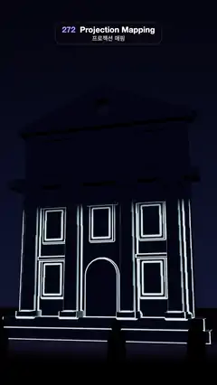

# 272 · Projection Mapping · 프로젝션 매핑



**EN** A white neoclassical facade is painted with projected light: outlines trace every edge, windows fill gold, a colour wave floods it, then fake shadows swing.  
**KO** 밤의 하얀 신고전주의 건물 정면에 빛을 투사해, 윤곽선이 모서리를 타고 오르고 창이 금빛으로 차오르며 색 물결이 덮인 뒤 가짜 그림자가 빙 돈다.

[Video (mp4)](https://sueun-dev.github.io/motion-effects/videos/272-projection-mapping.mp4) · [Code](../effects/272-projection-mapping.js) · Spatial illusions · 공간 착시

## Prompt (English)

```text
Create a "Projection Mapping" effect: one projector lights a plain white building facade at night, and the light show is drawn to fit the stone exactly, so the building seems to glow, change colour and stand out further.

Look
- A white neoclassical facade #F4F1EA (rough stone), 10.6 m wide and about 16 m tall: a 12.6 m wall on two steps; four columns (radius 0.4–0.46, 7.4 m tall, 0.55 m in front of the wall) with square bases and capitals; seven window frames (1.5 × 2.2 m, each with a pane a step further out and a hood above) on three floors; an arched door; a cornice at 9.35 m and another at 13 m; a triangular pediment 11.8 m wide and 2.6 m tall with a round oculus; a round clock panel between the top windows.
- Night: sky gradient #03040E → #0E1430 → #1C1A38, a dim blue hemisphere light (#5A6AB0, 0.35), a dark square #4A4652 with a soft violet pool of bounced light in front of the steps, and six dark silhouettes of people watching.
- Every colour on the facade is projected light.

Motion (0–5 s), a = 2π · t / 5; the show runs on its own clock s = (t + 0.6) mod 5
- s 0–1.3: cyan-white outlines trace every edge from the bottom up, then dim to 40 %.
- s 1.3–2.4: the windows fill one after another, 0.13 s apart, with a warm gold gradient.
- s 2.0–3.4: a colour wave sweeps diagonally from the lower left and gives every part its own saturated hue (magenta wall, blue and green columns, mint pediment…), the outlines kept on top.
- s 3.3–4.95: a white wash with a fake light swinging round: everything raised (columns, frames, cornices) throws a drop shadow up to 26 texels long that turns with the light, and the side towards the light is brighter.
- s 4.4–5.0: the outlines and windows fade to dark, then the trace starts again.
- The camera drifts at (8 + 1.5 · sin(a), 2.2 + 0.3 · sin(2a), 26) looking at (0.4, 8.6, 0), 46° field of view, so the columns show their depth.

Technique
- three.js. The projector is a SpotLight at (0, 5, 30) aimed at (0, 8.2, 0) (angle 0.37 rad, no distance falloff, intensity 5.5, shadows on) whose .map is the slide: the light is projected, and the facade parts shadow each other as with a real projector.
- Mapping template: once at setup, render the facade from the spot light's own shadow camera into a 1024 × 1024 float target, each part written as (part id, part type, depth along the projector axis, window index).
- Each frame a full-screen shader draws the 1024 × 1024 slide from that template: edges where the id changes within 3 texels; windows by type and index; the colour wave by position; drop shadows by sampling 10 points along a 26-texel line towards the fake light and checking for a nearer (raised) part. Texels with no part stay black, so no light spills onto the sky or the square.
- ACES tone mapping, PCF soft shadows (2048).

Output and rules
- One self-contained HTML file with no external assets (three.js from a CDN is fine if you use it), drawing on a 1080 × 1920 canvas (9:16) scaled to fit the window.
- Write a function renderFrame(t) that draws the frame for time t in seconds, and preview it with requestAnimationFrame. Everything must be a pure function of t and fixed seeds: no Math.random(), Date or state carried between frames, so frame i = renderFrame(i / 30) can be exported to a 30 fps video.
- Loop seamlessly every 5 seconds: renderFrame(5) must look exactly like renderFrame(0).
- No flicker of any kind: no noise or grain that changes from frame to frame, no strobing or blinking, no z-fighting, no shimmering 1 px lines. Any grain or texture stays fixed to the screen or to the object.
- Keep the top 280 px free of important content (a title label goes there) and fill the whole frame with a designed background.
```

## 프롬프트 (한국어)

```text
"프로젝션 매핑" 효과를 만들어 줘: 프로젝터 한 대가 밤의 하얀 건물 정면을 비추고, 빛의 쇼가 돌 모양에 정확히 맞춰 그려져 건물이 빛나고 색이 바뀌고 더 도드라져 보이는 효과.

모양
- 하얀 신고전주의 건물 정면 #F4F1EA(거친 돌), 폭 10.6 m, 높이 약 16 m: 계단 두 단 위의 12.6 m 벽; 벽에서 0.55 m 앞으로 나온 기둥 넷(반지름 0.4~0.46, 높이 7.4 m)과 네모난 받침·머리; 세 층에 걸친 창틀 일곱 개(1.5 × 2.2 m, 한 단 더 나온 유리판과 위쪽 차양); 아치형 문; 9.35 m와 13 m 높이의 처마 장식; 폭 11.8 m, 높이 2.6 m의 삼각 박공과 둥근 원형 창; 맨 위 창 사이 둥근 시계판.
- 밤: 하늘 그라디언트 #03040E → #0E1430 → #1C1A38, 흐린 파란 반구광(#5A6AB0, 0.35), 어두운 광장 #4A4652와 계단 앞의 은은한 보랏빛 반사광 웅덩이, 지켜보는 사람 실루엣 여섯.
- 건물 정면의 모든 색은 투사된 빛이다.

움직임 (0–5초), a = 2π · t / 5; 쇼는 자기 시계 s = (t + 0.6) mod 5로 돈다
- s 0~1.3: 청록빛 흰 윤곽선이 아래에서 위로 모든 모서리를 따라 그려지고, 이후 40 %로 어두워진다.
- s 1.3~2.4: 창이 0.13초 간격으로 하나씩 따뜻한 금빛 그라디언트로 차오른다.
- s 2.0~3.4: 색 물결이 왼쪽 아래에서 대각선으로 쓸고 지나가며 부분마다 진한 색을 입힌다(자홍 벽, 파랑·초록 기둥, 민트 박공…), 윤곽선은 위에 남는다.
- s 3.3~4.95: 하얀 빛 위로 가짜 조명이 빙 돈다: 튀어나온 것(기둥, 창틀, 처마)이 최대 26텍셀 길이의 그림자를 드리우고 그 방향이 조명을 따라 돌며, 조명 쪽이 더 밝다.
- s 4.4~5.0: 윤곽선과 창이 어두워지고, 다시 윤곽 그리기가 시작된다.
- 카메라는 (8 + 1.5 · sin(a), 2.2 + 0.3 · sin(2a), 26)에서 (0.4, 8.6, 0)을 보며 천천히 움직인다(시야각 46°). 그래서 기둥의 깊이가 보인다.

기법
- three.js. 프로젝터는 (0, 5, 30)에서 (0, 8.2, 0)을 겨누는 SpotLight(각도 0.37 rad, 거리 감쇠 없음, 세기 5.5, 그림자 켬)이고 .map이 슬라이드다: 빛이 투사되고, 진짜 프로젝터처럼 건물 부분끼리 그림자를 만든다.
- 매핑 템플릿: 시작할 때 한 번, 스폿 라이트의 그림자 카메라로 건물을 1024 × 1024 float 타깃에 그린다. 부분마다 (부분 id, 종류, 프로젝터 축 방향 깊이, 창 번호)를 쓴다.
- 매 프레임 전체 화면 셰이더가 그 템플릿으로 1024 × 1024 슬라이드를 그린다: 3텍셀 안에서 id가 바뀌는 곳이 윤곽선; 창은 종류와 번호로; 색 물결은 위치로; 그림자는 가짜 조명 쪽 26텍셀 선 위의 10점을 보며 더 가까운(튀어나온) 부분이 있는지 확인한다. 부분이 없는 텍셀은 검정이라 하늘이나 광장으로 빛이 새지 않는다.
- ACES 톤 매핑, PCF 소프트 그림자(2048).

출력과 규칙
- 외부 파일 없는 HTML 파일 하나(three.js를 쓴다면 CDN은 괜찮다). 1080 × 1920(9:16) 캔버스에 그리고 창 크기에 맞춰 보이게 한다.
- 시간 t(초)의 프레임을 그리는 renderFrame(t) 함수를 만들고, 미리보기는 requestAnimationFrame으로 돌린다. 모든 것은 t와 고정 시드만으로 정해진다: Math.random(), Date, 프레임 사이에 쌓이는 상태 금지. 그래야 i번째 프레임 = renderFrame(i / 30)으로 30fps 영상을 뽑을 수 있다.
- 5초마다 끊김 없이 반복: renderFrame(5)는 renderFrame(0)과 똑같아 보여야 한다.
- 어떤 깜빡임도 금지: 프레임마다 바뀌는 노이즈·그레인, 번쩍임·깜빡임, z-fighting, 반짝이며 떨리는 1px 선 모두 금지. 그레인·질감은 화면이나 물체에 고정한다.
- 위쪽 280px에는 중요한 내용을 두지 않고(제목 라벨 자리), 화면 전체를 디자인된 배경으로 채운다.
```
