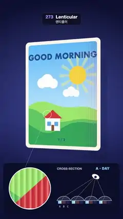

# 273 · Lenticular · 렌티큘러



**EN** A ridged lenticular postcard tilts from GOOD MORNING to EVENING to NIGHT; a loupe shows its lens ridges and a cross-section shows the eye picking a strip.  
**KO** 볼록 렌즈 줄이 덮인 렌티큘러 엽서가 기울며 GOOD MORNING·EVENING·NIGHT로 바뀌고, 돋보기는 렌즈 줄을, 단면도는 눈이 고르는 띠를 보여 준다.

[Video (mp4)](https://sueun-dev.github.io/motion-effects/videos/273-lenticular.mp4) · [Code](../effects/273-lenticular.js) · Spatial illusions · 공간 착시

## Prompt (English)

```text
Create a "Lenticular" effect: a postcard covered in tiny cylinder lenses shows a different picture as it tilts, with a loupe and a cross-section that explain why.

Look
- Background: a navy studio gradient #0C1030 → #1E2660 → #0C1030 with a soft blue glow behind the card; the card casts a soft shadow on a wall 2.2 units behind it.
- The card: 6 × 8 units with rounded corners (radius 0.3) and a cream edge #F4EFE6 0.07 thick, centred in the frame (about y 330–1300 px).
- Three pictures of the same little house on three hills, flat poster style with a white border: A "GOOD MORNING" (sky #5BB8FF → #BFE8FF, a yellow sun with rays, clouds, green hills, red roof, blue windows); B "GOOD EVENING" (sky purple #4A2A7A → orange #FF7A59 → gold #FFC46B, a big sun sinking behind magenta hills, lit windows); C "GOOD NIGHT" (navy sky with stars and a crescent moon, dark blue hills, lit windows). Each has "1 / 3", "2 / 3" or "3 / 3" at the bottom.
- 64 vertical lenses across the card, about 12 px each on screen.
- A dark panel at the bottom (y 1430–1876 px): on the left a round loupe (radius 182 px), joined by a thin line to a small circle on the card's roof; on the right a cross-section: four lenses drawn as arcs over their three strips (A blue, B orange, C indigo), an eye on an arc above them, rays from the eye through each lens to a focus dot on one strip; the strip in focus is bright, and the name of the picture seen ("A · DAY", "B · DUSK", "C · NIGHT") crossfades at the top right.

Motion (0–5 s)
- The card turns by −0.62 · cos(2π · t / 5 − 0.8) rad about its vertical axis: it dwells on the day picture at one end, the night picture at the other, and passes the dusk picture on the way.
- The flip sweeps across the card (each part sees it at a slightly different angle), and during a change each ridge shows a thin stripe of both pictures.
- The eye in the cross-section follows the viewing angle and the focus dots slide from strip to strip.

Technique
- three.js. The card face is a shader: from the camera position in card space it finds the viewing angle θ across the ridges; the lens focuses on strip q = −θ / 0.62 + 0.15 · (position inside the lens, −0.5 to 0.5): picture A where q < −0.5, C where q > 0.5, B in between, blended over a narrow band so each change is smooth.
- Each ridge is shaded as a cylinder section, averaged over 4 samples across the pixel. In the main view only a soft cosine valley shows (8 % darker); in the loupe, where a ridge is about 60 px wide, the full lens shading and a highlight.
- The loupe is the same scene from the same eye with a 1.15° field of view (about 5 × closer), drawn into a square viewport and masked to a circle.
- Every frame averages 12 renders across its 1/30 s, so the ridges blur when the card turns fast instead of crawling.

Output and rules
- One self-contained HTML file with no external assets (three.js from a CDN is fine if you use it), drawing on a 1080 × 1920 canvas (9:16) scaled to fit the window.
- Write a function renderFrame(t) that draws the frame for time t in seconds, and preview it with requestAnimationFrame. Everything must be a pure function of t and fixed seeds: no Math.random(), Date or state carried between frames, so frame i = renderFrame(i / 30) can be exported to a 30 fps video.
- Loop seamlessly every 5 seconds: renderFrame(5) must look exactly like renderFrame(0).
- No flicker of any kind: no noise or grain that changes from frame to frame, no strobing or blinking, no z-fighting, no shimmering 1 px lines. Any grain or texture stays fixed to the screen or to the object.
- Keep the top 280 px free of important content (a title label goes there) and fill the whole frame with a designed background.
```

## 프롬프트 (한국어)

```text
"렌티큘러" 효과를 만들어 줘: 작은 원통 렌즈가 촘촘히 덮인 엽서가 기울일 때마다 다른 그림을 보여 주고, 돋보기와 단면도가 그 이유를 설명하는 효과.

모양
- 배경: 남색 스튜디오 그라디언트 #0C1030 → #1E2660 → #0C1030, 카드 뒤에 은은한 파란 빛. 카드는 2.2 뒤의 벽에 부드러운 그림자를 드리운다.
- 카드: 6 × 8, 둥근 모서리(반지름 0.3), 두께 0.07의 크림색 옆면 #F4EFE6, 화면 가운데(대략 y 330~1300 px).
- 같은 작은 집과 세 겹 언덕을 그린 그림 셋, 흰 테두리가 있는 평면 포스터풍: A "GOOD MORNING"(하늘 #5BB8FF → #BFE8FF, 빛살 있는 노란 해, 구름, 초록 언덕, 빨간 지붕, 파란 창); B "GOOD EVENING"(하늘 보라 #4A2A7A → 주황 #FF7A59 → 금빛 #FFC46B, 자홍 언덕 뒤로 지는 큰 해, 불 켜진 창); C "GOOD NIGHT"(별과 초승달이 뜬 남색 하늘, 짙은 파란 언덕, 불 켜진 창). 아래에 각각 "1 / 3", "2 / 3", "3 / 3".
- 카드 가로로 세로 렌즈 64줄, 화면에서 줄마다 약 12 px.
- 아래쪽 어두운 패널(y 1430~1876 px): 왼쪽에 둥근 돋보기(반지름 182 px)와 카드 지붕 위 작은 원을 잇는 가는 선; 오른쪽에 단면도: 세 띠(A 파랑, B 주황, C 남보라) 위에 호로 그린 렌즈 넷, 그 위 호를 따라 움직이는 눈, 눈에서 각 렌즈를 지나 한 띠 위 초점으로 가는 광선. 초점이 맺힌 띠가 밝고, 오른쪽 위에 지금 보이는 그림 이름("A · DAY", "B · DUSK", "C · NIGHT")이 교차 페이드된다.

움직임 (0–5초)
- 카드는 세로축으로 −0.62 · cos(2π · t / 5 − 0.8) rad 돈다: 한쪽 끝에서는 낮 그림에, 다른 끝에서는 밤 그림에 머물고, 그 사이에 노을 그림을 지난다.
- 바뀌는 순간이 카드 위를 쓸고 지나가며(카드의 부분마다 보는 각도가 조금씩 다르다), 바뀌는 동안 렌즈 줄마다 두 그림이 가는 줄무늬로 함께 보인다.
- 단면도의 눈은 보는 각도를 따라가고, 초점이 띠에서 띠로 미끄러진다.

기법
- three.js. 카드 앞면은 셰이더다: 카드 좌표계에서 카메라 위치로 렌즈 줄을 가로지르는 시선 각 θ를 구하고, 렌즈가 초점을 맺는 띠 q = −θ / 0.62 + 0.15 · (렌즈 안 위치, −0.5~0.5)를 계산한다: q < −0.5면 그림 A, q > 0.5면 C, 그 사이는 B, 경계는 좁은 띠로 섞어 부드럽게 바뀐다.
- 렌즈 줄마다 원통 단면으로 음영을 넣고 픽셀 폭 안의 4점을 평균한다. 큰 화면에서는 부드러운 코사인 골짜기만(8 % 어둡게), 렌즈 줄이 약 60 px인 돋보기에서는 렌즈 음영과 하이라이트가 다 보인다.
- 돋보기는 같은 눈 위치에서 시야각 1.15°(약 5배)로 같은 장면을 그린 것으로, 정사각형 뷰포트에 그리고 원 모양으로 가린다.
- 매 프레임 1/30초 안의 렌더 12장을 평균해, 카드가 빨리 돌 때 렌즈 줄이 기어가 보이지 않고 흐려진다.

출력과 규칙
- 외부 파일 없는 HTML 파일 하나(three.js를 쓴다면 CDN은 괜찮다). 1080 × 1920(9:16) 캔버스에 그리고 창 크기에 맞춰 보이게 한다.
- 시간 t(초)의 프레임을 그리는 renderFrame(t) 함수를 만들고, 미리보기는 requestAnimationFrame으로 돌린다. 모든 것은 t와 고정 시드만으로 정해진다: Math.random(), Date, 프레임 사이에 쌓이는 상태 금지. 그래야 i번째 프레임 = renderFrame(i / 30)으로 30fps 영상을 뽑을 수 있다.
- 5초마다 끊김 없이 반복: renderFrame(5)는 renderFrame(0)과 똑같아 보여야 한다.
- 어떤 깜빡임도 금지: 프레임마다 바뀌는 노이즈·그레인, 번쩍임·깜빡임, z-fighting, 반짝이며 떨리는 1px 선 모두 금지. 그레인·질감은 화면이나 물체에 고정한다.
- 위쪽 280px에는 중요한 내용을 두지 않고(제목 라벨 자리), 화면 전체를 디자인된 배경으로 채운다.
```
