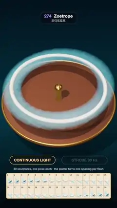

# 274 · Zoetrope · 조이트로프



**EN** Thirty bird sculptures on a spinning platter smear into a ring under steady light, then flap their wings as one flock when a 30 Hz strobe matches the spin.  
**KO** 돌아가는 원판 위 새 조각 30개가 보통 조명에서는 고리로 번지다가, 회전에 맞춘 30 Hz 스트로브가 켜지면 한 무리가 되어 날갯짓한다.

[Video (mp4)](https://sueun-dev.github.io/motion-effects/videos/274-zoetrope.mp4) · [Code](../effects/274-zoetrope.js) · Spatial illusions · 공간 착시

## Prompt (English)

```text
Create a "Zoetrope" effect: a 3D zoetrope whose still sculptures come alive as one animation when the light flashes in step with the spin, shown smoothly with no flashing.

Look
- A walnut turntable #6B3F26 (radius 3.6, 0.24 thick) with a brass rim, a darker ring inlay, a brass spindle and knob, on a wooden pedestal; a dark teal studio gradient #0E2430 → #1C4250 → #0A1A22; a warm spot light #FFE6C4 from the upper left with soft shadows on a shadow-only floor.
- 30 small birds on brass rods round a ring of radius 2.9, identical in shape and colour (white body #FFF6E8, sky-blue wings and tail #5FB6D9, orange beak #FF8A3D), each frozen one step further through a wingbeat: bird j is at phase −j / 30. At phase p the wings are at ±(0.62 · cos(2πp) + 0.1) rad (up at 0, down at 0.5) and the body at height 1.2 + 0.12 · sin(2πp − 0.6), pitching slightly.
- The camera looks down from about 48°, the platter filling the width (about y 430–1350 px).
- Under the platter two pills, "CONTINUOUS LIGHT" (amber) and "STROBE 30 Hz" (cyan), the active one lit, a one-line caption, and a cream sheet at the bottom showing all 30 poses in wingbeat order in two numbered rows of 15.

Motion (0–5 s)
- The platter turns exactly one bird spacing (12°) per video frame: 6 full turns in 5 s.
- Continuous light (0–0.7 s and 4.7–5 s): each frame is the average of 64 renders spread across its 1/30 s, so the birds smear into a soft ring.
- Strobe (1.25–4.15 s): each frame is one instant. The platter has moved exactly one spacing, so every bird now stands where its neighbour stood, one pose further on: the ring looks still and the whole flock beats its wings once per second.
- The two crossfade over 0.55 s (0.7–1.25 s and 4.15–4.7 s). The camera sways ±0.13 rad round the platter once per loop.

Technique
- three.js. Accumulate renders in a half-float target with additive blending (weight (1 − s) / 64 for each blurred sample and s for the strobe instant, s = strobe amount), then tone-map once (ACES) at the end.
- The pose sheet is a second small scene with the 30 birds lined up without rods, drawn with an orthographic camera into its own viewport; it never moves.

Output and rules
- One self-contained HTML file with no external assets (three.js from a CDN is fine if you use it), drawing on a 1080 × 1920 canvas (9:16) scaled to fit the window.
- Write a function renderFrame(t) that draws the frame for time t in seconds, and preview it with requestAnimationFrame. Everything must be a pure function of t and fixed seeds: no Math.random(), Date or state carried between frames, so frame i = renderFrame(i / 30) can be exported to a 30 fps video.
- Loop seamlessly every 5 seconds: renderFrame(5) must look exactly like renderFrame(0).
- No flicker of any kind: no noise or grain that changes from frame to frame, no strobing or blinking, no z-fighting, no shimmering 1 px lines. Any grain or texture stays fixed to the screen or to the object.
- Keep the top 280 px free of important content (a title label goes there) and fill the whole frame with a designed background.
```

## 프롬프트 (한국어)

```text
"조이트로프" 효과를 만들어 줘: 3D 조이트로프의 멈춘 조각들이 회전에 맞춰 빛이 번쩍일 때 하나의 애니메이션으로 살아나는 효과. 화면은 번쩍이지 않고 부드럽게 보여 준다.

모양
- 호두나무 턴테이블 #6B3F26(반지름 3.6, 두께 0.24), 놋쇠 테두리, 더 짙은 고리 상감, 놋쇠 축과 손잡이, 나무 받침대. 어두운 청록 스튜디오 그라디언트 #0E2430 → #1C4250 → #0A1A22. 왼쪽 위의 따뜻한 스포트라이트 #FFE6C4가 그림자 전용 바닥에 부드러운 그림자를 만든다.
- 반지름 2.9 고리를 따라 놋쇠 막대 위에 선 작은 새 30마리, 모양과 색은 모두 같다(흰 몸 #FFF6E8, 하늘색 날개·꼬리 #5FB6D9, 주황 부리 #FF8A3D). 새마다 날갯짓의 한 단계씩 더 나아간 자세로 멈춰 있다: j번째 새는 위상 −j / 30. 위상 p에서 날개는 ±(0.62 · cos(2πp) + 0.1) rad(0에서 위, 0.5에서 아래), 몸 높이 1.2 + 0.12 · sin(2πp − 0.6), 몸이 살짝 숙여진다.
- 카메라는 약 48° 위에서 내려다보고, 원판이 화면 폭을 채운다(대략 y 430~1350 px).
- 원판 아래에 알약 두 개 "CONTINUOUS LIGHT"(호박색)와 "STROBE 30 Hz"(청록), 지금 상태인 쪽이 켜진다. 한 줄 설명, 그리고 맨 아래 크림색 판에 30가지 자세를 날갯짓 순서대로 15개씩 두 줄, 번호와 함께.

움직임 (0–5초)
- 원판은 영상 한 프레임마다 정확히 새 한 칸(12°)씩 돈다: 5초에 6바퀴.
- 보통 조명(0~0.7초, 4.7~5초): 프레임마다 1/30초에 걸친 렌더 64장을 평균해, 새들이 부드러운 고리로 번진다.
- 스트로브(1.25~4.15초): 프레임마다 한순간만 찍는다. 원판이 정확히 한 칸 돌았으니 모든 새가 이웃이 서 있던 자리에 한 단계 다음 자세로 서 있다: 고리는 멈춘 듯 보이고 무리 전체가 1초에 한 번 날갯짓한다.
- 둘은 0.55초 동안 교차 페이드한다(0.7~1.25초, 4.15~4.7초). 카메라는 반복마다 원판 둘레로 ±0.13 rad 흔들린다.

기법
- three.js. 렌더를 half-float 타깃에 더하기 블렌딩으로 쌓는다(흐림 샘플마다 가중치 (1 − s) / 64, 스트로브 순간에 s, s는 스트로브 비율). 톤 매핑(ACES)은 마지막에 한 번.
- 자세 판은 막대 없이 새 30마리를 늘어놓은 작은 장면을 직교 카메라로 따로 뷰포트에 그린 것이고, 움직이지 않는다.

출력과 규칙
- 외부 파일 없는 HTML 파일 하나(three.js를 쓴다면 CDN은 괜찮다). 1080 × 1920(9:16) 캔버스에 그리고 창 크기에 맞춰 보이게 한다.
- 시간 t(초)의 프레임을 그리는 renderFrame(t) 함수를 만들고, 미리보기는 requestAnimationFrame으로 돌린다. 모든 것은 t와 고정 시드만으로 정해진다: Math.random(), Date, 프레임 사이에 쌓이는 상태 금지. 그래야 i번째 프레임 = renderFrame(i / 30)으로 30fps 영상을 뽑을 수 있다.
- 5초마다 끊김 없이 반복: renderFrame(5)는 renderFrame(0)과 똑같아 보여야 한다.
- 어떤 깜빡임도 금지: 프레임마다 바뀌는 노이즈·그레인, 번쩍임·깜빡임, z-fighting, 반짝이며 떨리는 1px 선 모두 금지. 그레인·질감은 화면이나 물체에 고정한다.
- 위쪽 280px에는 중요한 내용을 두지 않고(제목 라벨 자리), 화면 전체를 디자인된 배경으로 채운다.
```
