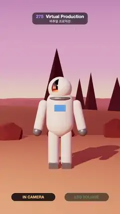

# 275 · Virtual Production · 버추얼 프로덕션



**EN** An astronaut stands in an alien desert that is really a curved LED wall; the camera's picture shrinks away to reveal the stage, the rig and its frustum.  
**KO** 외계 사막에 선 우주인 뒤 풍경은 사실 휘어진 LED 벽이다. 카메라 화면이 구석으로 줄어들며 무대와 촬영 카메라, 벽 위의 촬영 범위가 드러난다.

[Video (mp4)](https://sueun-dev.github.io/motion-effects/videos/275-virtual-production.mp4) · [Code](../effects/275-virtual-production.js) · Spatial illusions · 공간 착시

## Prompt (English)

```text
Create a "Virtual Production" effect (in-camera VFX): an actor in front of a curved LED wall that shows a 3D world rendered from the moving film camera, so the shot only looks real through that camera.

Look
- The stage: a curved LED wall, a 240° arc of radius 10 m and 7 m high, open towards the camera, with an LED ceiling over its back part; a sand floor #C98F6A with nine practical rust-red rocks along the foot of the wall; a dark studio beyond.
- The actor: an astronaut about 2 m tall at (0, 0, −3.5): white suit #F2F0EC, grey trims and backpack, a blue chest panel, a gold mirror visor; lit by a warm spot #FFE2C4 from the front left, a pink rim light and the reflections of the wall.
- The virtual world: an alien desert at dusk, sky from peach at the horizon through rose and violet to near-black with fixed stars, a ringed planet low on the left, two pale moons, flat sand round the stage rising into dunes beyond 14 m, 12 rust spires from 13 to 50 m and 10 mesas from 90 to 310 m, pink haze.
- The film camera: a dark cinema camera with a red tally light on a column and a wheeled dolly; its frustum drawn as 3 px green #59FF9A lines from the lens to the four corners where it meets the wall, and a green outline round the inner frustum on the wall.
- Pills at the bottom, "IN CAMERA" (amber) and "LED VOLUME" (green); "● REC  CAMERA VIEW" under the camera picture.

Motion (0–5 s), a = 2π · t / 5
- The film camera dollies at (1.8 · sin(a), 1.45, 3.3), always looking at the astronaut (38° field of view): the dunes, spires and planet shift in parallax behind him.
- 0–0.75 s: the whole frame is the film camera's picture. 0.75–2.25 s: the picture shrinks smoothly into a rounded box at the top right (x 620, y 300, 400 × 711 px, white border), revealing the stage from a camera at (−4.2, 4.6, 12.5) looking at (1.4, 2.0, −3.0), 50°, drifting slightly. 3.5–5.0 s: it grows back to full frame.
- The astronaut turns his head ±16° and sways a little.

Technique
- three.js. Inner frustum: every frame render the desert from the film camera into a 1080 × 1920 target; the wall shader projects each wall point with the film camera's view-projection matrix and shows that image inside the frustum.
- Outer frustum: once at setup render the desert into a cube map from the stage centre (0, 1.6, 0); outside the frustum the wall shows it 25 % dimmer, only to light the set.
- In the wide view the wall also shows 0.5 m panel seams (fading out when smaller than about 12 px) and the frustum outline.
- A cube camera at the helmet renders the stage every frame for the visor and suit reflections.
- The film camera's picture is rendered to a mipmapped target and drawn as the rounded, bordered inset over the wide view; ACES tone mapping.

Output and rules
- One self-contained HTML file with no external assets (three.js from a CDN is fine if you use it), drawing on a 1080 × 1920 canvas (9:16) scaled to fit the window.
- Write a function renderFrame(t) that draws the frame for time t in seconds, and preview it with requestAnimationFrame. Everything must be a pure function of t and fixed seeds: no Math.random(), Date or state carried between frames, so frame i = renderFrame(i / 30) can be exported to a 30 fps video.
- Loop seamlessly every 5 seconds: renderFrame(5) must look exactly like renderFrame(0).
- No flicker of any kind: no noise or grain that changes from frame to frame, no strobing or blinking, no z-fighting, no shimmering 1 px lines. Any grain or texture stays fixed to the screen or to the object.
- Keep the top 280 px free of important content (a title label goes there) and fill the whole frame with a designed background.
```

## 프롬프트 (한국어)

```text
"버추얼 프로덕션"(인카메라 VFX) 효과를 만들어 줘: 배우 뒤의 휘어진 LED 벽이 움직이는 촬영 카메라 시점으로 렌더한 3D 세계를 보여 줘서, 그 카메라로 볼 때만 진짜 풍경처럼 보이는 효과.

모양
- 무대: 반지름 10 m, 높이 7 m, 240° 호로 휜 LED 벽(카메라 쪽이 열려 있다), 뒤쪽 위에 LED 천장; 모래색 바닥 #C98F6A와 벽 아래를 따라 놓인 실제 녹슨 빨간 바위 아홉 개; 바깥은 어두운 스튜디오.
- 배우: (0, 0, −3.5)에 선 키 약 2 m의 우주인: 흰 우주복 #F2F0EC, 회색 장식과 등짐, 파란 가슴 패널, 금빛 거울 바이저. 왼쪽 앞의 따뜻한 스포트라이트 #FFE2C4, 분홍 림 라이트, 벽의 반사로 비춘다.
- 가상 세계: 해 질 녘 외계 사막. 하늘은 지평선의 복숭아색에서 장미색·보라를 거쳐 거의 검정까지, 고정된 별, 왼쪽 낮게 고리 행성, 옅은 달 둘. 무대 둘레는 평평한 모래, 14 m 너머부터 사구, 13~50 m에 녹슨 첨탑 바위 12개, 90~310 m에 메사 10개, 분홍 안개.
- 촬영 카메라: 빨간 탤리 램프가 달린 어두운 시네마 카메라, 기둥과 바퀴 달린 돌리. 렌즈에서 벽과 만나는 네 모서리까지 3 px 초록 #59FF9A 선으로 촬영 범위(프러스텀)를 그리고, 벽 위 안쪽 프러스텀 둘레에 초록 윤곽선.
- 아래쪽 알약 "IN CAMERA"(호박색)와 "LED VOLUME"(초록); 카메라 화면 아래 "● REC  CAMERA VIEW".

움직임 (0–5초), a = 2π · t / 5
- 촬영 카메라는 (1.8 · sin(a), 1.45, 3.3)에서 좌우로 돌리 이동하며 늘 우주인을 본다(시야각 38°): 사구·첨탑·행성이 그 뒤에서 시차를 두고 움직인다.
- 0~0.75초: 화면 전체가 촬영 카메라의 그림. 0.75~2.25초: 그 그림이 오른쪽 위 둥근 상자(x 620, y 300, 400 × 711 px, 흰 테두리)로 부드럽게 줄어들며, (−4.2, 4.6, 12.5)에서 (1.4, 2.0, −3.0)을 보는 카메라(50°, 살짝 흔들림)로 본 무대가 드러난다. 3.5~5.0초: 다시 전체 화면으로 커진다.
- 우주인은 고개를 ±16° 돌리고 몸을 살짝 흔든다.

기법
- three.js. 안쪽 프러스텀: 매 프레임 촬영 카메라로 사막을 1080 × 1920 타깃에 그리고, 벽 셰이더가 벽의 각 점을 촬영 카메라의 뷰-투영 행렬로 투영해 프러스텀 안에 그 그림을 보여 준다.
- 바깥 프러스텀: 시작할 때 한 번 무대 중심 (0, 1.6, 0)에서 사막을 큐브맵에 그린다. 프러스텀 밖의 벽은 이것을 25 % 어둡게 보여 주며 무대를 비추는 역할만 한다.
- 넓은 화면에서는 벽에 0.5 m 패널 이음매(약 12 px보다 작아지면 사라짐)와 프러스텀 윤곽선도 보인다.
- 헬멧 위치의 큐브 카메라가 매 프레임 무대를 그려 바이저와 우주복에 반사시킨다.
- 촬영 카메라의 그림은 밉맵 타깃에 그려 넓은 화면 위에 둥근 테두리 상자로 얹는다; ACES 톤 매핑.

출력과 규칙
- 외부 파일 없는 HTML 파일 하나(three.js를 쓴다면 CDN은 괜찮다). 1080 × 1920(9:16) 캔버스에 그리고 창 크기에 맞춰 보이게 한다.
- 시간 t(초)의 프레임을 그리는 renderFrame(t) 함수를 만들고, 미리보기는 requestAnimationFrame으로 돌린다. 모든 것은 t와 고정 시드만으로 정해진다: Math.random(), Date, 프레임 사이에 쌓이는 상태 금지. 그래야 i번째 프레임 = renderFrame(i / 30)으로 30fps 영상을 뽑을 수 있다.
- 5초마다 끊김 없이 반복: renderFrame(5)는 renderFrame(0)과 똑같아 보여야 한다.
- 어떤 깜빡임도 금지: 프레임마다 바뀌는 노이즈·그레인, 번쩍임·깜빡임, z-fighting, 반짝이며 떨리는 1px 선 모두 금지. 그레인·질감은 화면이나 물체에 고정한다.
- 위쪽 280px에는 중요한 내용을 두지 않고(제목 라벨 자리), 화면 전체를 디자인된 배경으로 채운다.
```
