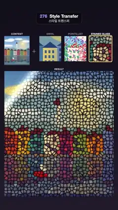

# 276 · Style Transfer · 스타일 트랜스퍼



**EN** A harbour photo is repainted as swirling blue-gold strokes, pointillist dots and leaded stained glass, a soft diagonal wipe sweeping from style to style.  
**KO** 항구 사진을 푸른·금빛 소용돌이 붓질, 점묘, 납선 스테인드글라스로 다시 그리고, 부드러운 대각선 와이프가 한 스타일에서 다음 스타일로 넘긴다.

[Video (mp4)](https://sueun-dev.github.io/motion-effects/videos/276-style-transfer.mp4) · [Code](../effects/276-style-transfer.js) · AI-era techniques · AI 시대 기법

## Prompt (English)

```text
Create a "Style Transfer" effect: a content photo plus a style sample gives a painting of the photo in that style. Imitate the look of neural style transfer with deterministic image filters (no neural network), and switch between three styles.

Look
- Dark background #120F1A → #211C2B.
- Top row (y 330–595 px): the content photo as a 230 × 265 px thumbnail labelled CONTENT, a "+", and three 200 × 230 px style swatches labelled SWIRL, POINTILLIST and STAINED GLASS; a gold ring marks the active style.
- The result below it: 1000 × 1150 px at x 40, y 650, labelled RESULT.
- The content photo (painted once on a canvas): a blue-to-peach sky with a hazy sun and soft clouds, two layers of blue-green hills, a bell tower, a row of nine coloured harbour houses (coral, mustard, teal, cream, rose…) with dark roofs and windows on a stone quay, their blurred reflection in a blue harbour with light ripples, and a red boat with a white sail.
- Swirl: long curling strokes that follow the photo's edges and turn into vortices over the sky and water; tones mapped onto navy #0A1745 → blue #1F4C9E → light blue #6B9EC7 → gold #FAD65C, embossed like thick paint.
- Pointillist: one dot per 12 px cell (radius 5–7 px, jittered) on cream canvas #F2EBD9, each the nearest of nine pure hues to the photo colour (saturated first), one dot in four taking the second-nearest hue.
- Stained glass: Voronoi cells about 30 px across in jewel colours taken from the photo, brighter at the centre, with dark lead lines about 3 px wide.

Motion (0–5 s)
- Swirl → Pointillist wipe 1.45–2.25 s, Pointillist → Stained glass 3.1–3.9 s, Stained glass → Swirl 4.85–5.65 s (through the loop point).
- A wipe is a soft diagonal edge running from the top left to the bottom right with a thin warm glow along it. Between wipes the picture is completely still.

Technique
- three.js with one full-screen shader whose inputs are the photo, a flow field and a fixed 256 × 256 noise texture.
- Flow field, computed once in JavaScript: Sobel gradients of the blurred luminance, the structure tensor blurred over about 13 px, its minor eigenvector (the edge direction) blended by coherence with a field of five vortices for the flat areas.
- Swirl: line integral convolution, 14 steps of 1.6 px each way along the flow over the noise; the result shifts the palette lookup, and its change across the flow gives the emboss.
- Pointillist and stained glass: jittered points per cell from a hash, checking the 3 × 3 neighbouring cells; edges anti-aliased with fwidth.
- The swatches are the same filters applied to a patch of the photo.

Output and rules
- One self-contained HTML file with no external assets (three.js from a CDN is fine if you use it), drawing on a 1080 × 1920 canvas (9:16) scaled to fit the window.
- Write a function renderFrame(t) that draws the frame for time t in seconds, and preview it with requestAnimationFrame. Everything must be a pure function of t and fixed seeds: no Math.random(), Date or state carried between frames, so frame i = renderFrame(i / 30) can be exported to a 30 fps video.
- Loop seamlessly every 5 seconds: renderFrame(5) must look exactly like renderFrame(0).
- No flicker of any kind: no noise or grain that changes from frame to frame, no strobing or blinking, no z-fighting, no shimmering 1 px lines. Any grain or texture stays fixed to the screen or to the object.
- Keep the top 280 px free of important content (a title label goes there) and fill the whole frame with a designed background.
```

## 프롬프트 (한국어)

```text
"스타일 트랜스퍼" 효과를 만들어 줘: 내용 사진과 스타일 견본을 합치면 사진이 그 스타일의 그림으로 바뀌는 효과. 신경망 스타일 트랜스퍼의 모습을 결정론적 이미지 필터로 흉내 내고(신경망 없음), 세 스타일을 오간다.

모양
- 어두운 배경 #120F1A → #211C2B.
- 위쪽 줄(y 330~595 px): CONTENT라고 적힌 230 × 265 px 내용 사진 썸네일, "+", SWIRL·POINTILLIST·STAINED GLASS라고 적힌 200 × 230 px 스타일 견본 셋. 금빛 테두리가 지금 스타일을 표시한다.
- 그 아래 결과: x 40, y 650의 1000 × 1150 px, RESULT라고 적는다.
- 내용 사진(캔버스에 한 번 그린다): 파랑에서 복숭아색으로 가는 하늘, 흐릿한 해, 부드러운 구름, 청록 언덕 두 겹, 종탑, 돌 부두 위 색색의 항구 집 아홉 채(산호, 겨자, 청록, 크림, 장미…)와 어두운 지붕·창, 파란 항구에 비친 흐릿한 반영과 잔물결, 흰 돛의 빨간 배.
- 소용돌이: 사진의 경계를 따라가고 하늘과 물 위에서는 소용돌이로 감기는 긴 붓질. 명암은 남색 #0A1745 → 파랑 #1F4C9E → 연파랑 #6B9EC7 → 금빛 #FAD65C로 바꾸고, 두꺼운 물감처럼 돋을새김한다.
- 점묘: 12 px 칸마다 점 하나(반지름 5~7 px, 위치가 조금씩 어긋남)를 크림색 캔버스 #F2EBD9 위에 찍는다. 점 색은 (채도를 올린) 사진 색에 가장 가까운 순색 아홉 가지 중 하나, 넷 중 하나는 두 번째로 가까운 색.
- 스테인드글라스: 지름 약 30 px의 보로노이 칸, 사진에서 가져온 보석 색, 가운데가 더 밝고, 약 3 px 굵기의 어두운 납선.

움직임 (0–5초)
- 소용돌이 → 점묘 와이프 1.45~2.25초, 점묘 → 스테인드글라스 3.1~3.9초, 스테인드글라스 → 소용돌이 4.85~5.65초(반복 지점을 넘어간다).
- 와이프는 왼쪽 위에서 오른쪽 아래로 가는 부드러운 대각선 경계이고, 경계를 따라 따뜻한 빛이 가늘게 번진다. 와이프 사이에는 그림이 완전히 멈춰 있다.

기법
- three.js 전체 화면 셰이더 하나. 입력은 사진, 흐름장, 고정된 256 × 256 노이즈 텍스처.
- 흐름장은 JavaScript로 한 번 계산한다: 흐린 휘도의 소벨 기울기, 약 13 px로 흐린 구조 텐서, 그 작은 고유벡터(경계 방향)를 일관성에 따라 평평한 곳의 소용돌이 다섯 개 장과 섞는다.
- 소용돌이: 선 적분 컨볼루션, 흐름을 따라 양쪽으로 1.6 px씩 14걸음 노이즈를 모은다. 그 값으로 팔레트 위치를 옮기고, 흐름을 가로지르는 변화로 돋을새김을 만든다.
- 점묘와 스테인드글라스: 해시로 칸마다 어긋난 점을 정하고 주변 3 × 3 칸을 확인한다; 경계는 fwidth로 안티에일리어싱.
- 견본은 같은 필터를 사진의 한 부분에 적용한 것이다.

출력과 규칙
- 외부 파일 없는 HTML 파일 하나(three.js를 쓴다면 CDN은 괜찮다). 1080 × 1920(9:16) 캔버스에 그리고 창 크기에 맞춰 보이게 한다.
- 시간 t(초)의 프레임을 그리는 renderFrame(t) 함수를 만들고, 미리보기는 requestAnimationFrame으로 돌린다. 모든 것은 t와 고정 시드만으로 정해진다: Math.random(), Date, 프레임 사이에 쌓이는 상태 금지. 그래야 i번째 프레임 = renderFrame(i / 30)으로 30fps 영상을 뽑을 수 있다.
- 5초마다 끊김 없이 반복: renderFrame(5)는 renderFrame(0)과 똑같아 보여야 한다.
- 어떤 깜빡임도 금지: 프레임마다 바뀌는 노이즈·그레인, 번쩍임·깜빡임, z-fighting, 반짝이며 떨리는 1px 선 모두 금지. 그레인·질감은 화면이나 물체에 고정한다.
- 위쪽 280px에는 중요한 내용을 두지 않고(제목 라벨 자리), 화면 전체를 디자인된 배경으로 채운다.
```
