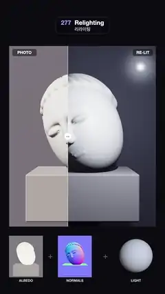

# 277 · Relighting · 리라이팅



**EN** A photo of a sleeping marble head is split into albedo and normal maps and re-lit by a coloured light circling it, a divider comparing it with the original.  
**KO** 잠든 대리석 두상 사진을 알베도·노멀 맵으로 나누고 둘레를 도는 색 조명으로 다시 비추며, 움직이는 경계선이 원본 사진과 나란히 비교해 보여 준다.

[Video (mp4)](https://sueun-dev.github.io/motion-effects/videos/277-relighting.mp4) · [Code](../effects/277-relighting.js) · AI-era techniques · AI 시대 기법

## Prompt (English)

```text
Create a "Relighting" effect: one photo is turned into the maps a relighting model would estimate (albedo, surface normals, depth) and re-lit by a moving light. Imitate the look with deterministic code (no neural network): here the maps come from a sculpted 3D head.

Look
- Background #0B0B10. The main image, 960 × 1180 px at x 60, y 300: a minimalist marble head lying tilted on its side (closed eyes with lid creases, a long gentle nose, small lips, carved hair in grooves over the crown) on a grey stone block, in front of a dark wall.
- Albedo: marble #F5F1EA with thin grey veins (a sine bent by noise), the carved hair slightly warmer #EEE8DF, the block grey #ADA7A2, the wall #7B7882 (the lighting makes the wall read dark).
- A vertical divider with a round white handle: on its left, labelled PHOTO, the original (a soft warm key light from the upper left with soft shadows, a cool fill); on its right, labelled RE-LIT, the same maps lit by the moving light, which is drawn as a glowing orb when it is in front of the head.
- Bottom row: ALBEDO and NORMALS thumbnails (220 × 270 px, normals as RGB) and a LIGHT sphere showing the light's direction and colour, joined by "+" signs.

Motion (0–5 s), a = 2π · t / 5
- The light moves on a sphere of radius 2.4 round the head: azimuth 1.25 · sin(a + 0.3) rad, elevation 0.55 · sin(2a + 0.6) rad, always in front; its colour blends between warm amber and cool blue.
- The divider sweeps at x = 960 · (0.4 + 0.28 · sin(a)) px across the image.

Technique
- three.js. Once at setup, ray-march a signed-distance head (smooth unions and subtractions of ellipsoids and capsules, grooves for the hair, a rounded block, a wall plane) at 2 × 2 samples per pixel into three float buffers: albedo, normal and position.
- Every frame a shader lights only those buffers: Lambert diffuse with inverse-square falloff, a Blinn gloss on the marble, a faint fill, and shadows found by marching 40 steps from each point towards the light and comparing with the depth in the position buffer (a fixed per-pixel offset, averaged over the 2 × 2 samples). The four samples are averaged per pixel; ACES tone mapping.

Output and rules
- One self-contained HTML file with no external assets (three.js from a CDN is fine if you use it), drawing on a 1080 × 1920 canvas (9:16) scaled to fit the window.
- Write a function renderFrame(t) that draws the frame for time t in seconds, and preview it with requestAnimationFrame. Everything must be a pure function of t and fixed seeds: no Math.random(), Date or state carried between frames, so frame i = renderFrame(i / 30) can be exported to a 30 fps video.
- Loop seamlessly every 5 seconds: renderFrame(5) must look exactly like renderFrame(0).
- No flicker of any kind: no noise or grain that changes from frame to frame, no strobing or blinking, no z-fighting, no shimmering 1 px lines. Any grain or texture stays fixed to the screen or to the object.
- Keep the top 280 px free of important content (a title label goes there) and fill the whole frame with a designed background.
```

## 프롬프트 (한국어)

```text
"리라이팅" 효과를 만들어 줘: 사진 한 장을 리라이팅 모델이 추정하는 맵(알베도, 표면 노멀, 깊이)으로 나누고 움직이는 조명으로 다시 비추는 효과. 결정론적 코드로 그 모습을 흉내 낸다(신경망 없음): 여기서 맵은 조각한 3D 두상에서 얻는다.

모양
- 배경 #0B0B10. 주 이미지: x 60, y 300의 960 × 1180 px. 회색 돌 받침 위에 옆으로 기울어 누운 미니멀한 대리석 두상(주름 잡힌 감은 눈, 길고 완만한 코, 작은 입술, 정수리를 덮은 홈 파인 머리카락), 뒤에는 어두운 벽.
- 알베도: 대리석 #F5F1EA에 가는 회색 결(노이즈로 휜 사인), 머리카락은 조금 더 따뜻한 #EEE8DF, 받침은 회색 #ADA7A2, 벽은 #7B7882(조명 때문에 어둡게 보인다).
- 둥근 흰 손잡이가 달린 세로 경계선: 왼쪽은 PHOTO, 원본(왼쪽 위의 부드럽고 따뜻한 키 라이트와 부드러운 그림자, 차가운 보조광); 오른쪽은 RE-LIT, 같은 맵을 움직이는 조명으로 비춘 것. 조명이 두상 앞에 있을 때는 빛나는 구슬로 보인다.
- 아래쪽 줄: ALBEDO와 NORMALS 썸네일(220 × 270 px, 노멀은 RGB로)과 조명의 방향과 색을 보여 주는 LIGHT 구, 사이에 "+".

움직임 (0–5초), a = 2π · t / 5
- 조명은 두상 둘레 반지름 2.4 구면 위를 움직인다: 방위각 1.25 · sin(a + 0.3) rad, 고도 0.55 · sin(2a + 0.6) rad, 늘 앞쪽에 있다. 색은 따뜻한 호박색과 차가운 파랑 사이를 오간다.
- 경계선은 x = 960 · (0.4 + 0.28 · sin(a)) px로 이미지를 가로질러 움직인다.

기법
- three.js. 시작할 때 한 번, 부호 거리 함수 두상(타원체와 캡슐의 부드러운 합·차, 머리카락의 홈, 둥근 받침, 벽 평면)을 픽셀당 2 × 2 샘플로 레이마칭해 알베도·노멀·위치 float 버퍼 셋에 담는다.
- 매 프레임 셰이더는 그 버퍼만으로 빛을 계산한다: 거리 제곱으로 줄어드는 램버트 확산광, 대리석의 블린 광택, 약한 보조광, 그리고 각 점에서 조명 쪽으로 40걸음 나아가며 위치 버퍼의 깊이와 비교해 찾는 그림자(픽셀마다 고정된 오프셋, 2 × 2 샘플로 평균). 픽셀마다 네 샘플을 평균하고 ACES 톤 매핑.

출력과 규칙
- 외부 파일 없는 HTML 파일 하나(three.js를 쓴다면 CDN은 괜찮다). 1080 × 1920(9:16) 캔버스에 그리고 창 크기에 맞춰 보이게 한다.
- 시간 t(초)의 프레임을 그리는 renderFrame(t) 함수를 만들고, 미리보기는 requestAnimationFrame으로 돌린다. 모든 것은 t와 고정 시드만으로 정해진다: Math.random(), Date, 프레임 사이에 쌓이는 상태 금지. 그래야 i번째 프레임 = renderFrame(i / 30)으로 30fps 영상을 뽑을 수 있다.
- 5초마다 끊김 없이 반복: renderFrame(5)는 renderFrame(0)과 똑같아 보여야 한다.
- 어떤 깜빡임도 금지: 프레임마다 바뀌는 노이즈·그레인, 번쩍임·깜빡임, z-fighting, 반짝이며 떨리는 1px 선 모두 금지. 그레인·질감은 화면이나 물체에 고정한다.
- 위쪽 280px에는 중요한 내용을 두지 않고(제목 라벨 자리), 화면 전체를 디자인된 배경으로 채운다.
```
