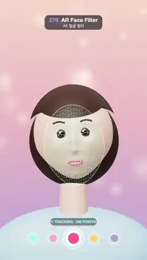

# 278 · AR Face Filter · AR 얼굴 필터



**EN** A turning, smiling selfie face carries a tracked 300-point landmark mesh; heart glasses, bunny ears, blush and sparkles pop on and stay stuck to it as it moves.  
**KO** 고개를 돌리고 웃는 셀카 얼굴에 300점 랜드마크 메시가 따라붙고, 하트 안경·토끼 귀·볼터치·반짝이가 튀어나와 얼굴에 붙은 채 함께 움직인다.

[Video (mp4)](https://sueun-dev.github.io/motion-effects/videos/278-ar-face-filter.mp4) · [Code](../effects/278-ar-face-filter.js) · AI-era techniques · AI 시대 기법

## Prompt (English)

```text
Create an "AR Face Filter" effect: a face-tracking mesh rides on a selfie face, and filter stickers anchored to it follow every turn and smile. Imitate the look with deterministic code (no tracking network): the landmarks are computed on a 3D head.

Look
- A soft pastel selfie background, peach #F6D6C8 → pink #E9B7C4 → lilac #B9A4D8, with blurred bokeh circles.
- A stylised 3D head (a sphere reshaped into a face: soft jaw, small nose, cheeks, lips, chin), skin #F2C4A8 with sheen, large glossy eyes with brown irises and a white glint, thin brows, pink lips, a dark brown bob with a fringe, a neck and rounded light-blue shoulders; a warm key light and a room environment.
- The landmark mesh: about 300 points on a grid over the face oval, triangulated, drawn as thin mint lines #78FFE6 with small dots, and brighter white contours for the eyes, brows and face oval. Triangles facing away are skipped.
- The filter: pink heart-shaped glasses (lenses #FF5C9A at 55 % opacity, rims and arms #FF2E7E) on the nose bridge; white bunny ears with pink insides on the crown; round pink blush on the cheeks; four-point white sparkles beside the face.
- Camera-app UI: a status pill ("● TRACKING · 300 POINTS" in mint, then "● FILTER ON" in pink) and a row of five filter circles with the middle one selected.

Motion (0–5 s), a = 2π · t / 5
- The head turns 0.42 · sin(a) rad, nods 0.07 · sin(2a + 0.5) and tilts 0.09 · sin(a + 1).
- 0–1.05 s: tracking only, the mesh bright. 1.05–1.6 s: the filter springs on (a back-ease scale; the glasses drop into place) and the mesh dims. 1.9–2.5 s: the face smiles (the cheeks lift, the mouth widens and its corners rise, the mesh follows), the blush fades in and the sparkles grow and pulse gently; the smile relaxes at 3.5–4.1 s. 4.15–4.6 s: the filter shrinks away and the mesh comes back up.
- The bunny ears sway softly.

Technique
- three.js. The head is one function from a sphere direction to a face point (with a smile weight); it builds the head mesh and its smile morph target and also gives every landmark, so the landmarks always sit on the deformed surface.
- Every frame the landmarks are transformed by the head's matrix, projected to the screen and drawn in a 2D canvas overlay; the glasses, ears and blush are children of the head, so they stick to it.

Output and rules
- One self-contained HTML file with no external assets (three.js from a CDN is fine if you use it), drawing on a 1080 × 1920 canvas (9:16) scaled to fit the window.
- Write a function renderFrame(t) that draws the frame for time t in seconds, and preview it with requestAnimationFrame. Everything must be a pure function of t and fixed seeds: no Math.random(), Date or state carried between frames, so frame i = renderFrame(i / 30) can be exported to a 30 fps video.
- Loop seamlessly every 5 seconds: renderFrame(5) must look exactly like renderFrame(0).
- No flicker of any kind: no noise or grain that changes from frame to frame, no strobing or blinking, no z-fighting, no shimmering 1 px lines. Any grain or texture stays fixed to the screen or to the object.
- Keep the top 280 px free of important content (a title label goes there) and fill the whole frame with a designed background.
```

## 프롬프트 (한국어)

```text
"AR 얼굴 필터" 효과를 만들어 줘: 셀카 얼굴 위에 얼굴 추적 메시가 따라붙고, 거기에 고정된 필터 스티커가 고개를 돌리고 웃을 때마다 함께 움직이는 효과. 결정론적 코드로 그 모습을 흉내 낸다(추적 신경망 없음): 랜드마크는 3D 머리 위에서 계산한다.

모양
- 부드러운 파스텔 셀카 배경, 복숭아 #F6D6C8 → 분홍 #E9B7C4 → 라일락 #B9A4D8, 흐릿한 보케 원.
- 양식화한 3D 머리(구를 얼굴 모양으로 다듬은 것: 부드러운 턱, 작은 코, 볼, 입술, 턱끝), 윤기 있는 피부 #F2C4A8, 갈색 홍채와 흰 반사점이 있는 크고 반짝이는 눈, 가는 눈썹, 분홍 입술, 앞머리가 있는 짙은 갈색 단발, 목과 둥근 연파랑 어깨. 따뜻한 키 라이트와 방 환경맵.
- 랜드마크 메시: 얼굴 타원 위 격자로 놓은 약 300점을 삼각형으로 잇고, 가는 민트 선 #78FFE6과 작은 점으로 그린다. 눈·눈썹·얼굴 윤곽은 더 밝은 흰 선. 뒤로 돌아간 삼각형은 그리지 않는다.
- 필터: 콧등에 걸친 분홍 하트 안경(렌즈 #FF5C9A 불투명도 55 %, 테와 다리 #FF2E7E), 정수리의 안쪽이 분홍인 흰 토끼 귀, 볼의 둥근 분홍 볼터치, 얼굴 옆의 네 갈래 흰 반짝이.
- 카메라 앱 UI: 상태 알약(민트 "● TRACKING · 300 POINTS", 이어서 분홍 "● FILTER ON")과 가운데가 선택된 필터 동그라미 다섯 개.

움직임 (0–5초), a = 2π · t / 5
- 머리는 0.42 · sin(a) rad 돌고, 0.07 · sin(2a + 0.5) 끄덕이고, 0.09 · sin(a + 1) 기운다.
- 0~1.05초: 추적만, 메시가 밝다. 1.05~1.6초: 필터가 튀어나오듯 켜지고(백 이징 크기, 안경이 제자리로 내려앉는다) 메시가 흐려진다. 1.9~2.5초: 얼굴이 웃고(볼이 올라가고 입이 넓어지며 입꼬리가 올라가고 메시도 따라간다) 볼터치가 나타나며 반짝이가 커져 부드럽게 맥동한다; 3.5~4.1초에 웃음이 풀린다. 4.15~4.6초: 필터가 줄어들어 사라지고 메시가 다시 밝아진다.
- 토끼 귀가 살랑 흔들린다.

기법
- three.js. 머리는 구 위의 방향을 얼굴 위의 점으로 바꾸는 함수 하나(웃음 가중치 포함)로 만든다. 이 함수로 머리 메시와 웃음 모프 타깃을 만들고 랜드마크도 구하므로, 랜드마크는 늘 변형된 표면 위에 있다.
- 매 프레임 랜드마크를 머리 행렬로 옮기고 화면에 투영해 2D 캔버스 오버레이에 그린다. 안경·귀·볼터치는 머리의 자식이라 얼굴에 붙어 다닌다.

출력과 규칙
- 외부 파일 없는 HTML 파일 하나(three.js를 쓴다면 CDN은 괜찮다). 1080 × 1920(9:16) 캔버스에 그리고 창 크기에 맞춰 보이게 한다.
- 시간 t(초)의 프레임을 그리는 renderFrame(t) 함수를 만들고, 미리보기는 requestAnimationFrame으로 돌린다. 모든 것은 t와 고정 시드만으로 정해진다: Math.random(), Date, 프레임 사이에 쌓이는 상태 금지. 그래야 i번째 프레임 = renderFrame(i / 30)으로 30fps 영상을 뽑을 수 있다.
- 5초마다 끊김 없이 반복: renderFrame(5)는 renderFrame(0)과 똑같아 보여야 한다.
- 어떤 깜빡임도 금지: 프레임마다 바뀌는 노이즈·그레인, 번쩍임·깜빡임, z-fighting, 반짝이며 떨리는 1px 선 모두 금지. 그레인·질감은 화면이나 물체에 고정한다.
- 위쪽 280px에는 중요한 내용을 두지 않고(제목 라벨 자리), 화면 전체를 디자인된 배경으로 채운다.
```
