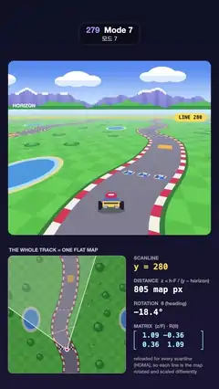

# 279 · Mode 7 · 모드 7



**EN** An SNES-style kart track is one flat map, rotated and scaled anew on every scanline below a fixed horizon; a yellow scanline and a map inset show how.  
**KO** SNES풍 카트 트랙은 평평한 지도 한 장이다. 고정된 지평선 아래 주사선마다 지도를 새로 회전·확대하고, 노란 주사선과 지도 인셋이 그 원리를 보여 준다.

[Video (mp4)](https://sueun-dev.github.io/motion-effects/videos/279-mode-7.mp4) · [Code](../effects/279-mode-7.js) · Retro 3D · 레트로 3D

## Prompt (English)

```text
Create a "Mode 7" motion effect: an SNES-style kart racing view in which the whole track is one flat texture, rotated and scaled line by line under a fixed horizon, with a map inset that shows the camera wedge and the scanline being explained.

Look
- Page background: a dark navy gradient, rgb(15, 18, 38) at the top to rgb(26, 23, 51) at the bottom.
- The game screen: a rounded rectangle x 40–1040, y 300–1160 (corner radius 28 px). Horizon at y = 540.
- The track map: 256 × 256 map pixels, stored as a 2048 × 2048 texture (8 texels per map pixel) that wraps in both directions:
  - checkered grass, 16-pixel squares in #5CBC4B and #50AE43;
  - a road whose centre follows x = 128 + 15 sin(2πy/256) + 3 sin(4πy/256 + 0.9): asphalt #7C7A8C 34 px wide (measured across the road), red #E8414F / white #F4F1EA curbs 4 px wide in 8-pixel blocks along the road, a dark green edge #2F6E33 2 px wide;
  - a black and white checkered start line (4-pixel checks) across the road at y 248–256, a yellow #FFD23F / orange #FF8A2A chevron boost pad at y 60–78, and three 7 × 7 item boxes at y 150 (rainbow border, white "?" on blue #3D5BE0);
  - an oval pond (radii 22 × 30) at (36, 176) with a light blue shore and a sand ring, seven round tree canopies (radius 8–12, dark rim, light highlight, a shadow offset down-right) and 16 small round bushes (radius 4.5) off the road.
  - Road edges, pond and canopies are computed per texel, so they are smooth; checker squares and curb blocks keep the map-pixel grid.
- Sky above the horizon: pale haze rgb(204, 230, 255) at the horizon to blue rgb(84, 140, 245) 230 px higher; five white puffy clouds with a pale blue underside; a far range of lavender-blue mountains with white snow caps and a near range of green hills, both with silhouettes stepped in 6-pixel blocks.
- The kart, seen from behind, in pixel art: 18 × 12 blocks of 7 px (red helmet with a white stripe, blue suit, yellow body, black tyres, grey exhaust pipes) over a soft dark shadow ellipse.
- A yellow #FFD84D scanline marker: a 3 px line across the screen inside a 28 px soft glow, with a yellow pill "LINE 345" (row inside the screen) at its right end; a small white "HORIZON" label and tick at the left end of the horizon.
- Below the screen, the map inset: 580 × 580 px at (40, 1262), corner radius 22, caption "THE WHOLE TRACK = ONE FLAT MAP" above it. It shows the same map at 1.875 px per map pixel, north up, slightly darkened, with the camera fixed at 80 % of its height; a white wedge for the field of view (22 % white fill, 3 px edges), a thin white segment for the screen's bottom row, a 6 px yellow segment for the current scanline's footprint, and a red-and-white camera dot.
- Right of the inset (x 660): grey labels with big monospaced values: "SCANLINE y = 345" in yellow, "DISTANCE z = h·F / (y − horizon)" in map px, "ROTATION θ (heading)" in degrees, then "MATRIX (z/F) · R(θ)" as a bracketed 2 × 2 matrix in cyan #9BE7FF, and three small lines: "reloaded for every scanline (HDMA), so each line is the map rotated and scaled differently".

Motion (0–5 s), p = t / 5
- The camera drives along the road centre, exactly one map period (256 px, northwards) per loop, always heading toward the road point 60 px ahead: a gentle S-turn of about ±20°.
- Each screen row y below the horizon shows the map at distance z = 46 · 700 / (y − 540) (camera height 46 map px, focal length 700 px) with a sideways offset (x − 540) · z / 700, rotated by the heading.
- The kart stands on the road 62 map px ahead, projected the same way, bobbing 2 px six times per loop.
- The sky layers slide sideways with the heading: clouds at 0.35, far mountains at 0.55 and near hills at 1.0 × heading × 700 px.
- The scanline marker glides from 40 px to 510 px below the horizon and back: dy = 40 + 470 (0.5 − 0.5 cos 2πp). Its footprint on the inset and the numbers follow it.

Technique
- three.js with one full-screen ShaderMaterial; the map is a CanvasTexture with repeat wrapping, mipmaps and the maximum anisotropy.
- Per pixel: map position w = camera + forward · z + right · (x − 540)/700 · z, and its exact screen gradients d/dx = right · z/700 and d/dy = −(z/dy) · (forward + right · (x − 540)/700), sampled with textureGrad; 3 × 3 sub-samples per pixel; haze mix 1 − exp(−(z/800)^1.25) toward the horizon. This keeps the far checkerboard and curbs from crawling or shimmering.
- The rounded game screen is a rounded-rectangle distance in the same shader; kart, marker, inset and numbers are drawn on a 2D canvas on top. The inset map is a repeating pattern slid under the camera, so it scrolls seamlessly.

Output and rules
- One self-contained HTML file with no external assets (three.js from a CDN is fine if you use it), drawing on a 1080 × 1920 canvas (9:16) scaled to fit the window.
- Write a function renderFrame(t) that draws the frame for time t in seconds, and preview it with requestAnimationFrame. Everything must be a pure function of t and fixed seeds: no Math.random(), Date or state carried between frames, so frame i = renderFrame(i / 30) can be exported to a 30 fps video.
- Loop seamlessly every 5 seconds: renderFrame(5) must look exactly like renderFrame(0).
- No flicker of any kind: no noise or grain that changes from frame to frame, no strobing or blinking, no z-fighting, no shimmering 1 px lines. Any grain or texture stays fixed to the screen or to the object.
- Keep the top 280 px free of important content (a title label goes there) and fill the whole frame with a designed background.
```

## 프롬프트 (한국어)

```text
"모드 7" 모션 효과를 만들어 줘: SNES풍 카트 레이싱 화면. 트랙 전체가 평평한 텍스처 한 장이고, 고정된 지평선 아래에서 한 줄씩 회전·확대되며, 지도 인셋이 카메라 시야 쐐기와 설명 중인 주사선을 보여 준다.

모양
- 페이지 배경: 짙은 남색 그라디언트, 위 rgb(15, 18, 38)에서 아래 rgb(26, 23, 51).
- 게임 화면: x 40–1040, y 300–1160의 둥근 사각형(모서리 반지름 28px). 지평선은 y = 540.
- 트랙 지도: 256 × 256 지도 픽셀을 2048 × 2048 텍스처(지도 픽셀당 텍셀 8개)에 담고, 가로세로 모두 반복된다:
  - 16픽셀 정사각형의 체크무늬 잔디, #5CBC4B와 #50AE43;
  - 중심선이 x = 128 + 15 sin(2πy/256) + 3 sin(4πy/256 + 0.9)를 따르는 도로: 아스팔트 #7C7A8C 폭 34px(도로에 수직으로 잼), 도로를 따라 8픽셀 블록으로 번갈아 나오는 빨강 #E8414F / 흰색 #F4F1EA 연석 폭 4px, 진녹색 #2F6E33 가장자리 폭 2px;
  - y 248–256의 흑백 체크 출발선(4픽셀 칸), y 60–78의 노랑 #FFD23F / 주황 #FF8A2A 쉐브론 부스트 패드, y 150의 7 × 7 아이템 상자 셋(무지개 테두리, 파랑 #3D5BE0 위 흰 "?");
  - (36, 176)의 타원 연못(반지름 22 × 30, 연한 파랑 물가와 모래 테), 둥근 나무 수관 일곱 개(반지름 8–12, 짙은 테두리·밝은 하이라이트·오른쪽 아래 그림자), 도로 밖의 작은 둥근 덤불 16개(반지름 4.5).
  - 도로 가장자리·연못·수관은 텍셀 단위로 계산해 매끄럽고, 체크 칸과 연석 블록은 지도 픽셀 격자를 지킨다.
- 지평선 위 하늘: 지평선의 옅은 안개색 rgb(204, 230, 255)에서 230px 위의 파랑 rgb(84, 140, 245)까지; 아랫면이 연한 파랑인 흰 뭉게구름 다섯 개; 흰 눈 덮인 라벤더빛 먼 산맥과 초록 가까운 언덕, 둘 다 윤곽이 6픽셀 계단으로 끊긴다.
- 뒤에서 본 카트는 픽셀 아트: 7px 블록 18 × 12(흰 줄 빨간 헬멧, 파란 옷, 노란 차체, 검은 타이어, 회색 배기관), 아래에 부드러운 그림자 타원.
- 노랑 #FFD84D 주사선 표시: 화면을 가로지르는 3px 선과 28px 부드러운 빛, 오른쪽 끝에 노란 알약 "LINE 345"(화면 안 행 번호); 지평선 왼쪽 끝에 작은 흰 "HORIZON" 라벨과 눈금.
- 화면 아래 지도 인셋: (40, 1262)의 580 × 580px, 모서리 반지름 22, 위에 "THE WHOLE TRACK = ONE FLAT MAP" 캡션. 같은 지도를 지도 픽셀당 1.875px로, 북쪽이 위, 살짝 어둡게 보여 주며 카메라는 인셋 높이의 80 % 지점에 고정된다. 시야를 나타내는 흰 쐐기(흰색 22 % 채움, 3px 테두리), 화면 맨 아래 행을 나타내는 가는 흰 선분, 현재 주사선이 지도에서 차지하는 6px 노란 선분, 빨강·흰색 카메라 점.
- 인셋 오른쪽(x 660): 회색 라벨과 큰 고정폭 숫자: 노란 "SCANLINE y = 345", 지도 픽셀 단위의 "DISTANCE z = h·F / (y − horizon)", 도 단위의 "ROTATION θ (heading)", 그리고 하늘색 #9BE7FF 괄호 속 2 × 2 행렬 "MATRIX (z/F) · R(θ)", 작은 세 줄 "reloaded for every scanline (HDMA), so each line is the map rotated and scaled differently".

움직임 (0–5초), p = t / 5
- 카메라는 도로 중심선을 따라 루프마다 정확히 지도 한 주기(256px, 북쪽으로)를 달리고, 늘 60px 앞 도로 지점을 향한다: 약 ±20°의 완만한 S자 회전.
- 지평선 아래 화면 행 y는 거리 z = 46 · 700 / (y − 540)(카메라 높이 46 지도 픽셀, 초점 거리 700px), 옆 오프셋 (x − 540) · z / 700의 지도를 진행 방향만큼 돌려서 보여 준다.
- 카트는 62 지도 픽셀 앞 도로 위에 같은 방식으로 투영되어 서 있고, 루프마다 여섯 번 2px씩 통통 뛴다.
- 하늘 층은 진행 방향에 따라 옆으로 미끄러진다: 구름 0.35, 먼 산 0.55, 가까운 언덕 1.0 × 방향각 × 700px.
- 주사선 표시는 지평선 아래 40px에서 510px까지 내려갔다 돌아온다: dy = 40 + 470 (0.5 − 0.5 cos 2πp). 인셋의 노란 선분과 숫자가 함께 따라간다.

기법
- three.js의 전체 화면 ShaderMaterial 하나; 지도는 반복 래핑·밉맵·최대 비등방성을 켠 CanvasTexture.
- 픽셀마다: 지도 위치 w = 카메라 + 앞 · z + 오른쪽 · (x − 540)/700 · z와 정확한 화면 기울기 d/dx = 오른쪽 · z/700, d/dy = −(z/dy) · (앞 + 오른쪽 · (x − 540)/700)을 구해 textureGrad로 샘플링; 픽셀당 3 × 3 서브샘플; 지평선 쪽으로 1 − exp(−(z/800)^1.25)만큼 안개와 섞는다. 그래서 먼 체크무늬와 연석이 기어가거나 반짝이지 않는다.
- 둥근 게임 화면은 같은 셰이더의 둥근 사각형 거리로 그리고, 카트·표시선·인셋·숫자는 그 위 2D 캔버스에 그린다. 인셋 지도는 카메라 아래로 미끄러지는 반복 패턴이라 끊김 없이 흐른다.

출력과 규칙
- 외부 파일 없는 HTML 파일 하나(three.js를 쓴다면 CDN은 괜찮다). 1080 × 1920(9:16) 캔버스에 그리고 창 크기에 맞춰 보이게 한다.
- 시간 t(초)의 프레임을 그리는 renderFrame(t) 함수를 만들고, 미리보기는 requestAnimationFrame으로 돌린다. 모든 것은 t와 고정 시드만으로 정해진다: Math.random(), Date, 프레임 사이에 쌓이는 상태 금지. 그래야 i번째 프레임 = renderFrame(i / 30)으로 30fps 영상을 뽑을 수 있다.
- 5초마다 끊김 없이 반복: renderFrame(5)는 renderFrame(0)과 똑같아 보여야 한다.
- 어떤 깜빡임도 금지: 프레임마다 바뀌는 노이즈·그레인, 번쩍임·깜빡임, z-fighting, 반짝이며 떨리는 1px 선 모두 금지. 그레인·질감은 화면이나 물체에 고정한다.
- 위쪽 280px에는 중요한 내용을 두지 않고(제목 라벨 자리), 화면 전체를 디자인된 배경으로 채운다.
```
