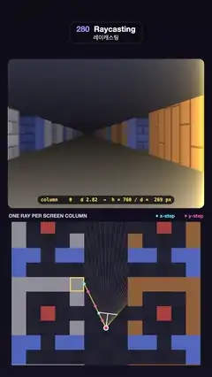

# 280 · Raycasting · 레이캐스팅



**EN** A Wolfenstein-style textured corridor drawn one ray per screen column; a cursor lights each column as it is cast, and the grid map below shows its DDA steps.  
**KO** 울펜슈타인풍 텍스처 복도를 화면 열마다 광선 하나로 그린다. 커서가 지나는 열이 빛나고, 아래 격자 지도에 그 광선의 DDA 걸음이 표시된다.

[Video (mp4)](https://sueun-dev.github.io/motion-effects/videos/280-raycasting.mp4) · [Code](../effects/280-raycasting.js) · Retro 3D · 레트로 3D

## Prompt (English)

```text
Create a "Raycasting" motion effect: a Wolfenstein 3D-style first-person view of a textured grid maze, built one ray per screen column, with a top-down map of the same grid showing the fan of rays and the DDA grid steps of the column being cast.

Look
- Page background: dark navy, rgb(13, 13, 23) at the top to rgb(20, 18, 33) at the bottom.
- The 3D view: a rounded rectangle x 40–1040, y 300–1060 (radius 26). Flat ceiling (gradient from rgb(18, 18, 26) at the middle to rgb(51, 54, 69) at the top) and flat floor (rgb(26, 23, 20) at the middle to rgb(120, 112, 102) at the bottom).
- The maze: 13 columns × 6 rows that repeat endlessly along y (row by row, x = 0 … 12; 0 = open):
  1 1 1 1 1 0 0 0 3 3 3 3 3 / 1 0 0 0 1 0 0 0 3 0 0 0 3 / 1 0 4 0 0 0 0 0 0 0 4 0 3 / 1 0 0 0 1 0 0 0 3 0 0 0 3 / 2 2 0 2 2 0 0 0 2 2 0 2 2 / 2 0 0 0 0 0 0 0 0 0 0 0 2.
  A 3-cell hall runs up the middle, with doorways into rooms (each with a pillar) and a cross corridor; everything outside x 0–12 is wall.
- Four 64 × 64 pixel-art wall textures computed per texel: 1 grey stone blocks (32 × 16, base rgb(143, 143, 153)), 2 blue stone blocks (rgb(69, 92, 173)), 3 wooden planks 16 texels wide (rgb(143, 89, 48)), 4 small red bricks 16 × 8 (rgb(168, 66, 54)); 2-texel mortar at 55 % brightness, a light top-left bevel (×1.08) and a darker bottom-right bevel (×0.88); per-block brightness varies by a fixed hash. Walls hit on their y-side are drawn at 72 % brightness (the classic Wolfenstein trick); distance fog toward rgb(26, 26, 31) with 1 − exp(−d/16).
- The cursor: the column being cast glows, a warm band that cools down behind it; a yellow #FFD84D bracket marks that column's wall slice, and a dark pill at the bottom of the view reads "column 600   d 3.56 → h = 760 / d = 214 px".
- The map panel: x 40–1040, y 1130–1860 (radius 26), caption "ONE RAY PER SCREEN COLUMN" and a legend "● x-step" (cyan #5CE1FF) and "● y-step" (pink #FF6FB5). Cells are 74 px: walls filled grey #8E8E98, blue #4F68C0, wood #94623A and brick #B04A3E, open floor in a faint checker of #1D1F2D and #222433. The player stays at 74 % of the panel height while the map scrolls under it.
- On the map: 26 thin rays of the fan (2 px, warm white, brighter for the ones cast in the last moments), the current ray in yellow (4 px) with a dot at every grid line it crosses (cyan for vertical grid lines, pink for horizontal) and a yellow square around the wall cell it hits; the player as a red dot in a white ring with a white direction line and the camera plane segment.

Motion (0–5 s), p = t / 5
- The player walks up the middle hall exactly one maze period (6 rows) per loop: x = 6.5 + 0.15 sin 2πp, y = 3.5 − 6p, glancing left and right with heading 0.22 sin(2πp + 0.6) rad.
- The cursor sweeps the 1000 columns left to right twice per loop (one pass per 2.5 s). A column's glow decays as exp(−age / 0.4 s), with a brighter thin front exp(−age / 0.06 s); the fan rays use the same glow.
- The map scrolls with the walk, so it repeats seamlessly; numbers in the pill change with the cursor.

Technique
- One full-screen fragment shader (WebGL2) for the view: for each pixel's column, camera x = 2 · column / 1000 − 1, ray = direction + plane · camera x (plane length 0.66, a 66° field of view); DDA through the grid (always step to the nearer of the next vertical or horizontal grid line) up to 64 steps; perpendicular distance → slice height 760 / d centred on the view; texture column from the hit point.
- To keep far and grazing walls from shimmering, estimate texels per pixel (vertically 64 / slice height, along the wall from the analytic derivative of the hit point) and fade the texture toward its average colour between 0.25 and 0.9 texels per pixel.
- 2 × 2 sub-pixel samples × 4 moments spread over the frame time (motion blur), averaged.
- The map, rays, crossings, bracket and labels are drawn on a 2D canvas on top, running the same DDA in JavaScript.

Output and rules
- One self-contained HTML file with no external assets (three.js from a CDN is fine if you use it), drawing on a 1080 × 1920 canvas (9:16) scaled to fit the window.
- Write a function renderFrame(t) that draws the frame for time t in seconds, and preview it with requestAnimationFrame. Everything must be a pure function of t and fixed seeds: no Math.random(), Date or state carried between frames, so frame i = renderFrame(i / 30) can be exported to a 30 fps video.
- Loop seamlessly every 5 seconds: renderFrame(5) must look exactly like renderFrame(0).
- No flicker of any kind: no noise or grain that changes from frame to frame, no strobing or blinking, no z-fighting, no shimmering 1 px lines. Any grain or texture stays fixed to the screen or to the object.
- Keep the top 280 px free of important content (a title label goes there) and fill the whole frame with a designed background.
```

## 프롬프트 (한국어)

```text
"레이캐스팅" 모션 효과를 만들어 줘: 울펜슈타인 3D 같은 1인칭 텍스처 격자 미로 화면을 화면 열마다 광선 하나로 만들고, 같은 격자를 위에서 본 지도에 광선 부채꼴과 지금 쏘는 열의 DDA 격자 걸음을 보여 주는 효과.

모양
- 페이지 배경: 짙은 남색, 위 rgb(13, 13, 23)에서 아래 rgb(20, 18, 33).
- 3D 화면: x 40–1040, y 300–1060의 둥근 사각형(반지름 26). 평평한 천장(가운데 rgb(18, 18, 26)에서 위 rgb(51, 54, 69))과 평평한 바닥(가운데 rgb(26, 23, 20)에서 아래 rgb(120, 112, 102)).
- 미로: 13열 × 6행이 y 방향으로 끝없이 반복된다(행마다 x = 0 … 12, 0 = 빈칸):
  1 1 1 1 1 0 0 0 3 3 3 3 3 / 1 0 0 0 1 0 0 0 3 0 0 0 3 / 1 0 4 0 0 0 0 0 0 0 4 0 3 / 1 0 0 0 1 0 0 0 3 0 0 0 3 / 2 2 0 2 2 0 0 0 2 2 0 2 2 / 2 0 0 0 0 0 0 0 0 0 0 0 2.
  가운데로 폭 3칸 복도가 나 있고, 기둥이 하나씩 있는 방으로 통하는 문과 가로 복도가 있다; x 0–12 바깥은 모두 벽.
- 텍셀마다 계산하는 64 × 64 픽셀 아트 벽 텍스처 네 가지: 1 회색 돌 블록(32 × 16, 기본 rgb(143, 143, 153)), 2 파란 돌 블록(rgb(69, 92, 173)), 3 폭 16텍셀 나무 판자(rgb(143, 89, 48)), 4 작은 빨간 벽돌 16 × 8(rgb(168, 66, 54)); 2텍셀 줄눈은 밝기 55 %, 왼쪽 위 밝은 모서리(×1.08)와 오른쪽 아래 어두운 모서리(×0.88); 블록마다 고정 해시로 밝기가 다르다. y면에 맞은 벽은 밝기 72 %(울펜슈타인의 고전 기법); 1 − exp(−d/16)만큼 rgb(26, 26, 31) 쪽 거리 안개.
- 커서: 지금 쏘는 열이 빛나는 따뜻한 띠이고 지나간 자리는 서서히 식는다; 노랑 #FFD84D 괄호가 그 열의 벽 조각을 표시하고, 화면 아래 어두운 알약에 "column 600   d 3.56 → h = 760 / d = 214 px"가 적힌다.
- 지도 패널: x 40–1040, y 1130–1860(반지름 26), 캡션 "ONE RAY PER SCREEN COLUMN"과 범례 "● x-step"(하늘색 #5CE1FF), "● y-step"(분홍 #FF6FB5). 칸은 74px: 벽은 회색 #8E8E98, 파랑 #4F68C0, 나무 #94623A, 벽돌 #B04A3E로 채우고, 빈 바닥은 #1D1F2D와 #222433의 옅은 체크. 플레이어는 패널 높이 74 % 지점에 머물고 지도가 그 아래로 흐른다.
- 지도 위: 부채꼴의 가는 광선 26개(2px, 따뜻한 흰색, 방금 쏜 것일수록 밝다), 현재 광선은 노랑(4px)이고 지나는 격자선마다 점(세로 격자선은 하늘색, 가로 격자선은 분홍), 맞은 벽 칸에 노란 사각 테두리; 플레이어는 흰 테두리의 빨간 점, 흰 방향선과 카메라 평면 선분.

움직임 (0–5초), p = t / 5
- 플레이어는 가운데 복도를 따라 루프마다 정확히 미로 한 주기(6행)를 걷는다: x = 6.5 + 0.15 sin 2πp, y = 3.5 − 6p, 방향 0.22 sin(2πp + 0.6) rad로 좌우를 살핀다.
- 커서는 1000개 열을 왼쪽에서 오른쪽으로 루프마다 두 번 훑는다(2.5초에 한 번). 열의 빛은 exp(−경과 / 0.4초)로 식고, 앞쪽에 exp(−경과 / 0.06초)의 더 밝고 가는 선이 있다; 부채꼴 광선도 같은 빛을 쓴다.
- 지도는 걷는 만큼 흘러 끊김 없이 반복되고, 알약 숫자는 커서를 따라 바뀐다.

기법
- 화면은 전체 화면 프래그먼트 셰이더(WebGL2) 하나: 픽셀의 열마다 카메라 x = 2 · 열 / 1000 − 1, 광선 = 방향 + 평면 · 카메라 x(평면 길이 0.66, 시야 66°); 격자를 DDA로 최대 64걸음(늘 다음 세로·가로 격자선 중 가까운 쪽으로); 수직 거리로 벽 조각 높이 760 / d를 화면 가운데에 세우고, 맞은 지점으로 텍스처 열을 고른다.
- 멀거나 비스듬한 벽이 반짝이지 않도록 픽셀당 텍셀 수(세로는 64 / 조각 높이, 벽 방향은 맞은 지점의 해석적 미분)를 구해 0.25–0.9 텍셀/픽셀 사이에서 텍스처를 평균색으로 바랜다.
- 2 × 2 서브픽셀 × 프레임 시간에 펼친 4개 순간(모션 블러)을 평균한다.
- 지도·광선·교차점·괄호·라벨은 같은 DDA를 JavaScript로 돌려 그 위 2D 캔버스에 그린다.

출력과 규칙
- 외부 파일 없는 HTML 파일 하나(three.js를 쓴다면 CDN은 괜찮다). 1080 × 1920(9:16) 캔버스에 그리고 창 크기에 맞춰 보이게 한다.
- 시간 t(초)의 프레임을 그리는 renderFrame(t) 함수를 만들고, 미리보기는 requestAnimationFrame으로 돌린다. 모든 것은 t와 고정 시드만으로 정해진다: Math.random(), Date, 프레임 사이에 쌓이는 상태 금지. 그래야 i번째 프레임 = renderFrame(i / 30)으로 30fps 영상을 뽑을 수 있다.
- 5초마다 끊김 없이 반복: renderFrame(5)는 renderFrame(0)과 똑같아 보여야 한다.
- 어떤 깜빡임도 금지: 프레임마다 바뀌는 노이즈·그레인, 번쩍임·깜빡임, z-fighting, 반짝이며 떨리는 1px 선 모두 금지. 그레인·질감은 화면이나 물체에 고정한다.
- 위쪽 280px에는 중요한 내용을 두지 않고(제목 라벨 자리), 화면 전체를 디자인된 배경으로 채운다.
```
