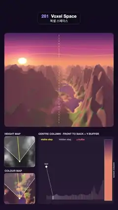

# 281 · Voxel Space · 복셀 스페이스



**EN** A Comanche-style flight down a sunset river valley drawn from a height map and a colour map, front to back with a y-buffer, shown column by column below.  
**KO** 높이 맵과 색 맵 두 장으로 그린 코만치풍 노을 강 계곡 비행. 앞에서 뒤로 그리며 y버퍼로 가려진 땅을 건너뛰는 과정을 아래 도식이 한 열씩 보여 준다.

[Video (mp4)](https://sueun-dev.github.io/motion-effects/videos/281-voxel-space.mp4) · [Code](../effects/281-voxel-space.js) · Retro 3D · 레트로 3D

## Prompt (English)

```text
Create a "Voxel Space" motion effect: the Comanche heightmap terrain renderer, flying low down a river valley at sunset, with the two source maps as insets and a diagram of one screen column drawn front to back with a y-buffer.

Look
- Page background: dark plum, rgb(18, 13, 31) at the top to rgb(28, 18, 41) at the bottom.
- The view: a rounded rectangle x 40–1040, y 300–1160 (radius 26); horizon 290 px below its top; focal length 560 px; a dashed yellow #FFD84D line (14 on, 10 off, 3 px) marks the centre column.
- The world is two tiling 512 × 512 maps:
  - Height map: 4 octaves of periodic gradient noise plus a ridged layer, 30 + 95 (fbm + 0.35) + 70 · ridge, clamped to 16–240; a river valley carved along x = 256 + 22 sin(2πy/512) + 6 sin(4πy/512 + 1.2) (flat valley floor within 34 units, full height beyond 120); water level 22.
  - Colour map with the sunset light baked in: sand rgb(214, 170, 110) → grass rgb(96, 130, 60) → forest rgb(52, 92, 52) by height, rock rgb(128, 100, 84) on slopes and above 120–150, snow rgb(246, 238, 240) above 175–195 on gentle slopes; water rgb(40, 52, 110) with soft orange streaks. Lighting: a low sun from the front-left (direction (−0.62, −0.62, 0.48)), lambert × 1.15 + 0.32 ambient, shadows marched toward the sun over the height map, a warm tint (×1.08, 0.86, 0.80) and violet fill in the shade.
- Sky: from peach rgb(255, 158, 107) at the horizon through rose rgb(199, 92, 133) to deep violet rgb(51, 33, 92) high up; a bright low sun with a soft glow ahead-left; two thin wavy cloud bands. Distant terrain fades into a haze rgb(250, 158, 128) with 1 − exp(−z/950).
- Bottom left: "HEIGHT MAP" (grey) and "COLOUR MAP" insets, 280 × 280 px each at (40, 1246) and (40, 1584), slightly softened, scrolling under the camera (fixed at 82 % of the inset height) with a white view wedge and a yellow line for the centre column.
- Bottom right, panel (350, 1246)–(1040, 1864), title "CENTRE COLUMN · FRONT TO BACK + Y-BUFFER", legend "visible step" (yellow), "hidden step" (grey), "y-buffer" (pink): a side view of the terrain under the centre column (a soft filled profile), the eye as a white dot, 46 steps at distances z = 120 · 1.044^k drawn as vertical grey bars, and at the right a 70 px wide strip, "screen column", that starts as sky gradient.

Motion (0–5 s), p = t / 5
- The camera flies at altitude 200 along the valley, exactly one map length (512 units) per loop, heading toward the valley point 200 units ahead: a slow, gentle turn.
- In the diagram a sweep processes the steps front to back twice per loop (1.9 s each, then a 0.25 s fade): a white bar and line mark the current step; a step whose top projects above the y-buffer turns yellow, sends a ray from the eye and adds its colour span to the screen strip, bottom row first; hidden steps stay grey; a dashed pink line from the eye through the last visible top shows the y-buffer.
- The insets scroll with the flight and repeat seamlessly.

Technique
- three.js, one full-screen ShaderMaterial. Height map as a float texture with its own mip chain, colour map as an RGBA mipmapped texture, both repeating.
- Per pixel (equivalent to the column-by-column y-buffer): march z from 8 with steps max(0.6, 0.005 z) up to 2600; at each step compare the terrain height (read at mip level log2(1.2 · step), so ridges are never skipped) with the height of this pixel's ray, ALT − (y − horizon) · z / F. The first step above it colours the pixel; refine the crossing with 5 secant steps, then read the colour at a mip level that grows with distance.
- 2 × 2 sub-pixel samples × 4 camera positions spread over the frame (motion blur). Insets, diagram and labels are drawn on a 2D canvas on top.

Output and rules
- One self-contained HTML file with no external assets (three.js from a CDN is fine if you use it), drawing on a 1080 × 1920 canvas (9:16) scaled to fit the window.
- Write a function renderFrame(t) that draws the frame for time t in seconds, and preview it with requestAnimationFrame. Everything must be a pure function of t and fixed seeds: no Math.random(), Date or state carried between frames, so frame i = renderFrame(i / 30) can be exported to a 30 fps video.
- Loop seamlessly every 5 seconds: renderFrame(5) must look exactly like renderFrame(0).
- No flicker of any kind: no noise or grain that changes from frame to frame, no strobing or blinking, no z-fighting, no shimmering 1 px lines. Any grain or texture stays fixed to the screen or to the object.
- Keep the top 280 px free of important content (a title label goes there) and fill the whole frame with a designed background.
```

## 프롬프트 (한국어)

```text
"복셀 스페이스" 모션 효과를 만들어 줘: 코만치의 하이트맵 지형 렌더러로 노을 진 강 계곡을 낮게 나는 장면. 두 원본 맵을 인셋으로 보여 주고, 화면 한 열을 y버퍼로 앞에서 뒤로 그리는 도식을 곁들인다.

모양
- 페이지 배경: 짙은 자두색, 위 rgb(18, 13, 31)에서 아래 rgb(28, 18, 41).
- 화면: x 40–1040, y 300–1160의 둥근 사각형(반지름 26); 지평선은 위에서 290px 아래, 초점 거리 560px; 노랑 #FFD84D 점선(14 켬, 10 끔, 3px)이 가운데 열을 표시한다.
- 세계는 반복되는 512 × 512 맵 두 장:
  - 높이 맵: 주기적 그라디언트 노이즈 4옥타브와 능선 층, 30 + 95 (fbm + 0.35) + 70 · 능선, 16–240으로 제한; x = 256 + 22 sin(2πy/512) + 6 sin(4πy/512 + 1.2)를 따라 강 계곡을 깎는다(34 이내는 평평한 바닥, 120 밖은 원래 높이); 수면 높이 22.
  - 노을빛을 미리 구운 색 맵: 높이에 따라 모래 rgb(214, 170, 110) → 풀 rgb(96, 130, 60) → 숲 rgb(52, 92, 52), 경사면과 120–150 위는 바위 rgb(128, 100, 84), 완만한 175–195 위는 눈 rgb(246, 238, 240); 물은 rgb(40, 52, 110)에 부드러운 주황 줄무늬. 조명: 왼쪽 앞 낮은 해(방향 (−0.62, −0.62, 0.48)), 램버트 × 1.15 + 환경광 0.32, 해 쪽으로 높이 맵을 따라 걸어 만든 그림자, 따뜻한 색조(×1.08, 0.86, 0.80)와 그늘의 보랏빛.
- 하늘: 지평선의 복숭아색 rgb(255, 158, 107)에서 장밋빛 rgb(199, 92, 133)을 지나 높은 곳의 짙은 보라 rgb(51, 33, 92)로; 왼쪽 앞 낮게 걸린 밝은 해와 부드러운 빛무리; 가는 물결 구름 띠 두 줄. 먼 지형은 1 − exp(−z/950)만큼 안개색 rgb(250, 158, 128)으로 바랜다.
- 왼쪽 아래: (40, 1246)과 (40, 1584)의 280 × 280px "HEIGHT MAP"(회색)·"COLOUR MAP" 인셋, 살짝 부드럽게, 카메라(인셋 높이 82 % 지점 고정) 아래로 흐르며 흰 시야 쐐기와 가운데 열을 뜻하는 노란 선.
- 오른쪽 아래 패널 (350, 1246)–(1040, 1864), 제목 "CENTRE COLUMN · FRONT TO BACK + Y-BUFFER", 범례 "visible step"(노랑), "hidden step"(회색), "y-buffer"(분홍): 가운데 열 아래 지형의 옆모습(부드럽게 채운 윤곽), 흰 점의 눈, 거리 z = 120 · 1.044^k의 걸음 46개를 회색 세로 막대로, 오른쪽에는 하늘 그라디언트로 시작하는 폭 70px의 "screen column" 띠.

움직임 (0–5초), p = t / 5
- 카메라는 고도 200으로 계곡을 따라 루프마다 정확히 맵 한 길이(512)를 날고, 200 앞의 계곡 지점을 향한다: 느리고 완만한 선회.
- 도식에서는 훑기가 루프마다 두 번 걸음을 앞에서 뒤로 처리한다(각 1.9초, 이어서 0.25초 페이드): 흰 막대와 선이 현재 걸음을 표시; 꼭대기가 y버퍼보다 위로 투영되는 걸음은 노랗게 변해 눈에서 광선을 받고, 그 색 구간을 화면 띠에 아래 행부터 채운다; 가려진 걸음은 회색으로 남는다; 눈에서 마지막으로 보인 꼭대기를 지나는 분홍 점선이 y버퍼다.
- 인셋은 비행을 따라 흐르며 끊김 없이 반복된다.

기법
- three.js 전체 화면 ShaderMaterial 하나. 높이 맵은 자체 밉 체인을 가진 float 텍스처, 색 맵은 RGBA 밉맵 텍스처, 둘 다 반복.
- 픽셀마다(열 단위 y버퍼와 같은 결과): z를 8부터 걸음 max(0.6, 0.005 z)로 2600까지 나아가며, 지형 높이(밉 레벨 log2(1.2 · 걸음)로 읽어 능선을 건너뛰지 않는다)와 이 픽셀 광선의 높이 ALT − (y − 지평선) · z / F를 비교한다. 처음 넘는 걸음이 픽셀 색을 정하고, 교차점을 할선법 5번으로 다듬은 뒤 거리에 따라 커지는 밉 레벨로 색을 읽는다.
- 2 × 2 서브픽셀 × 프레임 안에 펼친 카메라 위치 4개(모션 블러). 인셋·도식·라벨은 그 위 2D 캔버스에 그린다.

출력과 규칙
- 외부 파일 없는 HTML 파일 하나(three.js를 쓴다면 CDN은 괜찮다). 1080 × 1920(9:16) 캔버스에 그리고 창 크기에 맞춰 보이게 한다.
- 시간 t(초)의 프레임을 그리는 renderFrame(t) 함수를 만들고, 미리보기는 requestAnimationFrame으로 돌린다. 모든 것은 t와 고정 시드만으로 정해진다: Math.random(), Date, 프레임 사이에 쌓이는 상태 금지. 그래야 i번째 프레임 = renderFrame(i / 30)으로 30fps 영상을 뽑을 수 있다.
- 5초마다 끊김 없이 반복: renderFrame(5)는 renderFrame(0)과 똑같아 보여야 한다.
- 어떤 깜빡임도 금지: 프레임마다 바뀌는 노이즈·그레인, 번쩍임·깜빡임, z-fighting, 반짝이며 떨리는 1px 선 모두 금지. 그레인·질감은 화면이나 물체에 고정한다.
- 위쪽 280px에는 중요한 내용을 두지 않고(제목 라벨 자리), 화면 전체를 디자인된 배경으로 채운다.
```
