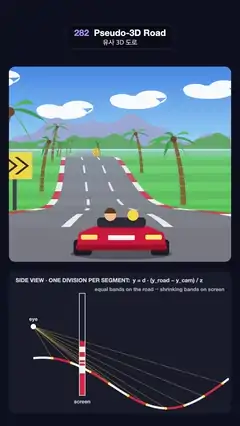

# 282 · Pseudo-3D Road · 유사 3D 도로



**EN** An 80s arcade road built from flat segments: bends and hills come from per-segment offsets, palms and signs scale up, and a side view shows the projection.  
**KO** 평평한 세그먼트로 만든 80년대 아케이드 도로. 굽이와 언덕은 세그먼트마다 더하는 오프셋이고 야자수와 표지판이 커지며, 옆 단면도가 투영을 보여 준다.

[Video (mp4)](https://sueun-dev.github.io/motion-effects/videos/282-pseudo-3d-road.mp4) · [Code](../effects/282-pseudo-3d-road.js) · Retro 3D · 레트로 3D

## Prompt (English)

```text
Create a "Pseudo-3D Road" motion effect: an 80s arcade racer view whose road is a list of flat segments projected with one division each, with curves and hills faked by per-segment offsets, scaling roadside sprites, and a side-view diagram of the projection.

Look
- Page background #0D1020. The game screen: a rounded rectangle x 40–1040, y 300–1180 (radius 28); horizon at 42 % of its height.
- Sky: gradient #3F86E8 → #8CC6F5 → #D8EEFA at the horizon; five white clouds made of three ellipses each; two ranges of hills (lavender #9AA9D6 and green #5E9E6A) as sums of sines.
- The road: segments 200 units long, road half-width 2000, camera height 1000, d = 1 / tan 50°, 220 segments drawn. Every 3 segments the colours alternate: grass #4FB848 / #46A640 across the whole width, rumble strips (1.16 × road width) white #F4F2EE / red #E2393F, road #7C7B84 / #76757E, and on the light bands two white lane dashes at ±1/3 of the road width (3 % wide). Distance haze toward rgb(178, 214, 240) with 1 − exp(−z / 26000).
- Roadside sprites: a palm every 6 segments on alternating sides (1.5–2.0 road widths out): a curved trunk of 7 tapering rings #8A5A34, 7 leaf fronds in #2E8B3E / #3CA34A and a brown coconut cluster; yellow #FFD23F chevron signs with two black chevrons on a grey post on the outside of the sharpest bends.
- The car, from behind, at the bottom centre: a red #D92B3A 80s convertible with dark tyres, yellow tail lights, a white plate, a dark windscreen, a driver (brown hair) and a passenger (yellow), over a soft shadow.
- Below, a side-view panel (40, 1222)–(1040, 1862), radius 26, title "SIDE VIEW · ONE DIVISION PER SEGMENT:  y = d · (y_road − y_cam) / z" and the note "equal bands on the road → shrinking bands on screen": the eye (white dot), the road profile with its hills as a 10 px line in red/white bands of 3 segments, yellow rays from the eye to every band edge (yellow dots on the road), and a 26 px wide "screen" strip 220 px in front of the eye filled with the same bands where the rays cross it, squeezed smaller and smaller.

Motion (0–5 s), p = t / 5
- The track is 90 segments long; the car covers it exactly once per loop (120 units per frame, 0.1 band pair per frame), so bands, rumble strips and dashes glide toward the viewer without strobing.
- Bends: curve(s) = 4.2 sin(2πs/90) + 2.4 sin(4πs/90 + 0.7) per segment, accumulated as x += dx; dx += curve. Hills: y(s) = 700 sin(4πs/90 + 1.9) + 250 sin(6πs/90). The camera rides at 1000 above the road under it.
- Clouds (1.5×) and hills (2.2× and 3.6×) slide sideways by the integral of the bend, which returns to its start each lap.
- The car bobs 2 px ten times per loop and leans 0.35 × the bend 3 segments ahead.
- The side view scrolls with the road and its rays and screen bands move with it.

Technique
- Canvas 2D. For each segment boundary ahead: scale = d / z, screen x = centre − scale · x · 500, screen y = horizon − scale · (y_road − y_cam) · 440, road width = scale · 2000 · 500.
- Paint segments far to near as trapezoids (grass band, rumble strip, road, lane dashes), each 1 px taller than its space so neighbours never leave a seam; skip segments seen from behind (beyond a crest). Sprites stand on their segment and are scaled by the same factor, fading in from 130 to 100 segments.
- Bands thinner than 2–6 px blend to the average of their two colours, so the distance never shimmers.

Output and rules
- One self-contained HTML file with no external assets (three.js from a CDN is fine if you use it), drawing on a 1080 × 1920 canvas (9:16) scaled to fit the window.
- Write a function renderFrame(t) that draws the frame for time t in seconds, and preview it with requestAnimationFrame. Everything must be a pure function of t and fixed seeds: no Math.random(), Date or state carried between frames, so frame i = renderFrame(i / 30) can be exported to a 30 fps video.
- Loop seamlessly every 5 seconds: renderFrame(5) must look exactly like renderFrame(0).
- No flicker of any kind: no noise or grain that changes from frame to frame, no strobing or blinking, no z-fighting, no shimmering 1 px lines. Any grain or texture stays fixed to the screen or to the object.
- Keep the top 280 px free of important content (a title label goes there) and fill the whole frame with a designed background.
```

## 프롬프트 (한국어)

```text
"유사 3D 도로" 모션 효과를 만들어 줘: 80년대 아케이드 레이싱 화면. 도로는 나눗셈 한 번으로 투영되는 평평한 세그먼트의 목록이고, 굽이와 언덕은 세그먼트마다 더하는 오프셋으로 흉내 내며, 길가 스프라이트가 커지고, 투영 원리를 옆 단면도로 보여 준다.

모양
- 페이지 배경 #0D1020. 게임 화면: x 40–1040, y 300–1180의 둥근 사각형(반지름 28); 지평선은 높이의 42 %.
- 하늘: #3F86E8 → #8CC6F5 → 지평선의 #D8EEFA 그라디언트; 타원 세 개로 만든 흰 구름 다섯; 사인 합으로 만든 언덕 두 겹(라벤더 #9AA9D6, 초록 #5E9E6A).
- 도로: 세그먼트 길이 200, 도로 반폭 2000, 카메라 높이 1000, d = 1 / tan 50°, 세그먼트 220개를 그린다. 3세그먼트마다 색이 번갈아 바뀐다: 화면 폭 전체의 잔디 #4FB848 / #46A640, 연석(도로 폭의 1.16배) 흰색 #F4F2EE / 빨강 #E2393F, 도로 #7C7B84 / #76757E, 밝은 띠에는 도로 폭 ±1/3 위치에 흰 차선(폭 3 %). 1 − exp(−z / 26000)만큼 rgb(178, 214, 240) 쪽 거리 안개.
- 길가 스프라이트: 6세그먼트마다 좌우 번갈아(도로 폭의 1.5–2.0배 바깥) 야자수: 가늘어지는 고리 7개로 휜 줄기 #8A5A34, #2E8B3E / #3CA34A 잎 7장, 갈색 열매; 가장 급한 굽이 바깥에는 회색 기둥 위 검은 쉐브론 두 개의 노랑 #FFD23F 표지판.
- 아래 가운데에 뒤에서 본 차: 빨강 #D92B3A 80년대 오픈카, 짙은 타이어, 노란 후미등, 흰 번호판, 짙은 앞유리, 운전자(갈색 머리)와 동승자(노랑), 부드러운 그림자.
- 아래 옆 단면 패널 (40, 1222)–(1040, 1862), 반지름 26, 제목 "SIDE VIEW · ONE DIVISION PER SEGMENT:  y = d · (y_road − y_cam) / z"와 메모 "equal bands on the road → shrinking bands on screen": 눈(흰 점), 3세그먼트씩 빨강·흰 띠로 칠한 10px 선의 언덕진 도로 옆모습, 눈에서 띠 경계마다 가는 노란 광선(도로 위 노란 점), 눈 앞 220px의 폭 26px "screen" 띠에는 광선이 지나는 자리마다 같은 띠가 점점 작게 눌려 채워진다.

움직임 (0–5초), p = t / 5
- 트랙은 90세그먼트이고 차는 루프마다 정확히 한 바퀴를 돈다(프레임당 120, 띠 한 쌍의 0.1). 그래서 띠·연석·차선이 깜빡이지 않고 미끄러지듯 다가온다.
- 굽이: 세그먼트마다 curve(s) = 4.2 sin(2πs/90) + 2.4 sin(4πs/90 + 0.7)를 x += dx; dx += curve로 누적. 언덕: y(s) = 700 sin(4πs/90 + 1.9) + 250 sin(6πs/90). 카메라는 바로 아래 도로보다 1000 위에 있다.
- 구름(1.5배)과 언덕(2.2배, 3.6배)은 굽이의 적분만큼 옆으로 밀리고, 한 바퀴면 제자리로 돌아온다.
- 차는 루프마다 열 번 2px씩 흔들리고, 3세그먼트 앞 굽이의 0.35배만큼 기운다.
- 옆 단면도도 도로와 함께 흐르고 광선과 화면 띠가 따라 움직인다.

기법
- Canvas 2D. 앞쪽 세그먼트 경계마다: scale = d / z, 화면 x = 가운데 − scale · x · 500, 화면 y = 지평선 − scale · (y_도로 − y_카메라) · 440, 도로 폭 = scale · 2000 · 500.
- 세그먼트를 먼 것부터 가까운 것 순으로 사다리꼴(잔디 띠, 연석, 도로, 차선)로 칠하고, 각자 1px씩 더 크게 그려 이웃 사이에 틈이 생기지 않게 한다; 언덕 너머 뒤에서 보이는 세그먼트는 건너뛴다. 스프라이트는 자기 세그먼트 위에 같은 배율로 서고, 130에서 100세그먼트 사이에서 서서히 나타난다.
- 2–6px보다 얇아진 띠는 두 색의 평균으로 섞여 먼 곳이 반짝이지 않는다.

출력과 규칙
- 외부 파일 없는 HTML 파일 하나(three.js를 쓴다면 CDN은 괜찮다). 1080 × 1920(9:16) 캔버스에 그리고 창 크기에 맞춰 보이게 한다.
- 시간 t(초)의 프레임을 그리는 renderFrame(t) 함수를 만들고, 미리보기는 requestAnimationFrame으로 돌린다. 모든 것은 t와 고정 시드만으로 정해진다: Math.random(), Date, 프레임 사이에 쌓이는 상태 금지. 그래야 i번째 프레임 = renderFrame(i / 30)으로 30fps 영상을 뽑을 수 있다.
- 5초마다 끊김 없이 반복: renderFrame(5)는 renderFrame(0)과 똑같아 보여야 한다.
- 어떤 깜빡임도 금지: 프레임마다 바뀌는 노이즈·그레인, 번쩍임·깜빡임, z-fighting, 반짝이며 떨리는 1px 선 모두 금지. 그레인·질감은 화면이나 물체에 고정한다.
- 위쪽 280px에는 중요한 내용을 두지 않고(제목 라벨 자리), 화면 전체를 디자인된 배경으로 채운다.
```
