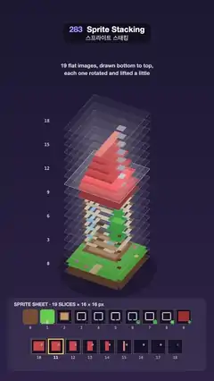

# 283 · Sprite Stacking · 스프라이트 스태킹



**EN** A pixel cottage made of 19 flat 16 × 16 slices fans apart into loose sheets, a glow climbs through them, and they close into a solid-looking house that turns.  
**KO** 16 × 16 평면 조각 19장으로 만든 픽셀 오두막이 낱장으로 펼쳐지고, 빛이 조각을 타고 오른 뒤 다시 포개져 단단해 보이는 집이 되어 돈다.

[Video (mp4)](https://sueun-dev.github.io/motion-effects/videos/283-sprite-stacking.mp4) · [Code](../effects/283-sprite-stacking.js) · Retro 3D · 레트로 3D

## Prompt (English)

```text
Create a "Sprite Stacking" motion effect: a little pixel-art cottage that is only a stack of 19 flat 16 × 16 images, drawn bottom to top, each rotated by the same angle and lifted a little, so it looks solid; the slices fan apart to prove it and close again.

Look
- Background: a vertical gradient #1C1A33 → #2E2547. Caption near the top, centred, white 80 %, 27 px: "19 flat images, drawn bottom to top," / "each one rotated and lifted a little" at y 340 and 378.
- The model, as 19 slices of 16 × 16 pixels (k = 0 bottom … 18 top):
  - k 0: dirt #7B5034 (corners cut); k 1: grass #5DBB4C with a beige path #E8CF9C (x 7–8, y 12–15) and five pink #FF8FB8 / yellow #FFE45C flowers;
  - k 2: the floor inside the house footprint (x 3–12, y 3–11): wood #C89A6A with a #9C6B43 rim;
  - k 3–8: the walls as a one-pixel ring #F2E2C4 (#E2CBA4 at k 8) with #9C6B43 corner posts, a door #8A5530 (lintel #5A3520) at the front, light blue windows #8FD3FF / #BDEBFF (k 4–6) on the front, sides and back;
  - k 9: the eaves #A83A32 (x 2–13, y 2–12); k 10–15: a gable roof #D9534A narrowing by one pixel per side each slice, gable ends #B84238, ridge #F28C7A;
  - a chimney #9A9AA4 (x 10–11, y 5–6) from k 10 to 18, its top #4A4A52; a small tree by the front-right corner: trunk #7A4A2A at (14, 13), a round crown #3FA34D with a lighter top #6CCB5C.
- Each slice pixel is drawn as a filled square 20 px wide, rotated, and squashed vertically to 62 % for the tilted view; lower slices are slightly darker (brightness 0.72 → 1.0 from bottom to top). A soft shadow ellipse (radius 245, 28 % black) lies under the stack.
- When fanned out, every slice sits on a faint square sheet (5 % white fill, 35 % white outline) and slice numbers 0, 3, 6 … 18 appear in white monospace left of the stack.
- Bottom panel (40, 1500)–(1040, 1870), radius 24, title "SPRITE SHEET · 19 SLICES × 16 × 16 px": the same 19 slices as thumbnails, 4.5 px per pixel, on dark #16142A tiles in two rows (10 + 9) with numbers below, each framed in yellow #FFD84D at 25 %.

Motion (0–5 s)
- The stack turns once per loop: angle = 2π · t / 5 + 0.5.
- Lift per slice: 40 px when fanned, 14 px when stacked. The loop starts fanned out; it closes between 0.7 and 1.7 s, stays stacked until 3.0 s, and opens again from 3.0 to 4.0 s (ease in-out). The base moves down by 90 px when fanned so the tall stack fits.
- While fanned (4.0 s → 5.0 s → 0.7 s) a glow walks up through the slices: a Gaussian of width 0.8 slices centred on slice −2 + 23 · u, u = 0 → 1 over those 1.7 s. The lit slice brightens (+35 %) and its sheet and its thumbnail frame light up in yellow.

Technique
- Canvas 2D only. For slice k: setTransform(20 cos a, 20 sin a · 0.62, −20 sin a, 20 cos a · 0.62, centre x, base y − k · lift), then add every pixel of one colour to a single path as 1 × 1 rects (centred, from −8 to 8) and fill once per colour, so neighbouring squares never show seams.
- Because every pixel is a rotated, antialiased square, the turn is smooth and nothing crawls; stacking the slices tighter than a pixel makes the edges read as walls.

Output and rules
- One self-contained HTML file with no external assets (three.js from a CDN is fine if you use it), drawing on a 1080 × 1920 canvas (9:16) scaled to fit the window.
- Write a function renderFrame(t) that draws the frame for time t in seconds, and preview it with requestAnimationFrame. Everything must be a pure function of t and fixed seeds: no Math.random(), Date or state carried between frames, so frame i = renderFrame(i / 30) can be exported to a 30 fps video.
- Loop seamlessly every 5 seconds: renderFrame(5) must look exactly like renderFrame(0).
- No flicker of any kind: no noise or grain that changes from frame to frame, no strobing or blinking, no z-fighting, no shimmering 1 px lines. Any grain or texture stays fixed to the screen or to the object.
- Keep the top 280 px free of important content (a title label goes there) and fill the whole frame with a designed background.
```

## 프롬프트 (한국어)

```text
"스프라이트 스태킹" 모션 효과를 만들어 줘: 작은 픽셀 아트 오두막이 사실은 16 × 16 평면 이미지 19장을 쌓은 것뿐이다. 아래에서 위로 그리며 모두 같은 각도로 돌리고 조금씩 들어 올려 단단해 보이게 하고, 조각들이 펼쳐져 그 사실을 보여 준 뒤 다시 포개진다.

모양
- 배경: 세로 그라디언트 #1C1A33 → #2E2547. 위쪽 가운데 캡션, 흰색 80 %, 27px: "19 flat images, drawn bottom to top," / "each one rotated and lifted a little"을 y 340, 378에.
- 모델은 16 × 16 픽셀 조각 19장(k = 0 맨 아래 … 18 맨 위):
  - k 0: 흙 #7B5034(모서리 잘림); k 1: 잔디 #5DBB4C에 베이지 길 #E8CF9C(x 7–8, y 12–15)와 분홍 #FF8FB8 / 노랑 #FFE45C 꽃 다섯;
  - k 2: 집 바닥(x 3–12, y 3–11) 나무 #C89A6A, 테두리 #9C6B43;
  - k 3–8: 1픽셀 고리 모양 벽 #F2E2C4(k 8은 #E2CBA4), 모서리 기둥 #9C6B43, 앞쪽 문 #8A5530(상인방 #5A3520), 앞·옆·뒤의 연한 파랑 창 #8FD3FF / #BDEBFF(k 4–6);
  - k 9: 처마 #A83A32(x 2–13, y 2–12); k 10–15: 조각마다 양쪽이 1픽셀씩 좁아지는 박공지붕 #D9534A, 박공 끝 #B84238, 용마루 #F28C7A;
  - k 10부터 18까지 굴뚝 #9A9AA4(x 10–11, y 5–6), 꼭대기 #4A4A52; 앞쪽 오른쪽 모서리 옆의 작은 나무: (14, 13)의 줄기 #7A4A2A, 둥근 수관 #3FA34D와 밝은 윗부분 #6CCB5C.
- 조각의 각 픽셀은 폭 20px의 채운 정사각형으로, 회전한 뒤 기울어진 시점을 위해 세로를 62 %로 누른다; 아래 조각일수록 조금 어둡다(아래에서 위로 밝기 0.72 → 1.0). 쌓인 조각 아래에 부드러운 그림자 타원(반지름 245, 검정 28 %).
- 펼쳐지면 조각마다 옅은 정사각형 판(흰색 5 % 채움, 35 % 테두리) 위에 놓이고, 왼쪽에 흰 고정폭 숫자 0, 3, 6 … 18이 나타난다.
- 아래 패널 (40, 1500)–(1040, 1870), 반지름 24, 제목 "SPRITE SHEET · 19 SLICES × 16 × 16 px": 같은 19장을 픽셀당 4.5px 썸네일로, 어두운 #16142A 칸에 두 줄(10 + 9)로 놓고 아래에 번호, 테두리는 노랑 #FFD84D 25 %.

움직임 (0–5초)
- 쌓인 조각은 루프마다 한 바퀴 돈다: 각도 = 2π · t / 5 + 0.5.
- 조각 사이 높이: 펼치면 40px, 쌓으면 14px. 루프는 펼친 상태로 시작해 0.7–1.7초에 닫히고, 3.0초까지 쌓여 있다가 3.0–4.0초에 다시 열린다(ease in-out). 펼칠 때 바닥이 90px 내려가 높은 더미가 화면에 들어온다.
- 펼친 동안(4.0초 → 5.0초 → 0.7초) 빛이 조각을 타고 오른다: 폭 0.8조각의 가우스, 중심은 조각 −2 + 23 · u(이 1.7초 동안 u = 0 → 1). 빛이 닿은 조각은 35 % 밝아지고 판과 썸네일 테두리가 노랗게 켜진다.

기법
- Canvas 2D만. 조각 k마다 setTransform(20 cos a, 20 sin a · 0.62, −20 sin a, 20 cos a · 0.62, 중심 x, 바닥 y − k · 높이)를 걸고, 한 색의 모든 픽셀을 1 × 1 사각형(−8에서 8로 중심 맞춤)으로 경로 하나에 넣어 색마다 한 번 채운다. 그래서 이웃 정사각형 사이에 틈이 보이지 않는다.
- 모든 픽셀이 회전된 안티에일리어스 정사각형이라 회전이 매끄럽고 아무것도 기어가지 않는다; 조각을 한 픽셀보다 촘촘히 쌓으면 가장자리가 벽처럼 읽힌다.

출력과 규칙
- 외부 파일 없는 HTML 파일 하나(three.js를 쓴다면 CDN은 괜찮다). 1080 × 1920(9:16) 캔버스에 그리고 창 크기에 맞춰 보이게 한다.
- 시간 t(초)의 프레임을 그리는 renderFrame(t) 함수를 만들고, 미리보기는 requestAnimationFrame으로 돌린다. 모든 것은 t와 고정 시드만으로 정해진다: Math.random(), Date, 프레임 사이에 쌓이는 상태 금지. 그래야 i번째 프레임 = renderFrame(i / 30)으로 30fps 영상을 뽑을 수 있다.
- 5초마다 끊김 없이 반복: renderFrame(5)는 renderFrame(0)과 똑같아 보여야 한다.
- 어떤 깜빡임도 금지: 프레임마다 바뀌는 노이즈·그레인, 번쩍임·깜빡임, z-fighting, 반짝이며 떨리는 1px 선 모두 금지. 그레인·질감은 화면이나 물체에 고정한다.
- 위쪽 280px에는 중요한 내용을 두지 않고(제목 라벨 자리), 화면 전체를 디자인된 배경으로 채운다.
```
