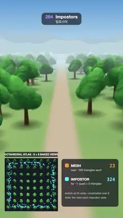

# 284 · Impostors · 임포스터



**EN** In a forest walk only near trees are real meshes; far ones are camera-facing quads that blend views from a baked octahedral atlas, revealed by a wipe.  
**KO** 숲길에서 가까운 나무만 진짜 메시이고 먼 나무는 구워 둔 팔면체 아틀라스의 시점을 섞어 보여 주는 카메라 정면 사각형이며, 와이프가 그 정체를 드러낸다.

[Video (mp4)](https://sueun-dev.github.io/motion-effects/videos/284-impostors.mp4) · [Code](../effects/284-impostors.js) · Retro 3D · 레트로 3D

## Prompt (English)

```text
Create an "Impostors" motion effect: a walk along a forest trail where trees within 24 units are real 520-triangle meshes and every farther tree is one camera-facing quad that shows views baked into an 8 × 8 octahedral atlas; a wipe reveals which is which.

Look
- The tree: a tapered trunk (radius 0.2–0.36, height 3.4) and two branches in #6E4A2E, six faceted leaf clumps (icosahedra of detail 1, radius 1.05–1.75, corners jittered ±11 % by a hash of their position) in greens #3F8F3A, #4FA144, #357F35, #5BB04C, #46963F, #3A8A3A; flat shading from a sun (−0.55, 0.75, 0.38) plus a sky fill. About 520 triangles.
- The forest: one 84 × 42 tile of trees on a jittered 7 × 6 grid (scale 0.85–1.3, random turn), with a 9-unit-wide trail kept clear down the middle, repeated 7 times along the walk; a soft dark contact shadow (radial gradient, 5.5 × scale wide) under every tree.
- Ground: green, linear colour (0.20, 0.36, 0.12) to (0.34, 0.50, 0.17) by a slow sine pattern, and a sandy trail (0.62, 0.50, 0.34) with soft edges along x = 0. Distance fog toward #CFE3EC from 40 to 175 units.
- Sky: a screen-space gradient #5E9BD8 → #B9D9EC → #CFE3EC with two layers of pale blue-grey hills on the horizon.
- Camera: 56° vertical field of view, 11 units up, looking at the ground 37 units ahead.
- The atlas inset: 470 × 470 px at (40, 1392) on a dark card #141A24, with a faint 8 × 8 cell grid, a white frame and the title "OCTAHEDRAL ATLAS · 8 × 8 BAKED VIEWS"; a cyan dot on it for every impostor at the view direction it is using right now.
- Legend card at (540, 1400), 500 × 420, dark 72 %: an orange #FF9A2E chip "MESH" with "near · 520 triangles each" and its count, a cyan #5AE6FF chip "IMPOSTOR" with "far · 1 quad = 2 triangles" and its count, and the notes "switch at 24 units, crossfaded over 8" and "dots: the view each impostor uses".

Motion (0–5 s), p = t / 5
- The camera walks down the trail exactly one tile (42 units) per loop, swaying 0.6 sideways: x = 0.6 sin 2πp, z = −42p.
- Every tree switches by distance: k = smoothstep(20, 28, distance). Below 28 the opaque mesh is drawn; above 20 the impostor quad is drawn over it with opacity k, so it fades in on top of the identical-looking mesh and the mesh is removed only once the quad is solid: no popping.
- The reveal: a wipe line enters from the left between 1.0 and 2.2 s and a second one clears it between 3.4 and 4.6 s (ease in-out, a thin white line while moving). Inside the revealed region mesh trees show their triangle edges in orange over a darkened orange tint, impostor quads get a cyan tint and a cyan 2–3 px outline, and the 24-unit switch ring glows yellow on the ground.

Technique
- three.js. In setup bake the tree from 64 directions on the upper hemisphere: atlas cell (i, j) → e = (−1 + 2i/7, −1 + 2j/7), p = ((e.x + e.y)/2, (e.x − e.y)/2), direction = normalize(p.x, 1 − |p.x| − |p.y|, p.y). Each view is rendered with an orthographic camera (half-size 4.2, up = +Y) into a 4× multisampled 192 × 192 target and copied into its cell of a 1536 × 1536 mipmapped atlas (transparent background, so colours come out premultiplied).
- Impostor quad (vertex shader): face the camera (right = normalize(up × d), up' = d × right), slide the quad to the front of the tree's bounding sphere while keeping its screen size, and turn the view direction into the tree's own frame (undo its random rotation).
- Fragment shader: encode that direction with the hemi-octahedral map, take the 4 nearest atlas cells and blend them bilinearly (uv clamped 1.5 % inside each cell), un-premultiply, apply fog and the output colour conversion, then premultiply again; blend with ONE, ONE_MINUS_SRC_ALPHA, no depth writes, sorted back to front. Contact shadows draw before the quads.
- The reveal is a screen-x window computed in every shader; triangle edges come from barycentric coordinates and fwidth.

Output and rules
- One self-contained HTML file with no external assets (three.js from a CDN is fine if you use it), drawing on a 1080 × 1920 canvas (9:16) scaled to fit the window.
- Write a function renderFrame(t) that draws the frame for time t in seconds, and preview it with requestAnimationFrame. Everything must be a pure function of t and fixed seeds: no Math.random(), Date or state carried between frames, so frame i = renderFrame(i / 30) can be exported to a 30 fps video.
- Loop seamlessly every 5 seconds: renderFrame(5) must look exactly like renderFrame(0).
- No flicker of any kind: no noise or grain that changes from frame to frame, no strobing or blinking, no z-fighting, no shimmering 1 px lines. Any grain or texture stays fixed to the screen or to the object.
- Keep the top 280 px free of important content (a title label goes there) and fill the whole frame with a designed background.
```

## 프롬프트 (한국어)

```text
"임포스터" 모션 효과를 만들어 줘: 숲길을 걷는 장면. 24 안쪽의 나무만 삼각형 520개짜리 진짜 메시이고, 더 먼 나무는 모두 8 × 8 팔면체 아틀라스에 구워 둔 시점을 보여 주는 카메라 정면 사각형 하나다. 와이프가 어느 쪽인지 드러낸다.

모양
- 나무: 가늘어지는 줄기(반지름 0.2–0.36, 높이 3.4)와 가지 둘 #6E4A2E, 각진 잎 덩어리 여섯(세분 1의 정이십면체, 반지름 1.05–1.75, 꼭짓점을 위치 해시로 ±11 % 흔듦) 초록 #3F8F3A, #4FA144, #357F35, #5BB04C, #46963F, #3A8A3A; 해 (−0.55, 0.75, 0.38)와 하늘빛의 플랫 셰이딩. 삼각형 약 520개.
- 숲: 84 × 42 타일 하나에 흔든 7 × 6 격자로 나무를 심고(크기 0.85–1.3, 무작위 회전), 가운데 폭 9의 길은 비우고, 걷는 방향으로 7번 반복; 나무마다 아래에 부드러운 접지 그림자(방사 그라디언트, 폭 5.5 × 크기).
- 땅: 느린 사인 무늬로 선형 색 (0.20, 0.36, 0.12)에서 (0.34, 0.50, 0.17)까지의 초록, x = 0을 따라 가장자리가 부드러운 모래길 (0.62, 0.50, 0.34). 40에서 175까지 #CFE3EC 쪽 거리 안개.
- 하늘: 화면 공간 그라디언트 #5E9BD8 → #B9D9EC → #CFE3EC와 지평선의 옅은 청회색 언덕 두 겹.
- 카메라: 세로 시야 56°, 높이 11, 37 앞의 땅을 바라본다.
- 아틀라스 인셋: (40, 1392)의 470 × 470px, 어두운 카드 #141A24 위에 옅은 8 × 8 칸 격자, 흰 테두리, 제목 "OCTAHEDRAL ATLAS · 8 × 8 BAKED VIEWS"; 임포스터마다 지금 쓰는 시점 방향에 하늘색 점.
- (540, 1400)의 500 × 420 범례 카드(어둡게 72 %): 주황 #FF9A2E 칩 "MESH"와 "near · 520 triangles each", 개수; 하늘색 #5AE6FF 칩 "IMPOSTOR"와 "far · 1 quad = 2 triangles", 개수; 메모 "switch at 24 units, crossfaded over 8", "dots: the view each impostor uses".

움직임 (0–5초), p = t / 5
- 카메라는 루프마다 정확히 타일 하나(42)만큼 길을 따라 걷고 옆으로 0.6 흔들린다: x = 0.6 sin 2πp, z = −42p.
- 나무마다 거리로 바뀐다: k = smoothstep(20, 28, 거리). 28 안쪽은 불투명 메시를 그리고, 20 바깥은 그 위에 불투명도 k로 임포스터 사각형을 그린다. 그래서 똑같아 보이는 메시 위로 사각형이 서서히 나타나고, 사각형이 완전히 불투명해진 뒤에야 메시가 빠진다: 튀는 순간이 없다.
- 드러내기: 와이프 선이 1.0–2.2초에 왼쪽에서 들어오고, 3.4–4.6초에 두 번째 선이 그것을 지운다(ease in-out, 움직이는 동안 가는 흰 선). 드러난 영역에서 메시 나무는 어둡게 한 주황 색조 위에 주황 삼각형 모서리를, 임포스터 사각형은 하늘색 색조와 2–3px 하늘색 테두리를 보이고, 24 거리의 전환 고리가 땅에서 노랗게 빛난다.

기법
- three.js. 설정 단계에서 위쪽 반구의 64방향으로 나무를 굽는다: 아틀라스 칸 (i, j) → e = (−1 + 2i/7, −1 + 2j/7), p = ((e.x + e.y)/2, (e.x − e.y)/2), 방향 = normalize(p.x, 1 − |p.x| − |p.y|, p.y). 각 시점을 직교 카메라(반크기 4.2, 위 = +Y)로 4배 멀티샘플 192 × 192 타깃에 그린 뒤 1536 × 1536 밉맵 아틀라스의 자기 칸에 복사한다(배경이 투명하므로 색은 premultiplied로 나온다).
- 임포스터 사각형(버텍스 셰이더): 카메라를 향하고(right = normalize(위 × d), up' = d × right), 화면 크기는 그대로 두고 나무 경계 구의 앞쪽으로 밀고, 시선 방향을 나무 자신의 좌표로 바꾼다(무작위 회전을 되돌림).
- 프래그먼트 셰이더: 그 방향을 반구 팔면체 매핑으로 부호화하고, 가장 가까운 아틀라스 칸 4개를 쌍선형으로 섞고(uv는 칸 안쪽 1.5 %로 제한), premultiply를 풀어 안개와 출력 색 변환을 적용한 뒤 다시 곱한다; ONE, ONE_MINUS_SRC_ALPHA 블렌딩, 깊이 쓰기 없음, 뒤에서 앞 순 정렬. 접지 그림자는 사각형보다 먼저 그린다.
- 드러내기는 모든 셰이더에서 화면 x 창으로 계산하고, 삼각형 모서리는 무게중심 좌표와 fwidth로 그린다.

출력과 규칙
- 외부 파일 없는 HTML 파일 하나(three.js를 쓴다면 CDN은 괜찮다). 1080 × 1920(9:16) 캔버스에 그리고 창 크기에 맞춰 보이게 한다.
- 시간 t(초)의 프레임을 그리는 renderFrame(t) 함수를 만들고, 미리보기는 requestAnimationFrame으로 돌린다. 모든 것은 t와 고정 시드만으로 정해진다: Math.random(), Date, 프레임 사이에 쌓이는 상태 금지. 그래야 i번째 프레임 = renderFrame(i / 30)으로 30fps 영상을 뽑을 수 있다.
- 5초마다 끊김 없이 반복: renderFrame(5)는 renderFrame(0)과 똑같아 보여야 한다.
- 어떤 깜빡임도 금지: 프레임마다 바뀌는 노이즈·그레인, 번쩍임·깜빡임, z-fighting, 반짝이며 떨리는 1px 선 모두 금지. 그레인·질감은 화면이나 물체에 고정한다.
- 위쪽 280px에는 중요한 내용을 두지 않고(제목 라벨 자리), 화면 전체를 디자인된 배경으로 채운다.
```
