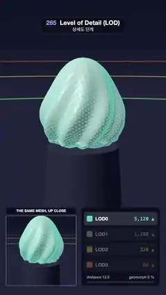

# 285 · Level of Detail (LOD) · 상세도 단계



**EN** A fluted sculpture steps from 5,120 to 80 triangles as the camera dollies back, its added vertices gliding onto their parent edges so the switch never pops.  
**KO** 카메라가 물러나면 홈이 팬 조각상이 삼각형 5,120개에서 80개로 단계를 내리고, 추가된 꼭짓점이 부모 모서리로 미끄러져 전환할 때 튀지 않는다.

[Video (mp4)](https://sueun-dev.github.io/motion-effects/videos/285-level-of-detail.mp4) · [Code](../effects/285-level-of-detail.js) · Rendering internals · 렌더링 내부

## Prompt (English)

```text
Create a "Level of Detail (LOD)" motion effect: one sculpture built at four resolutions; as the camera dollies back the mesh steps down a level each time the distance doubles, geomorphing so nothing pops, with the level shown by colour and wireframe and an up-close inset of the mesh being drawn.

Look
- The sculpture: a unit icosphere pushed out to radius r(d) = 1.05 · (1 + 0.3y − 0.18y² + 0.55 · max(0, y)⁶ + 0.075 sin(9 · atan2(z, x) + 5y)(1 − y²) + 0.06 exp(−((y + 0.42)/0.06)²)): a teardrop with a pointed top, nine twisted flutes and a thin collar. It stands on a dark plinth #2B2F45 (cylinder radius 0.95–1.05, height 1.6).
- Four levels: LOD0 = icosphere subdivided 4 times (5,120 triangles), LOD1 3 times (1,280), LOD2 twice (320), LOD3 once (80). Colours: LOD0 teal #4FD1C5, LOD1 green #7BD389, LOD2 yellow #F6C445, LOD3 orange #F28D52.
- Surface: flat-shaded off-white (0.86, 0.85, 0.82) tinted 28 % toward the level colour, a key light from (−0.5, 0.8, 0.6), a rim light from (0.7, 0.3, −0.6) in the level colour and a small specular highlight; every triangle edge drawn as a thin antialiased line in the level colour (80 %).
- Background: vertical gradient #0E1224 → #1E2442 → #0A0C18; a dark floor that fades into the backdrop far away, with three rings at radius 24, 48 and 96 in the colours of LOD1, LOD2 and LOD3: the distances where those levels take over. In the main view the rings fade out below y 1330, so nothing from the scene crosses the panels.
- Camera: 36° vertical field of view, looking at the sculpture, which sits a little above the middle of the frame (view offset 150 px).
- Inset "THE SAME MESH, UP CLOSE": 456 × 456 px at (40, 1404), the same mesh in the same state from 5.6 units away.
- Ladder card (530, 1350)–(1040, 1860), opaque #0C0F1E like the inset's title bar: four rows "LOD0 5,120 ▲", "LOD1 1,280 ▲", "LOD2 320 ▲", "LOD3 80 ▲" with colour chips; the active row lit, the next one lighting up as the morph progresses; below, "distance 23.4" on the left, "geomorph 64 %" (or "coarsest") on the right, and a progress bar in the active colour.

Motion (0–5 s), p = t / 5
- Level value l = 3.4 · (0.5 − 0.5 cos 2πp): 0 → 3.4 → 0. Camera distance = 12 · 2^l (12 → 127 → 12) from direction (sin a, 0.18, cos a), a = 0.35 + 0.3 sin 2πp.
- Active level L = floor(l) (max 3); geomorph m = smoothstep(0.45, 1, l − L) for L < 3. Every vertex that level L added over level L+1 moves toward the midpoint of its parent edge as m goes 0 → 1, the edges it added fade out, and the tint blends toward the next level's colour. At m = 1 the mesh equals level L+1 exactly, which then takes over.

Technique
- three.js. Build the icospheres level by level, keeping old vertices at their indices and remembering each new vertex's two parents. For each LOD make one non-indexed geometry with attributes: position (displaced), target (parent-edge midpoint of the displaced parents, or the position itself for old vertices), barycentric coordinates, and per-triangle flags for which edges are new (a corner triangle has one new edge, the middle triangle three).
- Vertex shader: position = mix(position, target, m). Fragment shader: flat normal from cross(dFdx(world), dFdy(world)), lighting as above, wire = edge of the barycentrics via fwidth, times (1 − newEdgeFlag · m).
- Render the main view, then the inset with a scissored viewport and the close camera.

Output and rules
- One self-contained HTML file with no external assets (three.js from a CDN is fine if you use it), drawing on a 1080 × 1920 canvas (9:16) scaled to fit the window.
- Write a function renderFrame(t) that draws the frame for time t in seconds, and preview it with requestAnimationFrame. Everything must be a pure function of t and fixed seeds: no Math.random(), Date or state carried between frames, so frame i = renderFrame(i / 30) can be exported to a 30 fps video.
- Loop seamlessly every 5 seconds: renderFrame(5) must look exactly like renderFrame(0).
- No flicker of any kind: no noise or grain that changes from frame to frame, no strobing or blinking, no z-fighting, no shimmering 1 px lines. Any grain or texture stays fixed to the screen or to the object.
- Keep the top 280 px free of important content (a title label goes there) and fill the whole frame with a designed background.
```

## 프롬프트 (한국어)

```text
"상세도 단계(LOD)" 모션 효과를 만들어 줘: 조각상 하나를 네 가지 해상도로 만들고, 카메라가 물러나 거리가 두 배가 될 때마다 한 단계 낮은 메시로 바꾸되 지오모핑으로 튀지 않게 하며, 단계를 색과 와이어프레임으로 보여 주고 지금 그리는 메시를 가까이서 본 인셋을 곁들인다.

모양
- 조각상: 단위 아이코스피어를 반지름 r(d) = 1.05 · (1 + 0.3y − 0.18y² + 0.55 · max(0, y)⁶ + 0.075 sin(9 · atan2(z, x) + 5y)(1 − y²) + 0.06 exp(−((y + 0.42)/0.06)²))로 밀어낸 것: 끝이 뾰족한 물방울에 비틀린 홈 아홉 줄과 가는 띠. 어두운 받침 #2B2F45(원기둥 반지름 0.95–1.05, 높이 1.6) 위에 선다.
- 네 단계: LOD0 = 4번 세분한 아이코스피어(삼각형 5,120), LOD1 3번(1,280), LOD2 2번(320), LOD3 1번(80). 색: LOD0 청록 #4FD1C5, LOD1 초록 #7BD389, LOD2 노랑 #F6C445, LOD3 주황 #F28D52.
- 표면: 평면 셰이딩한 미색 (0.86, 0.85, 0.82)을 단계 색 쪽으로 28 % 물들이고, (−0.5, 0.8, 0.6)의 키 라이트, 단계 색의 (0.7, 0.3, −0.6) 림 라이트, 작은 하이라이트; 모든 삼각형 모서리를 단계 색의 가는 안티에일리어스 선(80 %)으로 그린다.
- 배경: 세로 그라디언트 #0E1224 → #1E2442 → #0A0C18; 멀어질수록 배경에 녹아드는 어두운 바닥과, LOD1·LOD2·LOD3 색으로 반지름 24, 48, 96에 그린 고리 셋: 그 단계가 넘겨받는 거리. 본 화면에서는 y 1330 아래에서 고리가 사라져 장면이 패널을 가로지르지 않는다.
- 카메라: 세로 시야 36°, 조각상을 바라보며, 조각상은 화면 가운데보다 조금 위에 놓인다(뷰 오프셋 150px).
- 인셋 "THE SAME MESH, UP CLOSE": (40, 1404)의 456 × 456px, 같은 상태의 같은 메시를 5.6 거리에서 본 모습.
- 단계표 카드 (530, 1350)–(1040, 1860), 인셋 제목 막대처럼 불투명 #0C0F1E: 색 칩과 함께 "LOD0 5,120 ▲", "LOD1 1,280 ▲", "LOD2 320 ▲", "LOD3 80 ▲" 네 줄; 현재 줄이 켜지고 모핑이 진행될수록 다음 줄이 켜진다; 아래 왼쪽 "distance 23.4", 오른쪽 "geomorph 64 %"(또는 "coarsest"), 현재 색의 진행 막대.

움직임 (0–5초), p = t / 5
- 단계 값 l = 3.4 · (0.5 − 0.5 cos 2πp): 0 → 3.4 → 0. 카메라 거리 = 12 · 2^l(12 → 127 → 12), 방향 (sin a, 0.18, cos a), a = 0.35 + 0.3 sin 2πp.
- 현재 단계 L = floor(l)(최대 3); L < 3이면 지오모프 m = smoothstep(0.45, 1, l − L). 단계 L이 L+1보다 더한 꼭짓점은 m이 0 → 1로 가며 부모 모서리의 중점으로 이동하고, 더해진 모서리는 사라지며, 색조는 다음 단계 색으로 섞인다. m = 1이면 메시가 정확히 L+1과 같아지고 그때 L+1이 넘겨받는다.

기법
- three.js. 아이코스피어를 단계별로 만들며 기존 꼭짓점은 같은 인덱스로 두고 새 꼭짓점마다 부모 두 개를 기억한다. LOD마다 인덱스 없는 지오메트리 하나에 속성: position(밀어낸 위치), target(밀어낸 두 부모의 중점, 기존 꼭짓점은 자기 위치), 무게중심 좌표, 삼각형마다 어느 모서리가 새것인지의 플래그(모서리 삼각형은 새 모서리 하나, 가운데 삼각형은 셋).
- 버텍스 셰이더: 위치 = mix(position, target, m). 프래그먼트 셰이더: cross(dFdx(월드), dFdy(월드))의 평면 법선, 위 조명, 와이어 = fwidth로 구한 무게중심 모서리 × (1 − 새모서리플래그 · m).
- 본 화면을 그린 뒤 시저 뷰포트와 가까운 카메라로 인셋을 그린다.

출력과 규칙
- 외부 파일 없는 HTML 파일 하나(three.js를 쓴다면 CDN은 괜찮다). 1080 × 1920(9:16) 캔버스에 그리고 창 크기에 맞춰 보이게 한다.
- 시간 t(초)의 프레임을 그리는 renderFrame(t) 함수를 만들고, 미리보기는 requestAnimationFrame으로 돌린다. 모든 것은 t와 고정 시드만으로 정해진다: Math.random(), Date, 프레임 사이에 쌓이는 상태 금지. 그래야 i번째 프레임 = renderFrame(i / 30)으로 30fps 영상을 뽑을 수 있다.
- 5초마다 끊김 없이 반복: renderFrame(5)는 renderFrame(0)과 똑같아 보여야 한다.
- 어떤 깜빡임도 금지: 프레임마다 바뀌는 노이즈·그레인, 번쩍임·깜빡임, z-fighting, 반짝이며 떨리는 1px 선 모두 금지. 그레인·질감은 화면이나 물체에 고정한다.
- 위쪽 280px에는 중요한 내용을 두지 않고(제목 라벨 자리), 화면 전체를 디자인된 배경으로 채운다.
```
