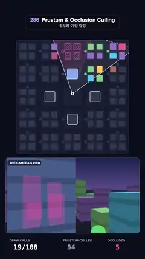

# 286 · Frustum & Occlusion Culling · 절두체·가림 컬링



**EN** A top-down city as the camera turns: objects outside its frustum go grey, those behind four towers are hatched, and only the rest cost a draw call.  
**KO** 위에서 본 도시에서 카메라가 돈다. 절두체 밖 물체는 회색, 탑 네 개 뒤에 가린 물체는 빗금이 되고, 남은 것만 드로 콜을 쓴다. 아래 창은 카메라의 시야다.

[Video (mp4)](https://sueun-dev.github.io/motion-effects/videos/286-frustum-culling.mp4) · [Code](../effects/286-frustum-culling.js) · Rendering internals · 렌더링 내부

## Prompt (English)

```text
Create a "Frustum & Occlusion Culling" motion effect: a top-down map of a city whose objects are coloured by the culling result as the camera's frustum sweeps around: outside the frustum grey (frustum-culled), behind a tower hatched (occluded), otherwise drawn in colour; a draw-call counter and the camera's own view below.

Look
- Background #0B0E1C. The map: 840 × 840 px at (120, 296), radius 22, 100 × 100 units (8.4 px per unit), base #151A2E with 5 × 5 rounded blocks #1C2238 (16 units, streets between).
- Objects: the centre block is an empty plaza; the four blocks next to it hold towers 9 × 9 units, 40 tall, #7FA8FF with a white 3 px outline (the occluders); the other 20 blocks hold 4 buildings each (5–6.2 units square, 5–17 tall) in #FF8A65, #FFC857, #4FC3F7, #9575CD, #F06292 or #81C784; 24 street trees (circles 2.4 units, #5CCB6A). 108 objects in all.
- States: culled = flat grey #323850; drawn = its own colour; occluded = grey with a screen-fixed pink #FF5CAA diagonal hatch and a pink outline.
- The frustum: near plane 1, far plane 54, 74° wide; drawn as a 7 % white trapezoid with 3 px white side edges and a dashed far edge. Each tower in view casts its occlusion region away from the camera: the area between the rays through its two outermost corners, filled pink 10 % with a 2 px pink border, clipped to the frustum. The camera: a white disc with a dark arrow.
- "THE CAMERA'S VIEW": 1000 × 560 px at (40, 1170), radius 22: sky #1B2350 → #5A4E8C, ground #262B45 → #141828, horizon at 42 %; drawn objects as boxes from an eye 12 units up (side faces shaded by direction, a darker band every 3.4 units of height, roofs below the eye) and trees as trunks with round crowns, far to near. Occluded buildings show through the tower as translucent pink faces (x-ray), since they are never drawn.
- Counters at the bottom: "DRAW CALLS 18/108" in white, "FRUSTUM-CULLED 85" in grey-blue #8A93B8, "OCCLUDED 5" in pink.

Motion (0–5 s), p = t / 5
- The camera stands in the plaza and turns once per loop: yaw = 2πp − π/2 + 0.3, moving on a small circle (radius 2.5) around the plaza centre, so the occlusion regions change shape as it turns.
- Each frame every object's bounding circle (radius r) is tested: in-frustum = s(cross(left edge, p) + r) · s(cross(p, right edge) + r) · s(54 + r − depth) · s(depth + r − 1); occluded = s(cross(lo ray, p) − r) · s(cross(p, hi ray) − r) for a tower nearer than the object, where s(x) = smoothstep(−0.8, 0.8, x). So objects change state with a quick fade instead of a hard pop, and the counters update.

Technique
- Canvas 2D. Towers' silhouette rays come from the corner angles relative to the tower centre (min and max); distances use cross products of unit vectors (signed distances to the planes).
- The camera view projects with focal length 500 / tan 37° and the painter's algorithm (objects sorted by depth); faces facing the camera only; objects fade in and out with the same in-frustum × (1 − occluded) value.

Output and rules
- One self-contained HTML file with no external assets (three.js from a CDN is fine if you use it), drawing on a 1080 × 1920 canvas (9:16) scaled to fit the window.
- Write a function renderFrame(t) that draws the frame for time t in seconds, and preview it with requestAnimationFrame. Everything must be a pure function of t and fixed seeds: no Math.random(), Date or state carried between frames, so frame i = renderFrame(i / 30) can be exported to a 30 fps video.
- Loop seamlessly every 5 seconds: renderFrame(5) must look exactly like renderFrame(0).
- No flicker of any kind: no noise or grain that changes from frame to frame, no strobing or blinking, no z-fighting, no shimmering 1 px lines. Any grain or texture stays fixed to the screen or to the object.
- Keep the top 280 px free of important content (a title label goes there) and fill the whole frame with a designed background.
```

## 프롬프트 (한국어)

```text
"절두체·가림 컬링" 모션 효과를 만들어 줘: 위에서 본 도시 지도에서 카메라의 절두체가 한 바퀴 돌면, 물체들이 컬링 결과에 따라 색이 바뀐다: 절두체 밖은 회색(절두체 컬링), 탑 뒤는 빗금(가림), 나머지는 제 색으로 그려진다. 아래에 드로 콜 카운터와 카메라 자신의 시야.

모양
- 배경 #0B0E1C. 지도: (120, 296)의 840 × 840px, 반지름 22, 100 × 100 단위(단위당 8.4px), 바탕 #151A2E에 둥근 블록 5 × 5개 #1C2238(16 단위, 사이에 길).
- 물체: 가운데 블록은 빈 광장; 그 옆 블록 네 개에는 9 × 9 단위, 높이 40의 탑 #7FA8FF와 3px 흰 테두리(가림 물체); 나머지 블록 20개에는 건물 네 채씩(한 변 5–6.2, 높이 5–17), 색은 #FF8A65, #FFC857, #4FC3F7, #9575CD, #F06292, #81C784 중 하나; 가로수 24그루(지름 2.4의 원, #5CCB6A). 모두 108개.
- 상태: 컬링됨 = 평평한 회색 #323850; 그려짐 = 제 색; 가려짐 = 회색 위에 화면에 고정된 분홍 #FF5CAA 사선 빗금과 분홍 테두리.
- 절두체: 근평면 1, 원평면 54, 폭 74°; 흰색 7 % 사다리꼴, 3px 흰 옆선, 원평면은 점선. 시야 안의 탑은 카메라 반대쪽으로 가림 영역을 드리운다: 가장 바깥 두 모서리를 지나는 광선 사이 영역을 분홍 10 %로 채우고 2px 분홍 테두리, 절두체로 잘라 낸다. 카메라: 흰 원에 어두운 화살표.
- "THE CAMERA'S VIEW": (40, 1170)의 1000 × 560px, 반지름 22: 하늘 #1B2350 → #5A4E8C, 땅 #262B45 → #141828, 지평선 42 %; 높이 12의 눈에서 본 그려진 물체를 상자로(옆면은 방향에 따라 명암, 3.4 높이마다 어두운 띠, 눈보다 낮은 지붕), 가로수는 줄기와 둥근 수관으로, 먼 것부터. 가려진 건물은 결코 그려지지 않으므로 탑을 투과해 반투명 분홍 면(엑스레이)으로 보인다.
- 아래 카운터: 흰 "DRAW CALLS 18/108", 회청색 #8A93B8 "FRUSTUM-CULLED 85", 분홍 "OCCLUDED 5".

움직임 (0–5초), p = t / 5
- 카메라는 광장에 서서 루프마다 한 바퀴 돈다: yaw = 2πp − π/2 + 0.3, 광장 중심 둘레의 작은 원(반지름 2.5) 위를 움직여 돌면서 가림 영역의 모양이 바뀐다.
- 매 프레임 모든 물체의 경계 원(반지름 r)을 검사한다: 절두체 안 = s(cross(왼쪽 모서리, p) + r) · s(cross(p, 오른쪽 모서리) + r) · s(54 + r − 깊이) · s(깊이 + r − 1); 가려짐 = 물체보다 가까운 탑에 대해 s(cross(lo 광선, p) − r) · s(cross(p, hi 광선) − r), 여기서 s(x) = smoothstep(−0.8, 0.8, x). 그래서 물체는 딱 튀지 않고 짧게 페이드되며 상태가 바뀌고, 카운터가 갱신된다.

기법
- Canvas 2D. 탑의 윤곽 광선은 탑 중심 기준 모서리 각도의 최소·최대에서 얻고, 거리는 단위 벡터의 외적(평면까지의 부호 있는 거리)으로 잰다.
- 카메라 시야는 초점 거리 500 / tan 37°로 투영하고 화가 알고리즘(깊이 순 정렬)으로 그린다; 카메라를 향한 면만; 물체는 같은 절두체 안 × (1 − 가려짐) 값으로 나타나고 사라진다.

출력과 규칙
- 외부 파일 없는 HTML 파일 하나(three.js를 쓴다면 CDN은 괜찮다). 1080 × 1920(9:16) 캔버스에 그리고 창 크기에 맞춰 보이게 한다.
- 시간 t(초)의 프레임을 그리는 renderFrame(t) 함수를 만들고, 미리보기는 requestAnimationFrame으로 돌린다. 모든 것은 t와 고정 시드만으로 정해진다: Math.random(), Date, 프레임 사이에 쌓이는 상태 금지. 그래야 i번째 프레임 = renderFrame(i / 30)으로 30fps 영상을 뽑을 수 있다.
- 5초마다 끊김 없이 반복: renderFrame(5)는 renderFrame(0)과 똑같아 보여야 한다.
- 어떤 깜빡임도 금지: 프레임마다 바뀌는 노이즈·그레인, 번쩍임·깜빡임, z-fighting, 반짝이며 떨리는 1px 선 모두 금지. 그레인·질감은 화면이나 물체에 고정한다.
- 위쪽 280px에는 중요한 내용을 두지 않고(제목 라벨 자리), 화면 전체를 디자인된 배경으로 채운다.
```
