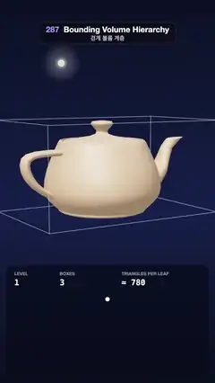

# 287 · Bounding Volume Hierarchy · 경계 볼륨 계층



**EN** A teapot's 1,560 triangles are wrapped in nested boxes built level by level; three rays walk the tree, lighting only the boxes they test, then it folds away.  
**KO** 주전자의 삼각형 1,560개를 감싼 상자들이 한 단계씩 쪼개져 트리가 되고, 광선 세 줄이 트리를 따라가며 실제로 검사한 상자만 빛난 뒤 다시 접힌다.

[Video (mp4)](https://sueun-dev.github.io/motion-effects/videos/287-bvh.mp4) · [Code](../effects/287-bvh.js) · Rendering internals · 렌더링 내부

## Prompt (English)

```text
Create a "Bounding Volume Hierarchy" motion effect: a teapot is wrapped in a tree of nested axis-aligned boxes that is built level by level, then three rays walk the tree and only the boxes they actually test light up, with the tree drawn as a diagram below.

Look
- Background: a vertical gradient #0B1024 → #16204A (55 %) → #0A0E1E.
- The Utah teapot (three.js TeapotGeometry, size 1, 5 segments = 1,560 triangles), moved −0.14 in x, in a clay material #D9B48F (roughness 0.42, metalness 0.05), lit by a neutral room environment (intensity 0.55) and a warm key light #FFF0DD (intensity 2.2) from (−3, 5, 4); ACES tone mapping.
- Camera: perspective, 34° vertical field of view, at (0, 1.6, 13.5) looking at (0, −0.55, 0); the teapot sits in the middle of the frame (about y 600–1150 px).
- The tree: 63 boxes in levels 0–5 (32 leaves of about 49 triangles). Every box is its 12 edges as 3.2 px screen-space lines coloured by level: #FFFFFF, #C3A6FF, #7FA8FF, #56D4E8, #7CE39A, #FFD166. Each is drawn depth-tested, and again through the teapot at 28 % opacity and 2 px, so hidden edges show faintly.
- The ray origin: a small glowing point (a 0.06 sphere #FFF4C8 with a soft additive halo) above and in front of the teapot, at (−1.85, 2.1, 1.45) in teapot space.
- The tree diagram: a dark rounded panel (rgba(8, 11, 26, 0.7), radius 28) from y 1330 to 1890 px. Node dots in the level colours (radius 11; 9 on level 4; 7 on level 5) at y = 1500 + 64 · level px, spread evenly across x 70–1010; edges 2 px white at 22 %.
- Counters at the top of the panel, labels at y 1380 (22 px, 55 % white) and values at y 1430 (40 px monospace): while building LEVEL · BOXES · TRIANGLES PER LEAF; while rays fly RAY n / 3 (gold #FFE08A) · BOXES TESTED · TRIANGLES TESTED x / 1560, plus HIT or MISS at the right.

Motion (0–5 s), a = 2π · t / 5
- The teapot, its boxes and the ray origin turn together about the vertical axis: 0.55 + 0.22 · sin(a) rad.
- 0–1.5 s, the build: level L grows out of its parent box during [0.3 · (L − 1), 0.3 · L] s (ease-out, both corners moving from the parent's corners to its own) and its dot slides out of its parent's dot in the diagram. The newest level is drawn at full opacity, older levels at 32 %, the root at 55 %.
- 1.95–4.2 s, three rays of 0.75 s each, toward the body (0.3, 0.3, 0.4), the spout tip (1.9, 0.5, 0) and through the handle hole (−1.65, 0, 0). All boxes fade to 10 %. The ray (a 4 px gold line #FFE08A) grows from the origin over 0.3 s; the boxes it tests light up one after another, in the order of the walk, between 0.06 and 0.5 s of its slot: blue #7FD3FF when the ray enters the box, red #FF5D6E when it misses it. The triangles of every leaf it opens are tinted orange #FF9A3D at 42 %, and a glow marks the hit. The same nodes and the path light up in the diagram. Results: body 19 box tests and 98 triangle tests, spout 17 and 147, handle hole 21 and 194 with no hit, instead of 1,560 triangles each. Each ray's marks fade in its last 0.12 s.
- 4.35–5 s: the boxes fold back into their parents, level 5 first, 0.13 s per level, so the loop ends on the bare root box it started from.

Technique
- Build once: for a node, take the bounds of its triangles' centroids, sort them along the longest axis, split at the median and recurse to depth 5.
- Walk each ray with a stack: a slab test against the node's box; skip the node if the ray misses it or enters it beyond the closest hit so far; push the farther child first so the nearer one is tested first; at a leaf, test its triangles (Möller–Trumbore) and keep the closest hit. Record every box test, entered or not, and play the list back over time.
- The box edges are LineSegments2 with LineMaterial (width in pixels); the leaf tint is a copy of the leaf's triangles drawn with a polygon offset so it never z-fights the teapot.

Output and rules
- One self-contained HTML file with no external assets (three.js from a CDN is fine if you use it), drawing on a 1080 × 1920 canvas (9:16) scaled to fit the window.
- Write a function renderFrame(t) that draws the frame for time t in seconds, and preview it with requestAnimationFrame. Everything must be a pure function of t and fixed seeds: no Math.random(), Date or state carried between frames, so frame i = renderFrame(i / 30) can be exported to a 30 fps video.
- Loop seamlessly every 5 seconds: renderFrame(5) must look exactly like renderFrame(0).
- No flicker of any kind: no noise or grain that changes from frame to frame, no strobing or blinking, no z-fighting, no shimmering 1 px lines. Any grain or texture stays fixed to the screen or to the object.
- Keep the top 280 px free of important content (a title label goes there) and fill the whole frame with a designed background.
```

## 프롬프트 (한국어)

```text
"경계 볼륨 계층" 모션 효과를 만들어 줘: 주전자를 축 정렬 상자들의 트리가 한 단계씩 감싸 나가고, 광선 세 줄이 트리를 따라가며 실제로 검사한 상자만 빛나며, 아래에는 트리 도식이 있는 효과.

모양
- 배경: 세로 그라디언트 #0B1024 → #16204A(55 %) → #0A0E1E.
- 유타 주전자(three.js TeapotGeometry, 크기 1, 분할 5 = 삼각형 1,560개), x로 −0.14 이동, 점토 재질 #D9B48F(거칠기 0.42, 금속성 0.05). 중성 룸 환경광(세기 0.55)과 따뜻한 키 라이트 #FFF0DD(세기 2.2, 위치 (−3, 5, 4)), ACES 톤 매핑.
- 카메라: 원근, 세로 시야각 34°, 위치 (0, 1.6, 13.5)에서 (0, −0.55, 0)을 본다. 주전자는 화면 가운데(대략 y 600–1150 px).
- 트리: 0–5단계 상자 63개(잎 32개, 잎마다 삼각형 약 49개). 상자마다 모서리 12개를 3.2 px 화면 두께 선으로 그리고 단계별 색 #FFFFFF, #C3A6FF, #7FA8FF, #56D4E8, #7CE39A, #FFD166. 깊이 테스트로 한 번, 주전자를 뚫고 불투명도 28 %·2 px로 한 번 더 그려 가려진 모서리도 흐리게 보인다.
- 광선 출발점: 주전자 위 앞쪽(주전자 좌표 (−1.85, 2.1, 1.45))의 작게 빛나는 점(반지름 0.06 구 #FFF4C8 + 부드러운 가산 후광).
- 트리 도식: 어두운 둥근 패널(rgba(8, 11, 26, 0.7), 반지름 28), y 1330–1890 px. 단계 색의 노드 점(반지름 11, 4단계 9, 5단계 7)이 y = 1500 + 64 · 단계 px에, x 70–1010에 고르게 놓인다. 가지는 2 px 흰색 22 %.
- 패널 위쪽 숫자: 이름 y 1380(22 px, 흰색 55 %), 값 y 1430(40 px 고정폭). 쌓는 동안 LEVEL · BOXES · TRIANGLES PER LEAF, 광선 동안 RAY n / 3(금색 #FFE08A) · BOXES TESTED · TRIANGLES TESTED x / 1560, 오른쪽에 HIT 또는 MISS.

움직임 (0–5초), a = 2π · t / 5
- 주전자·상자·광선 출발점이 함께 세로축으로 0.55 + 0.22 · sin(a) rad 돈다.
- 0–1.5초 쌓기: L단계 상자가 [0.3 · (L − 1), 0.3 · L]초 동안 부모 상자에서 자라 나온다(ease-out, 두 꼭짓점이 부모 꼭짓점에서 제자리로). 도식에서도 그 점이 부모 점에서 미끄러져 나온다. 가장 새 단계는 불투명도 100 %, 이전 단계 32 %, 루트 55 %.
- 1.95–4.2초 광선 세 줄, 각 0.75초: 몸통 (0.3, 0.3, 0.4), 주둥이 끝 (1.9, 0.5, 0), 손잡이 구멍 (−1.65, 0, 0) 방향. 모든 상자가 10 %로 흐려진다. 광선(4 px 금색 선 #FFE08A)이 0.3초 동안 출발점에서 뻗고, 광선이 검사한 상자가 순회 순서대로 칸의 0.06–0.5초 사이에 하나씩 켜진다: 광선이 들어가면 파랑 #7FD3FF, 빗나가면 빨강 #FF5D6E. 연 잎의 삼각형은 주황 #FF9A3D 42 %로 물들고, 맞은 점에 빛이 맺힌다. 도식에서도 같은 노드와 경로가 켜진다. 결과: 몸통 상자 19번·삼각형 98번, 주둥이 17번·147번, 손잡이 구멍 21번·194번에 맞지 않음(전부 검사하면 매번 1,560번). 각 광선의 표시는 마지막 0.12초에 사라진다.
- 4.35–5초: 상자가 5단계부터 단계당 0.13초씩 부모 안으로 접혀 들어가, 처음과 같은 루트 상자 하나로 끝난다.

기법
- 트리는 한 번만 만든다: 노드의 삼각형 중심들의 경계에서 가장 긴 축으로 정렬해 중앙값에서 나누고 깊이 5까지 반복.
- 광선마다 스택으로 순회: 노드 상자와 슬랩 테스트, 빗나가거나 지금까지 가장 가까운 충돌보다 멀리서 들어가면 건너뛴다. 먼 자식을 먼저 넣어 가까운 자식부터 검사하고, 잎에서는 삼각형을 Möller–Trumbore로 검사해 가장 가까운 충돌을 남긴다. 들어갔든 아니든 모든 상자 검사를 기록해 시간에 맞춰 재생한다.
- 상자 모서리는 LineSegments2 + LineMaterial(픽셀 단위 두께). 잎 물들이기는 잎 삼각형을 복사해 폴리곤 오프셋으로 그려 주전자와 z-fighting이 없다.

출력과 규칙
- 외부 파일 없는 HTML 파일 하나(three.js를 쓴다면 CDN은 괜찮다). 1080 × 1920(9:16) 캔버스에 그리고 창 크기에 맞춰 보이게 한다.
- 시간 t(초)의 프레임을 그리는 renderFrame(t) 함수를 만들고, 미리보기는 requestAnimationFrame으로 돌린다. 모든 것은 t와 고정 시드만으로 정해진다: Math.random(), Date, 프레임 사이에 쌓이는 상태 금지. 그래야 i번째 프레임 = renderFrame(i / 30)으로 30fps 영상을 뽑을 수 있다.
- 5초마다 끊김 없이 반복: renderFrame(5)는 renderFrame(0)과 똑같아 보여야 한다.
- 어떤 깜빡임도 금지: 프레임마다 바뀌는 노이즈·그레인, 번쩍임·깜빡임, z-fighting, 반짝이며 떨리는 1px 선 모두 금지. 그레인·질감은 화면이나 물체에 고정한다.
- 위쪽 280px에는 중요한 내용을 두지 않고(제목 라벨 자리), 화면 전체를 디자인된 배경으로 채운다.
```
