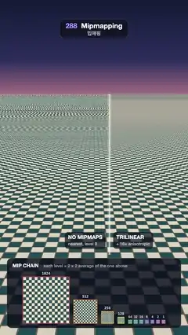

# 288 · Mipmapping · 밉매핑



**EN** A still tiled floor runs to the horizon as a divider sweeps: without mipmaps it breaks into moiré, trilinear mipmaps stay clean, and tints show each level.  
**KO** 멈춰 있는 타일 바닥이 지평선까지 뻗고 경계선이 지나간다. 최근접 샘플링 쪽은 무아레로 깨지고 트라이리니어 밉맵 쪽은 깨끗하며, 레벨 색이 밉 사슬을 보여 준다.

[Video (mp4)](https://sueun-dev.github.io/motion-effects/videos/288-mipmapping.mp4) · [Code](../effects/288-mipmapping.js) · Rendering internals · 렌더링 내부

## Prompt (English)

```text
Create a "Mipmapping" motion effect: one tiled floor runs to the horizon under a still camera; left of a sweeping divider it is sampled with no mipmaps and breaks into moiré, right of it it is filtered from its mip chain and stays clean, and the chain itself is drawn below.

Look
- The texture, level 0: a 1024 × 1024 canvas of 16 × 16 tiles (64 px), cream #EFE4CF and teal #22525A in a checker, with 5 px grout lines #7C6A58 along the top and left of every tile.
- The mip chain: every lower level is the 2 × 2 box average of the one above (rounded), down to 1 × 1: 11 levels. A second chain is the same with each level covered 62 % by its own colour: #FF4D5E, #FF8A3D, #FFC23D, #C9E84A, #5FD873, #3CCFB4, #3DB5F0, #5B7CFF, #9466FF, #D45BE8, #FF66B3.
- Sky: a vertical gradient #141B36 → #2C2F5C (18 %) → #B9798A (30 %) → #F3C49A (33 % and below).
- Floor: a 6000 × 6000 plane with the texture repeating every 2 units (uv × 3000). Camera: 50° vertical field of view, 1.5 units above the floor, pitched down 0.2009 rad (horizon about 540 px from the top), never moving. The floor is darkened to 80 % right under the camera (smoothstep 1.5–9 units) and hazes into #F3C49A far away (smoothstep 600–2800 units).
- Divider: a 3 px cream line #FFF6E6 from y 538 to 1460 with a 28 px soft glow.
- Tags riding 22 px either side of the divider at y 1330, dark rounded pills (rgba(12, 16, 30, 0.72)): "NO MIPMAPS / nearest, level 0" on the left and "TRILINEAR / + 16× anisotropic" on the right (30 px bold over 24 px).
- The chain panel: x 40–1040, y 1480–1880, rgba(12, 16, 30, 0.84), radius 26, titled "MIP CHAIN" with "each level = 2 × 2 average of the one above". The levels sit on one baseline at y 1852, centred: 264, 132, 66 and 33 px squares, then 16 px for levels 4–10 (their real pixels, no smoothing), each framed 3 px in its level colour with its size (1024 … 1) above it.

Motion (0–5 s), a = 2π · t / 5
- The divider: x = 1080 · (0.5 + 0.21 · sin(a + 0.4)).
- The tint: k = smoothstep(1.5, 2.0, t) − smoothstep(3.5, 4.0, t). The floor mixes in the tinted chain by k, the chain panel shows its tinted levels by k, and "LEVEL TINT ON" (#FFD9A8) fades in at the panel's top right. The right side then shows bands of colour, each the mip level the GPU chose at that distance, while the left side stays level 0 red throughout.
- Nothing else moves: the camera and the floor are still, so the moiré is visible but never crawls.

Technique
- three.js. Four textures from the same canvases: plain and tinted, each once with no mipmaps (minFilter Nearest, magFilter Linear) and once with the manual chain (texture.mipmaps, generateMipmaps false, LinearMipmapLinear, anisotropy 16), sRGB, repeat wrapping.
- The floor's shader reads all four every pixel (no texture reads inside a branch), mixes in the tint, then picks a side by gl_FragCoord.x against the divider.
- The chain panel and labels are drawn in 2D over the render.

Output and rules
- One self-contained HTML file with no external assets (three.js from a CDN is fine if you use it), drawing on a 1080 × 1920 canvas (9:16) scaled to fit the window.
- Write a function renderFrame(t) that draws the frame for time t in seconds, and preview it with requestAnimationFrame. Everything must be a pure function of t and fixed seeds: no Math.random(), Date or state carried between frames, so frame i = renderFrame(i / 30) can be exported to a 30 fps video.
- Loop seamlessly every 5 seconds: renderFrame(5) must look exactly like renderFrame(0).
- No flicker of any kind: no noise or grain that changes from frame to frame, no strobing or blinking, no z-fighting, no shimmering 1 px lines. Any grain or texture stays fixed to the screen or to the object.
- Keep the top 280 px free of important content (a title label goes there) and fill the whole frame with a designed background.
```

## 프롬프트 (한국어)

```text
"밉매핑" 모션 효과를 만들어 줘: 움직이지 않는 카메라 아래 타일 바닥 하나가 지평선까지 뻗는다. 지나가는 경계선 왼쪽은 밉맵 없이 샘플링해 무아레로 깨지고, 오른쪽은 밉 사슬에서 걸러 깨끗하며, 아래에 밉 사슬 자체를 그린다.

모양
- 텍스처 0레벨: 1024 × 1024 캔버스에 64 px 타일 16 × 16개, 크림 #EFE4CF와 청록 #22525A 체커, 타일마다 위·왼쪽에 5 px 줄눈 #7C6A58.
- 밉 사슬: 아래 레벨은 위 레벨의 2 × 2 박스 평균(반올림), 1 × 1까지 11레벨. 두 번째 사슬은 같은 것에 레벨마다 자기 색을 62 % 덮는다: #FF4D5E, #FF8A3D, #FFC23D, #C9E84A, #5FD873, #3CCFB4, #3DB5F0, #5B7CFF, #9466FF, #D45BE8, #FF66B3.
- 하늘: 세로 그라디언트 #141B36 → #2C2F5C(18 %) → #B9798A(30 %) → #F3C49A(33 % 이하).
- 바닥: 6000 × 6000 평면, 텍스처가 2 단위마다 반복(uv × 3000). 카메라: 세로 시야각 50°, 바닥 위 1.5, 아래로 0.2009 rad 기울임(지평선이 위에서 약 540 px), 절대 움직이지 않는다. 카메라 바로 아래는 80 %로 어둡고(1.5–9 단위 smoothstep), 멀리서는 #F3C49A로 흐려진다(600–2800 단위 smoothstep).
- 경계선: y 538–1460의 3 px 크림색 선 #FFF6E6과 28 px 부드러운 빛.
- 경계선 양쪽 22 px에 붙어 다니는 y 1330의 어두운 둥근 표(rgba(12, 16, 30, 0.72)): 왼쪽 "NO MIPMAPS / nearest, level 0", 오른쪽 "TRILINEAR / + 16× anisotropic"(30 px 굵게, 아래 24 px).
- 밉 사슬 패널: x 40–1040, y 1480–1880, rgba(12, 16, 30, 0.84), 반지름 26, 제목 "MIP CHAIN"과 "each level = 2 × 2 average of the one above". 레벨들이 y 1852 한 기준선 위에 가운데 정렬: 264, 132, 66, 33 px 정사각형, 4–10레벨은 16 px(실제 픽셀 그대로, 부드럽게 하지 않음). 각각 레벨 색 3 px 테두리와 위에 크기(1024 … 1).

움직임 (0–5초), a = 2π · t / 5
- 경계선: x = 1080 · (0.5 + 0.21 · sin(a + 0.4)).
- 색 입히기: k = smoothstep(1.5, 2.0, t) − smoothstep(3.5, 4.0, t). 바닥은 색 입힌 사슬을 k만큼 섞고, 패널도 색 입힌 레벨을 k만큼 보이며, 패널 오른쪽 위에 "LEVEL TINT ON"(#FFD9A8)이 나타난다. 오른쪽은 거리마다 GPU가 고른 밉 레벨이 색 띠로 보이고, 왼쪽은 내내 0레벨 빨강이다.
- 그 밖에는 아무것도 움직이지 않는다: 카메라와 바닥이 멈춰 있어 무아레가 보이지만 기어다니지 않는다.

기법
- three.js. 같은 캔버스로 텍스처 네 개: 보통·색 입힌 것 각각 밉맵 없는 것(minFilter Nearest, magFilter Linear)과 직접 만든 사슬(texture.mipmaps, generateMipmaps false, LinearMipmapLinear, anisotropy 16), sRGB, 반복 래핑.
- 바닥 셰이더는 매 픽셀 네 개를 모두 읽고(분기 안에서 텍스처를 읽지 않음) 색을 섞은 뒤 gl_FragCoord.x를 경계선과 비교해 한쪽을 고른다.
- 사슬 패널과 글자는 렌더 위에 2D로 그린다.

출력과 규칙
- 외부 파일 없는 HTML 파일 하나(three.js를 쓴다면 CDN은 괜찮다). 1080 × 1920(9:16) 캔버스에 그리고 창 크기에 맞춰 보이게 한다.
- 시간 t(초)의 프레임을 그리는 renderFrame(t) 함수를 만들고, 미리보기는 requestAnimationFrame으로 돌린다. 모든 것은 t와 고정 시드만으로 정해진다: Math.random(), Date, 프레임 사이에 쌓이는 상태 금지. 그래야 i번째 프레임 = renderFrame(i / 30)으로 30fps 영상을 뽑을 수 있다.
- 5초마다 끊김 없이 반복: renderFrame(5)는 renderFrame(0)과 똑같아 보여야 한다.
- 어떤 깜빡임도 금지: 프레임마다 바뀌는 노이즈·그레인, 번쩍임·깜빡임, z-fighting, 반짝이며 떨리는 1px 선 모두 금지. 그레인·질감은 화면이나 물체에 고정한다.
- 위쪽 280px에는 중요한 내용을 두지 않고(제목 라벨 자리), 화면 전체를 디자인된 배경으로 채운다.
```
