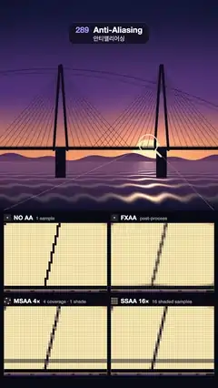

# 289 · Anti-Aliasing · 안티앨리어싱



**EN** A loupe hops over a still sunset bridge of thin cables while four 10× pixel panels compare No AA, FXAA, MSAA 4× and SSAA 16×; the scene itself never moves.  
**KO** 가는 케이블이 걸린 노을 다리 위를 돋보기가 옮겨 다니고, 10배 확대 픽셀 패널 넷이 AA 없음·FXAA·MSAA 4×·SSAA 16×를 비교한다. 장면은 전혀 움직이지 않는다.

[Video (mp4)](https://sueun-dev.github.io/motion-effects/videos/289-anti-aliasing.mp4) · [Code](../effects/289-anti-aliasing.js) · Rendering internals · 렌더링 내부

## Prompt (English)

```text
Create an "Anti-Aliasing" motion effect: a still sunset scene full of thin edges, a loupe that hops between three spots, and four panels that show the pixels under it ten times larger, resolved four different ways.

Look
- The scene fills the top 1040 px (1 scene unit = 1 px, y down), every pixel averaged from 4 × 4 samples, with a soft vignette:
  - sky from (0.07, 0.09, 0.22) at the top through (0.32, 0.22, 0.48) to (0.96, 0.6, 0.38) at the horizon y 800, a sun disc of radius 80 at (735, 772) in (1, 0.92, 0.7) with an orange glow 0.5 · exp(−d / 150);
  - hills between y = 785 − 20 · (0.5 + 0.5 · sin(0.011 x + 1)) − 9 · sin(0.031 x) and the horizon, (0.3, 0.2, 0.36) to (0.42, 0.27, 0.38);
  - water below the horizon, (0.42, 0.28, 0.42) to (0.06, 0.07, 0.17), with ripples finer toward the horizon: phase = 2600 / y′ + 0.8 · sin(0.045 x + 900 / y′), y′ = y − 790, brightness (0.5 + 0.5 · sin(phase))⁴ · (0.18 + 0.95 · path) in (1, 0.78, 0.5), path = exp(−((x − 735) / (46 + 0.5 y′))²);
  - a cable-stayed bridge in dark ink (0.045, 0.05, 0.1): A-frame pylons at x 300 and 800 (legs 12 px thick from (cx ∓ 34, 742) to (cx ∓ 5, 330)), piers 52 px wide down to y 880, a deck from y 726 to 742 and a rail only 0.8 px thick at y 721.6–722.4; ten stay cables each side of each pylon, 1.2 px, from (cx, 345 + 9 · (9 − i)) to (cx ± (70 + 30 i), 727), colour (0.09, 0.08, 0.15);
  - two sagging power lines across the sky: y = 340 + 0.00028 (x − 260)², 1.8 px, and y = 362 + 0.00024 (x − 200)², 1.1 px.
- Four panels of 510 × 340 px at (20, 1104), (550, 1104), (20, 1516), (550, 1516): 51 × 34 scene pixels at 10×, with a 1 px grid between them (darkened to 72 %). Above each: a 34 px icon of one pixel with its sample points (gold dots), the name (30 px bold) and a note (22 px, 62 % white): "NO AA · 1 sample", "FXAA · post-process", "MSAA 4× · 4 coverage · 1 shade", "SSAA 16× · 16 shaded samples".
- The loupe: a 2 px cream (#FFECC8) rectangle around the 51 × 34 region, a 5 px ring of radius 46 with a 9 px handle toward the lower right, and two 35 % leader lines from the region's lower corners to (20, 1040) and (1060, 1040).

Motion (150 frames)
- Spots: (760, 413) where a power line crosses five stay cables; (735, 712) where cables cross the sun above the deck and the rail; (735, 818) the ripples just below the horizon.
- 50 frames per spot: the loupe glides to the next spot over the first 20 frames (ease in-out cubic) while the panels switch to it one 10 px pixel row per frame, top to bottom, with a 3 px gold line (#FFC24D) on the switching row (34 frames); then everything rests. The loop starts 33 frames into the first switch, so the cut from the last frame to the first is just one more row.
- The scene never moves: the jaggies are plain to see and never crawl.

Technique
- One fragment shader. The scene is a function: hit(p) gives the front-most object at a point, shade(id, p) its colour.
- NO AA: one sample at the pixel centre (the 0.8 px rail vanishes, cables break into dashes, the ripples alias into false bands).
- FXAA (3.11 quality) on the no-AA image: luma; skip if the local range is below max(0.0312, 0.125 · max luma); pick horizontal or vertical from the 3 × 3 second differences; walk up to 12 pixels both ways along the edge until the luma on the edge line changes by a quarter of the gradient; blend toward the neighbour across the edge by max(0.5 − nearer end / total length, a sub-pixel term ≤ 0.75).
- MSAA 4×: coverage at the rotated-grid samples (0.375, 0.125), (0.875, 0.375), (0.125, 0.625), (0.625, 0.875), but each covering object shaded once at the pixel centre, so edges are smooth and the ripples still alias.
- SSAA 16×: 4 × 4 fully shaded samples.
- The labels, loupe and leader lines are drawn in 2D on top.

Output and rules
- One self-contained HTML file with no external assets (three.js from a CDN is fine if you use it), drawing on a 1080 × 1920 canvas (9:16) scaled to fit the window.
- Write a function renderFrame(t) that draws the frame for time t in seconds, and preview it with requestAnimationFrame. Everything must be a pure function of t and fixed seeds: no Math.random(), Date or state carried between frames, so frame i = renderFrame(i / 30) can be exported to a 30 fps video.
- Loop seamlessly every 5 seconds: renderFrame(5) must look exactly like renderFrame(0).
- No flicker of any kind: no noise or grain that changes from frame to frame, no strobing or blinking, no z-fighting, no shimmering 1 px lines. Any grain or texture stays fixed to the screen or to the object.
- Keep the top 280 px free of important content (a title label goes there) and fill the whole frame with a designed background.
```

## 프롬프트 (한국어)

```text
"안티앨리어싱" 모션 효과를 만들어 줘: 가는 모서리로 가득한 정지된 노을 장면, 세 곳을 옮겨 다니는 돋보기, 그리고 그 아래 픽셀을 열 배로 키워 네 가지 방식으로 보여 주는 패널 네 개.

모양
- 장면은 위쪽 1040 px를 채운다(장면 1단위 = 1 px, y는 아래로). 픽셀마다 4 × 4 샘플 평균, 부드러운 비네트:
  - 하늘: 위 (0.07, 0.09, 0.22)에서 (0.32, 0.22, 0.48)을 거쳐 지평선 y 800에서 (0.96, 0.6, 0.38). 해: 중심 (735, 772), 반지름 80, (1, 0.92, 0.7), 주황 빛 0.5 · exp(−d / 150);
  - 언덕: y = 785 − 20 · (0.5 + 0.5 · sin(0.011 x + 1)) − 9 · sin(0.031 x)에서 지평선까지, (0.3, 0.2, 0.36)–(0.42, 0.27, 0.38);
  - 지평선 아래 물: (0.42, 0.28, 0.42)–(0.06, 0.07, 0.17), 지평선으로 갈수록 촘촘한 물결: 위상 = 2600 / y′ + 0.8 · sin(0.045 x + 900 / y′), y′ = y − 790, 밝기 (0.5 + 0.5 · sin(위상))⁴ · (0.18 + 0.95 · 길), 색 (1, 0.78, 0.5), 길 = exp(−((x − 735) / (46 + 0.5 y′))²);
  - 짙은 잉크색 (0.045, 0.05, 0.1)의 사장교: x 300, 800의 A자 주탑(다리 두께 12 px, (cx ∓ 34, 742)에서 (cx ∓ 5, 330)), 너비 52 px 교각은 y 880까지, 상판 y 726–742, 두께 0.8 px뿐인 난간 y 721.6–722.4. 주탑 양쪽에 사장 케이블 10줄씩(1.2 px), (cx, 345 + 9 · (9 − i))에서 (cx ± (70 + 30 i), 727)까지, 색 (0.09, 0.08, 0.15);
  - 하늘을 가로질러 처진 전깃줄 둘: y = 340 + 0.00028 (x − 260)²(1.8 px), y = 362 + 0.00024 (x − 200)²(1.1 px).
- 패널 넷(510 × 340 px): (20, 1104), (550, 1104), (20, 1516), (550, 1516). 장면 픽셀 51 × 34개를 10배로, 픽셀 사이 1 px 격자(72 %로 어둡게). 패널 위에는 픽셀 하나와 샘플 위치(금색 점)를 그린 34 px 아이콘, 이름(30 px 굵게), 설명(22 px, 흰색 62 %): "NO AA · 1 sample", "FXAA · post-process", "MSAA 4× · 4 coverage · 1 shade", "SSAA 16× · 16 shaded samples".
- 돋보기: 51 × 34 영역을 두른 2 px 크림색(#FFECC8) 사각형, 반지름 46의 5 px 고리와 오른쪽 아래로 뻗은 9 px 손잡이, 영역 아래 두 모서리에서 (20, 1040), (1060, 1040)으로 가는 35 % 안내선.

움직임 (150프레임)
- 지점: (760, 413) 전깃줄이 사장 케이블 다섯 줄을 가로지르는 곳, (735, 712) 해를 가로지르는 케이블과 상판·난간, (735, 818) 지평선 바로 아래 물결.
- 지점마다 50프레임: 처음 20프레임 동안 돋보기가 다음 지점으로 미끄러지고(ease in-out cubic), 그동안 패널은 위에서 아래로 한 프레임에 10 px 픽셀 한 줄씩 새 지점으로 바뀐다(34프레임, 바뀌는 줄에 3 px 금색 선 #FFC24D). 그다음은 모두 멈춘다. 루프는 첫 전환의 33프레임째에서 시작해 마지막 프레임에서 첫 프레임으로 넘어갈 때 한 줄만 바뀐다.
- 장면은 절대 움직이지 않는다: 계단 현상이 또렷이 보이지만 기어다니지 않는다.

기법
- 프래그먼트 셰이더 하나. 장면은 함수다: hit(p)는 그 점의 맨 앞 물체, shade(id, p)는 그 색.
- NO AA: 픽셀 중심 샘플 하나(0.8 px 난간이 사라지고 케이블이 점선으로 끊기며 물결이 가짜 띠로 앨리어싱된다).
- FXAA(3.11 quality)를 NO AA 이미지에: 루마, 주변 범위가 max(0.0312, 0.125 · 최대 루마)보다 작으면 건너뜀, 3 × 3 2차 차분으로 가로·세로 모서리 판정, 모서리를 따라 양쪽으로 최대 12픽셀 걸으며 모서리 선의 루마가 기울기의 1/4만큼 바뀌는 끝을 찾고, max(0.5 − 가까운 끝 / 전체 길이, 0.75 이하의 서브픽셀 항)만큼 모서리 건너편 이웃 쪽으로 섞는다.
- MSAA 4×: 회전 격자 샘플 (0.375, 0.125), (0.875, 0.375), (0.125, 0.625), (0.625, 0.875)로 덮임만 보고 덮은 물체마다 픽셀 중심에서 한 번만 셰이딩: 모서리는 매끈하지만 물결은 여전히 앨리어싱된다.
- SSAA 16×: 4 × 4 샘플을 모두 셰이딩.
- 글자·돋보기·안내선은 위에 2D로 그린다.

출력과 규칙
- 외부 파일 없는 HTML 파일 하나(three.js를 쓴다면 CDN은 괜찮다). 1080 × 1920(9:16) 캔버스에 그리고 창 크기에 맞춰 보이게 한다.
- 시간 t(초)의 프레임을 그리는 renderFrame(t) 함수를 만들고, 미리보기는 requestAnimationFrame으로 돌린다. 모든 것은 t와 고정 시드만으로 정해진다: Math.random(), Date, 프레임 사이에 쌓이는 상태 금지. 그래야 i번째 프레임 = renderFrame(i / 30)으로 30fps 영상을 뽑을 수 있다.
- 5초마다 끊김 없이 반복: renderFrame(5)는 renderFrame(0)과 똑같아 보여야 한다.
- 어떤 깜빡임도 금지: 프레임마다 바뀌는 노이즈·그레인, 번쩍임·깜빡임, z-fighting, 반짝이며 떨리는 1px 선 모두 금지. 그레인·질감은 화면이나 물체에 고정한다.
- 위쪽 280px에는 중요한 내용을 두지 않고(제목 라벨 자리), 화면 전체를 디자인된 배경으로 채운다.
```
