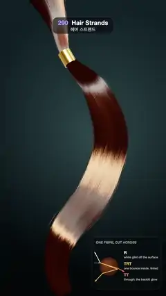

# 290 · Hair Strands · 헤어 스트랜드



**EN** A chestnut ponytail of 14,000 strands sways from a gold cuff as a white R glint and a golden, shifted TRT band slide along it, beside a fibre diagram.  
**KO** 금색 커프에서 늘어진 밤색 포니테일(가닥 14,000개)이 흔들리고, 흰 R 반사와 금빛으로 밀린 TRT 띠가 머리결을 따라 흐르며, 옆에 세 빛 경로 도해가 있다.

[Video (mp4)](https://sueun-dev.github.io/motion-effects/videos/290-hair-strands.mp4) · [Code](../effects/290-hair-strands.js) · Shading tricks · 셰이딩 기법

## Prompt (English)

```text
Create a "Hair Strands" motion effect: a long chestnut ponytail made of thousands of single-strand curves sways in a soft wind, shaded with Marschner's three highlights, with a small diagram of where those highlights come from.

Look
- Background: a vertical gradient #1E2B30 → #0B1114 with a soft radial glow rgba(120, 150, 150, 0.35) behind the upper middle.
- Camera: 30° vertical field of view at (0, 0.45, 16) looking at (0, 0.45, 0).
- The ponytail's centre line: a centripetal Catmull–Rom curve through (−1.3, 5.6, −0.9), (−0.75, 4.1, −0.25), (−0.45, 3.05, 0), (0.35, 2.15, 0.2), (0.85, 0.75, 0.1), (0.45, −0.75, 0.05), (−0.45, −2.1, 0.15), (−0.6, −3.0, 0.05), (−0.35, −3.75, 0): the hair comes in from the head above the frame, is gathered at the third point, and falls in a long S to the bottom.
- A gold cuff there: an open cylinder (radius 0.19, height 0.42) along the curve, metal #E2B860, roughness 0.22.
- The bundle's radius along the curve (u = arc length 0..1, u₀ = the cuff): above it 0.13 + 0.55 · (1 − u / u₀)^1.6; below it 0.13 + 0.36 · sin(min(1, (u − u₀) / 0.3) · π / 2), minus 0.2 · ((u − 0.72) / 0.28)^1.5 toward the tips.
- 14,000 strands, each a 48-segment line, grouped in 180 clumps (clump centres within 82 % of the radius). Each strand sits up to 0.3 from its clump centre, closing in by up to 65 % toward the tips, waves by 0.035 · sin(23 u + φ), and ends at 80–100 % of the length; 2 % are flyaways with a 0.13 wave.
- A legend at the lower right (x 596–1048, y 1536–1876, rgba(8, 14, 16, 0.72), radius 26): "ONE FIBRE, CUT ACROSS", a brown circle (radius 60) with an incoming ray and three exits: R (white) bouncing off the surface, TT (orange #FF8A4C) passing through, TRT (gold #FFC857) bouncing once inside; beside it the names and "white glint off the surface", "one bounce inside, tinted", "through: the backlit glow".

Motion (0–5 s), a = 2π · t / 5
- Below the cuff each point moves by w · (0.2 · sin(a′ − 2.2 u), 0.02 · sin(2 a′ − 3 u), 0.15 · cos(a′ − 2.0 u + 0.6)), w = ((u − u₀) / (1 − u₀))^1.5 and a′ = a + 0.4 · (the clump's random number), so the swing travels down the tail, the tips lag and clumps part a little. Above the cuff nothing moves. One swing per loop.

Technique
- three.js LineSegments with a vertex shader for the sway; the tangent is re-derived from the swayed curve every frame.
- Shading per pixel along the tangent T (Marschner, in the real-time form of Karis 2016), with sin θ_L = T·L, sin θ_V = T·V, φ the angle between L and V around T:
  - R: Gaussian (width β = 0.075) of sin θ_L + sin θ_V − 2α, times 0.25 · cos(φ / 2) and a Fresnel term; white; weight 1.2;
  - TT: width β / 2 at +α, times exp(−3.65 cos φ − 3.98) and the hair colour to the power 0.5 / cos θ_d; weight 2.0;
  - TRT: width 2β at +3α, times exp(17 cos φ − 16.78) and the colour to the power 0.8 / cos θ_d; weight 2.6;
  - plus a little Kajiya diffuse; shift α = 0.045 ± 0.015 per clump.
- Hair colour #4E2410, × 0.75–1.25 per clump and × 0.94–1.06 per strand. Key light from (2.2, 3, 4), warm (1, 0.95, 0.88) × 2.6; rim light from behind (−3, 1.2, −2.6) × 1.5; ambient 0.05. Self-shadow baked per vertex: strands on the far side of the bundle from the key light, and deep inside it, are darker (0.3–1.0); roots near the head are darker.
- Supersampling so the sub-pixel strands never shimmer: the frame is rendered 8 times at 2160 × 3840 (half float) with sub-pixel camera offsets (±1, ±3, ±5, ±7) / 16, each 2 × 2 averaged and added into one accumulation target (32 samples per pixel), then an ACES-style curve.

Output and rules
- One self-contained HTML file with no external assets (three.js from a CDN is fine if you use it), drawing on a 1080 × 1920 canvas (9:16) scaled to fit the window.
- Write a function renderFrame(t) that draws the frame for time t in seconds, and preview it with requestAnimationFrame. Everything must be a pure function of t and fixed seeds: no Math.random(), Date or state carried between frames, so frame i = renderFrame(i / 30) can be exported to a 30 fps video.
- Loop seamlessly every 5 seconds: renderFrame(5) must look exactly like renderFrame(0).
- No flicker of any kind: no noise or grain that changes from frame to frame, no strobing or blinking, no z-fighting, no shimmering 1 px lines. Any grain or texture stays fixed to the screen or to the object.
- Keep the top 280 px free of important content (a title label goes there) and fill the whole frame with a designed background.
```

## 프롬프트 (한국어)

```text
"헤어 스트랜드" 모션 효과를 만들어 줘: 낱가닥 곡선 수천 개로 된 긴 밤색 포니테일이 부드러운 바람에 흔들리고, 마슈너(Marschner)의 세 하이라이트로 셰이딩되며, 그 하이라이트가 어디서 오는지 작은 도해가 곁에 있는 효과.

모양
- 배경: 세로 그라디언트 #1E2B30 → #0B1114, 위쪽 가운데 뒤에 부드러운 원형 빛 rgba(120, 150, 150, 0.35).
- 카메라: 세로 시야각 30°, 위치 (0, 0.45, 16)에서 (0, 0.45, 0)을 본다.
- 포니테일 중심선: (−1.3, 5.6, −0.9), (−0.75, 4.1, −0.25), (−0.45, 3.05, 0), (0.35, 2.15, 0.2), (0.85, 0.75, 0.1), (0.45, −0.75, 0.05), (−0.45, −2.1, 0.15), (−0.6, −3.0, 0.05), (−0.35, −3.75, 0)을 지나는 centripetal Catmull–Rom 곡선. 머리카락이 화면 위 머리에서 내려와 세 번째 점에서 모이고, 긴 S자로 아래까지 떨어진다.
- 그 자리에 금색 커프: 곡선을 따라 놓인 열린 원통(반지름 0.19, 높이 0.42), 금속 #E2B860, 거칠기 0.22.
- 다발 반지름(u = 호 길이 0..1, u₀ = 커프 위치): 커프 위는 0.13 + 0.55 · (1 − u / u₀)^1.6, 아래는 0.13 + 0.36 · sin(min(1, (u − u₀) / 0.3) · π / 2)에서 끝으로 갈수록 0.2 · ((u − 0.72) / 0.28)^1.5를 뺀다.
- 가닥 14,000개, 각각 48분할 선. 덩어리 180개로 묶인다(덩어리 중심은 반지름의 82 % 안에 흩어짐). 가닥은 덩어리 중심에서 최대 0.3 떨어져 끝으로 갈수록 최대 65 % 모이고, 0.035 · sin(23 u + φ)로 굽이치며, 길이의 80–100 %에서 끝난다. 2 %는 0.13으로 굽이치는 잔머리.
- 오른쪽 아래 범례(x 596–1048, y 1536–1876, rgba(8, 14, 16, 0.72), 반지름 26): "ONE FIBRE, CUT ACROSS", 갈색 원(반지름 60)에 들어오는 빛 하나와 나가는 셋: R(흰색) 표면에서 반사, TT(주황 #FF8A4C) 통과, TRT(금색 #FFC857) 안에서 한 번 반사. 옆에 이름과 "white glint off the surface", "one bounce inside, tinted", "through: the backlit glow".

움직임 (0–5초), a = 2π · t / 5
- 커프 아래 각 점이 w · (0.2 · sin(a′ − 2.2 u), 0.02 · sin(2 a′ − 3 u), 0.15 · cos(a′ − 2.0 u + 0.6))만큼 움직인다. w = ((u − u₀) / (1 − u₀))^1.5, a′ = a + 0.4 · (덩어리 난수): 흔들림이 꼬리를 따라 내려가 끝이 늦게 따라오고 덩어리가 조금씩 갈라진다. 커프 위는 움직이지 않는다. 루프마다 한 번 흔들린다.

기법
- three.js LineSegments, 흔들림은 버텍스 셰이더에서. 접선은 매 프레임 흔들린 곡선에서 다시 구한다.
- 픽셀마다 접선 T를 따라 셰이딩(Marschner, Karis 2016의 실시간 형태). sin θ_L = T·L, sin θ_V = T·V, φ는 T 둘레에서 L과 V 사이 각:
  - R: sin θ_L + sin θ_V − 2α의 가우시안(폭 β = 0.075) × 0.25 · cos(φ / 2) × 프레넬, 흰색, 가중치 1.2;
  - TT: 폭 β / 2, +α, × exp(−3.65 cos φ − 3.98) × 머리색^(0.5 / cos θ_d), 가중치 2.0;
  - TRT: 폭 2β, +3α, × exp(17 cos φ − 16.78) × 머리색^(0.8 / cos θ_d), 가중치 2.6;
  - 약간의 Kajiya 디퓨즈. 이동량 α = 덩어리마다 0.045 ± 0.015.
- 머리색 #4E2410, 덩어리마다 × 0.75–1.25, 가닥마다 × 0.94–1.06. 키 라이트 (2.2, 3, 4) 방향, 따뜻한 (1, 0.95, 0.88) × 2.6; 뒤쪽 림 라이트 (−3, 1.2, −2.6) × 1.5; 주변광 0.05. 자기 그림자는 버텍스에 구워 둔다: 다발에서 키 라이트 반대편·깊은 안쪽 가닥은 어둡고(0.3–1.0), 머리 쪽 뿌리도 어둡다.
- 픽셀보다 가는 가닥이 반짝이지 않도록 슈퍼샘플링: 프레임을 2160 × 3840(half float)으로, 카메라를 서브픽셀 (±1, ±3, ±5, ±7) / 16만큼 옮겨 8번 그리고, 매번 2 × 2 평균을 누적 타깃에 더한다(픽셀당 32샘플). 마지막에 ACES 계열 곡선.

출력과 규칙
- 외부 파일 없는 HTML 파일 하나(three.js를 쓴다면 CDN은 괜찮다). 1080 × 1920(9:16) 캔버스에 그리고 창 크기에 맞춰 보이게 한다.
- 시간 t(초)의 프레임을 그리는 renderFrame(t) 함수를 만들고, 미리보기는 requestAnimationFrame으로 돌린다. 모든 것은 t와 고정 시드만으로 정해진다: Math.random(), Date, 프레임 사이에 쌓이는 상태 금지. 그래야 i번째 프레임 = renderFrame(i / 30)으로 30fps 영상을 뽑을 수 있다.
- 5초마다 끊김 없이 반복: renderFrame(5)는 renderFrame(0)과 똑같아 보여야 한다.
- 어떤 깜빡임도 금지: 프레임마다 바뀌는 노이즈·그레인, 번쩍임·깜빡임, z-fighting, 반짝이며 떨리는 1px 선 모두 금지. 그레인·질감은 화면이나 물체에 고정한다.
- 위쪽 280px에는 중요한 내용을 두지 않고(제목 라벨 자리), 화면 전체를 디자인된 배경으로 채운다.
```
