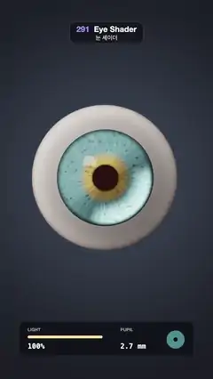

# 291 · Eye Shader · 눈 셰이더



**EN** A glossy eyeball glances around while the light dims and its pupil opens, then turns aside and splits into cornea, iris and sclera before closing up again.  
**KO** 윤기 나는 눈알이 이리저리 보는 사이 빛이 어두워지며 동공이 커진다. 이어 옆으로 돌며 각막·홍채·공막으로 갈라졌다가 다시 합쳐진다.

[Video (mp4)](https://sueun-dev.github.io/motion-effects/videos/291-eye-shader.mp4) · [Code](../effects/291-eye-shader.js) · Shading tricks · 셰이딩 기법

## Prompt (English)

```text
Create an "Eye Shader" motion effect: a close-up eyeball, ray traced, with a refracting cornea, an iris set back inside the eye, a wet catchlight and a caustic; it glances around, its pupil opens as the light dims, and it turns aside and pulls apart into its layers.

Look
- Background: a radial gradient (0.05, 0.06, 0.08) → (0.015, 0.017, 0.024), dimming with the light.
- Camera at z 3.4 looking down −z, focal length 1200 px; the eye's centre on screen at (540, 900), radius 1 (about 360 px).
- Geometry in eye space (the eye looks along +z):
  - sclera: a sphere of radius 1, open where |xy| < 0.52 at the front (the limbus, z = 0.854);
  - cornea: the cap of a sphere of radius 0.62 centred at z 0.516 that bulges in front of that opening;
  - iris: a flat disc at z 0.8, radius 0.504, with a pupil hole;
  - inside: a dark red (0.03, 0.008, 0.006).
- Sclera: off-white (0.86, 0.83, 0.8), warmer toward the back, with thin red veins from ridged simplex noise (scales 3.2 and 6.5) that gather away from the iris; soft wrapped light (0.55 · N·L + 0.45)^1.8 from the key at (−0.55, 0.6, 0.75); a 2 % Fresnel reflection; darker round the limbus.
- Iris: radial fibres (simplex noise around the circle at 9 and 26 lobes), dark crypts, an amber collarette (0.45, 0.28, 0.08)–(0.75, 0.55, 0.2) round the pupil, teal-green (0.16, 0.32, 0.36)–(0.3, 0.5, 0.5) outside, a dark outer rim, a dark pupil ruff, and a bright caustic crescent (× 2.6) on the side away from the light.
- The studio it reflects: dark, a large softbox (±0.24 × ±0.18 in the key light's frame, intensity 7) up left, and a thin strip light at (0.9, 0.1, 0.4).
- Labels while the eye is apart: CORNEA, IRIS and SCLERA (30 px bold, dark pills) on leader lines from points on each layer.
- A panel at the bottom (x 100–980, y 1630–1800): LIGHT with a #FFE3A8 bar and percentage; PUPIL in mm (pupil radius / 0.52 × 11.8); an iris icon (radius 46, #4E8C93) with its black pupil to scale.

Motion (0–5 s), on a schedule τ = (t + 4.8) mod 5, so the loop starts as the eye settles back
- Gaze (yaw, pitch in rad; positive yaw turns to the viewer's right, positive pitch looks down), eased in-out cubic between keys: (0, 0) until τ 0.25 → (−0.34, 0.16) at 0.5, held to 0.9 → (0.33, 0.04) at 1.15, held to 1.55 → (0.04, −0.2) at 1.8, held to 2.2 → (0, 0) at 2.5, held to 2.65 → (0.62, 0.1) at 3.25, held to 4.25 → (0, 0) at 4.9.
- Light: d = smoothstep(0.6, 1.4, τ) − smoothstep(2.0, 2.7, τ); light = 1 − 0.68 d (100 % → 32 %). Pupil radius 0.12 + 0.13 · d(τ − 0.25), about 2.7 → 5.7 mm, following the light a quarter second late.
- Pulling apart: e = smoothstep(2.95, 3.45, τ) − smoothstep(3.85, 4.35, τ). The cornea slides out 0.55 · e and the iris 0.28 · e along the eye's axis; the eye's screen centre moves left by 150 px for the turn (smoothstep 2.65–3.25 out, 4.25–4.9 back). The labels fade in with smoothstep(0.35, 0.9, e).

Technique
- One fragment shader, 3 × 3 samples per pixel near the eye. Rays go into eye space with the inverse gaze rotation.
- Up to four steps per ray, nearest hit first: the cornea adds a Schlick Fresnel reflection (F0 0.025) of the studio and refracts the ray with n = 1.336 (blended toward 1 as the cornea comes off, a thin shell); the iris disc is shaded unless the ray goes through the pupil; the sclera from outside is shaded, from inside it is the dark inner eye. So the iris shifts behind the bulging cornea as the eye turns (parallax), and rays that miss the iris near the limbus fall into the dark eye, which draws the limbal ring.
- An ACES-style curve, gamma 2.2 and a fixed per-pixel grain.

Output and rules
- One self-contained HTML file with no external assets (three.js from a CDN is fine if you use it), drawing on a 1080 × 1920 canvas (9:16) scaled to fit the window.
- Write a function renderFrame(t) that draws the frame for time t in seconds, and preview it with requestAnimationFrame. Everything must be a pure function of t and fixed seeds: no Math.random(), Date or state carried between frames, so frame i = renderFrame(i / 30) can be exported to a 30 fps video.
- Loop seamlessly every 5 seconds: renderFrame(5) must look exactly like renderFrame(0).
- No flicker of any kind: no noise or grain that changes from frame to frame, no strobing or blinking, no z-fighting, no shimmering 1 px lines. Any grain or texture stays fixed to the screen or to the object.
- Keep the top 280 px free of important content (a title label goes there) and fill the whole frame with a designed background.
```

## 프롬프트 (한국어)

```text
"눈 셰이더" 모션 효과를 만들어 줘: 레이 트레이싱한 눈알 클로즈업. 빛을 굴절시키는 각막, 눈 안쪽에 물러나 있는 홍채, 젖은 캐치라이트와 커스틱이 있고, 눈이 이리저리 보다가 빛이 어두워지면 동공이 커지고, 옆으로 돌며 층별로 갈라지는 효과.

모양
- 배경: 원형 그라디언트 (0.05, 0.06, 0.08) → (0.015, 0.017, 0.024), 빛과 함께 어두워진다.
- 카메라: z 3.4에서 −z를 본다, 초점 거리 1200 px. 눈 중심은 화면 (540, 900), 반지름 1(약 360 px).
- 눈 좌표의 형태(눈은 +z를 본다):
  - 공막: 반지름 1 구, 앞쪽 |xy| < 0.52(윤부, z = 0.854)가 뚫려 있다;
  - 각막: 그 구멍 앞으로 불룩 나온, z 0.516에 중심을 둔 반지름 0.62 구의 앞부분;
  - 홍채: z 0.8의 평평한 원판, 반지름 0.504, 가운데 동공 구멍;
  - 안쪽: 짙은 빨강 (0.03, 0.008, 0.006).
- 공막: 미색 (0.86, 0.83, 0.8), 뒤로 갈수록 따뜻하고, 능선형 심플렉스 노이즈(스케일 3.2, 6.5)로 만든 가는 핏줄이 홍채에서 먼 쪽에 모인다. 키 라이트 (−0.55, 0.6, 0.75)의 부드러운 감싼 빛 (0.55 · N·L + 0.45)^1.8, 2 % 프레넬 반사, 윤부 둘레는 어둡게.
- 홍채: 방사형 섬유(원을 따라 9엽·26엽 심플렉스 노이즈), 어두운 오목점, 동공 둘레 호박색 고리 (0.45, 0.28, 0.08)–(0.75, 0.55, 0.2), 바깥은 청록 (0.16, 0.32, 0.36)–(0.3, 0.5, 0.5), 어두운 바깥 테, 어두운 동공 가장자리, 빛 반대쪽에 밝은 초승달 커스틱(× 2.6).
- 비치는 스튜디오: 어둡고, 왼쪽 위에 큰 소프트박스(키 라이트 좌표계에서 ±0.24 × ±0.18, 세기 7), (0.9, 0.1, 0.4)에 가는 스트립 조명.
- 갈라진 동안의 이름표: CORNEA, IRIS, SCLERA(30 px 굵게, 어두운 알약)가 각 층의 점에서 나온 안내선 끝에.
- 아래 패널(x 100–980, y 1630–1800): LIGHT 막대(#FFE3A8)와 퍼센트, PUPIL mm(동공 반지름 / 0.52 × 11.8), 실제 비율로 검은 동공을 그린 홍채 아이콘(반지름 46, #4E8C93).

움직임 (0–5초), 일정표 τ = (t + 4.8) mod 5: 루프는 눈이 정면으로 돌아와 자리 잡는 순간에서 시작한다
- 시선(요, 피치 rad; 요가 양수면 보는 사람 기준 오른쪽, 피치가 양수면 아래), 키 사이는 ease in-out cubic: τ 0.25까지 (0, 0) → 0.5에 (−0.34, 0.16), 0.9까지 유지 → 1.15에 (0.33, 0.04), 1.55까지 → 1.8에 (0.04, −0.2), 2.2까지 → 2.5에 (0, 0), 2.65까지 → 3.25에 (0.62, 0.1), 4.25까지 → 4.9에 (0, 0).
- 빛: d = smoothstep(0.6, 1.4, τ) − smoothstep(2.0, 2.7, τ), 빛 = 1 − 0.68 d(100 % → 32 %). 동공 반지름 0.12 + 0.13 · d(τ − 0.25), 약 2.7 → 5.7 mm, 빛을 0.25초 늦게 따라간다.
- 갈라짐: e = smoothstep(2.95, 3.45, τ) − smoothstep(3.85, 4.35, τ). 각막은 눈의 축을 따라 0.55 · e, 홍채는 0.28 · e 앞으로 나온다. 도는 동안 눈의 화면 중심이 왼쪽으로 150 px 옮겨 간다(2.65–3.25에 가고 4.25–4.9에 돌아옴). 이름표는 smoothstep(0.35, 0.9, e)로 나타난다.

기법
- 프래그먼트 셰이더 하나, 눈 근처는 픽셀당 3 × 3 샘플. 광선은 시선 회전의 역으로 눈 좌표에 들어간다.
- 광선마다 가장 가까운 충돌부터 최대 네 단계: 각막은 스튜디오의 슐릭 프레넬 반사(F0 0.025)를 더하고 n = 1.336으로 굴절시킨다(각막이 떨어져 나오면 얇은 껍질이 되도록 1로 섞음). 홍채 원판은 동공을 지나지 않으면 셰이딩, 공막은 바깥에서 맞으면 셰이딩, 안에서 맞으면 어두운 눈 안쪽. 그래서 눈이 돌면 홍채가 불룩한 각막 뒤에서 어긋나고(시차), 윤부 근처에서 홍채를 놓친 광선은 어두운 눈 안으로 떨어져 윤부 고리가 생긴다.
- ACES 계열 곡선, 감마 2.2, 고정된 픽셀 그레인.

출력과 규칙
- 외부 파일 없는 HTML 파일 하나(three.js를 쓴다면 CDN은 괜찮다). 1080 × 1920(9:16) 캔버스에 그리고 창 크기에 맞춰 보이게 한다.
- 시간 t(초)의 프레임을 그리는 renderFrame(t) 함수를 만들고, 미리보기는 requestAnimationFrame으로 돌린다. 모든 것은 t와 고정 시드만으로 정해진다: Math.random(), Date, 프레임 사이에 쌓이는 상태 금지. 그래야 i번째 프레임 = renderFrame(i / 30)으로 30fps 영상을 뽑을 수 있다.
- 5초마다 끊김 없이 반복: renderFrame(5)는 renderFrame(0)과 똑같아 보여야 한다.
- 어떤 깜빡임도 금지: 프레임마다 바뀌는 노이즈·그레인, 번쩍임·깜빡임, z-fighting, 반짝이며 떨리는 1px 선 모두 금지. 그레인·질감은 화면이나 물체에 고정한다.
- 위쪽 280px에는 중요한 내용을 두지 않고(제목 라벨 자리), 화면 전체를 디자인된 배경으로 채운다.
```
