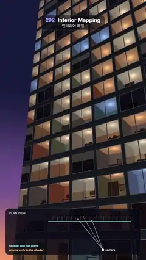

# 292 · Interior Mapping · 인테리어 매핑



**EN** Every window of a dusk tower's flat facade shows a lit, furnished room that shifts in depth as the camera drifts; a sweep and a plan view prove it is one quad.  
**KO** 해 질 녘 빌딩의 평평한 외벽 창마다 가구와 조명이 있는 방이 보이고 카메라가 움직이면 깊이 있게 어긋난다. 훑는 띠와 평면도가 외벽이 사각형 하나임을 보여 준다.

[Video (mp4)](https://sueun-dev.github.io/motion-effects/videos/292-interior-mapping.mp4) · [Code](../effects/292-interior-mapping.js) · Shading tricks · 셰이딩 기법

## Prompt (English)

```text
Create an "Interior Mapping" motion effect: a tower's facade at dusk is a single flat quad, yet every window shows a furnished, lit room with real depth that shifts as the camera drifts; a sweep and a plan view then prove the rooms are not geometry.

Look
- The facade: the plane z = 0 from x −4.5 to 9 and y 0 to 27, cut into window cells 1 wide and 0.9 tall. In each cell the glass fills x 7–93 % and y 14–86 %, with a light aluminium frame (0.32, 0.33, 0.36) round it, a thin dark mullion down the middle, and dark spandrel panels (0.1, 0.11, 0.14) between floors.
- Behind each window an imaginary room 1 × 0.9 × 1 deep. Each picks from a hash of its cell: a wall colour (cream (0.86, 0.78, 0.64), sage (0.56, 0.66, 0.54), terracotta (0.8, 0.52, 0.4), blue-grey (0.52, 0.6, 0.7) or white (0.9, 0.88, 0.84)); a light (warm (1, 0.7, 0.42) 50 %, soft white (1, 0.85, 0.65) 18 %, cool TV blue (0.55, 0.72, 1.0) 10 %, off 22 %) that glows strongest round a ceiling lamp; a framed picture on the back wall; floorboards; a flat furniture cut-out halfway in (sofa, floor lamp and table, plant, shelf, or desk with a screen); and in 30 % of rooms blinds pulled 25–75 % down, glowing with the room's light.
- The glass adds a Fresnel reflection (0.04 + 0.96 · (1 − cos)^5) of the sky.
- Sky: (0.98, 0.58, 0.38) at the horizon through (0.42, 0.3, 0.55) to (0.08, 0.09, 0.22) overhead, seen beside the tower's left edge; far parts of the facade haze toward it.
- A plan view at the bottom (x 40–1040, y 1540–1880, rgba(10, 10, 22, 0.8), radius 26): the facade as a 5 px cyan line (#7FE7FF), the rooms as dashed boxes behind it (34 px per unit), the camera as a white dot, and three rays from the camera that cross the line and carry on, dashed gold (#FFD27A), to the back or side wall of the room they enter; "facade: one flat plane" in cyan and "rooms: only in the shader" in gold.

Motion (0–5 s), a = 2π · t / 5
- The camera at (2.4 + 0.8 · sin a, 1.7 + 0.2 · sin 2a, 5.8 + 0.35 · cos a) looks at (−2.1 + 0.35 · sin(a + 0.6), 5.4, 0), looking up the tower; the rooms slide behind their frames with the drift.
- 2.5–4.5 s: a 260 px strip crosses the screen left to right (centre −260 + 1600 · easeInOut((t − 2.5) / 2), cyan 3 px edges). Inside it the trick is off and the windows are flat dark glass with reflections only.
- 2.4–4.7 s (fading in over 0.4 s and out over 0.4 s): the facade's real geometry in cyan (0.35, 0.95, 1.0), its outline and the diagonal from (−4.5, 0) to (9, 27) that splits it into two triangles, and a caption "1 QUAD · 2 TRIANGLES" (30 px bold cyan on a dark pill at y 1440).

Technique
- One fragment shader, 4 × 4 samples per pixel. The ray meets the plane z = 0; the cell id is floor(x / 1, y / 0.9).
- Interior mapping: from the entry point inside the cell, the ray's distances to the back wall (z = −1), the side wall it heads for and the floor or ceiling it heads for are compared, and the nearest surface is shaded at the point it reaches. Before that, if the ray crosses the plane z = −0.55 first and the furniture shape covers that point, it shows the furniture.
- The plan view uses the same camera path, so its rays match the picture.

Output and rules
- One self-contained HTML file with no external assets (three.js from a CDN is fine if you use it), drawing on a 1080 × 1920 canvas (9:16) scaled to fit the window.
- Write a function renderFrame(t) that draws the frame for time t in seconds, and preview it with requestAnimationFrame. Everything must be a pure function of t and fixed seeds: no Math.random(), Date or state carried between frames, so frame i = renderFrame(i / 30) can be exported to a 30 fps video.
- Loop seamlessly every 5 seconds: renderFrame(5) must look exactly like renderFrame(0).
- No flicker of any kind: no noise or grain that changes from frame to frame, no strobing or blinking, no z-fighting, no shimmering 1 px lines. Any grain or texture stays fixed to the screen or to the object.
- Keep the top 280 px free of important content (a title label goes there) and fill the whole frame with a designed background.
```

## 프롬프트 (한국어)

```text
"인테리어 매핑" 모션 효과를 만들어 줘: 해 질 녘 빌딩 외벽은 평평한 사각형 하나인데, 창마다 가구와 조명이 있는 방이 깊이감 있게 보이고 카메라가 움직이면 어긋난다. 이어 훑는 띠와 평면도가 방이 형상이 아님을 보여 준다.

모양
- 외벽: x −4.5–9, y 0–27의 평면 z = 0, 너비 1·높이 0.9 창 칸으로 나뉜다. 칸마다 유리가 x 7–93 %, y 14–86 %를 채우고, 둘레에 밝은 알루미늄 틀 (0.32, 0.33, 0.36), 가운데 가는 어두운 창살, 층 사이는 어두운 스팬드럴 판 (0.1, 0.11, 0.14).
- 창 뒤마다 깊이 1인 1 × 0.9 × 1 상상의 방. 칸 해시로 고른다: 벽 색(크림 (0.86, 0.78, 0.64), 세이지 (0.56, 0.66, 0.54), 테라코타 (0.8, 0.52, 0.4), 청회색 (0.52, 0.6, 0.7), 흰색 (0.9, 0.88, 0.84)), 조명(따뜻한 (1, 0.7, 0.42) 50 %, 부드러운 흰빛 (1, 0.85, 0.65) 18 %, 차가운 TV 파랑 (0.55, 0.72, 1.0) 10 %, 꺼짐 22 %, 천장 등 둘레가 가장 밝다), 뒷벽 액자, 마루, 방 중간의 납작한 가구 실루엣(소파, 스탠드와 탁자, 화분, 책장, 모니터 놓인 책상), 그리고 30 % 방에는 25–75 % 내려온 블라인드가 방 불빛으로 빛난다.
- 유리는 하늘의 프레넬 반사(0.04 + 0.96 · (1 − cos)^5)를 더한다.
- 하늘: 지평선 (0.98, 0.58, 0.38)에서 (0.42, 0.3, 0.55)를 거쳐 머리 위 (0.08, 0.09, 0.22), 빌딩 왼쪽 모서리 옆으로 보인다. 외벽 먼 곳은 하늘색으로 흐려진다.
- 아래 평면도(x 40–1040, y 1540–1880, rgba(10, 10, 22, 0.8), 반지름 26): 외벽은 5 px 청록 선(#7FE7FF), 그 뒤 방은 점선 상자(1단위 34 px), 카메라는 흰 점, 카메라에서 나간 광선 셋이 선을 지나 금색 점선(#FFD27A)으로 들어간 방의 뒷벽이나 옆벽까지 이어진다. 청록 "facade: one flat plane", 금색 "rooms: only in the shader".

움직임 (0–5초), a = 2π · t / 5
- 카메라 (2.4 + 0.8 · sin a, 1.7 + 0.2 · sin 2a, 5.8 + 0.35 · cos a)가 (−2.1 + 0.35 · sin(a + 0.6), 5.4, 0)을 올려다본다. 움직임에 따라 방들이 창틀 뒤에서 미끄러진다.
- 2.5–4.5초: 너비 260 px 띠가 화면을 왼쪽에서 오른쪽으로 지나간다(중심 −260 + 1600 · easeInOut((t − 2.5) / 2), 청록 3 px 가장자리). 띠 안에서는 트릭이 꺼져 창이 반사만 있는 평평한 어두운 유리가 된다.
- 2.4–4.7초(0.4초 동안 나타나고 0.4초 동안 사라짐): 외벽의 실제 형상이 청록 (0.35, 0.95, 1.0)으로, 외곽선과 (−4.5, 0)에서 (9, 27)로 가는 대각선(삼각형 둘로 나누는 선), 그리고 캡션 "1 QUAD · 2 TRIANGLES"(30 px 굵게 청록, y 1440의 어두운 알약).

기법
- 프래그먼트 셰이더 하나, 픽셀당 4 × 4 샘플. 광선이 평면 z = 0과 만나는 점에서 칸 번호는 floor(x / 1, y / 0.9).
- 인테리어 매핑: 칸 안의 진입점에서 뒷벽(z = −1), 향하는 옆벽, 향하는 바닥이나 천장까지의 거리를 비교해 가장 가까운 면을 그 점에서 셰이딩한다. 그 전에 광선이 z = −0.55 평면을 먼저 지나고 그 점이 가구 모양 안이면 가구를 보인다.
- 평면도는 같은 카메라 경로를 써서 광선이 그림과 맞는다.

출력과 규칙
- 외부 파일 없는 HTML 파일 하나(three.js를 쓴다면 CDN은 괜찮다). 1080 × 1920(9:16) 캔버스에 그리고 창 크기에 맞춰 보이게 한다.
- 시간 t(초)의 프레임을 그리는 renderFrame(t) 함수를 만들고, 미리보기는 requestAnimationFrame으로 돌린다. 모든 것은 t와 고정 시드만으로 정해진다: Math.random(), Date, 프레임 사이에 쌓이는 상태 금지. 그래야 i번째 프레임 = renderFrame(i / 30)으로 30fps 영상을 뽑을 수 있다.
- 5초마다 끊김 없이 반복: renderFrame(5)는 renderFrame(0)과 똑같아 보여야 한다.
- 어떤 깜빡임도 금지: 프레임마다 바뀌는 노이즈·그레인, 번쩍임·깜빡임, z-fighting, 반짝이며 떨리는 1px 선 모두 금지. 그레인·질감은 화면이나 물체에 고정한다.
- 위쪽 280px에는 중요한 내용을 두지 않고(제목 라벨 자리), 화면 전체를 디자인된 배경으로 채운다.
```
