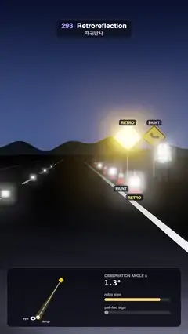

# 293 · Retroreflection · 재귀반사



**EN** On a night road a lamp beside the eye makes a retro sign, cone sleeves, cat's eyes and vest tape blaze while plain paint stays dim, until the lamp swings away.  
**KO** 밤길에서 눈 옆 램프에 재귀반사 표지판·고깔 띠·도로 표지병·조끼 테이프가 빛나고 같은 색 일반 도장은 어둡다. 램프가 눈에서 멀어지면 빛이 꺼진다.

[Video (mp4)](https://sueun-dev.github.io/motion-effects/videos/293-retroreflection.mp4) · [Code](../effects/293-retroreflection.js) · Shading tricks · 셰이딩 기법

## Prompt (English)

```text
Create a "Retroreflection" motion effect: a night road lit only by a lamp beside the viewer's eye, where retroreflective materials blaze back toward the lamp while identical plain paint stays dim; then the lamp swings away from the eye and the glow drops.

Look
- Sky: a dome from (0.03, 0.045, 0.1) at the horizon to (0.004, 0.006, 0.018) overhead, with a dark line of hills at elevation 0.022 + 0.012 · sin(23 az) · sin(7 az + 1) + 0.008 · sin(61 az + 2).
- Eye (camera) at (2.0, 1.2, 0), 40° vertical field of view, looking at (3.3, 0.3, −30) down a straight road along −z.
- Road 7.2 m wide #22232A with white lane paint (albedo 0.75, glass beads: retro 3): edge lines at x ±3.45 (0.16 m) and centre dashes (0.14 m, 3.2 m of every 9 m); dark verges #10160F.
- Cat's eyes on the centre line every 9 m: a small dark body (0.14 × 0.04 × 0.1 m) with a 0.1 × 0.022 m lens facing the driver (retro 14).
- Two identical diamond warning signs (0.95 m, yellow #F4C21A, black border, a bend arrow) on grey posts at (4.8, 2.05, −24) and (6.2, 2.05, −24): the left one retroreflective (retro 9), the right one plain paint; labelled RETRO (gold) and PAINT above.
- Six orange cones (#E8541E, 0.7 m) on the shoulder at x 3.85, z −14, −18, −22, −27, −33, −40, their white sleeves alternating retro (9) and plain; the first two labelled.
- A worker at (5.7, 0, −19) in a lime vest (#A6CC1E) with two tape bands round the chest and two braces (#C9CCD2, retro 9).
- A top-view panel at the bottom (x 40–1040, y 1540–1880): the eye, the lamp, the sign, the light's path to the sign (gold, 3 px) and the narrow cone it comes back in (±0.07 rad, filled at 22 %); on the right the observation angle α in degrees (40 px monospace) and two bars: "retro sign" 0.06 + 0.94 · exp(−(α / 3°)²) and "painted sign" 0.06.

Motion (0–5 s), a = 2π · t / 5
- The lamp sits at (2.25 + s, 0.95, −0.2), s = 5.5 · (0.5 − 0.5 · cos(a + 0.95))² m: at 0 s it is 0.24 m out and moving away, at 1.74 s it reaches 5.5 m to the right, and at 4.24 s it is back beside the eye. While it is near the eye everything retroreflective blazes; as it moves away the glow falls, nearest objects first, while the plain paint barely changes.
- The camera and the scene never move.

Technique
- three.js with one shader for every surface. The lamp is a spot along (0.03, −0.035, −1) (smoothstep 0.84–0.97 on the cosine), intensity 300: irradiance E = 300 · spot · cos θ / d².
- Colour = albedo · (E · (1 / π + R₀ · exp(−(α / 3°)²)) + 0.012), where α is the observation angle between the directions from the surface to the lamp and to the eye, and R₀ is the material's retro strength (0 for plain paint).
- ACES tone mapping at exposure 2.4; UnrealBloom (strength 0.5, radius 0.3, threshold 1.0) with a soft knee (smoothWidth 0.6) so glows fade in instead of switching on.

Output and rules
- One self-contained HTML file with no external assets (three.js from a CDN is fine if you use it), drawing on a 1080 × 1920 canvas (9:16) scaled to fit the window.
- Write a function renderFrame(t) that draws the frame for time t in seconds, and preview it with requestAnimationFrame. Everything must be a pure function of t and fixed seeds: no Math.random(), Date or state carried between frames, so frame i = renderFrame(i / 30) can be exported to a 30 fps video.
- Loop seamlessly every 5 seconds: renderFrame(5) must look exactly like renderFrame(0).
- No flicker of any kind: no noise or grain that changes from frame to frame, no strobing or blinking, no z-fighting, no shimmering 1 px lines. Any grain or texture stays fixed to the screen or to the object.
- Keep the top 280 px free of important content (a title label goes there) and fill the whole frame with a designed background.
```

## 프롬프트 (한국어)

```text
"재귀반사" 모션 효과를 만들어 줘: 보는 사람 눈 옆의 램프 하나만 비추는 밤길에서 재귀반사 재질은 램프 쪽으로 환하게 빛나고 똑같은 일반 도장은 어둡다. 이어 램프가 눈에서 멀어지면 빛이 꺼진다.

모양
- 하늘: 지평선 (0.03, 0.045, 0.1)에서 머리 위 (0.004, 0.006, 0.018)로 가는 돔, 고도 0.022 + 0.012 · sin(23 az) · sin(7 az + 1) + 0.008 · sin(61 az + 2)의 어두운 언덕 선.
- 눈(카메라): (2.0, 1.2, 0), 세로 시야각 40°, (3.3, 0.3, −30)을 보며 −z로 뻗은 곧은 길을 내려다본다.
- 도로: 너비 7.2 m #22232A, 흰 차선 도료(알베도 0.75, 유리알: 재귀 3): x ±3.45의 가장자리 선(0.16 m), 가운데 점선(0.14 m, 9 m마다 3.2 m). 길가는 어두운 #10160F.
- 가운데 선에 9 m마다 도로 표지병: 작은 어두운 몸체(0.14 × 0.04 × 0.1 m)에 운전자 쪽을 보는 0.1 × 0.022 m 렌즈(재귀 14).
- 똑같은 마름모 경고 표지판 둘(0.95 m, 노랑 #F4C21A, 검은 테, 굽은 길 화살표), 회색 기둥 위 (4.8, 2.05, −24)와 (6.2, 2.05, −24): 왼쪽은 재귀반사(재귀 9), 오른쪽은 일반 도장. 위에 RETRO(금색), PAINT 표.
- 갓길 x 3.85, z −14, −18, −22, −27, −33, −40에 주황 고깔(#E8541E, 0.7 m) 여섯 개, 흰 띠가 재귀(9)·일반으로 번갈아. 앞의 두 개에 표.
- (5.7, 0, −19)의 작업자: 라임색 조끼(#A6CC1E)에 가슴 테이프 두 줄과 멜빵 두 줄(#C9CCD2, 재귀 9).
- 아래 위에서 본 패널(x 40–1040, y 1540–1880): 눈, 램프, 표지판, 표지판까지 빛의 길(금색 3 px)과 빛이 돌아오는 좁은 원뿔(±0.07 rad, 22 % 채움). 오른쪽에 관측각 α(도, 40 px 고정폭)와 막대 둘: "retro sign" 0.06 + 0.94 · exp(−(α / 3°)²), "painted sign" 0.06.

움직임 (0–5초), a = 2π · t / 5
- 램프 위치 (2.25 + s, 0.95, −0.2), s = 5.5 · (0.5 − 0.5 · cos(a + 0.95))² m: 0초에는 0.24 m 나가 멀어지는 중이고, 1.74초에 오른쪽 5.5 m까지 갔다가 4.24초에 다시 눈 옆으로 돌아온다. 램프가 눈 가까이 있을 때 재귀반사는 모두 환하고, 멀어지면 가까운 것부터 빛이 꺼진다. 일반 도장은 거의 그대로다.
- 카메라와 장면은 움직이지 않는다.

기법
- three.js, 모든 표면에 셰이더 하나. 램프는 (0.03, −0.035, −1) 방향 스포트(코사인에 smoothstep 0.84–0.97), 세기 300: 조도 E = 300 · spot · cos θ / d².
- 색 = 알베도 · (E · (1 / π + R₀ · exp(−(α / 3°)²)) + 0.012). α는 표면에서 램프 방향과 눈 방향 사이의 관측각, R₀는 재질의 재귀반사 세기(일반 도장은 0).
- ACES 톤 매핑, 노출 2.4. UnrealBloom(세기 0.5, 반지름 0.3, 문턱 1.0)에 부드러운 무릎(smoothWidth 0.6)을 줘서 빛이 갑자기 켜지지 않고 서서히 번진다.

출력과 규칙
- 외부 파일 없는 HTML 파일 하나(three.js를 쓴다면 CDN은 괜찮다). 1080 × 1920(9:16) 캔버스에 그리고 창 크기에 맞춰 보이게 한다.
- 시간 t(초)의 프레임을 그리는 renderFrame(t) 함수를 만들고, 미리보기는 requestAnimationFrame으로 돌린다. 모든 것은 t와 고정 시드만으로 정해진다: Math.random(), Date, 프레임 사이에 쌓이는 상태 금지. 그래야 i번째 프레임 = renderFrame(i / 30)으로 30fps 영상을 뽑을 수 있다.
- 5초마다 끊김 없이 반복: renderFrame(5)는 renderFrame(0)과 똑같아 보여야 한다.
- 어떤 깜빡임도 금지: 프레임마다 바뀌는 노이즈·그레인, 번쩍임·깜빡임, z-fighting, 반짝이며 떨리는 1px 선 모두 금지. 그레인·질감은 화면이나 물체에 고정한다.
- 위쪽 280px에는 중요한 내용을 두지 않고(제목 라벨 자리), 화면 전체를 디자인된 배경으로 채운다.
```
