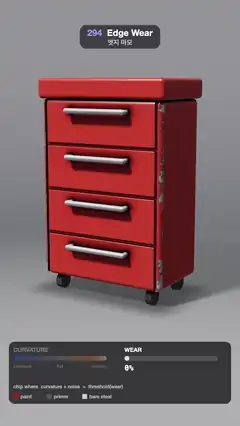

# 294 · Edge Wear · 엣지 마모



**EN** A red tool chest turns as its curvature map glows over it, then paint chips off along its convex edges, showing primer and bare steel, and grows back new.  
**KO** 빨간 공구 캐비닛이 돌며 곡률 맵이 겹쳐 빛나고, 이어 볼록한 모서리를 따라 도장이 벗겨져 프라이머와 맨 강철이 드러났다가 다시 새것이 된다.

[Video (mp4)](https://sueun-dev.github.io/motion-effects/videos/294-edge-wear.mp4) · [Code](../effects/294-edge-wear.js) · Shading tricks · 셰이딩 기법

## Prompt (English)

```text
Create an "Edge Wear" motion effect: a red painted tool chest whose paint chips off along its convex edges, driven by a curvature map that is shown first, the wear growing and receding while the chest turns.

Look
- The chest, a signed distance field (units in metres): a rounded box cabinet (half size 0.6 × 0.8 × 0.35, radius 0.045, centre y 0.95) and a lid (half size 0.63 × 0.09 × 0.375, radius 0.035, centre y 1.84); three grooves between four drawers at y 0.55, 0.95, 1.35 and two down the sides at x ±0.555, cut with a smooth subtraction (k 0.012); four chrome bar handles (radius 0.022, x −0.28 to 0.28, 8 cm in front of the drawers, at y 0.45 + 0.4 i); four black rubber casters.
- Paint: red (0.6, 0.06, 0.04) with a sharp highlight and a clear-coat Fresnel reflection; primer: dark grey (0.12, 0.125, 0.13), matte; bare steel: (0.56, 0.57, 0.6) with brushed streaks, reflecting the studio; grime darkens the paint in grooves and under the handles as wear grows. The handles are chrome and never wear.
- Studio: key light from (−0.55, 0.8, 0.5) with a soft ray-marched shadow and ambient occlusion, a grey floor (0.3, 0.3, 0.31), background (0.2, 0.2, 0.21) → (0.08, 0.085, 0.09).
- Camera at (0, 1.9, 5.9) looking at (0, 0.9, 0), focal length 1.55; the chest stands in the middle of the frame (about y 350–1350 px).
- The curvature map: blue (0.03, 0.15, 1.0) where concave, grey 0.16 where flat, orange (1, 0.3, 0.03) to pale gold (1, 0.9, 0.55) where convex.
- A panel at the bottom (x 40–1040, y 1540–1820, rgba(10, 10, 12, 0.72)): CURVATURE with a blue–grey–orange bar (bright while the map is shown); WEAR with a bar and percentage; "chip where curvature + noise > threshold(wear)"; swatches for paint, primer and bare steel.

Motion (0–5 s), a = 2π · t / 5
- The chest turns on a turntable: yaw 0.55 + 0.38 · sin(a) rad.
- Curvature map: fades in and out over the chest with smoothstep(0.45, 0.95, t) − smoothstep(1.75, 2.25, t).
- Wear: smoothstep(1.85, 3.1, t) − smoothstep(3.75, 4.9, t), 0 → 100 % → 0: chips open along the edges, spread into ragged bands with primer rims and bare steel inside, then close back to new paint by 5 s.

Technique
- One fragment shader, ray marched (2 × 2 samples per pixel), only inside the chest's bounding box.
- Curvature in the chest's own space, so it turns with it: k = (f(q + 0.055 n) + f(q − 0.055 n)) / 0.055 × 2.2, the second difference of the distance field f along the normal n: zero on a flat panel, positive near a convex edge (the inner sample is close to another face), negative in a groove; a dead zone of 0.15 keeps panels exactly flat.
- Wear mask: v = 1.3 k + 0.9 · fbm(5 q) + 0.3 · snoise(25 q) + a little extra near the bottom; threshold = 2.2 − 1.75 · wear; bare steel where v passes the threshold, primer within 0.15 below it, paint elsewhere, all with narrow smoothsteps.
- An ACES-style curve, gamma 2.2 and a fixed per-pixel grain.

Output and rules
- One self-contained HTML file with no external assets (three.js from a CDN is fine if you use it), drawing on a 1080 × 1920 canvas (9:16) scaled to fit the window.
- Write a function renderFrame(t) that draws the frame for time t in seconds, and preview it with requestAnimationFrame. Everything must be a pure function of t and fixed seeds: no Math.random(), Date or state carried between frames, so frame i = renderFrame(i / 30) can be exported to a 30 fps video.
- Loop seamlessly every 5 seconds: renderFrame(5) must look exactly like renderFrame(0).
- No flicker of any kind: no noise or grain that changes from frame to frame, no strobing or blinking, no z-fighting, no shimmering 1 px lines. Any grain or texture stays fixed to the screen or to the object.
- Keep the top 280 px free of important content (a title label goes there) and fill the whole frame with a designed background.
```

## 프롬프트 (한국어)

```text
"엣지 마모" 모션 효과를 만들어 줘: 빨간 도장의 공구 캐비닛이 돌고, 먼저 보여 준 곡률 맵을 따라 볼록한 모서리에서 도장이 벗겨지며, 마모가 커졌다가 다시 줄어드는 효과.

모양
- 캐비닛은 부호 거리 필드(단위 m): 둥근 상자 몸체(반 크기 0.6 × 0.8 × 0.35, 반지름 0.045, 중심 y 0.95)와 뚜껑(반 크기 0.63 × 0.09 × 0.375, 반지름 0.035, 중심 y 1.84). 서랍 네 개 사이 y 0.55, 0.95, 1.35의 홈 셋과 x ±0.555의 세로 홈 둘을 부드러운 빼기(k 0.012)로 판다. 크롬 막대 손잡이 넷(반지름 0.022, x −0.28–0.28, 서랍 앞 8 cm, y 0.45 + 0.4 i), 검은 고무 바퀴 넷.
- 도장: 빨강 (0.6, 0.06, 0.04), 날카로운 하이라이트와 클리어코트 프레넬 반사. 프라이머: 짙은 회색 (0.12, 0.125, 0.13), 무광. 맨 강철: (0.56, 0.57, 0.6), 헤어라인 줄무늬, 스튜디오를 비춘다. 마모가 커지면 홈과 손잡이 아래에 때가 끼어 도장이 어두워진다. 손잡이는 크롬이라 닳지 않는다.
- 스튜디오: (−0.55, 0.8, 0.5)의 키 라이트와 레이마칭 부드러운 그림자·주변광 차폐, 회색 바닥 (0.3, 0.3, 0.31), 배경 (0.2, 0.2, 0.21) → (0.08, 0.085, 0.09).
- 카메라: (0, 1.9, 5.9)에서 (0, 0.9, 0)을 본다, 초점 거리 1.55. 캐비닛은 화면 가운데(대략 y 350–1350 px).
- 곡률 맵: 오목은 파랑 (0.03, 0.15, 1.0), 평평은 회색 0.16, 볼록은 주황 (1, 0.3, 0.03)에서 연한 금색 (1, 0.9, 0.55).
- 아래 패널(x 40–1040, y 1540–1820, rgba(10, 10, 12, 0.72)): CURVATURE와 파랑–회색–주황 막대(맵이 보일 때 밝음), WEAR 막대와 퍼센트, "chip where curvature + noise > threshold(wear)", 도장·프라이머·맨 강철 색 견본.

움직임 (0–5초), a = 2π · t / 5
- 캐비닛이 턴테이블 위에서 돈다: 요 0.55 + 0.38 · sin(a) rad.
- 곡률 맵: smoothstep(0.45, 0.95, t) − smoothstep(1.75, 2.25, t)로 캐비닛 위에 나타났다 사라진다.
- 마모: smoothstep(1.85, 3.1, t) − smoothstep(3.75, 4.9, t), 0 → 100 % → 0. 모서리를 따라 칩이 생기고, 프라이머 테두리와 안쪽 맨 강철이 있는 들쭉날쭉한 띠로 번졌다가, 5초까지 다시 새 도장으로 닫힌다.

기법
- 프래그먼트 셰이더 하나, 레이마칭(픽셀당 2 × 2 샘플), 캐비닛 경계 상자 안에서만.
- 곡률은 캐비닛 자신의 좌표에서 구해 함께 돈다: k = (f(q + 0.055 n) + f(q − 0.055 n)) / 0.055 × 2.2, 법선 n 방향으로 거리 필드 f의 2차 차분. 평평한 판에서는 0, 볼록한 모서리 근처는 양수(안쪽 샘플이 다른 면에 가까움), 홈에서는 음수. 0.15의 무감 구간으로 판은 정확히 평평하게.
- 마모 마스크: v = 1.3 k + 0.9 · fbm(5 q) + 0.3 · snoise(25 q) + 바닥 근처 약간 더. 문턱 = 2.2 − 1.75 · 마모. v가 문턱을 넘으면 맨 강철, 그보다 0.15 아래까지는 프라이머, 나머지는 도장, 모두 좁은 smoothstep으로.
- ACES 계열 곡선, 감마 2.2, 고정된 픽셀 그레인.

출력과 규칙
- 외부 파일 없는 HTML 파일 하나(three.js를 쓴다면 CDN은 괜찮다). 1080 × 1920(9:16) 캔버스에 그리고 창 크기에 맞춰 보이게 한다.
- 시간 t(초)의 프레임을 그리는 renderFrame(t) 함수를 만들고, 미리보기는 requestAnimationFrame으로 돌린다. 모든 것은 t와 고정 시드만으로 정해진다: Math.random(), Date, 프레임 사이에 쌓이는 상태 금지. 그래야 i번째 프레임 = renderFrame(i / 30)으로 30fps 영상을 뽑을 수 있다.
- 5초마다 끊김 없이 반복: renderFrame(5)는 renderFrame(0)과 똑같아 보여야 한다.
- 어떤 깜빡임도 금지: 프레임마다 바뀌는 노이즈·그레인, 번쩍임·깜빡임, z-fighting, 반짝이며 떨리는 1px 선 모두 금지. 그레인·질감은 화면이나 물체에 고정한다.
- 위쪽 280px에는 중요한 내용을 두지 않고(제목 라벨 자리), 화면 전체를 디자인된 배경으로 채운다.
```
