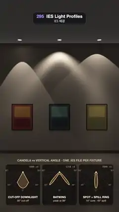

# 295 · IES Light Profiles · IES 배광



**EN** Three downlights load different IES files and paint a crisp cut-off arch, a batwing band and a spot with a spill ring on a gallery wall.  
**KO** 천장 다운라이트 세 개가 서로 다른 IES 파일을 받아 갤러리 벽에 또렷한 컷오프 아치, 배트윙 띠, 스필 링을 두른 스폿을 그린다.

[Video (mp4)](https://sueun-dev.github.io/motion-effects/videos/295-ies-light-profiles.mp4) · [Code](../effects/295-ies-light-profiles.js) · Shading tricks · 셰이딩 기법

## Prompt (English)

```text
Create an "IES Light Profiles" motion effect: three recessed downlights in front of a gallery wall, each loaded with a different photometric (IES) file, so each paints its own scallop of light; the polar candela plot of each fixture sits under it, and the files move from fixture to fixture.

Look
- A gallery wall seen straight on through a shifted lens (verticals stay vertical): camera at (0, 2.0, 5.0) m looking along −z, focal length 1470 px, the horizon at row 802. The wall is the plane z = 0 from the floor (y = 0) to the ceiling (y = 3.4 m): the wall top lands near row 390, the floor line near row 1390.
- Three downlights at x = −1.15, 0, +1.15 m, height 3.38 m, 0.32 m out from the wall. On the ceiling each shows as a black trim ring (radius 0.1 m) round a glowing lens (radius 0.055 m). The ceiling itself is near black (0.017, 0.016, 0.015), a little lighter toward the camera.
- Wall: warm grey plaster, albedo (0.62, 0.60, 0.58), with a fixed, very soft value-noise trowel texture (±3 %) and a dark skirting board (0.16, 0.15, 0.14) below 0.1 m.
- Under each fixture a framed colour-field painting 0.6 × 0.76 m centred at 1.12 m high: two soft-edged blocks on a ground (left: deep red, orange, maroon; middle: navy, teal, near black; right: ochre, yellow, olive), a fixed brushy weave, a 2.8 cm black frame and a soft shadow under the frame.
- Floor: dark polished concrete (0.2, 0.19, 0.18) with its own pools of light plus a glossy reflection of the wall: the sum of 4 slightly offset wall samples × 0.7 · (0.08 + 0.3 · (1 − |ray.y|)⁵) · e^(−0.25 y), y the height of the reflected point.
- Light colour 3000 K (1.0, 0.8, 0.6). Exposure 1 − e^(−1.25 x), gamma 2.2, 2 × 2 supersampling, a fixed grain of ±0.3 %.
- The three IES files, relative candela I(θ) at vertical angle θ (radians from straight down):
  - CUT-OFF DOWNLIGHT, "30° cut-off", 1800 cd: (0.86 + 0.14 cos 5θ) · (1 − smoothstep(0.505, 0.53, θ)) + 0.035 e^(−2θ) · (1 − smoothstep(1.1, 1.5, θ)).
  - BATWING, "peak at 38°", 1250 cd: (0.16 + 1.05 e^(−((θ − 0.66) / 0.13)²)) · (1 − smoothstep(0.8, 0.95, θ)).
  - SPOT + SPILL RING, "15° core · 45° spill", 3900 cd: 2.2 e^(−(θ / 0.2)²) + 0.3 · (1 − smoothstep(0.77, 0.8, θ)).
- Under the wall, three dark glass cards 316 × 372 px (radius 22, 16 px apart, top at row 1488), one per fixture: a polar candela plot on a half-circle grid (rings at 25 % steps, spokes every 15°, labels 0°, 45°, 90°), the curve mirrored left and right, scaled to its own peak, drawn in #FFC98A (4 px) with a 22 % fill; the peak in cd (mono) at the top right; the file's name (bold) and its note below. Above the cards: "CANDELA vs VERTICAL ANGLE · ONE .IES FILE PER FIXTURE".

Motion (0–5 s)
- At 0 s the fixtures hold, left to right: cut-off, batwing, spot.
- At 0.35 s, 2.02 s and 3.68 s the files move one fixture to the right (the rightmost one wraps round to the left). Each move takes 0.75 s (ease in-out): every fixture's candela curve blends linearly from its old file to its new one, so the scallops reshape on the wall and the polar curves morph with them. Between moves everything is completely still.
- During a move a card's name fades out in the first half and the new name fades in in the second half (never both at once); the peak in cd is blended and rounded to 50.
- After three moves every file is back where it started, so 5 s = 0 s.

Technique
- One full-screen fragment shader. For each point P on the wall or floor and each fixture L: v = P − L, r = |v|, θ = acos(−v.y / r), illuminance E = I(θ) · max(n · (−v / r), 0) / r² (inverse square with cosine incidence), summed over the three fixtures with their blended profiles. The wall gets 1.5 E + 0.018, the floor 0.9 E + 0.03.
- The view ray hits the wall plane where 0 ≤ y ≤ 3.4, otherwise the ceiling or the floor; all three planes are solved analytically.
- The three profile weights of each fixture are passed as vec3 uniforms every frame; the same profile functions draw the polar plots in a 2D canvas overlay.

Output and rules
- One self-contained HTML file with no external assets (three.js from a CDN is fine if you use it), drawing on a 1080 × 1920 canvas (9:16) scaled to fit the window.
- Write a function renderFrame(t) that draws the frame for time t in seconds, and preview it with requestAnimationFrame. Everything must be a pure function of t and fixed seeds: no Math.random(), Date or state carried between frames, so frame i = renderFrame(i / 30) can be exported to a 30 fps video.
- Loop seamlessly every 5 seconds: renderFrame(5) must look exactly like renderFrame(0).
- No flicker of any kind: no noise or grain that changes from frame to frame, no strobing or blinking, no z-fighting, no shimmering 1 px lines. Any grain or texture stays fixed to the screen or to the object.
- Keep the top 280 px free of important content (a title label goes there) and fill the whole frame with a designed background.
```

## 프롬프트 (한국어)

```text
"IES 배광" 모션 효과를 만들어 줘: 갤러리 벽 앞 천장에 묻힌 다운라이트 세 개가 각자 다른 배광(IES) 파일을 받아 저마다의 빛 무늬(스캘럽)를 벽에 그린다. 조명마다 아래에 극좌표 광도 그래프가 있고, 파일이 조명에서 조명으로 옮겨 간다.

모양
- 시프트 렌즈로 정면에서 본 갤러리 벽(세로선이 기울지 않음): 카메라 (0, 2.0, 5.0) m, −z 방향, 초점 거리 1470px, 지평선은 802번째 줄. 벽은 바닥(y = 0)부터 천장(y = 3.4 m)까지의 평면 z = 0: 벽 위쪽 끝은 약 390줄, 바닥선은 약 1390줄에 온다.
- 다운라이트 세 개: x = −1.15, 0, +1.15 m, 높이 3.38 m, 벽에서 0.32 m 앞. 천장에는 각각 검은 테(반지름 0.1 m) 안에 빛나는 렌즈(반지름 0.055 m)로 보인다. 천장은 거의 검정(0.017, 0.016, 0.015)이고 카메라 쪽으로 조금 밝다.
- 벽: 따뜻한 회색 미장, 반사율 (0.62, 0.60, 0.58), 고정된 아주 부드러운 값 노이즈 흙손 질감(±3 %), 0.1 m 아래는 어두운 걸레받이 (0.16, 0.15, 0.14).
- 조명마다 아래에 0.6 × 0.76 m 액자 색면 회화, 중심 높이 1.12 m: 바탕 위 가장자리가 부드러운 두 색 덩어리(왼쪽: 짙은 빨강·주황·적갈색, 가운데: 남색·청록·검정에 가까운 색, 오른쪽: 황토·노랑·올리브), 고정된 붓결, 2.8 cm 검은 액자, 액자 아래 부드러운 그림자.
- 바닥: 어두운 광택 콘크리트 (0.2, 0.19, 0.18), 바닥에 떨어진 빛 웅덩이와 벽이 비친 광택 반사: 조금씩 어긋난 벽 샘플 4개의 합 × 0.7 · (0.08 + 0.3 · (1 − |ray.y|)⁵) · e^(−0.25 y), y는 반사된 점의 높이.
- 빛 색 3000 K (1.0, 0.8, 0.6). 노출 1 − e^(−1.25 x), 감마 2.2, 2 × 2 슈퍼샘플링, ±0.3 % 고정 그레인.
- IES 파일 세 개, 수직각 θ(바로 아래에서 잰 라디안)의 상대 광도 I(θ):
  - CUT-OFF DOWNLIGHT, "30° cut-off", 1800 cd: (0.86 + 0.14 cos 5θ) · (1 − smoothstep(0.505, 0.53, θ)) + 0.035 e^(−2θ) · (1 − smoothstep(1.1, 1.5, θ)).
  - BATWING, "peak at 38°", 1250 cd: (0.16 + 1.05 e^(−((θ − 0.66) / 0.13)²)) · (1 − smoothstep(0.8, 0.95, θ)).
  - SPOT + SPILL RING, "15° core · 45° spill", 3900 cd: 2.2 e^(−(θ / 0.2)²) + 0.3 · (1 − smoothstep(0.77, 0.8, θ)).
- 벽 아래에 조명마다 어두운 유리 카드 316 × 372px(모서리 22, 간격 16px, 위쪽 1488줄): 반원 격자(25 % 간격 고리, 15°마다 살, 0°·45°·90° 표기) 위 극좌표 광도 그래프, 좌우 대칭, 자기 최댓값에 맞춰 크기 조절, #FFC98A 4px 선과 22 % 채움. 오른쪽 위에 최대 광도(cd, 고정폭), 아래에 파일 이름(굵게)과 설명. 카드 위에 "CANDELA vs VERTICAL ANGLE · ONE .IES FILE PER FIXTURE".

움직임 (0–5초)
- 0초에 왼쪽부터 컷오프, 배트윙, 스폿.
- 0.35초, 2.02초, 3.68초에 파일이 오른쪽 조명으로 한 칸씩 옮겨 간다(맨 오른쪽 것은 왼쪽 끝으로). 한 번에 0.75초(ease in-out): 조명마다 광도 곡선이 옛 파일에서 새 파일로 선형으로 섞여, 벽의 빛 무늬가 모양을 바꾸고 극좌표 곡선도 함께 변한다. 옮기는 사이에는 모든 것이 완전히 멈춰 있다.
- 옮기는 동안 카드의 이름은 앞 절반에 사라지고 뒤 절반에 새 이름이 나타난다(둘이 겹치지 않음). 최대 광도는 섞은 값을 50 단위로 반올림.
- 세 번 옮기면 모든 파일이 제자리로 돌아와 5초 = 0초.

기법
- 전체 화면 프래그먼트 셰이더 하나. 벽이나 바닥의 점 P와 조명 L마다: v = P − L, r = |v|, θ = acos(−v.y / r), 조도 E = I(θ) · max(n · (−v / r), 0) / r²(역제곱 법칙과 입사각 코사인), 섞인 배광으로 조명 셋을 더한다. 벽은 1.5 E + 0.018, 바닥은 0.9 E + 0.03.
- 시선이 0 ≤ y ≤ 3.4이면 벽 평면, 아니면 천장이나 바닥에 닿는다. 세 평면 모두 해석적으로 푼다.
- 조명마다 세 파일의 섞음 비율을 매 프레임 vec3 유니폼으로 넘기고, 같은 배광 함수로 2D 캔버스 오버레이에 극좌표 그래프를 그린다.

출력과 규칙
- 외부 파일 없는 HTML 파일 하나(three.js를 쓴다면 CDN은 괜찮다). 1080 × 1920(9:16) 캔버스에 그리고 창 크기에 맞춰 보이게 한다.
- 시간 t(초)의 프레임을 그리는 renderFrame(t) 함수를 만들고, 미리보기는 requestAnimationFrame으로 돌린다. 모든 것은 t와 고정 시드만으로 정해진다: Math.random(), Date, 프레임 사이에 쌓이는 상태 금지. 그래야 i번째 프레임 = renderFrame(i / 30)으로 30fps 영상을 뽑을 수 있다.
- 5초마다 끊김 없이 반복: renderFrame(5)는 renderFrame(0)과 똑같아 보여야 한다.
- 어떤 깜빡임도 금지: 프레임마다 바뀌는 노이즈·그레인, 번쩍임·깜빡임, z-fighting, 반짝이며 떨리는 1px 선 모두 금지. 그레인·질감은 화면이나 물체에 고정한다.
- 위쪽 280px에는 중요한 내용을 두지 않고(제목 라벨 자리), 화면 전체를 디자인된 배경으로 채운다.
```
