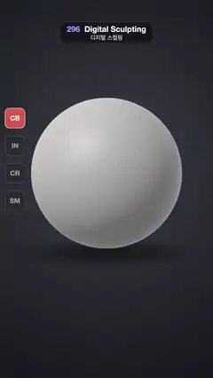

# 296 · Digital Sculpting · 디지털 스컬핑



**EN** A grey clay sphere becomes a face stroke by stroke as Clay Buildup, Inflate, Crease and Smooth brushes pass, a red brush circle riding the surface.  
**KO** 회색 점토 구가 클레이 빌드업, 인플레이트, 크리스, 스무드 브러시가 지날 때마다 얼굴이 되어 가고, 빨간 브러시 원이 표면을 타고 움직인다.

[Video (mp4)](https://sueun-dev.github.io/motion-effects/videos/296-digital-sculpting.mp4) · [Code](../effects/296-digital-sculpting.js) · Modeling craft · 모델링 기법

## Prompt (English)

```text
Create a "Digital Sculpting" motion effect: a grey clay sphere is shaped into a face by ten brush strokes, the way a sculpting app works, with the brush circle following the surface and a brush palette showing which brush is in use.

Look
- Background: a radial gradient #3A3D46 in the middle to #121318 at the edges; a soft round shadow (a radial gradient on a 2.6 × 2.6 plane) under the clay.
- The clay: an icosphere of radius 1, detail 64 (42,252 vertices once shared corners are merged), smooth normals recomputed every frame, at y = −0.42. Camera: perspective, 28° vertical field of view, at (0, 0.15, 10.1) looking at (0, −0.63, 0); the sphere is about 760 px across, centred near row 880.
- Clay shading (a custom shader, gamma 2.2): colour (0.6, 0.585, 0.57); key light from (−0.55, 0.75, 0.6): 0.16 + 0.62 · diffuse + 0.22 · wrap (0.5 + 0.5 n·l); a cool back light (0.42, 0.48, 0.6) × 0.35 from (0.6, −0.1, −0.6); specular power 30 × 0.12; rim (0.55, 0.62, 0.8) × 0.3 · (1 − n·v)⁴.
- The brush, drawn on the surface in the same shader: an anti-aliased ring at the brush radius, a faint falloff disc (13 %) and a centre dot, all in red (1.0, 0.36, 0.3).
- Left: a brush palette of four 100 px rounded buttons at x = 76, rows 600, 740, 880, 1020, labelled CB, IN, CR, SM (Clay Buildup, Inflate, Crease, Smooth); the active one fills red. Under the clay: the brush name (bold 46 px, row 1660) and "radius 0.22" (mono 30 px, row 1720).
- The ten strokes. Paths are on the front of the sphere in face coordinates (x right, y up, z = √(1 − x² − y²)), u = 0 → 1 along the stroke. Brush, start (s), duration (s), radius, strength per dab:
  1. Clay Buildup, 0.25, 0.45, 0.22, 0.018: the brow, x = −0.46 → 0.46, y = 0.27 + 0.03 sin(πu).
  2. Clay Buildup, 0.8, 0.38, 0.15, 0.018: the nose bridge, x = 0, y = 0.18 → −0.12.
  3. Clay Buildup, 1.22, 0.16, 0.13, 0.026: the nose tip, a small circle of radius 0.03 round (0, −0.12).
  4. Clay Buildup, 1.45, 0.36, 0.22, 0.022: the chin, x = −0.25 → 0.25 at y = −0.6.
  5–6. Inflate, 1.9 and 2.2, 0.26 each, 0.2, 0.007: the cheeks, circles of radius 0.07 round (−0.42, −0.12) and (0.42, −0.12).
  7–8. Inflate, 2.52 and 2.72, 0.14 each, 0.105, 0.036: the eyeballs, circles of radius 0.02 round (∓0.25, 0.1).
  9. Crease, 2.95, 0.4, 0.1, 0.021: the mouth, x = −0.27 → 0.27, y = −0.33 + 0.08 (x / 0.27)².
  10. Smooth, 3.45, 0.5, 0.28, 0.25: a zigzag, x = −0.45 → 0.45, y = −0.25 + 0.22 sin(3πu).

Motion (0–5 s), a = 2π · t / 5
- During a stroke the brush travels along its path and the clay builds up right behind it; between strokes the brush glides to the next start (ease in-out), dimming to 35 % halfway, and its radius blends to the next one.
- A brush change: the old button and name fade out, then the new ones fade in (the two names never overlap).
- After the last stroke (3.95 s) the brush fades out and the name gives way to "10 STROKES" / "42,000 vertices"; from 4.3 to 4.97 s the whole face relaxes back into the sphere (ease in-out), and the Clay Buildup button lights again for the loop.
- The clay turns gently all the time: rotation y = 0.34 + 0.24 sin a + 0.05 sin 2a, x = 0.08 + 0.04 sin(a + 1).

Technique
- three.js. All ten strokes are sculpted once at load on a working copy of the mesh. A stroke is a line of dabs spaced 0.18 × radius. Each dab finds the surface point in the path direction (the vertex whose rest direction is closest), takes the vertices within the radius with falloff (1 − d²)² (d = distance / radius) and moves them: Clay Buildup along the falloff-weighted average normal of the area, Inflate along each vertex normal, Crease inward along the normal with falloff² plus a pinch of 0.12 toward the dab centre, Smooth toward the average of the vertex's neighbours.
- For each stroke keep every moved vertex's offset and u, the falloff-weighted mean position along the stroke where it was touched. A frame adds offset × clamp((p (1 + 2s) − s − u) / (2s) + 0.5), with p the stroke's progress and s = 0.6 · radius / stroke length, so each vertex fills in as the brush passes over it.
- The brush ring sits at the current position of the vertex nearest the brush direction; the ring is drawn with fwidth anti-aliasing.

Output and rules
- One self-contained HTML file with no external assets (three.js from a CDN is fine if you use it), drawing on a 1080 × 1920 canvas (9:16) scaled to fit the window.
- Write a function renderFrame(t) that draws the frame for time t in seconds, and preview it with requestAnimationFrame. Everything must be a pure function of t and fixed seeds: no Math.random(), Date or state carried between frames, so frame i = renderFrame(i / 30) can be exported to a 30 fps video.
- Loop seamlessly every 5 seconds: renderFrame(5) must look exactly like renderFrame(0).
- No flicker of any kind: no noise or grain that changes from frame to frame, no strobing or blinking, no z-fighting, no shimmering 1 px lines. Any grain or texture stays fixed to the screen or to the object.
- Keep the top 280 px free of important content (a title label goes there) and fill the whole frame with a designed background.
```

## 프롬프트 (한국어)

```text
"디지털 스컬핑" 모션 효과를 만들어 줘: 회색 점토 구를 브러시 열 번으로 얼굴로 빚는다. 스컬핑 앱처럼 브러시 원이 표면을 따라가고, 브러시 팔레트가 지금 쓰는 브러시를 보여 준다.

모양
- 배경: 가운데 #3A3D46에서 가장자리 #121318로 가는 원형 그라디언트. 점토 아래에 부드러운 둥근 그림자(2.6 × 2.6 평면에 원형 그라디언트).
- 점토: 반지름 1, 분할 64 아이코스피어(공유 꼭짓점을 합치면 42,252개), 매 프레임 다시 계산하는 부드러운 노멀, y = −0.42. 카메라: 원근, 세로 시야각 28°, (0, 0.15, 10.1)에서 (0, −0.63, 0)을 본다. 구는 지름 약 760px, 중심은 약 880줄.
- 점토 셰이딩(직접 만든 셰이더, 감마 2.2): 색 (0.6, 0.585, 0.57). 키 라이트 방향 (−0.55, 0.75, 0.6): 0.16 + 0.62 · 확산 + 0.22 · 랩(0.5 + 0.5 n·l). 차가운 뒤쪽 빛 (0.42, 0.48, 0.6) × 0.35, 방향 (0.6, −0.1, −0.6). 스페큘러 지수 30 × 0.12. 림 (0.55, 0.62, 0.8) × 0.3 · (1 − n·v)⁴.
- 브러시는 같은 셰이더로 표면 위에 그린다: 브러시 반지름의 안티에일리어싱 고리, 옅은 감쇠 원판(13 %), 가운데 점, 모두 빨강 (1.0, 0.36, 0.3).
- 왼쪽: 100px 둥근 버튼 네 개의 브러시 팔레트, x = 76, 600·740·880·1020줄, 표기 CB, IN, CR, SM(클레이 빌드업, 인플레이트, 크리스, 스무드). 쓰는 버튼은 빨갛게 찬다. 점토 아래: 브러시 이름(굵게 46px, 1660줄)과 "radius 0.22"(고정폭 30px, 1720줄).
- 붓질 열 번. 경로는 구 앞면의 얼굴 좌표(x 오른쪽, y 위, z = √(1 − x² − y²)), u = 0 → 1. 브러시, 시작(초), 길이(초), 반지름, 한 번 찍을 때 세기:
  1. 클레이 빌드업, 0.25, 0.45, 0.22, 0.018: 눈썹 뼈, x = −0.46 → 0.46, y = 0.27 + 0.03 sin(πu).
  2. 클레이 빌드업, 0.8, 0.38, 0.15, 0.018: 콧등, x = 0, y = 0.18 → −0.12.
  3. 클레이 빌드업, 1.22, 0.16, 0.13, 0.026: 코끝, (0, −0.12) 둘레 반지름 0.03의 작은 원.
  4. 클레이 빌드업, 1.45, 0.36, 0.22, 0.022: 턱, y = −0.6에서 x = −0.25 → 0.25.
  5–6. 인플레이트, 1.9와 2.2, 각 0.26, 0.2, 0.007: 볼, (−0.42, −0.12)와 (0.42, −0.12) 둘레 반지름 0.07의 원.
  7–8. 인플레이트, 2.52와 2.72, 각 0.14, 0.105, 0.036: 눈알, (∓0.25, 0.1) 둘레 반지름 0.02의 원.
  9. 크리스, 2.95, 0.4, 0.1, 0.021: 입, x = −0.27 → 0.27, y = −0.33 + 0.08 (x / 0.27)².
  10. 스무드, 3.45, 0.5, 0.28, 0.25: 지그재그, x = −0.45 → 0.45, y = −0.25 + 0.22 sin(3πu).

움직임 (0–5초), a = 2π · t / 5
- 붓질하는 동안 브러시가 경로를 따라가고 점토가 바로 뒤에서 차오른다. 붓질 사이에는 브러시가 다음 시작점으로 미끄러지며(ease in-out) 중간에 35 %까지 흐려지고, 반지름도 다음 값으로 바뀐다.
- 브러시가 바뀔 때: 옛 버튼과 이름이 먼저 사라지고 새 것이 나타난다(두 이름이 겹치지 않음).
- 마지막 붓질 뒤(3.95초) 브러시가 사라지고 이름 자리에 "10 STROKES" / "42,000 vertices"가 나온다. 4.3초부터 4.97초까지 얼굴 전체가 다시 구로 풀리고(ease in-out), 반복을 위해 클레이 빌드업 버튼이 다시 켜진다.
- 점토는 늘 천천히 돈다: 회전 y = 0.34 + 0.24 sin a + 0.05 sin 2a, x = 0.08 + 0.04 sin(a + 1).

기법
- three.js. 붓질 열 번은 시작할 때 메시 작업 사본에 한 번 다 새긴다. 붓질 하나는 반지름 × 0.18 간격으로 찍는 점(dab)들의 줄이다. 점마다 경로 방향의 표면 점(쉬는 방향이 가장 가까운 꼭짓점)을 찾고, 반지름 안 꼭짓점을 감쇠 (1 − d²)²(d = 거리 / 반지름)로 옮긴다: 클레이 빌드업은 감쇠 가중 평균 노멀 방향으로, 인플레이트는 꼭짓점마다 제 노멀 방향으로, 크리스는 노멀 반대로 감쇠²만큼 + 점 중심 쪽으로 0.12 오므림, 스무드는 이웃 꼭짓점 평균 쪽으로.
- 붓질마다 움직인 꼭짓점의 변위와 u(그 꼭짓점이 닿은 붓질 위 위치의 감쇠 가중 평균)를 저장한다. 프레임마다 변위 × clamp((p (1 + 2s) − s − u) / (2s) + 0.5)를 더한다. p는 붓질 진행도, s = 0.6 · 반지름 / 붓질 길이. 그래서 브러시가 지나갈 때 꼭짓점이 차오른다.
- 브러시 고리는 브러시 방향에 가장 가까운 꼭짓점의 현재 위치에 놓고, fwidth로 안티에일리어싱해 그린다.

출력과 규칙
- 외부 파일 없는 HTML 파일 하나(three.js를 쓴다면 CDN은 괜찮다). 1080 × 1920(9:16) 캔버스에 그리고 창 크기에 맞춰 보이게 한다.
- 시간 t(초)의 프레임을 그리는 renderFrame(t) 함수를 만들고, 미리보기는 requestAnimationFrame으로 돌린다. 모든 것은 t와 고정 시드만으로 정해진다: Math.random(), Date, 프레임 사이에 쌓이는 상태 금지. 그래야 i번째 프레임 = renderFrame(i / 30)으로 30fps 영상을 뽑을 수 있다.
- 5초마다 끊김 없이 반복: renderFrame(5)는 renderFrame(0)과 똑같아 보여야 한다.
- 어떤 깜빡임도 금지: 프레임마다 바뀌는 노이즈·그레인, 번쩍임·깜빡임, z-fighting, 반짝이며 떨리는 1px 선 모두 금지. 그레인·질감은 화면이나 물체에 고정한다.
- 위쪽 280px에는 중요한 내용을 두지 않고(제목 라벨 자리), 화면 전체를 디자인된 배경으로 채운다.
```
