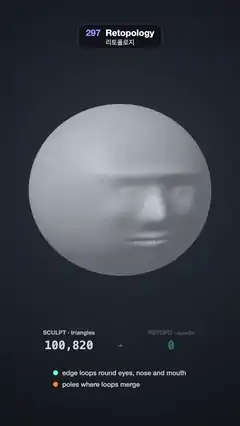

# 297 · Retopology · 리토폴로지



**EN** Clean quad edge loops are drawn over a dense 100,820-triangle sculpt: rings round the eyes, nose and mouth merge outward, with poles where they meet.  
**KO** 삼각형 100,820개의 촘촘한 스컬프트 위에 깔끔한 사각형 엣지 루프가 그려진다. 눈·코·입을 감싼 고리가 바깥으로 합쳐지고, 만나는 자리에 폴이 놓인다.

[Video (mp4)](https://sueun-dev.github.io/motion-effects/videos/297-retopology.mp4) · [Code](../effects/297-retopology.js) · Modeling craft · 모델링 기법

## Prompt (English)

```text
Create a "Retopology" motion effect: a dense, messy triangle sculpt of a head gets a clean quad net drawn over it, edge loops round the eyes, nose and mouth that merge into loops round the whole face, cross edges, vertices and poles, while the triangle count gives way to a quad count.

Look
- Background: a radial gradient #2C3340 → #0D1016. Camera: perspective, 26°, at (0, 0.4, 10.2) looking at (0, −0.13, 0). The head is turned 0.38 rad to the viewer's right (tilted 0.04), about 800 px across, centred near row 880.
- The sculpt: an icosphere of radius 1, detail 70 (100,820 triangles). Every vertex is nudged sideways at random by up to 0.009 (the nudge is hashed from the vertex position, so shared corners move together, which gives the irregular triangles of a dynamic-topology sculpt), then pushed out to the head radius along its direction d: 1 + 0.08 y − 0.06 y² + 0.04 max(0, −y) z, plus features on the front weighted by z²: brow +0.07 at y = 0.28; eye sockets −0.07 at (±0.29, 0.13); lids +0.05; a nose up to +0.2 along x = 0 from y = −0.3 to 0.18; cheekbones +0.04 at (±0.4, −0.1); lips +0.045 / −0.03 / +0.04 at y = −0.35 / −0.4 / −0.45; chin +0.06 at y = −0.68 (Gaussian bumps).
- Shading (custom shader, gamma 2.2): blue-grey clay (0.56, 0.60, 0.68) lit from (−0.5, 0.7, 0.6): 0.18 + 0.6 · diffuse + 0.25 · wrap, specular power 40 × 0.12, a soft rim. The dense triangles show as thin dark lines from barycentric coordinates (fwidth anti-aliased, mixed 75 % of the way to 45 % of the clay colour).
- The quad net in mint #4DFFB8: loops about 2 px wide drawn in the shader; cross edges as 2.4 px lines; white vertex dots (radius 0.0095) at every crossing; orange #FF8A3D poles (radius 0.026).
- Below the head: "SCULPT · triangles" 100,820 on the left, an arrow, "RETOPO · quads" N in mint on the right (mono 52 px, row 1560); a legend at rows 1680 and 1732: mint dot "edge loops round eyes, nose and mouth", orange dot "poles where loops merge".

Motion (0–5 s)
- 0–0.5 s: just the dense sculpt and its triangle wire. 0.5–1.0 s the wire dims to 25 %.
- The 11 loops fade in one after another, loop j over 0.3 s from 0.6 + 0.13 j s, inner rings first.
- 1.95–3.0 s: the cross edges draw band by band from the outermost loop inward, staggered round the face (each piece over 12 % of that span, from its outer end); each vertex dot pops up when an edge reaches it; the quad counter counts up to N (the number of cross-edge pieces between neighbouring loops, 745 here).
- From 2.95 s the three poles pop in (ease out back), 0.1 s apart. 3.0–3.45 s the triangle wire fades out completely.
- 3.5–4.4 s the head turns 0.3 rad toward the viewer and back (sin²), so the net is seen wrapping the surface.
- 4.42–4.97 s the net fades out and the dense wire returns, matching 0 s.

Technique
- One field F on the front of the face (object x, y): a soft minimum F = −0.05 · ln Σ e^(−dᵢ / 0.05) of the distances dᵢ to four rounded segments, measured in a face space squeezed 1.4× across (x / 1.4): the eyes, horizontal segments of half length 0.025 centred at (∓0.29 / 1.4, 0.125), radius 0.06; the nose, a vertical segment from the bridge (0, −0.03) to the tip (0, −0.16), radius 0.02; the mouth, from (−0.12, −0.4) to (0.12, −0.4), radius 0.05. Because the nose runs up between the eyes, F has no peak anywhere on the face, only three saddles.
- Edge loops = level sets F = 0.004 + 0.012 j + 0.0022 j² (j = 0 … 10, closer together near the features), drawn in the fragment shader where |F − c| is under about 1–2 × fwidth(F). The first loops ring each feature on its own; the outer ones merge into loops round the whole face.
- Cross edges = gradient lines of F (followed in the squeezed space). Each runs from a feature's first loop to the outermost loop, so it crosses every loop exactly once and no edge stops in the middle of the face. Seeds: 60 evenly along the outermost loop (traced down), then 16, 16, 14 and 24 evenly round the first loops of the eyes, nose and mouth (traced up), then, again and again, the point of any loop farthest from that loop's vertices (if more than 0.07 away), traced both ways. A line that comes within 0.03 of a vertex already placed joins it there, as edge flow merges near a pole. Vertices = where a line crosses a loop.
- Poles = the three saddle points of F (gradient ≈ 0, Hessian determinant < 0), where loops of two features merge: at the inner corners of the eyes and between the nose and the mouth.
- 2D points go onto the surface by bisecting along +z to the head radius; everything is traced once at load.

Output and rules
- One self-contained HTML file with no external assets (three.js from a CDN is fine if you use it), drawing on a 1080 × 1920 canvas (9:16) scaled to fit the window.
- Write a function renderFrame(t) that draws the frame for time t in seconds, and preview it with requestAnimationFrame. Everything must be a pure function of t and fixed seeds: no Math.random(), Date or state carried between frames, so frame i = renderFrame(i / 30) can be exported to a 30 fps video.
- Loop seamlessly every 5 seconds: renderFrame(5) must look exactly like renderFrame(0).
- No flicker of any kind: no noise or grain that changes from frame to frame, no strobing or blinking, no z-fighting, no shimmering 1 px lines. Any grain or texture stays fixed to the screen or to the object.
- Keep the top 280 px free of important content (a title label goes there) and fill the whole frame with a designed background.
```

## 프롬프트 (한국어)

```text
"리토폴로지" 모션 효과를 만들어 줘: 촘촘하고 지저분한 삼각형 머리 스컬프트 위에 깔끔한 사각형 망을 그린다. 눈·코·입을 감싼 엣지 루프가 얼굴 전체를 감싸는 루프로 합쳐지고, 가로 엣지·꼭짓점·폴이 놓이며, 삼각형 수가 사각형 수로 바뀐다.

모양
- 배경: 원형 그라디언트 #2C3340 → #0D1016. 카메라: 원근 26°, (0, 0.4, 10.2)에서 (0, −0.13, 0)을 본다. 머리는 보는 사람 오른쪽으로 0.38 rad 돌고(0.04 기울기), 지름 약 800px, 중심은 약 880줄.
- 스컬프트: 반지름 1, 분할 70 아이코스피어(삼각형 100,820개). 꼭짓점마다 최대 0.009만큼 옆으로 무작위로 민다(위치에서 해시로 정해 공유 꼭짓점이 함께 움직임. 다이내믹 토폴로지 스컬프트 같은 불규칙한 삼각형). 그다음 방향 d를 따라 머리 반지름까지 민다: 1 + 0.08 y − 0.06 y² + 0.04 max(0, −y) z, 앞면에는 z² 가중으로 이목구비(가우시안 혹): 눈썹 뼈 +0.07(y = 0.28), 눈구멍 −0.07((±0.29, 0.13)), 눈꺼풀 +0.05, 코 x = 0을 따라 y = −0.3~0.18에서 최대 +0.2, 광대 +0.04((±0.4, −0.1)), 입술 +0.045 / −0.03 / +0.04(y = −0.35 / −0.4 / −0.45), 턱 +0.06(y = −0.68).
- 셰이딩(직접 만든 셰이더, 감마 2.2): 푸른 회색 점토 (0.56, 0.60, 0.68), 빛 방향 (−0.5, 0.7, 0.6): 0.18 + 0.6 · 확산 + 0.25 · 랩, 스페큘러 지수 40 × 0.12, 부드러운 림. 촘촘한 삼각형은 무게중심 좌표로 그린 가는 어두운 선(fwidth 안티에일리어싱, 점토 색의 45 % 쪽으로 75 % 섞음).
- 사각형 망은 민트 #4DFFB8: 루프는 셰이더로 약 2px, 가로 엣지는 2.4px 선, 교차점마다 흰 꼭짓점 점(반지름 0.0095), 주황 #FF8A3D 폴(반지름 0.026).
- 머리 아래: 왼쪽 "SCULPT · triangles" 100,820, 화살표, 오른쪽 민트로 "RETOPO · quads" N(고정폭 52px, 1560줄). 1680·1732줄에 범례: 민트 점 "edge loops round eyes, nose and mouth", 주황 점 "poles where loops merge".

움직임 (0–5초)
- 0–0.5초: 촘촘한 스컬프트와 삼각형 선만. 0.5–1.0초 선이 25 %로 흐려진다.
- 루프 11개가 차례로 나타난다: 루프 j는 0.6 + 0.13 j초부터 0.3초 동안, 안쪽 고리부터.
- 1.95–3.0초: 가로 엣지가 가장 바깥 루프에서 안쪽으로 띠 하나씩 그려지고 얼굴 둘레로 시차를 둔다(조각마다 그 구간의 12 % 동안, 바깥 끝에서부터). 엣지가 닿으면 꼭짓점 점이 톡 나타나고, 사각형 수가 N(이웃한 루프 사이 가로 엣지 조각 수, 여기서는 745)까지 올라간다.
- 2.95초부터 폴 셋이 0.1초 간격으로 톡 튀어나온다(ease out back). 3.0–3.45초 삼각형 선이 완전히 사라진다.
- 3.5–4.4초 머리가 보는 사람 쪽으로 0.3 rad 돌았다 돌아와(sin²) 망이 표면을 감싼 것이 보인다.
- 4.42–4.97초 망이 사라지고 촘촘한 선이 돌아와 0초와 같아진다.

기법
- 얼굴 앞면(물체 좌표 x, y)의 필드 F 하나: 가로로 1.4배 줄인 얼굴 공간(x / 1.4)에서 잰, 둥근 선분 네 개까지 거리 dᵢ의 부드러운 최솟값 F = −0.05 · ln Σ e^(−dᵢ / 0.05). 눈: (∓0.29 / 1.4, 0.125) 중심의 반길이 0.025 가로 선분, 반지름 0.06; 코: 콧등 (0, −0.03)에서 코끝 (0, −0.16)까지 세로 선분, 반지름 0.02; 입: (−0.12, −0.4)에서 (0.12, −0.4)까지, 반지름 0.05. 코가 두 눈 사이로 올라가 있어 얼굴 어디에도 F의 봉우리가 없고 안장점 셋만 있다.
- 엣지 루프 = 등고선 F = 0.004 + 0.012 j + 0.0022 j²(j = 0 … 10, 이목구비 가까이에서 더 촘촘). 프래그먼트 셰이더에서 |F − c|가 fwidth(F)의 약 1–2배보다 작은 곳에 그린다. 처음 루프들은 이목구비를 하나씩 감싸고, 바깥 루프들은 얼굴 전체를 감싸는 루프로 합쳐진다.
- 가로 엣지 = F의 기울기 선(줄인 공간에서 따라감). 모두 이목구비의 첫 루프에서 가장 바깥 루프까지 이어져 루프마다 꼭 한 번씩 지나고, 얼굴 한가운데서 끊기는 엣지가 없다. 씨앗: 가장 바깥 루프에 고르게 60개(아래로 따라감), 눈·눈·코·입의 첫 루프 둘레에 고르게 16, 16, 14, 24개(위로 따라감), 그다음 어느 루프에서든 그 루프의 꼭짓점에서 가장 먼 점(0.07보다 멀면)을 골라 양쪽으로 따라가기를 되풀이한다. 이미 놓인 꼭짓점에 0.03보다 가까워진 선은 그 꼭짓점으로 합쳐진다(폴 근처에서 엣지 흐름이 모이듯). 꼭짓점 = 선이 루프를 지나는 점.
- 폴 = F의 안장점 셋(기울기 ≈ 0, 헤시안 행렬식 < 0), 두 이목구비의 루프가 합쳐지는 곳: 두 눈 안쪽 구석과 코와 입 사이.
- 2D 점은 +z 방향으로 머리 반지름까지 이분 탐색해 표면에 올린다. 모두 시작할 때 한 번 계산한다.

출력과 규칙
- 외부 파일 없는 HTML 파일 하나(three.js를 쓴다면 CDN은 괜찮다). 1080 × 1920(9:16) 캔버스에 그리고 창 크기에 맞춰 보이게 한다.
- 시간 t(초)의 프레임을 그리는 renderFrame(t) 함수를 만들고, 미리보기는 requestAnimationFrame으로 돌린다. 모든 것은 t와 고정 시드만으로 정해진다: Math.random(), Date, 프레임 사이에 쌓이는 상태 금지. 그래야 i번째 프레임 = renderFrame(i / 30)으로 30fps 영상을 뽑을 수 있다.
- 5초마다 끊김 없이 반복: renderFrame(5)는 renderFrame(0)과 똑같아 보여야 한다.
- 어떤 깜빡임도 금지: 프레임마다 바뀌는 노이즈·그레인, 번쩍임·깜빡임, z-fighting, 반짝이며 떨리는 1px 선 모두 금지. 그레인·질감은 화면이나 물체에 고정한다.
- 위쪽 280px에는 중요한 내용을 두지 않고(제목 라벨 자리), 화면 전체를 디자인된 배경으로 채운다.
```
