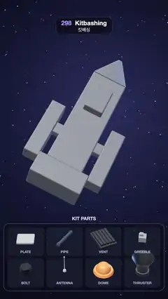

# 298 · Kitbashing · 킷배싱



**EN** A plain grey starship blockout is detailed from a tray of eight kit parts: plates, pipes, vents and greebles snap onto the hull in waves, then thrusters fire.  
**KO** 밋밋한 회색 우주선 블록아웃에 트레이의 키트 부품 여덟 종이 붙는다. 판·파이프·통풍구·그리블이 물결처럼 선체에 딸깍 붙고, 추진기가 불을 뿜는다.

[Video (mp4)](https://sueun-dev.github.io/motion-effects/videos/298-kitbashing.mp4) · [Code](../effects/298-kitbashing.js) · Modeling craft · 모델링 기법

## Prompt (English)

```text
Create a "Kitbashing" motion effect: a plain grey starship blockout gets all its detail from a small kit of reusable parts shown in a tray below; copies of each part snap onto the hull in waves, the thrusters fire, and the copies lift off again.

Look
- Space: a radial gradient #2A2F5E → #141733 → #07080F with 260 fixed stars. Camera: perspective, 30°, at (0, 0, 22.5) looking along −z. ACES Filmic tone mapping, a room environment at 0.55, a warm key #FFE9D2 at 2.6 from (−6, 8, 9), a blue rim #7FA8FF at 2.2 from (7, 2, −6), a hemisphere fill #9AA8D8 / #14121C at 0.5.
- The blockout (rounded boxes, corner radius 0.05, #737A86, metalness 0.55, roughness 0.6). The ship points along +y with its top facing +z: a spine 1.5 × 4.6 × 0.9 at y = 0.2; a bridge deck 0.8 × 1.2 × 0.36 on top at y = 1.1; side pods 0.62 × 2.6 × 0.62 at x = ±1.35, y = −0.9 with short pylons; an engine block 2.1 × 0.9 × 1.1 at y = −2.55; a four-sided pyramid nose (base radius 1.06, height 1.5, flattened to 60 % in depth) at y = 3.25. The whole ship sits at (0, 0.85, 0), rotated (−0.5, 0.4 sin(a + 0.6), −0.42) so the nose points up and to the right and the top faces the camera; x and z wobble by 0.05 and 0.04 · sin a.
- The kit, eight parts, each one instanced mesh (metalness 0.7, roughness 0.45): PLATE, a rounded slab #C6CBD3 scaled to its cell (every ninth one orange #E36E3A); PIPE #59606B, a cylinder of radius 0.06 with three collars; VENT #3B4049, a base plate with five slats; GREEBLE #9AA2AD, a box with a smaller box on top, random sizes; BOLT #2E3239, a hexagonal nut; ANTENNA #E9ECF0, a thin mast with a ball; DOME #FF8A3D, a glossy hemisphere on a ring; THRUSTER #4A505A, a lathed bell nozzle.
- Seeded layout: every top and side face of the blockout is cut into cells of about 0.36; each cell gets a plate (42 %, sometimes with a greeble or two bolts on it), a vent (13 %), a cluster of three greebles (30 %) or nothing; pipes run along the long faces; three antennas and three domes sit on the deck and pods; five thrusters point out of the engine block and the pod ends.
- The parts tray: a dark rounded panel 1040 × 440 px centred at row 1652 with eight slots (234 × 186) in two rows; each slot shows one copy of its part turning slowly (one turn per loop) and its name; "KIT PARTS" above it at row 1404.

Motion (0–5 s), a = 2π · t / 5
- Four waves: plates from 0.25 s; pipes and vents from 0.95 s; greebles and bolts from 1.65 s; antennas, domes and thrusters from 2.4 s. In a wave the copies start from nose to tail spread over 0.7 s (0.45 s in the last wave). Each copy takes 0.42 s: it drops 0.45 units along the face normal onto the hull (ease out) while growing from nothing with a small overshoot (ease out back), a snap.
- The slot of a part being placed gets an orange outline and its name turns orange (both fade in and out with the wave).
- 3.15–3.5 s the thrusters fire: blue glow discs in the nozzles and soft blue plume cones that fade along their length; they go out 3.8–4.05 s.
- 3.95–4.87 s every copy lifts off along its normal and shrinks away, tail first (each in 0.3 s, staggered over 0.62 s), leaving the bare blockout of 0 s.

Technique
- three.js with one InstancedMesh per kit part; each copy stores its face point, normal, spin and scale, and its matrix is composed every frame from the ship's world matrix (up axis turned onto the face normal), so copies stay glued to the swaying hull.
- The tray panel and its samples live in camera space at a fixed depth (8 units), placed by turning screen positions into camera coordinates.
- The plumes are open cones with a shader whose brightness falls off as (1 − v)^1.6 along their length, drawn additively.

Output and rules
- One self-contained HTML file with no external assets (three.js from a CDN is fine if you use it), drawing on a 1080 × 1920 canvas (9:16) scaled to fit the window.
- Write a function renderFrame(t) that draws the frame for time t in seconds, and preview it with requestAnimationFrame. Everything must be a pure function of t and fixed seeds: no Math.random(), Date or state carried between frames, so frame i = renderFrame(i / 30) can be exported to a 30 fps video.
- Loop seamlessly every 5 seconds: renderFrame(5) must look exactly like renderFrame(0).
- No flicker of any kind: no noise or grain that changes from frame to frame, no strobing or blinking, no z-fighting, no shimmering 1 px lines. Any grain or texture stays fixed to the screen or to the object.
- Keep the top 280 px free of important content (a title label goes there) and fill the whole frame with a designed background.
```

## 프롬프트 (한국어)

```text
"킷배싱" 모션 효과를 만들어 줘: 밋밋한 회색 우주선 블록아웃이 아래 트레이에 놓인 재사용 부품 키트만으로 디테일을 얻는다. 부품마다 복사본이 물결처럼 선체에 딸깍 붙고, 추진기가 불을 뿜고, 복사본들이 다시 떠난다.

모양
- 우주: 원형 그라디언트 #2A2F5E → #141733 → #07080F, 고정된 별 260개. 카메라: 원근 30°, (0, 0, 22.5)에서 −z 방향. ACES Filmic 톤 매핑, 룸 환경 0.55, 따뜻한 키 라이트 #FFE9D2 2.6 위치 (−6, 8, 9), 푸른 림 #7FA8FF 2.2 위치 (7, 2, −6), 반구광 #9AA8D8 / #14121C 0.5.
- 블록아웃(모서리 반지름 0.05 둥근 상자, #737A86, 금속성 0.55, 거칠기 0.6). 배는 +y를 향하고 윗면이 +z: 등뼈 1.5 × 4.6 × 0.9(y = 0.2), 그 위 함교 0.8 × 1.2 × 0.36(y = 1.1), 옆 포드 0.62 × 2.6 × 0.62(x = ±1.35, y = −0.9)와 짧은 연결대, 엔진 블록 2.1 × 0.9 × 1.1(y = −2.55), 사각뿔 기수(밑반지름 1.06, 높이 1.5, 깊이 60 %로 납작, y = 3.25). 배 전체는 (0, 0.85, 0)에 놓이고 회전 (−0.5, 0.4 sin(a + 0.6), −0.42)로 기수가 오른쪽 위를, 윗면이 카메라를 향한다. x와 z는 0.05, 0.04 · sin a로 살짝 흔들린다.
- 키트 부품 여덟 종, 종마다 인스턴스 메시 하나(금속성 0.7, 거칠기 0.45): PLATE 칸 크기에 맞춘 둥근 판 #C6CBD3(아홉 번째마다 주황 #E36E3A), PIPE #59606B 반지름 0.06 원기둥과 고리 셋, VENT #3B4049 바닥판과 살 다섯, GREEBLE #9AA2AD 상자 위 작은 상자(크기 무작위), BOLT #2E3239 육각 너트, ANTENNA #E9ECF0 가는 막대와 공, DOME #FF8A3D 고리 위 반구, THRUSTER #4A505A 회전체 종 모양 노즐.
- 시드로 정한 배치: 블록아웃의 윗면과 옆면을 약 0.36 칸으로 나누고 칸마다 판(42 %, 가끔 그 위에 그리블 하나나 볼트 둘), 통풍구(13 %), 그리블 셋 묶음(30 %), 또는 빈칸. 긴 면을 따라 파이프, 함교와 포드 위에 안테나 셋과 돔 셋, 엔진 블록과 포드 끝에 추진기 다섯.
- 부품 트레이: 1652줄 중심의 1040 × 440px 어두운 둥근 판, 두 줄 여덟 칸(234 × 186). 칸마다 그 부품 하나가 천천히 돌고(반복마다 한 바퀴) 이름이 있다. 위 1404줄에 "KIT PARTS".

움직임 (0–5초), a = 2π · t / 5
- 물결 네 번: 판 0.25초부터, 파이프·통풍구 0.95초부터, 그리블·볼트 1.65초부터, 안테나·돔·추진기 2.4초부터. 한 물결 안에서 복사본은 기수부터 꼬리 쪽으로 0.7초에 걸쳐(마지막 물결은 0.45초) 출발한다. 복사본 하나는 0.42초: 면의 노멀을 따라 0.45만큼 내려와 선체에 닿으며(ease out) 없던 크기에서 살짝 넘치게 커진다(ease out back). 딸깍 붙는 느낌.
- 붙고 있는 부품의 칸에는 주황 테두리가 생기고 이름이 주황으로 바뀐다(물결과 함께 서서히 나타났다 사라짐).
- 3.15–3.5초 추진기가 켜진다: 노즐 안의 파란 빛 원판과 길이를 따라 옅어지는 부드러운 파란 불꽃 원뿔. 3.8–4.05초에 꺼진다.
- 3.95–4.87초 모든 복사본이 노멀을 따라 떠오르며 작아져 사라진다. 꼬리부터(하나에 0.3초, 0.62초에 걸쳐 시차), 0초의 맨 블록아웃만 남는다.

기법
- three.js, 키트 부품마다 InstancedMesh 하나. 복사본마다 면 위의 점, 노멀, 회전, 크기를 저장하고, 매 프레임 배의 월드 행렬로 행렬을 만든다(위쪽 축을 면의 노멀에 맞춤). 그래서 복사본이 흔들리는 선체에 붙어 있다.
- 트레이 판과 견본은 카메라 공간의 고정 깊이(8)에 있고, 화면 위치를 카메라 좌표로 바꿔 놓는다.
- 불꽃은 열린 원뿔이고, 길이를 따라 밝기가 (1 − v)^1.6으로 줄어드는 셰이더로 더하기 합성한다.

출력과 규칙
- 외부 파일 없는 HTML 파일 하나(three.js를 쓴다면 CDN은 괜찮다). 1080 × 1920(9:16) 캔버스에 그리고 창 크기에 맞춰 보이게 한다.
- 시간 t(초)의 프레임을 그리는 renderFrame(t) 함수를 만들고, 미리보기는 requestAnimationFrame으로 돌린다. 모든 것은 t와 고정 시드만으로 정해진다: Math.random(), Date, 프레임 사이에 쌓이는 상태 금지. 그래야 i번째 프레임 = renderFrame(i / 30)으로 30fps 영상을 뽑을 수 있다.
- 5초마다 끊김 없이 반복: renderFrame(5)는 renderFrame(0)과 똑같아 보여야 한다.
- 어떤 깜빡임도 금지: 프레임마다 바뀌는 노이즈·그레인, 번쩍임·깜빡임, z-fighting, 반짝이며 떨리는 1px 선 모두 금지. 그레인·질감은 화면이나 물체에 고정한다.
- 위쪽 280px에는 중요한 내용을 두지 않고(제목 라벨 자리), 화면 전체를 디자인된 배경으로 채운다.
```
