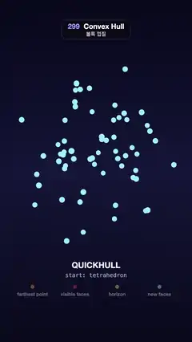

# 299 · Convex Hull · 볼록 껍질



**EN** Quickhull wraps 62 floating points face by face: the farthest point lights up, the faces it sees turn red, a yellow horizon forms and new faces bulge out.  
**KO** 퀵헐이 떠 있는 점 62개를 한 면씩 감싼다. 가장 먼 점이 켜지고, 그 점이 보는 면이 빨개지고, 노란 지평선이 생기고, 새 면이 부풀어 오른다.

[Video (mp4)](https://sueun-dev.github.io/motion-effects/videos/299-convex-hull.mp4) · [Code](../effects/299-convex-hull.js) · Modeling craft · 모델링 기법

## Prompt (English)

```text
Create a "Convex Hull" motion effect: a cloud of 3D points is wrapped by the Quickhull algorithm step by step, like shrink wrap, with every stage of a step shown (farthest point, visible faces, horizon, new faces); then the finished hull glows and fades.

Look
- Background: a vertical gradient #07081A → #151638 → #090A1C. Camera: perspective, 30°, at (0, 1.0, 10.6) looking at (0, −0.22, 0).
- 62 points (seeded): 16 near an egg-shaped surface (radii 1.45, 1.6, 1.3, spread like a Fibonacci sphere, at 0.9–1.0 of the radius; these become the hull) and 46 inside the unit ball scaled (1.15, 1.25, 1.0). Each is a sphere of radius 0.045: free points cyan #9BEBFF, hull vertices white and 1.35× larger, points found to be inside dim navy #3A4370, the current point orange #FF9F1C with a soft orange halo.
- Hull faces see-through: one triangle buffer drawn twice, back faces first and then front faces (no depth writes), flat normals; colour #4F8BFF × (0.55 + 0.45 · lambert) + 0.25 · f, alpha 0.34 + 0.4 · f, with f = (1 − |n·v|)². Edges #BFD8FF as 3.2 px lines.
- Highlights: visible faces red #FF3355 (more opaque), horizon edges yellow #FFD166 at 6 px, an orange 4 px line from the chosen face's centre to its farthest point; new faces start pale #9AF0FF.
- Under the hull: "QUICKHULL" (bold 46 px, row 1490), a mono line (row 1548): "start: tetrahedron", "step k / 12" or "hull done · 12 steps"; and four labels 238 px apart at row 1640, each with a coloured dot: farthest point, visible faces, horizon, new faces.

Motion (0–5 s), a = 2π · t / 5
- 0–0.25 s only the cloud. 0.25–0.7 s the starting tetrahedron fades in and its four corners turn white.
- Twelve steps from 0.7 s, step k lasting max(0.24, 0.46 · 0.8^k) s (until about 4.0 s). Inside a step (u = 0 → 1): the point goes orange over the first 25 % and the line to it rises and falls; the faces it sees turn red over u = 0.25–0.45; the horizon swells and fades over u = 0.35–0.95; then the new faces (one per horizon edge, joined to the point) grow out from the horizon's centre to the point while the red faces fade (old faces 1 − g, new faces √g, so the cover stays even), and points left inside dim.
- The detailed highlights belong to the first steps: from the second to the fifth step they ease out, so the quicker later steps are smooth growth only, with the "new faces" label steadily on (no 4 Hz pulsing).
- After the last step the hull swells pale once (sin² over 0.6 s); 4.45–4.97 s the hull fades out and the points are free again.
- The whole cloud sways: rotation y = 0.5 + 0.55 sin a, x = 0.12 sin(2a + 0.5).

Technique
- Incremental Quickhull with conflict lists, run once at load: start from the tetrahedron of the two x extremes, the point farthest from their line and the point farthest from that plane (faces oriented away from its centre); every face keeps the points outside it. Repeat: take a face with outside points and its farthest point (the eye); every face with positive distance to the eye is visible; the horizon is the directed edges of visible faces whose twin is not visible; replace the visible faces by triangles (a, b, eye) for each horizon edge (a, b); hand the visible faces' outside points to the new faces, and the rest are inside.
- Every step (eye, visible faces, horizon, new faces) is recorded and the frames replay it; the face buffer and the fat lines are rebuilt each frame from the faces alive at time t.

Output and rules
- One self-contained HTML file with no external assets (three.js from a CDN is fine if you use it), drawing on a 1080 × 1920 canvas (9:16) scaled to fit the window.
- Write a function renderFrame(t) that draws the frame for time t in seconds, and preview it with requestAnimationFrame. Everything must be a pure function of t and fixed seeds: no Math.random(), Date or state carried between frames, so frame i = renderFrame(i / 30) can be exported to a 30 fps video.
- Loop seamlessly every 5 seconds: renderFrame(5) must look exactly like renderFrame(0).
- No flicker of any kind: no noise or grain that changes from frame to frame, no strobing or blinking, no z-fighting, no shimmering 1 px lines. Any grain or texture stays fixed to the screen or to the object.
- Keep the top 280 px free of important content (a title label goes there) and fill the whole frame with a designed background.
```

## 프롬프트 (한국어)

```text
"볼록 껍질" 모션 효과를 만들어 줘: 3D 점 구름을 퀵헐 알고리즘이 한 단계씩 랩으로 싸듯 감싼다. 단계마다 과정(가장 먼 점, 보이는 면, 지평선, 새 면)을 보여 주고, 완성된 껍질이 빛났다가 사라진다.

모양
- 배경: 세로 그라디언트 #07081A → #151638 → #090A1C. 카메라: 원근 30°, (0, 1.0, 10.6)에서 (0, −0.22, 0)을 본다.
- 점 62개(시드 고정): 달걀 모양 면(반지름 1.45, 1.6, 1.3) 근처 16개(피보나치 구처럼 퍼뜨리고 반지름의 0.9–1.0, 이것들이 껍질이 됨)와 (1.15, 1.25, 1.0)로 늘린 단위 공 안의 46개. 각각 반지름 0.045 구: 자유로운 점은 청록 #9BEBFF, 껍질 꼭짓점은 흰색에 1.35배, 안에 든 것으로 밝혀진 점은 어두운 남색 #3A4370, 지금 고른 점은 주황 #FF9F1C와 부드러운 주황 후광.
- 껍질 면은 비쳐 보인다: 삼각형 버퍼 하나를 두 번(뒷면 먼저, 그다음 앞면, 깊이 쓰기 없음), 평면 노멀. 색 #4F8BFF × (0.55 + 0.45 · 램버트) + 0.25 · f, 알파 0.34 + 0.4 · f, f = (1 − |n·v|)². 모서리는 #BFD8FF 3.2px 선.
- 강조: 보이는 면은 빨강 #FF3355(더 불투명), 지평선 모서리는 노랑 #FFD166 6px, 고른 면 중심에서 가장 먼 점까지 주황 4px 선, 새 면은 옅은 #9AF0FF로 시작.
- 껍질 아래: "QUICKHULL"(굵게 46px, 1490줄), 고정폭 한 줄(1548줄) "start: tetrahedron", "step k / 12" 또는 "hull done · 12 steps", 1640줄에 238px 간격으로 색 점이 붙은 라벨 넷: farthest point, visible faces, horizon, new faces.

움직임 (0–5초), a = 2π · t / 5
- 0–0.25초 점 구름만. 0.25–0.7초 시작 사면체가 나타나고 네 꼭짓점이 하얘진다.
- 0.7초부터 12단계, k번째 단계는 max(0.24, 0.46 · 0.8^k)초(약 4.0초까지). 단계 안에서(u = 0 → 1): 처음 25 %에 점이 주황이 되고 그 점까지의 선이 떴다 사라진다. u = 0.25–0.45에 그 점이 보는 면이 빨개지고, u = 0.35–0.95에 지평선이 부풀었다 사라진다. 그다음 새 면(지평선 모서리마다 하나, 그 점과 이음)이 지평선 중심에서 그 점까지 자라나고, 빨간 면은 사라진다(옛 면 1 − g, 새 면 √g, 덮인 정도가 고르게). 안에 남은 점은 어두워진다.
- 자세한 강조는 처음 단계들 몫: 두 번째부터 다섯 번째 단계에 걸쳐 서서히 빠져, 뒤의 빠른 단계는 부드럽게 자라기만 하고 "new faces" 라벨만 꾸준히 켜 있다(4Hz 깜빡임 없음).
- 마지막 단계 뒤 껍질이 한 번 옅게 빛나고(0.6초 sin²), 4.45–4.97초 껍질이 사라져 점들이 다시 자유로워진다.
- 점 구름 전체가 흔들린다: 회전 y = 0.5 + 0.55 sin a, x = 0.12 sin(2a + 0.5).

기법
- 충돌 목록을 쓰는 점진적 퀵헐, 시작할 때 한 번 실행: x 양 끝 두 점, 그 직선에서 가장 먼 점, 그 평면에서 가장 먼 점으로 사면체를 만든다(면은 중심 반대쪽을 향하게). 면마다 그 바깥의 점을 가진다. 반복: 바깥 점이 있는 면과 그 가장 먼 점(눈)을 고르고, 눈까지 거리가 양수인 면은 모두 보이는 면, 지평선은 보이는 면의 방향 있는 모서리 중 짝이 보이지 않는 것, 보이는 면을 지평선 모서리 (a, b)마다 삼각형 (a, b, 눈)으로 바꾸고, 보이는 면의 바깥 점을 새 면에 나눠 주고 나머지는 안에 든 점.
- 단계마다(눈, 보이는 면, 지평선, 새 면) 기록해 프레임이 되풀이한다. 면 버퍼와 굵은 선은 매 프레임 시각 t에 살아 있는 면으로 다시 만든다.

출력과 규칙
- 외부 파일 없는 HTML 파일 하나(three.js를 쓴다면 CDN은 괜찮다). 1080 × 1920(9:16) 캔버스에 그리고 창 크기에 맞춰 보이게 한다.
- 시간 t(초)의 프레임을 그리는 renderFrame(t) 함수를 만들고, 미리보기는 requestAnimationFrame으로 돌린다. 모든 것은 t와 고정 시드만으로 정해진다: Math.random(), Date, 프레임 사이에 쌓이는 상태 금지. 그래야 i번째 프레임 = renderFrame(i / 30)으로 30fps 영상을 뽑을 수 있다.
- 5초마다 끊김 없이 반복: renderFrame(5)는 renderFrame(0)과 똑같아 보여야 한다.
- 어떤 깜빡임도 금지: 프레임마다 바뀌는 노이즈·그레인, 번쩍임·깜빡임, z-fighting, 반짝이며 떨리는 1px 선 모두 금지. 그레인·질감은 화면이나 물체에 고정한다.
- 위쪽 280px에는 중요한 내용을 두지 않고(제목 라벨 자리), 화면 전체를 디자인된 배경으로 채운다.
```
