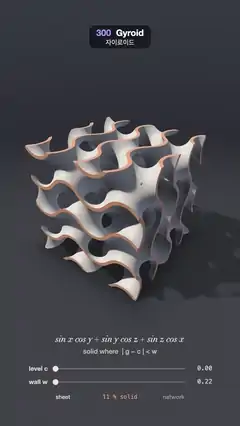

# 300 · Gyroid · 자이로이드



**EN** A 3D-printed gyroid lattice in a cube swings round as its walls thicken from a thin sheet between two labyrinths into the solid network, then thin back.  
**KO** 정육면체에 담긴 3D 프린팅 자이로이드 격자가 돌아가며, 두 미로를 가르는 얇은 판이 두꺼워져 단단한 그물 구조가 되었다가 다시 얇아진다.

[Video (mp4)](https://sueun-dev.github.io/motion-effects/videos/300-gyroid.mp4) · [Code](../effects/300-gyroid.js) · Modeling craft · 모델링 기법

## Prompt (English)

```text
Create a "Gyroid" motion effect: the triply periodic minimal surface sin x cos y + sin y cos z + sin z cos x = 0, cut by a cube and thickened into a 3D-printed lattice, morphing from a thin sheet into the skeletal network and back while the camera swings round it.

Look
- The field g = sin x cos y + sin y cos z + sin z cos x with (x, y, z) = 2π · (X, Y, Z): the cube has half size 1, so two periods fit across it.
- The solid is the shell |g − c| < w (level c, half wall w), cut by the cube |X|, |Y|, |Z| ≤ 1 (corners rounded 0.015).
- Material: walls in ivory nylon (0.93, 0.89, 0.82) with print layer lines fixed to the part, × (0.965 + 0.035 sin(140 Y)); the cube's cut faces in orange (1.0, 0.42, 0.2), so the cross-section reads.
- Lighting: a warm key (1, 0.95, 0.88) × 1.25 from direction (−0.55, 0.9, 0.45) with soft ray-marched shadows (k = 24), a cool fill (0.26, 0.3, 0.42) × 0.75 times ambient occlusion (two taps along the normal), a white specular (power 40, 0.18) and a cool rim (0.4, 0.5, 0.75) × 0.22 · (1 − n·v)³.
- The cube stands on a floor at Y = −1 (0.05, 0.053, 0.066) that takes the lattice's shadow and a soft contact darkening, fading into a dark backdrop gradient (0.016, 0.018, 0.026) → (0.04, 0.045, 0.062).
- Camera: distance 4.6 from (0, −0.08, 0), yaw 0.62 + 0.42 sin a, pitch 0.5 + 0.08 sin(2a + 0.8); focal length 1180 px, the cube's centre at row 900 (the cube is about 800 px wide).
- Below: the equation in italic serif 40 px "sin x cos y + sin y cos z + sin z cos x" (row 1530), "solid where | g − c | < w" (row 1584), two sliders, "level c" from 0 to 0.85 (row 1662) and "wall w" from 0.22 to 0.77 (row 1722), with orange #FF7A45 fills, knobs and their values in mono; under them "sheet" and "network" at the ends (the current one brighter) and "N % solid" in orange mono, the solid share sampled on a 24³ grid.

Motion (0–5 s), a = 2π · t / 5
- m = 0.5 − 0.5 cos a; c = 0.85 m, w = 0.22 + 0.55 m. At 0 s a thin sheet (11 % solid) that splits space into two interlocking labyrinths; as c and w grow, the top of the shell leaves the range of g and the solid swells into the skeletal (network) gyroid (about 47 % solid) at 2.5 s; then it thins back to the sheet.
- The camera swings with the yaw and pitch above.

Technique
- One full-screen fragment shader: ray-march only inside the cube's bounding box (up to 140 steps), distance max((|g − c| − w) / (2π · 1.75), box), the division keeping steps safe; central-difference normals; on the surface, the cut faces are where the box distance wins.
- 2 × 2 supersampling per pixel, tone map x / (1 + 0.35 x), gamma 2.2, a fixed grain of ±0.4 %.
- The equation, sliders and the solid share are drawn in a 2D canvas overlay.

Output and rules
- One self-contained HTML file with no external assets (three.js from a CDN is fine if you use it), drawing on a 1080 × 1920 canvas (9:16) scaled to fit the window.
- Write a function renderFrame(t) that draws the frame for time t in seconds, and preview it with requestAnimationFrame. Everything must be a pure function of t and fixed seeds: no Math.random(), Date or state carried between frames, so frame i = renderFrame(i / 30) can be exported to a 30 fps video.
- Loop seamlessly every 5 seconds: renderFrame(5) must look exactly like renderFrame(0).
- No flicker of any kind: no noise or grain that changes from frame to frame, no strobing or blinking, no z-fighting, no shimmering 1 px lines. Any grain or texture stays fixed to the screen or to the object.
- Keep the top 280 px free of important content (a title label goes there) and fill the whole frame with a designed background.
```

## 프롬프트 (한국어)

```text
"자이로이드" 모션 효과를 만들어 줘: 삼중 주기 극소 곡면 sin x cos y + sin y cos z + sin z cos x = 0을 정육면체로 잘라 두께를 주어 3D 프린팅 격자로 만들고, 얇은 판에서 뼈대 같은 그물 구조로 변했다 돌아오는 동안 카메라가 둘레를 돈다.

모양
- 필드 g = sin x cos y + sin y cos z + sin z cos x, (x, y, z) = 2π · (X, Y, Z): 정육면체 반 크기 1, 그래서 한 변에 두 주기가 들어간다.
- 고체는 껍질 |g − c| < w(등위 c, 벽 반두께 w)이고, 정육면체 |X|, |Y|, |Z| ≤ 1(모서리 0.015 둥글게)로 자른다.
- 재질: 벽은 아이보리 나일론 (0.93, 0.89, 0.82), 부품에 고정된 프린팅 층 무늬 × (0.965 + 0.035 sin(140 Y)). 정육면체로 잘린 면은 주황 (1.0, 0.42, 0.2)이라 단면이 읽힌다.
- 조명: 따뜻한 키 (1, 0.95, 0.88) × 1.25, 방향 (−0.55, 0.9, 0.45), 레이마칭 부드러운 그림자(k = 24). 차가운 필 (0.26, 0.3, 0.42) × 0.75 × 앰비언트 오클루전(노멀 방향 탭 두 개). 흰 스페큘러(지수 40, 0.18), 차가운 림 (0.4, 0.5, 0.75) × 0.22 · (1 − n·v)³.
- 정육면체는 Y = −1 바닥 (0.05, 0.053, 0.066) 위에 서 있고, 바닥에 격자 그림자와 부드러운 접촉 어둠이 지며, 어두운 배경 그라디언트 (0.016, 0.018, 0.026) → (0.04, 0.045, 0.062)로 사라진다.
- 카메라: (0, −0.08, 0)에서 거리 4.6, 방위 0.62 + 0.42 sin a, 높이각 0.5 + 0.08 sin(2a + 0.8). 초점 거리 1180px, 정육면체 중심은 900줄(폭 약 800px).
- 아래: 기울인 세리프 40px 수식 "sin x cos y + sin y cos z + sin z cos x"(1530줄), "solid where | g − c | < w"(1584줄), 슬라이더 둘 "level c" 0~0.85(1662줄), "wall w" 0.22~0.77(1722줄), 주황 #FF7A45 채움과 손잡이, 값은 고정폭. 그 아래 양 끝에 "sheet"와 "network"(지금 쪽이 더 밝음), 가운데 주황 고정폭 "N % solid"(24³ 격자로 샘플링한 고체 비율).

움직임 (0–5초), a = 2π · t / 5
- m = 0.5 − 0.5 cos a; c = 0.85 m, w = 0.22 + 0.55 m. 0초에는 공간을 맞물린 두 미로로 나누는 얇은 판(고체 11 %). c와 w가 커지면 껍질 윗면이 g의 범위를 벗어나 고체가 부풀어 2.5초에 뼈대(그물) 자이로이드(고체 약 47 %)가 되고, 다시 얇은 판으로 돌아간다.
- 카메라는 위의 방위·높이각으로 흔들린다.

기법
- 전체 화면 프래그먼트 셰이더 하나: 정육면체 경계 상자 안에서만 레이마칭(최대 140걸음), 거리 max((|g − c| − w) / (2π · 1.75), 상자). 나누기로 걸음이 안전하다. 노멀은 중심 차분, 표면에서 상자 거리가 이기는 곳이 잘린 면.
- 픽셀마다 2 × 2 슈퍼샘플링, 톤 매핑 x / (1 + 0.35 x), 감마 2.2, ±0.4 % 고정 그레인.
- 수식, 슬라이더, 고체 비율은 2D 캔버스 오버레이로 그린다.

출력과 규칙
- 외부 파일 없는 HTML 파일 하나(three.js를 쓴다면 CDN은 괜찮다). 1080 × 1920(9:16) 캔버스에 그리고 창 크기에 맞춰 보이게 한다.
- 시간 t(초)의 프레임을 그리는 renderFrame(t) 함수를 만들고, 미리보기는 requestAnimationFrame으로 돌린다. 모든 것은 t와 고정 시드만으로 정해진다: Math.random(), Date, 프레임 사이에 쌓이는 상태 금지. 그래야 i번째 프레임 = renderFrame(i / 30)으로 30fps 영상을 뽑을 수 있다.
- 5초마다 끊김 없이 반복: renderFrame(5)는 renderFrame(0)과 똑같아 보여야 한다.
- 어떤 깜빡임도 금지: 프레임마다 바뀌는 노이즈·그레인, 번쩍임·깜빡임, z-fighting, 반짝이며 떨리는 1px 선 모두 금지. 그레인·질감은 화면이나 물체에 고정한다.
- 위쪽 280px에는 중요한 내용을 두지 않고(제목 라벨 자리), 화면 전체를 디자인된 배경으로 채운다.
```
