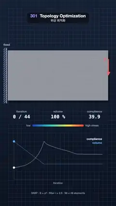

# 301 · Topology Optimization · 위상 최적화



**EN** SIMP topology optimization eats a solid bracket plate down to a bone-like truss, iteration by iteration, while compliance and volume are plotted below.  
**KO** SIMP 위상 최적화가 꽉 찬 브래킷 판을 반복할 때마다 깎아 뼈대 같은 트러스로 만들고, 아래에 컴플라이언스와 부피 그래프가 그려진다.

[Video (mp4)](https://sueun-dev.github.io/motion-effects/videos/301-topology-optimization.mp4) · [Code](../effects/301-topology-optimization.js) · Modeling craft · 모델링 기법

## Prompt (English)

```text
Create a "Topology Optimization" motion effect: a solid plate, bolted on its left edge and loaded at the middle of its right edge, is optimized with SIMP; iteration by iteration the material that carries no load disappears and a bone-like truss is left, coloured by stress; then the material grows back.

Look
- The problem: a 2:1 plate of 96 × 48 square four-node finite elements (plane stress, E = 1, ν = 0.3), the left edge fully fixed, a unit force straight down at the middle node of the right edge. On screen the plate is 936 × 468 px with its top-left corner at (72, 470).
- Backdrop: a blueprint gradient (0.035, 0.06, 0.11) at the bottom → (0.06, 0.1, 0.17) at the top, with a fixed 40 px grid.
- The plate as brushed metal (0.7, 0.72, 0.76) with a fixed horizontal brush texture; bevelled edges lit from (−0.5, 0.6, 0.65), the normal taken from the slope of the density; a soft drop shadow 14 px right and 18 px down; the 96 × 48 element grid faint on the material.
- Grey (intermediate) densities show as thinner, see-through material (opacity smoothstep(0.1, 0.85, ρ)); as the design settles to 0/1 its edge is drawn crisp at ρ = 0.5. Late in the run the stress colours come in at 62 %: von Mises stress in the material from deep blue through teal and yellow to red.
- Supports: a hatched wall at the left edge with "fixed"; the load: a red arrow #FF6A5C pointing down at the right edge, labelled "F".
- Read-outs (row 1040–1092): iteration "k / 44", volume in %, compliance; a stress legend bar "low … high stress" (row 1170); a chart 820 × 380 px at (130, 1290) of compliance (white) and volume (blue) against iteration, faint for the whole run and bright up to the current iteration, with dots at the current values; footer "SIMP · E = ρ³ · filter r = 2.8 · 96 × 48 elements" (row 1800).

Motion (0–5 s)
- Progress p = smoothstep(0.25 → 3.5 s) × (1 − easeInOut(3.8 → 5.0 s)); the iteration shown is 44 p^1.3, so the solid plate holds briefly, the early iterations (where most material goes) get the most time, the truss holds, and then the run plays back to the solid plate.
- Densities and stresses are blended linearly between neighbouring iterations, so material thins and vanishes smoothly.
- The crisp edge eases in between iterations 16 and 36, the stress colours between 22 and 40.

Technique
- SIMP: Young's modulus per element E(ρ) = 10⁻⁹ + ρ³ (1 − 10⁻⁹); compliance sensitivities −3ρ² uₑᵀ Kₑ uₑ; a sensitivity filter of radius 2.8 elements (weights 2.8 − distance); the optimality-criteria update with move limit 0.2 and bisection on the Lagrange multiplier. The allowed volume steps down from 100 % by 4 % per iteration to 40 %, so the plate is eaten away gradually.
- Every iteration solves K u = F with Jacobi-preconditioned conjugate gradients on a sparse (CSR) stiffness matrix assembled from the 8 × 8 element matrix (2 × 2 Gauss points), warm-started from the last solution. All 44 iterations are computed once at load (a few seconds) and stored.
- Stress for the colours: von Mises at each element's centre divided by ρ³; empty elements take the mean of the material around them, so the colour does not fade at the edges.
- Each frame the density and stress fields are upsampled 4× with Catmull-Rom into a 384 × 192 texture; a fragment shader draws the plate from it, and a 2D canvas overlay draws the supports, the load, the numbers and the chart.

Output and rules
- One self-contained HTML file with no external assets (three.js from a CDN is fine if you use it), drawing on a 1080 × 1920 canvas (9:16) scaled to fit the window.
- Write a function renderFrame(t) that draws the frame for time t in seconds, and preview it with requestAnimationFrame. Everything must be a pure function of t and fixed seeds: no Math.random(), Date or state carried between frames, so frame i = renderFrame(i / 30) can be exported to a 30 fps video.
- Loop seamlessly every 5 seconds: renderFrame(5) must look exactly like renderFrame(0).
- No flicker of any kind: no noise or grain that changes from frame to frame, no strobing or blinking, no z-fighting, no shimmering 1 px lines. Any grain or texture stays fixed to the screen or to the object.
- Keep the top 280 px free of important content (a title label goes there) and fill the whole frame with a designed background.
```

## 프롬프트 (한국어)

```text
"위상 최적화" 모션 효과를 만들어 줘: 왼쪽 가장자리를 볼트로 고정하고 오른쪽 가장자리 가운데에 힘을 건 꽉 찬 판을 SIMP로 최적화한다. 반복할 때마다 힘을 나르지 않는 재료가 사라져 뼈대 같은 트러스가 남고 응력으로 색칠된 뒤, 재료가 다시 차오른다.

모양
- 문제: 2:1 판, 사각형 4절점 유한 요소 96 × 48개(평면 응력, E = 1, ν = 0.3), 왼쪽 가장자리 완전 고정, 오른쪽 가장자리 가운데 절점에 아래로 단위 힘. 화면에서 판은 936 × 468px, 왼쪽 위 모서리 (72, 470).
- 배경: 청사진 그라디언트, 아래 (0.035, 0.06, 0.11) → 위 (0.06, 0.1, 0.17), 고정된 40px 격자.
- 판은 브러시드 금속 (0.7, 0.72, 0.76), 고정된 가로 결. 빛 방향 (−0.5, 0.6, 0.65)으로 비춘 베벨 가장자리(노멀은 밀도의 기울기에서), 오른쪽 14px·아래 18px의 부드러운 그림자, 재료 위에 96 × 48 요소 격자가 옅게.
- 회색(중간) 밀도는 얇고 비치는 재료로 보인다(불투명도 smoothstep(0.1, 0.85, ρ)). 설계가 0/1로 굳으면 가장자리를 ρ = 0.5에서 또렷하게 그린다. 후반에는 응력 색이 62 %로 들어온다: 재료 속 폰 미제스 응력, 짙은 파랑 → 청록 → 노랑 → 빨강.
- 지지: 왼쪽 가장자리에 빗금 벽과 "fixed". 하중: 오른쪽 가장자리에 아래를 향한 빨간 화살표 #FF6A5C와 "F".
- 수치(1040–1092줄): iteration "k / 44", volume %, compliance. 응력 범례 막대 "low … high stress"(1170줄). (130, 1290)에 820 × 380px 그래프: 반복에 따른 컴플라이언스(흰색)와 부피(파랑), 전체는 옅게, 지금 반복까지는 밝게, 지금 값에 점. 아래 줄(1800줄) "SIMP · E = ρ³ · filter r = 2.8 · 96 × 48 elements".

움직임 (0–5초)
- 진행도 p = smoothstep(0.25 → 3.5초) × (1 − easeInOut(3.8 → 5.0초)). 보이는 반복 = 44 p^1.3. 그래서 꽉 찬 판이 잠깐 머물고, 재료가 가장 많이 빠지는 앞쪽 반복에 시간이 가장 많이 가고, 트러스가 머문 뒤, 거꾸로 돌아 꽉 찬 판이 된다.
- 밀도와 응력은 이웃한 두 반복 사이를 선형으로 섞어, 재료가 부드럽게 얇아지고 사라진다.
- 또렷한 가장자리는 반복 16~36 사이, 응력 색은 22~40 사이에 서서히 들어온다.

기법
- SIMP: 요소마다 영률 E(ρ) = 10⁻⁹ + ρ³ (1 − 10⁻⁹). 컴플라이언스 민감도 −3ρ² uₑᵀ Kₑ uₑ. 반지름 2.8 요소 민감도 필터(가중치 2.8 − 거리). 이동 한계 0.2, 라그랑주 승수 이분법의 최적성 기준(OC) 갱신. 허용 부피는 반복마다 4 %씩 100 %에서 40 %로 내려가 판이 조금씩 깎인다.
- 반복마다 8 × 8 요소 행렬(2 × 2 가우스 점)로 조립한 희소(CSR) 강성 행렬로 K u = F를 자코비 전처리 켤레 기울기법으로 푼다(직전 해에서 시작). 44번 반복 모두 시작할 때 한 번(몇 초) 계산해 저장한다.
- 색에 쓰는 응력: 요소 중심의 폰 미제스 응력을 ρ³으로 나눈 값. 빈 요소는 주변 재료의 평균을 받아 가장자리에서 색이 바래지 않는다.
- 매 프레임 밀도와 응력 필드를 캣멀-롬으로 4배 키운 384 × 192 텍스처에 넣고, 프래그먼트 셰이더가 그것으로 판을 그린다. 지지, 하중, 숫자, 그래프는 2D 캔버스 오버레이로 그린다.

출력과 규칙
- 외부 파일 없는 HTML 파일 하나(three.js를 쓴다면 CDN은 괜찮다). 1080 × 1920(9:16) 캔버스에 그리고 창 크기에 맞춰 보이게 한다.
- 시간 t(초)의 프레임을 그리는 renderFrame(t) 함수를 만들고, 미리보기는 requestAnimationFrame으로 돌린다. 모든 것은 t와 고정 시드만으로 정해진다: Math.random(), Date, 프레임 사이에 쌓이는 상태 금지. 그래야 i번째 프레임 = renderFrame(i / 30)으로 30fps 영상을 뽑을 수 있다.
- 5초마다 끊김 없이 반복: renderFrame(5)는 renderFrame(0)과 똑같아 보여야 한다.
- 어떤 깜빡임도 금지: 프레임마다 바뀌는 노이즈·그레인, 번쩍임·깜빡임, z-fighting, 반짝이며 떨리는 1px 선 모두 금지. 그레인·질감은 화면이나 물체에 고정한다.
- 위쪽 280px에는 중요한 내용을 두지 않고(제목 라벨 자리), 화면 전체를 디자인된 배경으로 채운다.
```
