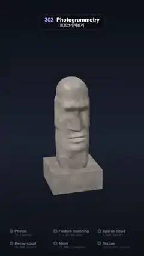

# 302 · Photogrammetry · 포토그래메트리



**EN** Thirty cameras surround a stone head; matched features, a sparse cloud, a dense cloud, a wireframe mesh and a projected texture rebuild it stage by stage.  
**KO** 카메라 30대가 돌 두상을 둘러싸고, 특징점 매칭, 희소 점군, 조밀 점군, 와이어프레임 메시, 투사 텍스처 순서로 두상을 한 단계씩 다시 만든다.

[Video (mp4)](https://sueun-dev.github.io/motion-effects/videos/302-photogrammetry.mp4) · [Code](../effects/302-photogrammetry.js) · Modeling craft · 모델링 기법

## Prompt (English)

```text
Create a "Photogrammetry" motion effect: a weathered stone head on a plinth is photographed by a rig of cameras round it and rebuilt stage by stage, the way photogrammetry software works: photos, feature matching, sparse cloud, dense cloud, mesh, texture.

Look
- Background: a vertical gradient #0B0F17 → #1B2230 (55 %) → #0C0F15; ACES Filmic tone mapping. Camera: perspective, 32°, at height 6 on a circle of radius 15.2 · 0.94 round the head, looking at (0, 1.3, 0); its angle is 0.3 cos(2π (t − 2.9) / 5), so the view turns slowest while the point clouds are up.
- The head, 3.05 tall, in the style of an Easter Island statue: a grid of 110 rings × 100 segments whose radius at height y and angle φ is a superellipse section (exponent 3, half sizes 0.52 across, 0.6 deep) with a heavy jaw, a domed crown, a deep brow ridge, eye sockets, a long straight nose, lips, a chin and long flat ears; it stands on a plinth 1.7 × 0.7 × 1.6 (22,512 triangles in all).
- Stone colour per vertex from 3D fbm: grey-brown (0.33, 0.29, 0.26) × (0.75 + 0.6 n + 0.28 m), n and m two noise scales, with grey-green lichen patches toward the crown and darker eye sockets.
- 30 cameras, all aimed at the head and drawn as light-blue #9FD8FF wire frustums (2.2 px) with a 0.3 × 0.2 image plane: a ring of 12 above the head (radius 1.9, height 3.85, aimed at (0, 2, 0)), and on each side three columns of three (60°, 90° and 120° round from the front, radius 2.25, heights 0.6, 1.5 and 2.4, aimed at (0, 1.5 + 0.3 (y − 1.5), 0)). So no camera ever stands between the viewer and the head, in any stage, whichever way the view swings.
- At the bottom the six stages in two rows of three (rows 1745 and 1837): a numbered dot, the name and a mono note: Photos (30 cameras), Feature matching (2 × 48 matches), Sparse cloud (1,500 points), Dense cloud (36,000 points), Mesh (22,500 triangles), Texture (projected colour). The current stage is lit (warm dot, white name).

Motion (0–5 s); the stages start at 0.15, 0.95, 1.75, 2.45, 3.15 and 3.85 s
- Photos: the head is the real, textured stone; the cameras pop in one by one, every 0.022 s (ease out over 0.25 s), each image plane flashing as it takes its shot (decay e^(−6 t)).
- Feature matching: the head fades to a 15 % ghost. Two neighbouring cameras on the right (60° and 90°, height 1.5) show their photos side by side (450 × 300 px each, row 1380), with 48 coloured match lines drawn one after another between the same features in both; in 3D, yellow rays #FFD27A grow from both cameras to those 48 points, which light up where the rays meet.
- Sparse cloud: 1,500 points on the surface (8 px soft dots, stone colour mixed 35 % with white) grow in.
- Dense cloud: 36,000 points (4.2 px soft dots, stone colour) grow in as the sparse ones shrink away.
- Mesh: a neutral grey surface (0.55, 0.55, 0.56) fades in with its triangle wireframe in cyan, drawn 45 % strong (it fades where triangles get tiny), while the dense points shrink away; the wireframe fades out again over 3.7–3.9 s.
- Texture: from 3.9 s the stone colours sweep up the plain grey head in a soft band over 0.6 s, straight from grey to stone (no tint in between); the cameras leave between 4.35 and 4.85 s; at 5 s it is the textured head of 0 s again.

Technique
- three.js. The head mesh is non-indexed with a barycentric attribute; one ShaderMaterial does the shading (lambert + sky), the ghost alpha, the texture sweep (1 − smoothstep(wipe − 0.25, wipe, height)) and the anti-aliased wireframe, which is only drawn where the texture has not arrived.
- The two matching photos are rendered once at load into 450 × 300 render targets (a 62° lens from each camera's position) and read back into canvases for the overlay; the match lines join each feature's projection in the two photos.
- Cloud points are sampled on the triangles by area with barycentric colours; each has a random seed and grows from 0 to full size as the stage's show value passes it; soft round dots use alpha to coverage.

Output and rules
- One self-contained HTML file with no external assets (three.js from a CDN is fine if you use it), drawing on a 1080 × 1920 canvas (9:16) scaled to fit the window.
- Write a function renderFrame(t) that draws the frame for time t in seconds, and preview it with requestAnimationFrame. Everything must be a pure function of t and fixed seeds: no Math.random(), Date or state carried between frames, so frame i = renderFrame(i / 30) can be exported to a 30 fps video.
- Loop seamlessly every 5 seconds: renderFrame(5) must look exactly like renderFrame(0).
- No flicker of any kind: no noise or grain that changes from frame to frame, no strobing or blinking, no z-fighting, no shimmering 1 px lines. Any grain or texture stays fixed to the screen or to the object.
- Keep the top 280 px free of important content (a title label goes there) and fill the whole frame with a designed background.
```

## 프롬프트 (한국어)

```text
"포토그래메트리" 모션 효과를 만들어 줘: 받침 위 풍화된 돌 두상을 둘레의 카메라들이 찍고, 포토그래메트리 프로그램처럼 사진, 특징점 매칭, 희소 점군, 조밀 점군, 메시, 텍스처 순서로 한 단계씩 다시 만든다.

모양
- 배경: 세로 그라디언트 #0B0F17 → #1B2230(55 %) → #0C0F15, ACES Filmic 톤 매핑. 카메라: 원근 32°, 두상 둘레 반지름 15.2 · 0.94 원 위 높이 6에서 (0, 1.3, 0)을 본다. 각도는 0.3 cos(2π (t − 2.9) / 5)라서 점군이 떠 있을 때 가장 천천히 돈다.
- 두상: 높이 3.05, 이스터섬 석상풍. 링 110개 × 분할 100 격자, 높이 y와 각도 φ의 반지름은 초타원 단면(지수 3, 가로 반 0.52, 깊이 반 0.6)에 두꺼운 턱, 둥근 정수리, 깊은 눈썹 뼈, 눈구멍, 길고 곧은 코, 입술, 턱끝, 길고 납작한 귀. 1.7 × 0.7 × 1.6 받침 위에 선다(모두 삼각형 22,512개).
- 꼭짓점마다 3D fbm으로 돌 색: 회갈색 (0.33, 0.29, 0.26) × (0.75 + 0.6 n + 0.28 m)(n, m은 두 크기의 노이즈), 정수리 쪽 회녹색 이끼 얼룩, 더 어두운 눈구멍.
- 카메라 30대, 모두 두상을 향하고 하늘색 #9FD8FF 철사 절두체(2.2px)와 0.3 × 0.2 이미지 판으로 그린다: 두상 위 고리에 12대(반지름 1.9, 높이 3.85, (0, 2, 0)을 향함), 양옆에 세 대씩 세 줄(정면에서 60°, 90°, 120°, 반지름 2.25, 높이 0.6, 1.5, 2.4, (0, 1.5 + 0.3 (y − 1.5), 0)을 향함). 그래서 어느 단계에서도, 시점이 어느 쪽으로 돌아도 보는 사람과 두상 사이에 카메라가 서지 않는다.
- 아래쪽에 여섯 단계를 세 개씩 두 줄(1745·1837줄): 번호 점, 이름, 고정폭 설명: Photos(30 cameras), Feature matching(2 × 48 matches), Sparse cloud(1,500 points), Dense cloud(36,000 points), Mesh(22,500 triangles), Texture(projected colour). 지금 단계가 켜진다(따뜻한 점, 흰 이름).

움직임 (0–5초), 단계 시작 0.15, 0.95, 1.75, 2.45, 3.15, 3.85초
- 사진: 두상은 텍스처가 입혀진 진짜 돌. 카메라가 0.022초마다 하나씩 나타나고(0.25초 ease out), 찍을 때 이미지 판이 번쩍였다가 잦아든다(e^(−6 t)).
- 특징점 매칭: 두상이 15 % 유령으로 흐려진다. 오른쪽 이웃 카메라 둘(60°와 90°, 높이 1.5)의 사진이 나란히 뜨고(각 450 × 300px, 1380줄), 두 사진의 같은 특징점 사이에 색색의 매칭 선 48개가 하나씩 그어진다. 3D에서는 두 카메라에서 노란 광선 #FFD27A가 그 48개 점으로 자라나고, 광선이 만나는 점이 켜진다.
- 희소 점군: 표면 위 점 1,500개(8px 부드러운 점, 돌 색에 흰색 35 %)가 자라난다.
- 조밀 점군: 점 36,000개(4.2px 부드러운 점, 돌 색)가 자라나고 희소 점들은 작아져 사라진다.
- 메시: 중성 회색 표면 (0.55, 0.55, 0.56)이 45 % 세기의 청록 삼각형 와이어프레임과 함께 나타나고(삼각형이 아주 작은 곳은 선이 옅어짐), 조밀 점들이 작아져 사라진다. 와이어프레임은 3.7–3.9초에 다시 사라진다.
- 텍스처: 3.9초부터 돌 색이 부드러운 띠로 0.6초 동안 민무늬 회색 두상을 타고 올라간다. 회색에서 곧바로 돌 색이 되고 중간에 다른 색이 끼지 않는다. 카메라는 4.35–4.85초에 떠나고, 5초에는 0초의 텍스처 두상이 된다.

기법
- three.js. 두상 메시는 인덱스 없는 메시에 무게중심 좌표 속성. ShaderMaterial 하나가 셰이딩(램버트 + 하늘빛), 유령 알파, 텍스처 띠(1 − smoothstep(wipe − 0.25, wipe, 높이)), 안티에일리어싱 와이어프레임을 맡고, 와이어프레임은 텍스처가 아직 닿지 않은 곳에만 그린다.
- 매칭용 사진 두 장은 시작할 때 450 × 300 렌더 타깃에 한 번 그려(각 카메라 위치에서 62° 렌즈) 오버레이용 캔버스로 읽어 온다. 매칭 선은 두 사진에 투영된 같은 특징점을 잇는다.
- 점군의 점은 삼각형 넓이에 비례해 뽑고 무게중심 좌표로 색을 섞는다. 점마다 무작위 시드가 있어, 단계의 표시 값이 그 시드를 지나면 0에서 원래 크기로 자란다. 부드러운 둥근 점은 alpha to coverage.

출력과 규칙
- 외부 파일 없는 HTML 파일 하나(three.js를 쓴다면 CDN은 괜찮다). 1080 × 1920(9:16) 캔버스에 그리고 창 크기에 맞춰 보이게 한다.
- 시간 t(초)의 프레임을 그리는 renderFrame(t) 함수를 만들고, 미리보기는 requestAnimationFrame으로 돌린다. 모든 것은 t와 고정 시드만으로 정해진다: Math.random(), Date, 프레임 사이에 쌓이는 상태 금지. 그래야 i번째 프레임 = renderFrame(i / 30)으로 30fps 영상을 뽑을 수 있다.
- 5초마다 끊김 없이 반복: renderFrame(5)는 renderFrame(0)과 똑같아 보여야 한다.
- 어떤 깜빡임도 금지: 프레임마다 바뀌는 노이즈·그레인, 번쩍임·깜빡임, z-fighting, 반짝이며 떨리는 1px 선 모두 금지. 그레인·질감은 화면이나 물체에 고정한다.
- 위쪽 280px에는 중요한 내용을 두지 않고(제목 라벨 자리), 화면 전체를 디자인된 배경으로 채운다.
```
