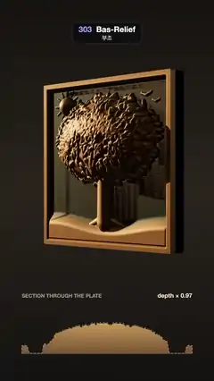

# 303 · Bas-Relief · 부조



**EN** A bronze tree-of-life plaque is squeezed from a deep, rounded sculpture to 8 % of its depth while a low raking light circles it and reveals the form.  
**KO** 깊고 둥근 생명의 나무 청동 조각이 깊이의 8 %로 눌려 얕은 부조판이 되고, 낮게 원을 그리는 측광이 그래도 살아 있는 형태를 드러낸다.

[Video (mp4)](https://sueun-dev.github.io/motion-effects/videos/303-bas-relief.mp4) · [Code](../effects/303-bas-relief.js) · Modeling craft · 모델링 기법

## Prompt (English)

```text
Create a "Bas-Relief" motion effect: a bronze plaque of a tree of life that turns from a deep, rounded sculpture into a shallow bas-relief, its depth squeezed to 8 %, while a low raking light circles it and still reveals the full form.

Look
- The figure is a height field on a 512 × 512 grid over a square plate (u, v from 0 to 1, heights in plate widths). Every part is a round solid and each cell keeps the highest surface:
  - a capsule from A to B with radius r and centre height c: height = c + √(r² − d²), d = distance to the segment (r and c taper linearly along it);
  - an almond leaf (ellipsoid) with half-axes a, b, turned by an angle: height = c + depth · √(1 − q), q = (x/a)² + (y/b)².
- Parts (seeded random, seed 303):
  - canopy: a half-dome 0.17 · √(1 − ((u − 0.5)/0.37)² − ((v − 0.64)/0.24)²);
  - ground: a low hill 0.04 high along the bottom, its top edge at v = 0.16 + 0.025 · sin(7u + 1);
  - trunk: capsule (0.5, 0.15) → (0.5, 0.5), radius 0.06 → 0.042; four roots spreading from (0.5, 0.18), radius 0.032 → 0.012;
  - branches: three from the trunk top, two at 90° ± 31.5° (length 0.09, radius 0.032, splitting four more times) and one straight up (length 0.1, radius 0.028, three more times); each split gives two branches ±0.48 rad apart (30 % of the time three, at −0.55, 0, +0.55) plus up to ±0.15 rad of jitter, length × 0.7–0.82 and radius × 0.72 per level, their centre height 0.02 + 0.8 × the dome;
  - leaves: 520 scattered over the canopy ellipse (radii 0.4 × 0.27) plus 7 round every twig tip, each 0.024–0.034 long, 0.011–0.015 wide, randomly turned, 0.022 deep, sitting on the dome (c = dome − 0.006); a 0.016 round fruit at a quarter of the tips;
  - a sun at (0.17, 0.86), radius 0.055 and 0.05 deep, with 12 rays from 0.07 to 0.1 out; two birds of two short capsules each at the top right;
  - a raised rim 0.045 high round the edge.
- The field is softened by a 1-cell box blur run twice.
- Full depth: the heights × 2 (the plate is 2 units wide), so the canopy stands out about 0.4 units: a deep, rounded sculpture.
- Bas-relief: h_r = 2 · 0.08 · top · ( ln(1 + h/0.025) / ln(1 + top/0.025) + 1.2 · (h − blur(h)) / top ), where top is the highest h and blur is a radius-5 box blur run twice. The log curve flattens the big steps far more than the small ones, and the fine detail is added back.
- Bronze by vertex colour: patina #3B4636 on the bare plate, bronze #B07D45 where the figure rises (smoothstep 0 → 0.02), polished #F0C27A on the crests (h − blur(h)) · 60. Standard material, metalness 0.55, roughness 0.5. A 2 × 2 × 0.16 back block #4A3A26 behind the plate.
- Background: vertical gradient #16130F → #2A241D (50 %) → #141210. Environment light 0.06, hemisphere light #9AA6C8 / #2A2018 at 0.22.
- A section panel under the plate (x 110–970, baseline y = 1780): "SECTION THROUGH THE PLATE" (left) and "depth × 1.00 … 0.08" (right) at y = 1500; the full-depth profile through v = 0.6 as a dashed line, the current profile filled with a bronze gradient #E0AE66 → #7A5530, at 430 px per unit.

Motion (one 5 s cycle; the video starts 0.5 s into it)
- Depth mix k = smoothstep(0.4, 1.4, t) · (1 − smoothstep(4.0, 4.95, t)): 0 = full depth, 1 = bas-relief. Each vertex height is lerp(full, relief, k) and its normal comes from the lerped slopes.
- Camera: 30° field of view, 8.4 units from the plate, 0.25 below its centre, looking at (0, −0.32, 0); yaw 42° − 34° · smoothstep(1.45, 2.3, t) · (1 − smoothstep(3.2, 4.0, t)). It watches from the side while the depth is squeezed, turns to face the plate (8°), and turns back before the depth swells again.
- Raking light: a warm directional light #FFE7C4, intensity 5.5, 13° above the plate, its direction circling the plate once per loop (azimuth 2π t / 5 + 2.2), casting soft shadows across the leaves.

Technique
- three.js. One 512 × 512 plane mesh. Both height fields and their slopes are computed once; each frame only lerps heights and slopes (no normal recomputation).
- VSM shadow map 2048 (radius 6, 12 blur samples), so the grazing light gives soft shadows with no acne; ACES Filmic tone mapping.

Output and rules
- One self-contained HTML file with no external assets (three.js from a CDN is fine if you use it), drawing on a 1080 × 1920 canvas (9:16) scaled to fit the window.
- Write a function renderFrame(t) that draws the frame for time t in seconds, and preview it with requestAnimationFrame. Everything must be a pure function of t and fixed seeds: no Math.random(), Date or state carried between frames, so frame i = renderFrame(i / 30) can be exported to a 30 fps video.
- Loop seamlessly every 5 seconds: renderFrame(5) must look exactly like renderFrame(0).
- No flicker of any kind: no noise or grain that changes from frame to frame, no strobing or blinking, no z-fighting, no shimmering 1 px lines. Any grain or texture stays fixed to the screen or to the object.
- Keep the top 280 px free of important content (a title label goes there) and fill the whole frame with a designed background.
```

## 프롬프트 (한국어)

```text
"부조(Bas-Relief)" 모션 효과를 만들어 줘: 생명의 나무를 새긴 청동판이 깊고 둥근 조각에서 깊이를 8 %로 눌러 얕은 부조가 되고, 낮게 원을 그리는 측광(레이킹 라이트)이 그래도 온전한 형태를 드러내는 효과.

모양
- 형상은 정사각형 판 위 512 × 512 격자의 높이장이다(u, v는 0~1, 높이는 판 폭 단위). 모든 부분은 둥근 입체이고, 칸마다 가장 높은 면을 남긴다:
  - A에서 B까지 반지름 r, 중심 높이 c인 캡슐: 높이 = c + √(r² − d²), d = 선분까지 거리(r과 c는 선분을 따라 직선으로 바뀐다);
  - 반축 a, b에 각도만큼 돌린 아몬드 잎(타원체): 높이 = c + 깊이 · √(1 − q), q = (x/a)² + (y/b)².
- 부분들(시드 303의 고정 난수):
  - 수관: 반구 0.17 · √(1 − ((u − 0.5)/0.37)² − ((v − 0.64)/0.24)²);
  - 땅: 아래쪽을 따라 높이 0.04의 낮은 언덕, 윗선은 v = 0.16 + 0.025 · sin(7u + 1);
  - 줄기: 캡슐 (0.5, 0.15) → (0.5, 0.5), 반지름 0.06 → 0.042; (0.5, 0.18)에서 퍼지는 뿌리 넷, 반지름 0.032 → 0.012;
  - 가지: 줄기 끝에서 셋. 90° ± 31.5°로 둘(길이 0.09, 반지름 0.032, 네 번 더 갈라짐), 곧게 위로 하나(길이 0.1, 반지름 0.028, 세 번 더). 갈라질 때마다 ±0.48 rad 벌어진 두 가지(30 %는 −0.55, 0, +0.55의 세 가지)에 최대 ±0.15 rad 흔들림, 단계마다 길이 × 0.7~0.82, 반지름 × 0.72, 중심 높이는 0.02 + 0.8 × 수관 반구;
  - 잎: 수관 타원(반지름 0.4 × 0.27) 전체에 520장, 잔가지 끝마다 7장. 길이 0.024~0.034, 폭 0.011~0.015, 무작위 방향, 깊이 0.022, 수관 위에 얹힌다(c = 반구 − 0.006). 가지 끝 4분의 1에 지름 0.016의 둥근 열매;
  - (0.17, 0.86)에 반지름 0.055, 깊이 0.05의 해와 0.07~0.1 거리의 빛살 12개; 오른쪽 위에 짧은 캡슐 두 개로 된 새 두 마리;
  - 가장자리를 두르는 높이 0.045의 테두리.
- 높이장은 1칸 박스 블러를 두 번 걸어 부드럽게 한다.
- 원래 깊이: 높이 × 2(판 폭이 2단위), 그래서 수관이 약 0.4단위 튀어나온다: 깊고 둥근 조각.
- 부조: h_r = 2 · 0.08 · top · ( ln(1 + h/0.025) / ln(1 + top/0.025) + 1.2 · (h − blur(h)) / top ). top은 가장 높은 h, blur는 반지름 5 박스 블러 두 번. 로그 곡선이 큰 단차를 작은 단차보다 훨씬 많이 눌러 주고, 잔디테일은 다시 더해 준다.
- 정점 색으로 청동: 맨 판은 녹청 #3B4636, 형상이 솟은 곳은 청동 #B07D45(smoothstep 0 → 0.02), 볼록한 마루는 광택 #F0C27A((h − blur(h)) · 60). 표준 재질, 금속성 0.55, 거칠기 0.5. 판 뒤에 2 × 2 × 0.16 받침 #4A3A26.
- 배경: 세로 그라디언트 #16130F → #2A241D(50 %) → #141210. 환경광 0.06, 반구광 #9AA6C8 / #2A2018 세기 0.22.
- 판 아래 단면 패널(x 110~970, 기준선 y = 1780): y = 1500에 "SECTION THROUGH THE PLATE"(왼쪽)와 "depth × 1.00 … 0.08"(오른쪽). v = 0.6을 지나는 원래 깊이 단면은 점선, 지금 단면은 청동 그라디언트 #E0AE66 → #7A5530으로 채운다(1단위 = 430 px).

움직임 (5초 한 주기, 영상은 주기의 0.5초에서 시작)
- 깊이 섞기 k = smoothstep(0.4, 1.4, t) · (1 − smoothstep(4.0, 4.95, t)): 0 = 원래 깊이, 1 = 부조. 정점 높이는 lerp(원래, 부조, k), 법선은 섞은 기울기에서 구한다.
- 카메라: 시야각 30°, 판에서 8.4단위, 판 중심보다 0.25 아래에서 (0, −0.32, 0)을 본다. 요 각 = 42° − 34° · smoothstep(1.45, 2.3, t) · (1 − smoothstep(3.2, 4.0, t)). 깊이가 눌리는 동안 옆에서 보다가 판 정면(8°)으로 돌고, 깊이가 다시 부풀기 전에 돌아온다.
- 측광: 따뜻한 방향광 #FFE7C4, 세기 5.5, 판 위 13°. 방향이 한 주기에 판을 한 바퀴 돈다(방위각 2π t / 5 + 2.2). 잎 위로 부드러운 그림자를 드리운다.

기법
- three.js. 512 × 512 평면 메시 하나. 두 높이장과 기울기는 한 번만 계산하고, 매 프레임 높이와 기울기만 섞는다(법선 재계산 없음).
- VSM 그림자 맵 2048(반지름 6, 블러 샘플 12)이라 스치는 빛에도 그림자가 부드럽고 얼룩(acne)이 없다. ACES Filmic 톤 매핑.

출력과 규칙
- 외부 파일 없는 HTML 파일 하나(three.js를 쓴다면 CDN은 괜찮다). 1080 × 1920(9:16) 캔버스에 그리고 창 크기에 맞춰 보이게 한다.
- 시간 t(초)의 프레임을 그리는 renderFrame(t) 함수를 만들고, 미리보기는 requestAnimationFrame으로 돌린다. 모든 것은 t와 고정 시드만으로 정해진다: Math.random(), Date, 프레임 사이에 쌓이는 상태 금지. 그래야 i번째 프레임 = renderFrame(i / 30)으로 30fps 영상을 뽑을 수 있다.
- 5초마다 끊김 없이 반복: renderFrame(5)는 renderFrame(0)과 똑같아 보여야 한다.
- 어떤 깜빡임도 금지: 프레임마다 바뀌는 노이즈·그레인, 번쩍임·깜빡임, z-fighting, 반짝이며 떨리는 1px 선 모두 금지. 그레인·질감은 화면이나 물체에 고정한다.
- 위쪽 280px에는 중요한 내용을 두지 않고(제목 라벨 자리), 화면 전체를 디자인된 배경으로 채운다.
```
