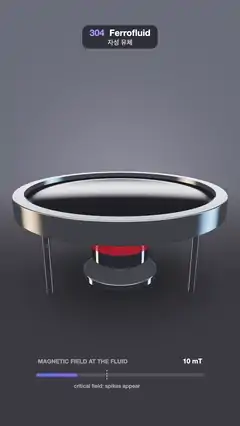

# 304 · Ferrofluid · 자성 유체



**EN** A magnet lifts under a dish of glossy black ferrofluid; past the critical field sharp spikes rise in a hexagonal pattern, then sink back to a mirror.  
**KO** 광택 있는 검은 자성 유체 접시 아래로 자석이 올라오고, 임계 자기장을 넘자 날카로운 가시가 육각형으로 솟았다가 다시 거울 같은 수면으로 가라앉는다.

[Video (mp4)](https://sueun-dev.github.io/motion-effects/videos/304-ferrofluid.mp4) · [Code](../effects/304-ferrofluid.js) · Physical phenomena · 물리 현상

## Prompt (English)

```text
Create a "Ferrofluid" motion effect: a pool of glossy black magnetic fluid in an aluminium dish; a magnet lifts up under it, the surface bulges, and past the critical field sharp Rosensweig spikes rise in a hexagonal pattern, then sink back as the magnet lowers.

Look
- Scene units: the fluid fills a circle of radius 1 at y ≈ 0. The dish is a cylinder of radius 1.1 and half-height 0.09 centred at y = −0.035 (edges rounded 0.012), hollowed out to radius 1 above y = −0.04. It stands on three chrome legs (radius 0.035, at radius 0.86) on a dark table at y = −0.95.
- The magnet: a cylinder of radius 0.32 and height 0.26, its top 0.12 painted red (the north face), chrome below, on a chrome rod (radius 0.07) from a base disc (radius 0.42) on the table. Its top is at y = lerp(−0.66, −0.165, lift).
- The fluid surface over (x, z), r = distance from the centre:
  - mound 0.07 · F · (1 − r²) − 0.012 · F, meniscus 0.018 · exp(−(1 − r)/0.03) at the wall, where F is the field (0..1);
  - spikes on a hexagonal lattice with spacing 0.165 (points within r < 0.86): each a concave cone amp · (1 − d/(0.6 · 0.165))^2.2, with d = √(distance² + 0.00012) so the tip is slightly round; amp = grow · (0.34 − 0.2 rc²), grow = smoothstep(0.42 + 0.42 rc, 0.72 + 0.42 rc, F) (rc = the lattice point's distance from the centre, so the middle spikes rise first and tallest); the surface takes the highest cone.
- Shading: the fluid is almost pure reflection: Fresnel 0.05 + 0.95 (1 − cos θ)^5 times the studio, plus a faint (0.006, 0.006, 0.008). The dish is brushed aluminium (blurred studio × (0.62, 0.64, 0.68) + 0.03), legs and rod chrome, the red face lit by a simple diffuse term.
- The studio (for reflections): dark walls from (0.018, 0.02, 0.028) below to (0.07, 0.075, 0.09) above; a big soft box overhead (|x| < 0.75, |z − 0.15| < 0.42 on the plane y = 1, colour (3.2, 3.1, 2.9)); a thin strip light behind the dish (|x| < 0.8, |y − 0.2| < 0.035 on z = −1, (2.4, 2.4, 2.6)); warm (2.6, 1.7, 1.0) and cool (1.0, 1.7, 2.8) vertical strips on the left and right.
- Backdrop: a graphite gradient (0.03, 0.032, 0.045) → (0.11, 0.115, 0.14) with a soft pool of light behind the dish; the table (0.045, 0.043, 0.05), darker under the dish.
- Camera at (0, 0.78, 3.2) looking at (0, −0.3, 0), focal length 1/0.4 (uv = (2 · pixel − resolution) / width, plus (0, 0.06)).
- A gauge under the dish (x 170–910, y = 1690): "MAGNETIC FIELD AT THE FLUID" and the reading F · 42 mT above it; a 14 px rounded bar filled with a gradient #5F7BFF → #B26BFF → #FF5C7A; a dashed white mark at 42 % labelled "critical field: spikes appear".

Motion (one 5 s cycle; the video starts 0.6 s into it)
- Magnet lift = smoothstep(0, 1.4, t) · (1 − smoothstep(3.0, 4.4, t)).
- Field F = smoothstep(0.15, 1.6, t) · (1 − smoothstep(3.1, 4.5, t)): the surface first bulges, then past F ≈ 0.42 the middle spikes grow, then the outer rings; they hold while the magnet is up, then sink as it lowers. From 4.5 s to the end the pool is a still mirror.

Technique
- One full-screen fragment shader. The solids are signed distance fields (raymarched, 160 steps); the table is a plane hit analytically.
- The fluid is a height field: the ray is clipped to the cylinder r < 1 between y = 0.45 and the dish floor (y = −0.04), marched with steps of max(0.0015, 0.22 · (y − height)), and the crossing refined by 8 bisection steps; normals from central differences (0.0015). The hexagonal lattice is found by inverting the lattice basis and testing the 4 × 4 nearest points.
- 2 × 2 supersampling, the ACES fit curve, gamma 2.2 and a fixed (never moving) ±0.5/255 dither against banding.

Output and rules
- One self-contained HTML file with no external assets (three.js from a CDN is fine if you use it), drawing on a 1080 × 1920 canvas (9:16) scaled to fit the window.
- Write a function renderFrame(t) that draws the frame for time t in seconds, and preview it with requestAnimationFrame. Everything must be a pure function of t and fixed seeds: no Math.random(), Date or state carried between frames, so frame i = renderFrame(i / 30) can be exported to a 30 fps video.
- Loop seamlessly every 5 seconds: renderFrame(5) must look exactly like renderFrame(0).
- No flicker of any kind: no noise or grain that changes from frame to frame, no strobing or blinking, no z-fighting, no shimmering 1 px lines. Any grain or texture stays fixed to the screen or to the object.
- Keep the top 280 px free of important content (a title label goes there) and fill the whole frame with a designed background.
```

## 프롬프트 (한국어)

```text
"자성 유체(Ferrofluid)" 모션 효과를 만들어 줘: 알루미늄 접시에 담긴 광택 있는 검은 자성 유체 아래로 자석이 올라오면 수면이 부풀고, 임계 자기장을 넘으면 로젠스바이크 가시가 육각형으로 솟았다가 자석이 내려가면 다시 가라앉는 효과.

모양
- 장면 단위: 유체는 반지름 1의 원을 y ≈ 0 높이로 채운다. 접시는 반지름 1.1, 반높이 0.09인 원기둥(중심 y = −0.035, 모서리 둥글기 0.012)을 y = −0.04 위로 반지름 1만큼 파낸 것. 크롬 다리 셋(반지름 0.035, 반지름 0.86 위치)으로 y = −0.95의 어두운 탁자 위에 서 있다.
- 자석: 반지름 0.32, 높이 0.26의 원기둥. 위 0.12는 빨간 칠(N극), 아래는 크롬. 탁자 위 받침 원판(반지름 0.42)에서 올라온 크롬 막대(반지름 0.07) 위에 있다. 윗면 높이 y = lerp(−0.66, −0.165, lift).
- (x, z)에서의 유체 수면, r = 중심에서 거리:
  - 언덕 0.07 · F · (1 − r²) − 0.012 · F, 벽의 메니스커스 0.018 · exp(−(1 − r)/0.03). F는 자기장(0~1);
  - 간격 0.165의 육각 격자(r < 0.86 안의 점)마다 오목한 원뿔 amp · (1 − d/(0.6 · 0.165))^2.2. d = √(거리² + 0.00012)로 끝을 살짝 둥글게. amp = grow · (0.34 − 0.2 rc²), grow = smoothstep(0.42 + 0.42 rc, 0.72 + 0.42 rc, F)(rc = 격자점의 중심 거리, 그래서 가운데 가시가 먼저, 가장 높이 솟는다). 수면은 가장 높은 원뿔을 따른다.
- 셰이딩: 유체는 거의 순수한 반사다: 프레넬 0.05 + 0.95 (1 − cos θ)^5 × 스튜디오, 그리고 아주 옅은 (0.006, 0.006, 0.008). 접시는 브러시드 알루미늄(흐린 스튜디오 × (0.62, 0.64, 0.68) + 0.03), 다리와 막대는 크롬, 빨간 면은 단순 확산광.
- 반사용 스튜디오: 아래 (0.018, 0.02, 0.028)에서 위 (0.07, 0.075, 0.09)로 가는 어두운 벽; 머리 위 큰 소프트박스(평면 y = 1에서 |x| < 0.75, |z − 0.15| < 0.42, 색 (3.2, 3.1, 2.9)); 접시 뒤 가는 띠 조명(평면 z = −1에서 |x| < 0.8, |y − 0.2| < 0.035, (2.4, 2.4, 2.6)); 왼쪽과 오른쪽의 따뜻한 (2.6, 1.7, 1.0)·차가운 (1.0, 1.7, 2.8) 세로 띠 조명.
- 배경: 흑연색 그라디언트 (0.03, 0.032, 0.045) → (0.11, 0.115, 0.14)와 접시 뒤의 부드러운 빛웅덩이. 탁자 (0.045, 0.043, 0.05), 접시 아래는 더 어둡게.
- 카메라는 (0, 0.78, 3.2)에서 (0, −0.3, 0)을 보고 초점 거리 1/0.4(uv = (2 · 픽셀 − 해상도) / 폭 + (0, 0.06)).
- 접시 아래 게이지(x 170~910, y = 1690): 위에 "MAGNETIC FIELD AT THE FLUID"와 F · 42 mT 값. 14 px 둥근 막대는 #5F7BFF → #B26BFF → #FF5C7A 그라디언트로 차오르고, 42 % 위치의 흰 점선 표시에 "critical field: spikes appear".

움직임 (5초 한 주기, 영상은 주기의 0.6초에서 시작)
- 자석 높이 lift = smoothstep(0, 1.4, t) · (1 − smoothstep(3.0, 4.4, t)).
- 자기장 F = smoothstep(0.15, 1.6, t) · (1 − smoothstep(3.1, 4.5, t)): 수면이 먼저 부풀고, F ≈ 0.42를 넘으면 가운데 가시, 이어서 바깥 고리들이 솟는다. 자석이 올라와 있는 동안 그대로 섰다가 내려가면 가라앉는다. 4.5초부터 끝까지 수면은 움직이지 않는 거울이다.

기법
- 전체 화면 프래그먼트 셰이더 하나. 고체는 부호 거리장(레이마칭 160걸음), 탁자는 해석적으로 만나는 평면.
- 유체는 높이장: 광선을 r < 1 원기둥, y = 0.45에서 접시 바닥(y = −0.04) 사이로 자르고, max(0.0015, 0.22 · (y − 높이)) 걸음으로 나아가 교차점을 이분법 8번으로 다듬는다. 법선은 중앙 차분(0.0015). 육각 격자는 격자 기저를 역변환해 가까운 4 × 4 점을 확인한다.
- 2 × 2 슈퍼샘플링, ACES 근사 곡선, 감마 2.2, 밴딩을 막는 고정된(움직이지 않는) ±0.5/255 디더.

출력과 규칙
- 외부 파일 없는 HTML 파일 하나(three.js를 쓴다면 CDN은 괜찮다). 1080 × 1920(9:16) 캔버스에 그리고 창 크기에 맞춰 보이게 한다.
- 시간 t(초)의 프레임을 그리는 renderFrame(t) 함수를 만들고, 미리보기는 requestAnimationFrame으로 돌린다. 모든 것은 t와 고정 시드만으로 정해진다: Math.random(), Date, 프레임 사이에 쌓이는 상태 금지. 그래야 i번째 프레임 = renderFrame(i / 30)으로 30fps 영상을 뽑을 수 있다.
- 5초마다 끊김 없이 반복: renderFrame(5)는 renderFrame(0)과 똑같아 보여야 한다.
- 어떤 깜빡임도 금지: 프레임마다 바뀌는 노이즈·그레인, 번쩍임·깜빡임, z-fighting, 반짝이며 떨리는 1px 선 모두 금지. 그레인·질감은 화면이나 물체에 고정한다.
- 위쪽 280px에는 중요한 내용을 두지 않고(제목 라벨 자리), 화면 전체를 디자인된 배경으로 채운다.
```
