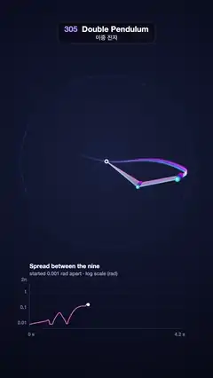

# 305 · Double Pendulum · 이중 진자



**EN** Nine double pendulums let go 0.001 rad apart swing as one, then fan out into chaos with glowing trails while a log-scale plot tracks the spread.  
**KO** 0.001 rad 차이로 놓인 이중 진자 아홉 개가 한 몸처럼 흔들리다 빛나는 궤적을 그리며 혼돈 속으로 흩어지고, 로그 그래프가 벌어짐을 그린다.

[Video (mp4)](https://sueun-dev.github.io/motion-effects/videos/305-double-pendulum.mp4) · [Code](../effects/305-double-pendulum.js) · Physical phenomena · 물리 현상

## Prompt (English)

```text
Create a "Double Pendulum" motion effect: nine double pendulums hang from one pivot and are let go from the same pose, each 0.001 rad apart; for a moment they swing as one, then the tiny difference grows until they fan out into chaos, each drawing its own glowing trail.

Look
- Background: a radial gradient centred on the pivot (540, 820): #18203E → #0D1228 (55 %) → #070915 at radius 1250.
- A reach circle of radius 434 px round the pivot, rgba(150, 170, 255, 0.16), 2 px, with 72 ticks pointing out (every sixth 18 px long, the others 8 px).
- Nine pendulums, rods 205 px each, hue = 188 + 140 · i/8 (cyan → violet → magenta). Rods: 3.5 px, hsla(hue, 70 %, 78 %, 0.75), drawn back to front. Bobs: radius 9 px (middle) and 13 px (end), radial gradient white → hsl(hue, 95 %, 66 %) → hsl(hue, 80 %, 40 %). The pivot: a 11 px #D9DEF2 disc with a 4.5 px #2A3150 dot.
- Trails of the end bobs over the last 0.55 s, sampled 240 times a second, drawn additively as short straight pieces with butt ends (so nothing doubles up): a 14 px pass at alpha 0.05 and a 4.5 px pass at alpha 0.5, both × (1 − age/0.55)², in hsla(hue, 95 %, 62 %).
- A plot below (x 150–930, y 1420–1670): "Spread between the nine" (700 30 px, y 1362) and "started 0.001 rad apart · log scale (rad)" (25 px, y 1398); a log axis from 0.004 to 2π with faint lines and labels at 0.01, 0.1, 1 and 2π; "0 s" and "4.2 s" under the time axis. The curve (#FF7AD9, 4 px) is the largest |Δθ1| + |Δθ2| of any pendulum against the first, drawn up to now, with an 8 px white dot at its head.

Motion (one 5 s cycle; the video starts 1.6 s into it)
- Physics: equal masses and rods of 1 m, g = 9.81, time running 1.6 × faster than the video; start θ1 = 2.2 rad, θ2 = 2.6 + i · 0.001 rad (i = 0..8), both at rest; the standard double-pendulum equations, integrated by RK4.
- 0–4.2 s: the simulation plays. For about a second the nine overlap as one; between 1.5 and 2.5 s the spread climbs from 0.01 to 1 rad on the plot and they fan apart; after that each follows its own chaotic path.
- 4.2–5 s: each pendulum glides back to the start pose along a cubic Hermite curve per angle that keeps its speed at 4.2 s and ends at rest, aimed at the nearest whole-turn copy of the start angle so no rod spins back round. The plot wipes away from the left (eased) by 4.95 s.

Technique
- Canvas 2D. The whole run is integrated once in setup (40 RK4 steps per 1/240 s sample) and the angles are interpolated linearly between samples; the trail is the same function read at earlier times, so it wraps naturally across the loop.

Output and rules
- One self-contained HTML file with no external assets (three.js from a CDN is fine if you use it), drawing on a 1080 × 1920 canvas (9:16) scaled to fit the window.
- Write a function renderFrame(t) that draws the frame for time t in seconds, and preview it with requestAnimationFrame. Everything must be a pure function of t and fixed seeds: no Math.random(), Date or state carried between frames, so frame i = renderFrame(i / 30) can be exported to a 30 fps video.
- Loop seamlessly every 5 seconds: renderFrame(5) must look exactly like renderFrame(0).
- No flicker of any kind: no noise or grain that changes from frame to frame, no strobing or blinking, no z-fighting, no shimmering 1 px lines. Any grain or texture stays fixed to the screen or to the object.
- Keep the top 280 px free of important content (a title label goes there) and fill the whole frame with a designed background.
```

## 프롬프트 (한국어)

```text
"이중 진자(Double Pendulum)" 모션 효과를 만들어 줘: 한 축에 매단 이중 진자 아홉 개를 같은 자세에서 0.001 rad씩만 다르게 놓으면, 잠시 한 몸처럼 흔들리다 그 작은 차이가 커져 혼돈 속으로 흩어지고 저마다 빛나는 궤적을 그리는 효과.

모양
- 배경: 축 (540, 820)을 중심으로 한 원형 그라디언트 #18203E → #0D1228(55 %) → 반지름 1250에서 #070915.
- 축 둘레 반지름 434 px의 도달 원, rgba(150, 170, 255, 0.16), 2 px, 바깥으로 눈금 72개(여섯 번째마다 18 px, 나머지 8 px).
- 진자 아홉 개, 막대는 각각 205 px, 색상 hue = 188 + 140 · i/8(청록 → 보라 → 자홍). 막대: 3.5 px, hsla(hue, 70 %, 78 %, 0.75), 뒤에서 앞으로 그린다. 추: 반지름 9 px(가운데)와 13 px(끝), 흰색 → hsl(hue, 95 %, 66 %) → hsl(hue, 80 %, 40 %) 원형 그라디언트. 축: 11 px #D9DEF2 원과 4.5 px #2A3150 점.
- 끝 추의 궤적: 지난 0.55초를 초당 240번 샘플링해, 끝이 잘린(butt) 짧은 직선 조각으로 더하기 합성(겹쳐 진해지는 곳이 없게). 14 px 알파 0.05 한 번, 4.5 px 알파 0.5 한 번, 둘 다 × (1 − 나이/0.55)², 색 hsla(hue, 95 %, 62 %).
- 아래 그래프(x 150~930, y 1420~1670): "Spread between the nine"(700 30 px, y 1362)과 "started 0.001 rad apart · log scale (rad)"(25 px, y 1398). 0.004에서 2π까지 로그 축, 0.01·0.1·1·2π에 옅은 선과 숫자, 시간축 아래 "0 s"와 "4.2 s". 곡선(#FF7AD9, 4 px)은 첫 진자와의 |Δθ1| + |Δθ2| 중 가장 큰 값을 지금까지 그리고, 끝에 8 px 흰 점.

움직임 (5초 한 주기, 영상은 주기의 1.6초에서 시작)
- 물리: 같은 질량, 길이 1 m 막대, g = 9.81, 시간은 영상보다 1.6배 빠르게. 시작 θ1 = 2.2 rad, θ2 = 2.6 + i · 0.001 rad(i = 0..8), 둘 다 정지 상태. 표준 이중 진자 방정식을 RK4로 적분한다.
- 0~4.2초: 시뮬레이션 재생. 1초쯤은 아홉 개가 하나로 겹쳐 보이고, 1.5~2.5초에 그래프의 벌어짐이 0.01에서 1 rad로 오르며 부채처럼 갈라지고, 그 뒤로는 저마다 혼돈스러운 길을 간다.
- 4.2~5초: 각 진자가 각도마다 3차 에르미트 곡선으로 시작 자세로 미끄러져 돌아간다. 4.2초의 속도를 이어받고 정지로 끝나며, 시작 각도의 가장 가까운 한 바퀴 단위 사본을 겨냥해 막대가 거꾸로 감겨 돌지 않는다. 그래프는 4.95초까지 왼쪽부터 (이징으로) 지워진다.

기법
- Canvas 2D. 전체 진행은 setup에서 한 번 적분하고(1/240초 샘플마다 RK4 40걸음), 각도는 샘플 사이를 선형 보간한다. 궤적은 같은 함수를 이전 시각에 읽은 것이라 루프 경계를 자연스럽게 넘어간다.

출력과 규칙
- 외부 파일 없는 HTML 파일 하나(three.js를 쓴다면 CDN은 괜찮다). 1080 × 1920(9:16) 캔버스에 그리고 창 크기에 맞춰 보이게 한다.
- 시간 t(초)의 프레임을 그리는 renderFrame(t) 함수를 만들고, 미리보기는 requestAnimationFrame으로 돌린다. 모든 것은 t와 고정 시드만으로 정해진다: Math.random(), Date, 프레임 사이에 쌓이는 상태 금지. 그래야 i번째 프레임 = renderFrame(i / 30)으로 30fps 영상을 뽑을 수 있다.
- 5초마다 끊김 없이 반복: renderFrame(5)는 renderFrame(0)과 똑같아 보여야 한다.
- 어떤 깜빡임도 금지: 프레임마다 바뀌는 노이즈·그레인, 번쩍임·깜빡임, z-fighting, 반짝이며 떨리는 1px 선 모두 금지. 그레인·질감은 화면이나 물체에 고정한다.
- 위쪽 280px에는 중요한 내용을 두지 않고(제목 라벨 자리), 화면 전체를 디자인된 배경으로 채운다.
```
