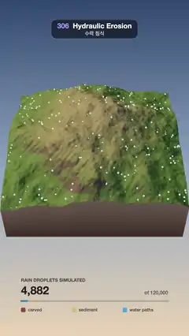

# 306 · Hydraulic Erosion · 수력 침식



**EN** Simulated rain droplets carve a fresh fBm mountain into gullies, sharp ridges and sediment fans as a time-lapse, then a scan line restores it.  
**KO** 시뮬레이션한 빗방울이 새 fBm 산을 깎아 골짜기·날카로운 능선·퇴적 부채꼴을 만드는 타임랩스가 흐르고, 스캔 선이 지나가며 처음 지형으로 되돌린다.

[Video (mp4)](https://sueun-dev.github.io/motion-effects/videos/306-hydraulic-erosion.mp4) · [Code](../effects/306-hydraulic-erosion.js) · Physical phenomena · 물리 현상

## Prompt (English)

```text
Create a "Hydraulic Erosion" motion effect: a block of fresh fBm mountain terrain is rained on by 120,000 simulated droplets, and a time-lapse shows the gullies, sharp ridges and sediment fans they carve; then a scan line sweeps across and restores the fresh terrain.

Look
- The terrain: a 256 × 256 height map over (u, v) in 0..1. With n = noise(2u + 3.1, 2v + 7.3, 0.5) and ridge = 1 − √(n² + 0.02): h = 0.5 · (fbm(3.4u, 3.4v, 1.7; 6 octaves) · 0.5 + 0.5) + 0.22 · ridge + 0.32 · exp(−((u − 0.5)² + (v − 0.48)²) · 6) − 0.5 · ((u − 0.5)² + (v − 0.5)²).
- Shown as an 8 × 8 unit block, heights × 2.9, with earth walls down to y = −1.6 (vertex colour (0.62, 0.40, 0.24) at the top to (0.30, 0.17, 0.09) at the bottom).
- Vertex colours: grass #6E8A48 → dry #A79A6A with height (smoothstep 0.35 → 0.75), → rock #7A6A5C where the normal's y falls from 0.86 to 0.7; then carved #8A4E36 by clamp(−Δ · 9) · 0.85 and sediment #D9B77C by clamp(Δ · 14) · 0.9, where Δ = height − fresh height; then water paths #3FA7E0 by wetness · rain · 0.85.
- Wetness: the water that ran over each cell up to now, shown where ln(1 + water) is between 4.2 and 7.5 (smoothstep), i.e. only the real channels.
- 1,200 droplets (every 100th) are replayed as glowing beads (radius 0.045, unlit #8FE6FF) running down their recorded paths on the current surface, each for 0.55 s, shrinking in and out (√sin).
- Lights: sun #FFE2BE 3.0 from (−10, 6, −3) with soft shadows (PCF, 2048), fill #C9D8FF 0.6 from (3, 4, 12), hemisphere #B8CCF0 / #5A4A3A 1.1. Sky: vertical gradient #30476E → #8FA6C2 (50 %) → #E9D2B4.
- Camera: 40° field of view at (0, 15.5, 16.5) looking at (0, −0.3, 0.9): the block sits in the middle third.
- Read-out below (dark brown text): "RAIN DROPLETS SIMULATED" (y 1610), the count in 64 px bold (y 1682), "of 120,000" at the right, a 10 px progress bar from x 120 to 960 at y 1720 (#2F86C8), and three legend chips (carved, sediment, water paths) at y 1778.

Motion (one 5 s cycle; the video starts 1.0 s into it)
- 0.35–3.35 s: the time-lapse: progress = easeInOut over that span, from 0 to 120,000 droplets; heights are blended between the 13 stored stages. The water colour fades in over 0.4 s and out from 3.15 to 3.95 s.
- 3.35–3.75 s: the eroded terrain holds.
- 3.75–4.85 s: a scan line (a bright #E8FBFF band, Gaussian width 0.012 in u) sweeps from right to left: front = 1.15 − 1.3 · easeInOut; behind it (u > front, 0.05 soft edge) the fresh heights are back; the count runs back down with it.

Technique
- three.js, plane mesh 256 × 256 vertices, positions and vertex colours rewritten every frame, normals recomputed.
- Droplet erosion run once in setup (seed 306), each droplet: start at a random cell, inertia 0.05, gradient by bilinear interpolation; capacity = max(−Δh · speed · water · 4, 0.01); if it carries more than that or climbs, deposit (sediment − capacity) · 0.3 (or fill the climb) onto the 4 corner cells; otherwise erode min((capacity − sediment) · 0.3, −Δh) with a radius-3 brush (weights 1 − d/3); speed = √(max(0, speed² − Δh · 4)); water × 0.99 per step; 30 steps. The map is saved every 10,000 droplets (13 stages) with the water each cell received.

Output and rules
- One self-contained HTML file with no external assets (three.js from a CDN is fine if you use it), drawing on a 1080 × 1920 canvas (9:16) scaled to fit the window.
- Write a function renderFrame(t) that draws the frame for time t in seconds, and preview it with requestAnimationFrame. Everything must be a pure function of t and fixed seeds: no Math.random(), Date or state carried between frames, so frame i = renderFrame(i / 30) can be exported to a 30 fps video.
- Loop seamlessly every 5 seconds: renderFrame(5) must look exactly like renderFrame(0).
- No flicker of any kind: no noise or grain that changes from frame to frame, no strobing or blinking, no z-fighting, no shimmering 1 px lines. Any grain or texture stays fixed to the screen or to the object.
- Keep the top 280 px free of important content (a title label goes there) and fill the whole frame with a designed background.
```

## 프롬프트 (한국어)

```text
"수력 침식(Hydraulic Erosion)" 모션 효과를 만들어 줘: 새로 만든 fBm 산 지형 덩어리에 시뮬레이션한 빗방울 12만 개가 떨어지고, 그 물이 깎아 낸 골짜기·날카로운 능선·퇴적 부채꼴이 타임랩스로 드러난 뒤, 스캔 선이 지나가며 처음 지형으로 되돌리는 효과.

모양
- 지형: (u, v) 0~1 위의 256 × 256 높이 맵. n = noise(2u + 3.1, 2v + 7.3, 0.5), ridge = 1 − √(n² + 0.02)일 때 h = 0.5 · (fbm(3.4u, 3.4v, 1.7; 6옥타브) · 0.5 + 0.5) + 0.22 · ridge + 0.32 · exp(−((u − 0.5)² + (v − 0.48)²) · 6) − 0.5 · ((u − 0.5)² + (v − 0.5)²).
- 8 × 8단위 덩어리로 보여 주고 높이 × 2.9, y = −1.6까지 내려가는 흙 벽(정점 색 위 (0.62, 0.40, 0.24) → 아래 (0.30, 0.17, 0.09)).
- 정점 색: 높이에 따라 풀 #6E8A48 → 마른 땅 #A79A6A(smoothstep 0.35 → 0.75), 법선 y가 0.86에서 0.7로 낮아지는 곳은 바위 #7A6A5C. 그 위에 깎인 곳 #8A4E36(clamp(−Δ · 9) · 0.85), 쌓인 퇴적물 #D9B77C(clamp(Δ · 14) · 0.9), Δ = 지금 높이 − 처음 높이. 그 위에 물길 #3FA7E0(젖음 · 비 · 0.85).
- 젖음: 지금까지 그 칸을 지난 물의 양. ln(1 + 물)이 4.2~7.5 사이인 곳만(smoothstep) 보여 진짜 물길만 남긴다.
- 빗방울 1,200개(100번째마다)를 빛나는 구슬(반지름 0.045, 조명 없는 #8FE6FF)로 다시 재생해, 기록된 길을 따라 지금 지형 위를 0.55초 동안 흘러내리게 한다(√sin으로 커졌다 작아짐).
- 조명: 해 #FFE2BE 3.0, (−10, 6, −3)에서 부드러운 그림자(PCF, 2048), 보조광 #C9D8FF 0.6, (3, 4, 12)에서, 반구광 #B8CCF0 / #5A4A3A 1.1. 하늘: 세로 그라디언트 #30476E → #8FA6C2(50 %) → #E9D2B4.
- 카메라: 시야각 40°, (0, 15.5, 16.5)에서 (0, −0.3, 0.9)를 본다. 덩어리는 화면 가운데 3분의 1에 놓인다.
- 아래 표시(짙은 갈색 글자): "RAIN DROPLETS SIMULATED"(y 1610), 64 px 굵은 개수(y 1682), 오른쪽에 "of 120,000", x 120~960, y 1720의 10 px 진행 막대(#2F86C8), y 1778에 범례 칩 셋(carved, sediment, water paths).

움직임 (5초 한 주기, 영상은 주기의 1.0초에서 시작)
- 0.35~3.35초: 타임랩스. 진행 = 이 구간의 easeInOut, 빗방울 0 → 120,000. 높이는 저장한 13단계 사이를 섞는다. 물 색은 0.4초에 걸쳐 나타나고 3.15~3.95초에 사라진다.
- 3.35~3.75초: 깎인 지형이 멈춰 있다.
- 3.75~4.85초: 스캔 선(밝은 #E8FBFF 띠, u 방향 가우스 폭 0.012)이 오른쪽에서 왼쪽으로 지나간다: 위치 = 1.15 − 1.3 · easeInOut. 그 뒤(u > 위치, 0.05 부드러운 경계)는 처음 높이로 돌아오고, 개수도 함께 0으로 내려간다.

기법
- three.js, 256 × 256 정점 평면 메시. 매 프레임 위치와 정점 색을 다시 쓰고 법선을 다시 계산한다.
- 빗방울 침식은 setup에서 한 번(시드 306). 빗방울마다: 무작위 칸에서 출발, 관성 0.05, 기울기는 쌍선형 보간; 운반 용량 = max(−Δh · 속도 · 물 · 4, 0.01); 용량보다 많이 싣고 있거나 오르막이면 (퇴적물 − 용량) · 0.3(오르막이면 그 높이만큼)을 네 모서리 칸에 쌓고, 아니면 min((용량 − 퇴적물) · 0.3, −Δh)를 반지름 3 붓(가중치 1 − d/3)으로 깎는다; 속도 = √(max(0, 속도² − Δh · 4)); 걸음마다 물 × 0.99; 30걸음. 빗방울 1만 개마다(13단계) 지도와 칸마다 받은 물의 양을 저장한다.

출력과 규칙
- 외부 파일 없는 HTML 파일 하나(three.js를 쓴다면 CDN은 괜찮다). 1080 × 1920(9:16) 캔버스에 그리고 창 크기에 맞춰 보이게 한다.
- 시간 t(초)의 프레임을 그리는 renderFrame(t) 함수를 만들고, 미리보기는 requestAnimationFrame으로 돌린다. 모든 것은 t와 고정 시드만으로 정해진다: Math.random(), Date, 프레임 사이에 쌓이는 상태 금지. 그래야 i번째 프레임 = renderFrame(i / 30)으로 30fps 영상을 뽑을 수 있다.
- 5초마다 끊김 없이 반복: renderFrame(5)는 renderFrame(0)과 똑같아 보여야 한다.
- 어떤 깜빡임도 금지: 프레임마다 바뀌는 노이즈·그레인, 번쩍임·깜빡임, z-fighting, 반짝이며 떨리는 1px 선 모두 금지. 그레인·질감은 화면이나 물체에 고정한다.
- 위쪽 280px에는 중요한 내용을 두지 않고(제목 라벨 자리), 화면 전체를 디자인된 배경으로 채운다.
```
