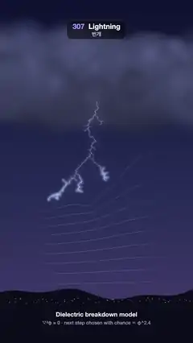

# 307 · Lightning · 번개



**EN** A stepped leader creeps down from a storm cloud, branching as field lines bend round its tips, then its path brightens smoothly into a bolt and fades.  
**KO** 폭풍 구름에서 계단형 선도가 갈라지며 내려오고 등전위선이 그 끝을 감싸 휘다가, 땅에 닿으면 그 길이 부드럽게 밝아져 번개가 되고 서서히 사라진다.

[Video (mp4)](https://sueun-dev.github.io/motion-effects/videos/307-lightning.mp4) · [Code](../effects/307-lightning.js) · Physical phenomena · 물리 현상

## Prompt (English)

```text
Create a "Lightning" motion effect: a branching bolt grown by the dielectric breakdown model (Laplacian growth). A faint stepped leader creeps down from a storm cloud while equipotential lines bend round its tips; when it touches the ground, the path back to the cloud brightens smoothly into the return stroke, lights the cloud and ground, and fades. No flashes.

Look
- A 120 × 160 grid of 6.6 px cells, its corner at (144, 598): the cloud base is row 0, the ground row 159 (y ≈ 1650).
- Sky: vertical gradient #0E1230 → #262C56 (55 %) → #3D3866 (86 %). Hills #0A0C1A along y ≈ 1650 with about 70 small warm lights. A storm cloud of 260 soft puffs (radius 70–220 px, centres y 260–590), hsla(232, 22–24 %, 18–40 %), lighter on top.
- The bolt: every grid cell of the channel becomes a point at its centre nudged by up to ±0.35 cell in x and ±0.25 in y (seed 77); every link to its parent kinks at its middle by up to ±0.25 of its length sideways; the first cell is pulled 30 px up into the cloud.
  - Leader: every link at lead · (0.45 + 0.55 · (1 − age/0.3)), branch links rgba(205, 215, 255), main-channel links rgb(235, 240, 255); each new link grows out of its parent over 0.07 s; tips younger than 0.3 s carry a 14 px soft glow. A link shows the larger of its leader and stroke brightness.
  - Main channel (the path from the cell that touched the ground back to the cloud): rgb(235, 240, 255), width 1.6 + 3.2 · B.
  - Branches in the stroke: alpha twig · clamp(0.25 + √sub / 6, ≤ 0.8), width 1.2 + 0.25 · √sub · twig, where sub = number of cells below that link.
  - Glow: the bolt layer is drawn three times additively: blurred 22 px at 0.9, blurred 6 px at 0.8, then sharp.
- Lit air: additive radial glows: round the cloud base (r 900, rgba(190, 200, 255, 0.5 B)), round the strike point on the ground (r 520, 0.42 B), and a violet charge glow in the cloud above the bolt's root (r 360, rgba(170, 160, 255, 0.22 · charge)).
- Field lines: contour lines of φ at 0.1, 0.2, … 0.9, 2.2 px rgba(120, 220, 255, 0.26 · a), faded out over the outer quarter of the grid on each side and over 220 px below the cloud base.
- Caption on the ground: "Dielectric breakdown model" (700 34 px, y 1772) and "∇²φ = 0 · next step chosen with chance ∝ φ^2.4" (27 px, y 1816).

Motion (one 5 s cycle; the video starts 1.0 s into it)
- 0.05–2.0 s: the leader grows. Each cell's time = 0.05 + 1.95 · (0.8 · deepest row so far / 158 + 0.2 · index / count), so the front creeps down steadily. Field lines show from 0 to 0.25 s (a rises) and fade from 1.9 to 2.4 s, blended between 24 stored stages of φ.
- Return stroke: B = smoothstep(2.0, 2.6, t) · (1 − smoothstep(2.95, 4.7, t)): one smooth 0.6 s brighten, a hold, a long fade. twig = smoothstep(2.0, 2.6) · (1 − smoothstep(2.8, 3.7)); the leader light gives way: lead = 1 − smoothstep(2.0, 2.6).
- charge = 0.3 · smoothstep(4.2, 5, t) at the end of the cycle and 0.3 · (1 − smoothstep(0, 1.1, t)) at its start: the cloud glows up again before the next leader.

Technique
- Canvas 2D. The growth runs once in setup (seed 2): φ = 0 on the cloud row and the channel, φ = 1 on the ground row, mirrored sides; relax ∇²φ = 0 by SOR (ω = 1.85), 400 sweeps first and 8 after each new cell; candidates are the empty 8-neighbours of the channel, one is picked with chance ∝ φ^2.4; stop when the channel reaches row 158. Each cell keeps its parent, so the channel is a tree.
- Contours by marching squares on the grid. Every brightness is a smooth function of t, so nothing flickers.

Output and rules
- One self-contained HTML file with no external assets (three.js from a CDN is fine if you use it), drawing on a 1080 × 1920 canvas (9:16) scaled to fit the window.
- Write a function renderFrame(t) that draws the frame for time t in seconds, and preview it with requestAnimationFrame. Everything must be a pure function of t and fixed seeds: no Math.random(), Date or state carried between frames, so frame i = renderFrame(i / 30) can be exported to a 30 fps video.
- Loop seamlessly every 5 seconds: renderFrame(5) must look exactly like renderFrame(0).
- No flicker of any kind: no noise or grain that changes from frame to frame, no strobing or blinking, no z-fighting, no shimmering 1 px lines. Any grain or texture stays fixed to the screen or to the object.
- Keep the top 280 px free of important content (a title label goes there) and fill the whole frame with a designed background.
```

## 프롬프트 (한국어)

```text
"번개(Lightning)" 모션 효과를 만들어 줘: 유전체 파괴 모형(라플라스 성장)으로 자라는 갈래 번개. 희미한 계단형 선도가 폭풍 구름에서 기어 내려오는 동안 등전위선이 그 끝을 감싸 휘고, 땅에 닿으면 구름까지 이어진 길이 부드럽게 밝아지는 귀환 뇌격이 되어 구름과 땅을 밝힌 뒤 사라진다. 번쩍임 없음.

모양
- 6.6 px 칸 120 × 160 격자, 모서리 (144, 598): 0행이 구름 밑면, 159행이 땅(y ≈ 1650).
- 하늘: 세로 그라디언트 #0E1230 → #262C56(55 %) → #3D3866(86 %). y ≈ 1650을 따라 언덕 #0A0C1A와 작은 따뜻한 불빛 약 70개. 부드러운 구름 덩이 260개(반지름 70~220 px, 중심 y 260~590)로 된 폭풍 구름, hsla(232, 22~24 %, 18~40 %), 위쪽이 더 밝다.
- 번개: 통로의 각 격자 칸은 중심에서 x로 최대 ±0.35칸, y로 ±0.25칸 옮긴 점(시드 77)이 되고, 부모로 이어지는 선은 가운데에서 길이의 최대 ±0.25만큼 옆으로 꺾인다. 첫 칸은 구름 속으로 30 px 끌어올린다.
  - 선도: 모든 선의 밝기 lead · (0.45 + 0.55 · (1 − 나이/0.3)), 가지 선은 rgba(205, 215, 255), 주 통로 선은 rgb(235, 240, 255). 새 선은 0.07초에 걸쳐 부모에서 뻗어 나오고, 0.3초가 안 된 끝에는 14 px 부드러운 빛. 선마다 선도 밝기와 뇌격 밝기 중 큰 쪽을 쓴다.
  - 주 통로(땅에 닿은 칸에서 구름까지 거슬러 오르는 길): rgb(235, 240, 255), 굵기 1.6 + 3.2 · B.
  - 뇌격 때의 가지: 알파 twig · clamp(0.25 + √sub / 6, ≤ 0.8), 굵기 1.2 + 0.25 · √sub · twig. sub = 그 선 아래 칸 수.
  - 빛번짐: 번개 레이어를 세 번 더하기 합성: 22 px 블러 0.9, 6 px 블러 0.8, 그리고 선명하게.
- 빛나는 공기: 더하기 합성 원형 빛. 구름 밑면(반지름 900, rgba(190, 200, 255, 0.5 B)), 땅의 낙뢰 지점(반지름 520, 0.42 B), 번개 뿌리 위 구름 속 보랏빛 충전 빛(반지름 360, rgba(170, 160, 255, 0.22 · charge)).
- 등전위선: φ = 0.1, 0.2, … 0.9의 등고선, 2.2 px rgba(120, 220, 255, 0.26 · a). 격자 양옆 바깥 4분의 1과 구름 밑면 아래 220 px에서는 옅어진다.
- 땅 위 설명: "Dielectric breakdown model"(700 34 px, y 1772)과 "∇²φ = 0 · next step chosen with chance ∝ φ^2.4"(27 px, y 1816).

움직임 (5초 한 주기, 영상은 주기의 1.0초에서 시작)
- 0.05~2.0초: 선도가 자란다. 칸마다 시각 = 0.05 + 1.95 · (0.8 · 지금까지 가장 깊은 행 / 158 + 0.2 · 순번 / 개수)라서 앞끝이 고르게 내려온다. 등전위선은 0~0.25초에 나타나고(a 증가) 1.9~2.4초에 사라지며, 저장한 24단계의 φ 사이를 섞는다.
- 귀환 뇌격: B = smoothstep(2.0, 2.6, t) · (1 − smoothstep(2.95, 4.7, t)): 0.6초에 걸친 한 번의 부드러운 밝아짐, 유지, 긴 잦아듦. twig = smoothstep(2.0, 2.6) · (1 − smoothstep(2.8, 3.7)), 선도 빛은 lead = 1 − smoothstep(2.0, 2.6)로 물러난다.
- charge = 주기 끝에서 0.3 · smoothstep(4.2, 5, t), 주기 처음에서 0.3 · (1 − smoothstep(0, 1.1, t)): 다음 선도 전에 구름이 다시 차오른다.

기법
- Canvas 2D. 성장은 setup에서 한 번(시드 2): 구름 행과 통로는 φ = 0, 땅 행은 φ = 1, 양옆은 거울 경계; ∇²φ = 0을 SOR(ω = 1.85)로 풀어 처음 400번, 새 칸마다 8번 쓸어 준다. 후보는 통로의 빈 8방향 이웃, φ^2.4에 비례하는 확률로 하나를 고른다. 통로가 158행에 닿으면 멈춘다. 칸마다 부모를 기억하므로 통로는 트리다.
- 등고선은 격자 위 마칭 스퀘어. 모든 밝기는 t의 부드러운 함수라 깜빡임이 없다.

출력과 규칙
- 외부 파일 없는 HTML 파일 하나(three.js를 쓴다면 CDN은 괜찮다). 1080 × 1920(9:16) 캔버스에 그리고 창 크기에 맞춰 보이게 한다.
- 시간 t(초)의 프레임을 그리는 renderFrame(t) 함수를 만들고, 미리보기는 requestAnimationFrame으로 돌린다. 모든 것은 t와 고정 시드만으로 정해진다: Math.random(), Date, 프레임 사이에 쌓이는 상태 금지. 그래야 i번째 프레임 = renderFrame(i / 30)으로 30fps 영상을 뽑을 수 있다.
- 5초마다 끊김 없이 반복: renderFrame(5)는 renderFrame(0)과 똑같아 보여야 한다.
- 어떤 깜빡임도 금지: 프레임마다 바뀌는 노이즈·그레인, 번쩍임·깜빡임, z-fighting, 반짝이며 떨리는 1px 선 모두 금지. 그레인·질감은 화면이나 물체에 고정한다.
- 위쪽 280px에는 중요한 내용을 두지 않고(제목 라벨 자리), 화면 전체를 디자인된 배경으로 채운다.
```
