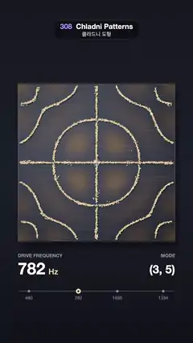

# 308 · Chladni Patterns · 클라드니 도형



**EN** Sand on a steel plate leaves the shaking parts and settles on the nodal lines as the drive steps through four resonances, read out in hertz.  
**KO** 철판을 울리는 주파수가 네 공명을 차례로 지날 때마다 모래가 흔들리는 곳을 떠나 마디선에 모여 멈추고, 진동수는 헤르츠로 표시된다.

[Video (mp4)](https://sueun-dev.github.io/motion-effects/videos/308-chladni-patterns.mp4) · [Code](../effects/308-chladni-patterns.js) · Physical phenomena · 물리 현상

## Prompt (English)

```text
Create a "Chladni Patterns" motion effect: sand on a square steel plate driven at one resonance after another; the sand leaves the parts that shake and comes to rest on the nodal lines, forming a new figure for each frequency.

Look
- The plate: 880 × 880 px with its corner at (100, 470): a cool gradient #5B6576 → #3E4656 → #2C3240 with 900 fixed faint brushed streaks, a 3 px rgba(255, 255, 255, 0.28) edge, a radial vignette to 35 % black, a soft drop shadow (18 px blur), and a bolt at the centre (radius 20, radial #E6EAF2 → #5A6274).
- Modes of the free plate, x, y in 0..1: f = cos(nπx) cos(mπy) ± cos(mπx) cos(nπy) for (2, 4, −), (3, 5, +), (3, 6, −), (3, 7, −); drive frequency 23 · (n² + m²) = 460, 782, 1,035 and 1,334 Hz.
- The shake: a warm tint (255, 120–180, 60) with alpha (|f| / 2)^1.3 · 150/255, drawn at 0.55 over the plate (a 200 × 200 image scaled up).
- 7,000 sand grains, radius 2.3 px, four colours #F1D9A6, #E5C68C, #F7E6C0, #D9B57A (grain i has colour i mod 4), each with a shadow rgba(10, 12, 18, 0.55) offset (1.3, 1.8) px.
- Read-out below: "DRIVE FREQUENCY" (26 px, y 1440), the frequency in 92 px bold with "Hz" in 44 px #F1D9A6; "MODE" and "(n, m)" in 64 px bold at the right; a scale from 400 to 1,400 Hz across x 110–970 at y 1630 with dots and labels at the four resonances and a 14 px #F1D9A6 marker at the current frequency. Background #15171F → #1C1F2A → #101219.

Motion (four 1.25 s slots, each a 0.82 s move and a rest; the video starts 0.67 s into the cycle)
- At the start of each slot the frequency eases to the next mode over 0.3 s and the tint crossfades; the old mode name fades out in 0.15 s, then the new one fades in from 0.2 to 0.4 s (never both at once).
- Each grain moves along its path: duration clamp(0.3 + 3.2 · length, 0.3, 0.62) s (length in plate widths); start 0.06 + (1 − loud) · (0.82 − 0.06 − duration) s, loud = |f_new| / 1.6 where it lies, so grains on loud spots leave first; position eased in and out along the path. While moving it lifts: radius × (1 + 0.35 sin(πk)), shadow offset grows by (4, 6) px · sin(πk).
- A grain at rest is drawn at exactly the end of its path, so settled sand is perfectly still.

Technique
- Canvas 2D. Resting places per mode: 7,000 random points, each Newton-stepped to f = 0 (step −f ∇f / |∇f|², at most 0.004, kept inside 0.012..0.988), then moved across the line by a fixed per-grain offset of up to ±0.008 (triangular), so the lines have width. Place s holds colour s mod 4.
- Each move (all precomputed): a grain's natural path is the Newton walk from where it lies onto the new mode's lines; it then takes the nearest free place of its own colour to where it would land (greedy on a 0.025 grid, then 12 passes of swaps between neighbours within 3 cells whenever that shortens the two moves), and the path is bent linearly to end there and resampled to 24 points. After four moves every place again holds a grain of the same colour, so the loop is seamless.

Output and rules
- One self-contained HTML file with no external assets (three.js from a CDN is fine if you use it), drawing on a 1080 × 1920 canvas (9:16) scaled to fit the window.
- Write a function renderFrame(t) that draws the frame for time t in seconds, and preview it with requestAnimationFrame. Everything must be a pure function of t and fixed seeds: no Math.random(), Date or state carried between frames, so frame i = renderFrame(i / 30) can be exported to a 30 fps video.
- Loop seamlessly every 5 seconds: renderFrame(5) must look exactly like renderFrame(0).
- No flicker of any kind: no noise or grain that changes from frame to frame, no strobing or blinking, no z-fighting, no shimmering 1 px lines. Any grain or texture stays fixed to the screen or to the object.
- Keep the top 280 px free of important content (a title label goes there) and fill the whole frame with a designed background.
```

## 프롬프트 (한국어)

```text
"클라드니 도형(Chladni Patterns)" 모션 효과를 만들어 줘: 정사각형 철판을 공명 진동수로 차례차례 울리면, 모래가 흔들리는 곳을 떠나 마디선에서 멈춰 진동수마다 새 도형을 그리는 효과.

모양
- 철판: 880 × 880 px, 모서리 (100, 470). 차가운 그라디언트 #5B6576 → #3E4656 → #2C3240에 고정된 옅은 브러시 결 900개, 3 px rgba(255, 255, 255, 0.28) 테두리, 검정 35 %까지의 원형 비네트, 부드러운 그림자(18 px 블러), 가운데 볼트(반지름 20, #E6EAF2 → #5A6274 원형 그라디언트).
- 자유 경계 판의 모드, x, y는 0~1: f = cos(nπx) cos(mπy) ± cos(mπx) cos(nπy), (2, 4, −), (3, 5, +), (3, 6, −), (3, 7, −). 구동 주파수 23 · (n² + m²) = 460, 782, 1,035, 1,334 Hz.
- 떨림: 따뜻한 색 (255, 120~180, 60), 알파 (|f| / 2)^1.3 · 150/255를 판 위에 0.55로 그린다(200 × 200 이미지를 확대).
- 모래알 7,000개, 반지름 2.3 px, 네 가지 색 #F1D9A6, #E5C68C, #F7E6C0, #D9B57A(i번 알갱이는 i mod 4 색), 각각 (1.3, 1.8) px 옮긴 그림자 rgba(10, 12, 18, 0.55).
- 아래 표시: "DRIVE FREQUENCY"(26 px, y 1440), 92 px 굵은 주파수와 44 px #F1D9A6 "Hz"; 오른쪽에 "MODE"와 64 px 굵은 "(n, m)"; y 1630에 x 110~970을 가로지르는 400~1,400 Hz 눈금자, 네 공명 위치에 점과 숫자, 지금 주파수에 14 px #F1D9A6 표시. 배경 #15171F → #1C1F2A → #101219.

움직임 (1.25초 칸 네 개, 각각 0.82초 이동과 정지. 영상은 주기의 0.67초에서 시작)
- 칸이 시작되면 주파수가 0.3초에 걸쳐 다음 모드로 바뀌고 떨림 색이 넘어간다. 이전 모드 이름은 0.15초에 사라지고, 새 이름은 0.2~0.4초에 나타난다(동시에 둘이 보이지 않는다).
- 알갱이는 자기 경로를 따라 움직인다: 걸리는 시간 clamp(0.3 + 3.2 · 길이, 0.3, 0.62)초(길이는 판 폭 단위); 출발 0.06 + (1 − loud) · (0.82 − 0.06 − 시간)초, loud = 놓인 곳의 |f_new| / 1.6이라 크게 떨리는 곳의 알갱이가 먼저 떠난다; 경로 위 위치는 이징 인·아웃. 움직이는 동안 들린다: 반지름 × (1 + 0.35 sin(πk)), 그림자 오프셋이 (4, 6) px · sin(πk)만큼 커진다.
- 멈춘 알갱이는 정확히 경로의 끝에 그리므로, 가라앉은 모래는 완전히 정지해 있다.

기법
- Canvas 2D. 모드마다 머물 자리: 무작위 점 7,000개를 각각 뉴턴 걸음으로 f = 0까지 옮기고(걸음 −f ∇f / |∇f|², 최대 0.004, 0.012~0.988 안), 알갱이마다 고정된 최대 ±0.008(삼각 분포)만큼 선을 가로질러 옮겨 선에 폭을 준다. s번 자리는 s mod 4 색.
- 이동마다(모두 미리 계산): 알갱이의 자연스러운 경로는 놓인 곳에서 새 모드의 선까지 뉴턴 걸음. 그다음 도착할 곳에서 가장 가까운 같은 색의 빈자리를 맡고(0.025 격자에서 탐욕 배정, 이어서 3칸 안 이웃끼리 두 이동이 짧아지면 맞바꾸기 12번), 경로를 그 자리에서 끝나도록 선형으로 휘어 24점으로 다시 샘플링한다. 네 번 옮긴 뒤 모든 자리에 다시 같은 색 알갱이가 놓이므로 이음매가 없다.

출력과 규칙
- 외부 파일 없는 HTML 파일 하나(three.js를 쓴다면 CDN은 괜찮다). 1080 × 1920(9:16) 캔버스에 그리고 창 크기에 맞춰 보이게 한다.
- 시간 t(초)의 프레임을 그리는 renderFrame(t) 함수를 만들고, 미리보기는 requestAnimationFrame으로 돌린다. 모든 것은 t와 고정 시드만으로 정해진다: Math.random(), Date, 프레임 사이에 쌓이는 상태 금지. 그래야 i번째 프레임 = renderFrame(i / 30)으로 30fps 영상을 뽑을 수 있다.
- 5초마다 끊김 없이 반복: renderFrame(5)는 renderFrame(0)과 똑같아 보여야 한다.
- 어떤 깜빡임도 금지: 프레임마다 바뀌는 노이즈·그레인, 번쩍임·깜빡임, z-fighting, 반짝이며 떨리는 1px 선 모두 금지. 그레인·질감은 화면이나 물체에 고정한다.
- 위쪽 280px에는 중요한 내용을 두지 않고(제목 라벨 자리), 화면 전체를 디자인된 배경으로 채운다.
```
