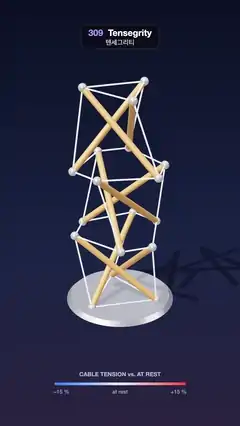

# 309 · Tensegrity · 텐세그리티



**EN** A three-stage tensegrity tower of wooden struts held only by cables is twisted down by a push, springs back and sways, its cables tinted by tension.  
**KO** 케이블에만 매달린 나무 버팀대들이 떠 있는 3단 텐세그리티 탑이 비트는 힘에 감겨 내려갔다가 튕겨 돌아와 흔들리고, 케이블은 장력에 따라 물든다.

[Video (mp4)](https://sueun-dev.github.io/motion-effects/videos/309-tensegrity.mp4) · [Code](../effects/309-tensegrity.js) · Physical phenomena · 물리 현상

## Prompt (English)

```text
Create a "Tensegrity" motion effect: a floating tower of three stacked tensegrity prisms whose wooden struts never touch each other and are held only by taut cables; a twisting push winds it down, it is let go and springs back, swaying, while the cables change colour with their tension.

Look
- Geometry: three stages of three struts. Stage k: a bottom triangle B and a top triangle T of radius 0.55, T turned 150° from B and 1.15 higher; the stage is turned 60° · k and starts at y = 0.8 k (each stage overlaps the one below by 0.35).
  - Struts B_i → T_i (9).
  - Cables (27): B_i → T_(i+2 mod 3) in every stage; the bottom ring of stage 0 and the top ring of stage 2; every bottom node of stages 1 and 2 tied to the two nearest top nodes of the stage below.
- Struts: cylinders of radius 0.045, warm wood #E9A85A (roughness 0.45) with metal ball caps (radius 0.06, #F4F1EA). Cables: radius 0.012, coloured by their tension against their own tension at rest: white #E8F4FF at rest, towards blue #3D7BFF at −15 % and red #FF4A3D at +15 %, emissive at 0.7 × that colour.
- The base: a metal plinth (radius 0.72–0.78, 0.06 high, #C9CFDD, metalness 0.7) holding the three bottom nodes; a shadow-only floor (opacity 0.35).
- Background: vertical gradient #0B1024 → #1B2446 (60 %) → #2A2440. Key light #FFF0DC 2.4 from (−4, 9, 5) with soft shadows (PCF 2048), hemisphere #AFC2FF / #2A2030 0.7, room environment 0.55.
- The push is shown by a gold #FFD36B curved arrow (a torus arc of radius 0.95 and tube 0.035 over 2.2 rad, with a cone head) 0.18 above the top triangle's centre, turning −0.6 rad with the push; opacity 0.95 · smoothstep(0, 0.3, push) while it acts.
- A tension scale below: "CABLE TENSION vs. AT REST" over a 12 px bar from x 250 to 830 at y 1730 (#3D7BFF → #E8F4FF → #FF4A3D), labelled "−15 %", "at rest", "+15 %".

Motion (0–5 s)
- Camera: 30° field of view, distance 10, height 6.2, swinging round the tower by 0.3 + 0.55 · sin(2π t / 5) rad, looking at (0, 1.32, 0).
- 0–0.5 s: the tower at rest. 0.5–1.3 s: on each top node a force (−sin a, −0.5, cos a) · 13 · sin²(π · progress), a = the node's angle round the axis: the tower twists and sinks. Then it is let go and springs back, swaying a few times as it settles.
- 4.45–4.95 s: the pose and tensions are blended (ease in-out) onto the rest state, so the end meets the start.

Technique
- three.js. Dynamic relaxation in setup: struts are stiff springs (k = 4000), cables pull-only springs (k = 300) with rest length 82 % of their first length, unit masses, time step 0.002, base nodes fixed. Form-finding: 40,000 steps with velocity damping 0.98 per step, giving the prestressed equilibrium. Then the push run with damping 0.9972 per step; positions and cable tensions stored every 1/30 s and played back by t.
- Each strut and cable is a unit cylinder stretched and turned between its two nodes every frame.

Output and rules
- One self-contained HTML file with no external assets (three.js from a CDN is fine if you use it), drawing on a 1080 × 1920 canvas (9:16) scaled to fit the window.
- Write a function renderFrame(t) that draws the frame for time t in seconds, and preview it with requestAnimationFrame. Everything must be a pure function of t and fixed seeds: no Math.random(), Date or state carried between frames, so frame i = renderFrame(i / 30) can be exported to a 30 fps video.
- Loop seamlessly every 5 seconds: renderFrame(5) must look exactly like renderFrame(0).
- No flicker of any kind: no noise or grain that changes from frame to frame, no strobing or blinking, no z-fighting, no shimmering 1 px lines. Any grain or texture stays fixed to the screen or to the object.
- Keep the top 280 px free of important content (a title label goes there) and fill the whole frame with a designed background.
```

## 프롬프트 (한국어)

```text
"텐세그리티(Tensegrity)" 모션 효과를 만들어 줘: 나무 버팀대끼리는 서로 닿지 않고 팽팽한 케이블에만 매달려 떠 있는 3단 텐세그리티 프리즘 탑이 비트는 힘에 감겨 내려갔다가, 놓이면 튕겨 돌아와 흔들리고, 케이블은 장력에 따라 색이 변하는 효과.

모양
- 형상: 버팀대 세 개짜리 단 세 개. k단: 반지름 0.55의 아래 삼각형 B와 위 삼각형 T, T는 B에서 150° 돌고 1.15 위. 단 전체는 60° · k 돌고 y = 0.8 k에서 시작한다(아래 단과 0.35씩 겹침).
  - 버팀대 B_i → T_i(9개).
  - 케이블(27개): 모든 단의 B_i → T_(i+2 mod 3); 0단 아래 고리와 2단 위 고리; 1·2단의 아래 꼭짓점마다 아래 단에서 가장 가까운 위 꼭짓점 두 개에 묶는다.
- 버팀대: 반지름 0.045 원기둥, 따뜻한 나무색 #E9A85A(거칠기 0.45), 끝에 금속 공(반지름 0.06, #F4F1EA). 케이블: 반지름 0.012, 자기 정지 장력 대비 장력으로 색을 정한다: 정지 때 흰색 #E8F4FF, −15 %로 갈수록 파랑 #3D7BFF, +15 %로 갈수록 빨강 #FF4A3D, 그 색 × 0.7로 자체 발광.
- 받침: 금속 받침대(반지름 0.72~0.78, 높이 0.06, #C9CFDD, 금속성 0.7)가 아래 꼭짓점 셋을 잡고, 그림자만 보이는 바닥(불투명도 0.35).
- 배경: 세로 그라디언트 #0B1024 → #1B2446(60 %) → #2A2440. 키 라이트 #FFF0DC 2.4, (−4, 9, 5)에서 부드러운 그림자(PCF 2048), 반구광 #AFC2FF / #2A2030 0.7, 룸 환경 0.55.
- 미는 힘은 금색 #FFD36B 곡선 화살표로 보여 준다(반지름 0.95, 관 두께 0.035, 2.2 rad 원환 호에 원뿔 머리). 위 삼각형 중심보다 0.18 위에 있고 미는 동안 −0.6 rad 돌며, 힘이 있는 동안 불투명도 0.95 · smoothstep(0, 0.3, push).
- 아래 장력 눈금: "CABLE TENSION vs. AT REST", y 1730에서 x 250~830의 12 px 막대(#3D7BFF → #E8F4FF → #FF4A3D), "−15 %", "at rest", "+15 %".

움직임 (0~5초)
- 카메라: 시야각 30°, 거리 10, 높이 6.2, 탑 둘레를 0.3 + 0.55 · sin(2π t / 5) rad로 오가며 (0, 1.32, 0)을 본다.
- 0~0.5초: 정지. 0.5~1.3초: 위 꼭짓점마다 힘 (−sin a, −0.5, cos a) · 13 · sin²(π · 진행), a = 축 둘레의 꼭짓점 각도: 탑이 비틀리며 내려앉는다. 그 뒤 놓으면 튕겨 돌아오고 몇 번 흔들리며 자리를 잡는다.
- 4.45~4.95초: 자세와 장력을 정지 상태로 (이징 인·아웃) 섞어 끝이 처음과 만난다.

기법
- three.js. setup에서 동적 이완: 버팀대는 단단한 스프링(k = 4000), 케이블은 당기기만 하는 스프링(k = 300), 정지 길이는 처음 길이의 82 %, 질량 1, 시간 간격 0.002, 받침 꼭짓점 고정. 형태 찾기: 걸음마다 속도 감쇠 0.98로 4만 걸음 → 프리스트레스 평형. 이어서 걸음마다 감쇠 0.9972로 미는 장면을 계산하고, 1/30초마다 위치와 케이블 장력을 저장해 t로 재생한다.
- 버팀대와 케이블은 매 프레임 두 꼭짓점 사이로 늘이고 돌린 단위 원기둥이다.

출력과 규칙
- 외부 파일 없는 HTML 파일 하나(three.js를 쓴다면 CDN은 괜찮다). 1080 × 1920(9:16) 캔버스에 그리고 창 크기에 맞춰 보이게 한다.
- 시간 t(초)의 프레임을 그리는 renderFrame(t) 함수를 만들고, 미리보기는 requestAnimationFrame으로 돌린다. 모든 것은 t와 고정 시드만으로 정해진다: Math.random(), Date, 프레임 사이에 쌓이는 상태 금지. 그래야 i번째 프레임 = renderFrame(i / 30)으로 30fps 영상을 뽑을 수 있다.
- 5초마다 끊김 없이 반복: renderFrame(5)는 renderFrame(0)과 똑같아 보여야 한다.
- 어떤 깜빡임도 금지: 프레임마다 바뀌는 노이즈·그레인, 번쩍임·깜빡임, z-fighting, 반짝이며 떨리는 1px 선 모두 금지. 그레인·질감은 화면이나 물체에 고정한다.
- 위쪽 280px에는 중요한 내용을 두지 않고(제목 라벨 자리), 화면 전체를 디자인된 배경으로 채운다.
```
