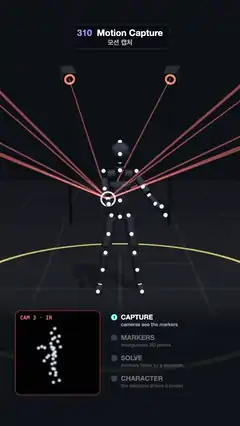

# 310 · Motion Capture · 모션 캡처



**EN** Twelve infrared cameras triangulate the markers on a performer's suit; the suit fades to a point cloud that solves into a skeleton, and a character takes over.  
**KO** 적외선 카메라 열두 대가 연기자 슈트의 마커를 삼각측량하고, 슈트가 사라져 점 구름이 되었다가 뼈대로 풀리고, 그 위에 캐릭터가 입혀져 똑같이 움직인다.

[Video (mp4)](https://sueun-dev.github.io/motion-effects/videos/310-motion-capture.mp4) · [Code](../effects/310-motion-capture.js) · Capture & camera rigs · 캡처·촬영 장비

## Prompt (English)

```text
Create a "Motion Capture" motion effect: a performer in a dark marker suit inside a ring of infrared cameras; rays from the cameras meet at the markers (triangulation), then the suit fades to the marker cloud, the points are solved into a skeleton bone by bone, and a character built on it moves exactly as the performer did.

Look
- Stage: a dark floor #20232B with a faint 1 m grid rgba(255, 255, 255, 0.07) and a #D9B648 tape circle of radius 2 m; background #0E1118. A spot light (intensity 60) from (1.5, 7, 3) with soft shadows, hemisphere #9FB4E8 / #1A1A22 0.6, room environment 0.35.
- Twelve cameras on poles in a ring of radius 3.4 at height 2.6 (at angles (k + 0.5) · 30°), each a 0.22 × 0.2 × 0.32 dark body #2B2F3A aimed at the performer with a glowing red LED ring round the lens (torus radius 0.075, tube 0.018, #FF3B3B, emissive 2.2).
- The performer (metres): hips at (0.17 sin a, 0.95 − 0.11 · (0.5 − 0.5 cos 2a), 0.02), a = 2π t / 5; torso turned by Euler YXZ (0.06 + 0.08 · (0.5 − 0.5 cos 2a), 0.42 sin a, −0.07 sin a); chest 0.48 above the hips, neck 0.12 more, head 0.13 more; shoulders ±0.19; upper arm 0.3, forearm 0.27, hand 0.08. Cloud hands: each arm with phase a (left) or a + π (right) raises by 0.75 + 0.55 sin(phase), sweeps by 0.45 cos(phase) and bends its elbow by 0.7 + 0.35 cos(phase). Legs: hips ±0.1, feet planted at (±0.24, 0.07, 0.06), thigh and shin 0.45, the knee found by two-bone IK (law of cosines), bending forward; toes 0.16 ahead of the ankle.
- Suit: capsules along the bones in #30343F (roughness 0.85) and a 0.115 head. 33 markers (radius 0.024, #F4F6FF, emissive 0.9) on the head, shoulders, elbows, wrists, hands, chest, back, hips, knees, shins, ankles and toes, each pushed 0.03–0.14 out from its bone.
- Skeleton: cyan #7DF9FF cylinders (radius 0.014) along the 19 bones.
- Character: capsules 1.25 × as thick in teal #2EC4B6 (clearcoat 0.6), orange #FF9F1C balls at the pelvis, chest, shoulders, elbows, hip joints and knees, a 0.15 helmet with a glowing visor (#BFF8FF, emissive #6FF2FF at 1.6).
- Rays: thin red beams (radius 0.009, #FF5A4E, additive) from all twelve lenses to the marker being triangulated, with a white ring (radius 0.05–0.065) facing the camera at that marker.
- Main camera: 42° field of view at (0, 2.4, 6.4) looking at (0, 0.95, 0).
- Overlay: a dark band from y = 1340 (rgba(14, 17, 24) fading in to 0.92 by y = 1460); an IR inset 380 × 380 at (70, 1400): black with a red outline, "CAM 3 · IR" in monospace, the markers projected through camera 3 (40°) as 11 px white glows; a list at x 500 from y 1440, 92 px apart: 1 CAPTURE (cameras see the markers), 2 MARKERS (triangulated 3D points), 3 SOLVE (markers fitted to a skeleton), 4 CHARACTER (the skeleton drives a model); the current step at full opacity with a cyan number, the others at 38 %.

Motion (0–5 s)
- Two markers at a time are triangulated, twelve per loop (2.4 per second, the second half a slot later); marker = ((slot mod 12) · 7 + q · 11) mod 33; beam opacity 0.55 · sin²(π · progress), dimmed to 15 % while the skeleton and character show; the ring grows from 1 to 1.6.
- Suit opacity 1 − smoothstep(1.3, 1.9, t) + smoothstep(4.3, 4.95, t): from 1.9 s only the marker cloud moves.
- From 2.1 s the bones grow one after another out of their parent joint (0.035 s apart, 0.25 s each); they fade out from 4.1 to 4.6 s.
- Character opacity smoothstep(3.0, 3.6, t) · (1 − smoothstep(4.2, 4.8, t)); the markers shrink to 40 % while it shows. The suit comes back as the character fades.
- The list steps crossfade over 0.2 s at 1.5, 2.15, 3.05 and 4.4 s.

Technique
- three.js. The pose is a pure function of t (forward kinematics for the spine and arms, two-bone IK for the legs); every capsule, bone and beam is a unit mesh stretched between two points each frame. The IR inset projects the same marker positions through a second perspective camera.

Output and rules
- One self-contained HTML file with no external assets (three.js from a CDN is fine if you use it), drawing on a 1080 × 1920 canvas (9:16) scaled to fit the window.
- Write a function renderFrame(t) that draws the frame for time t in seconds, and preview it with requestAnimationFrame. Everything must be a pure function of t and fixed seeds: no Math.random(), Date or state carried between frames, so frame i = renderFrame(i / 30) can be exported to a 30 fps video.
- Loop seamlessly every 5 seconds: renderFrame(5) must look exactly like renderFrame(0).
- No flicker of any kind: no noise or grain that changes from frame to frame, no strobing or blinking, no z-fighting, no shimmering 1 px lines. Any grain or texture stays fixed to the screen or to the object.
- Keep the top 280 px free of important content (a title label goes there) and fill the whole frame with a designed background.
```

## 프롬프트 (한국어)

```text
"모션 캡처(Motion Capture)" 모션 효과를 만들어 줘: 적외선 카메라 고리 안에서 마커 슈트를 입은 연기자가 움직이고, 카메라에서 나온 광선이 마커에서 만나(삼각측량), 슈트가 사라져 마커 점 구름만 남았다가, 점들이 뼈 하나씩 뼈대로 풀리고, 그 위에 만든 캐릭터가 연기자와 똑같이 움직이는 효과.

모양
- 무대: 어두운 바닥 #20232B, 옅은 1 m 격자 rgba(255, 255, 255, 0.07), 반지름 2 m의 #D9B648 테이프 원. 배경 #0E1118. 스포트라이트(세기 60), (1.5, 7, 3)에서 부드러운 그림자, 반구광 #9FB4E8 / #1A1A22 0.6, 룸 환경 0.35.
- 반지름 3.4, 높이 2.6 고리에 기둥 위 카메라 열두 대((k + 0.5) · 30° 위치). 각각 0.22 × 0.2 × 0.32 어두운 몸체 #2B2F3A가 연기자를 향하고, 렌즈 둘레에 빨간 LED 고리(원환 반지름 0.075, 관 0.018, #FF3B3B, 발광 2.2).
- 연기자(미터): 골반 (0.17 sin a, 0.95 − 0.11 · (0.5 − 0.5 cos 2a), 0.02), a = 2π t / 5. 몸통은 오일러 YXZ (0.06 + 0.08 · (0.5 − 0.5 cos 2a), 0.42 sin a, −0.07 sin a)만큼 돌고, 가슴은 골반 위 0.48, 목은 0.12 더, 머리는 0.13 더. 어깨 ±0.19, 위팔 0.3, 아래팔 0.27, 손 0.08. 운수(구름 손): 팔마다 위상 a(왼쪽) 또는 a + π(오른쪽)로 0.75 + 0.55 sin(위상)만큼 들고, 0.45 cos(위상)만큼 휘두르며, 팔꿈치를 0.7 + 0.35 cos(위상)만큼 굽힌다. 다리: 골반 ±0.1, 발은 (±0.24, 0.07, 0.06)에 고정, 넓적다리와 정강이 0.45, 무릎은 두 뼈 IK(코사인 법칙)로 앞으로 굽힌다. 발끝은 발목 0.16 앞.
- 슈트: 뼈를 따라 놓은 캡슐 #30343F(거칠기 0.85)와 0.115 머리. 마커 33개(반지름 0.024, #F4F6FF, 발광 0.9)가 머리·어깨·팔꿈치·손목·손·가슴·등·골반·무릎·정강이·발목·발끝에 있고, 뼈에서 0.03~0.14 바깥으로 나와 있다.
- 뼈대: 19개 뼈를 따라 청록 #7DF9FF 원기둥(반지름 0.014).
- 캐릭터: 1.25배 굵은 청록 캡슐 #2EC4B6(클리어코트 0.6), 골반·가슴·어깨·팔꿈치·고관절·무릎에 주황 #FF9F1C 공, 0.15 헬멧과 빛나는 바이저(#BFF8FF, 발광 #6FF2FF 1.6).
- 광선: 열두 렌즈 모두에서 지금 삼각측량하는 마커로 가는 가는 빨간 빛줄기(반지름 0.009, #FF5A4E, 더하기 합성), 그 마커에는 카메라를 향한 흰 고리(반지름 0.05~0.065).
- 주 카메라: 시야각 42°, (0, 2.4, 6.4)에서 (0, 0.95, 0)을 본다.
- 오버레이: y = 1340부터 어두운 띠(rgba(14, 17, 24), y = 1460까지 0.92로 짙어짐). (70, 1400)에 380 × 380 적외선 화면: 검정 바탕, 빨간 테두리, 고정폭 글꼴 "CAM 3 · IR", 3번 카메라(40°)로 투영한 마커를 11 px 흰 빛 점으로. x 500, y 1440부터 92 px 간격의 목록: 1 CAPTURE(cameras see the markers), 2 MARKERS(triangulated 3D points), 3 SOLVE(markers fitted to a skeleton), 4 CHARACTER(the skeleton drives a model). 지금 단계는 불투명하고 번호가 청록, 나머지는 38 %.

움직임 (0~5초)
- 한 번에 마커 두 개를 삼각측량하고, 한 주기에 12번(초당 2.4번, 두 번째는 반 칸 늦게). 마커 = ((칸 mod 12) · 7 + q · 11) mod 33. 빛줄기 불투명도 0.55 · sin²(π · 진행), 뼈대와 캐릭터가 보이는 동안 15 %로 옅어진다. 고리는 1에서 1.6배로 커진다.
- 슈트 불투명도 1 − smoothstep(1.3, 1.9, t) + smoothstep(4.3, 4.95, t): 1.9초부터는 마커 점 구름만 움직인다.
- 2.1초부터 뼈가 하나씩 부모 관절에서 자라 나온다(0.035초 간격, 각 0.25초). 4.1~4.6초에 사라진다.
- 캐릭터 불투명도 smoothstep(3.0, 3.6, t) · (1 − smoothstep(4.2, 4.8, t)). 보이는 동안 마커는 40 %로 작아진다. 캐릭터가 사라지며 슈트가 돌아온다.
- 목록 단계는 1.5, 2.15, 3.05, 4.4초에 0.2초에 걸쳐 넘어간다.

기법
- three.js. 자세는 t의 순수 함수(척추·팔은 순운동학, 다리는 두 뼈 IK). 캡슐·뼈·빛줄기는 매 프레임 두 점 사이로 늘인 단위 메시다. 적외선 화면은 같은 마커 위치를 두 번째 원근 카메라로 투영한다.

출력과 규칙
- 외부 파일 없는 HTML 파일 하나(three.js를 쓴다면 CDN은 괜찮다). 1080 × 1920(9:16) 캔버스에 그리고 창 크기에 맞춰 보이게 한다.
- 시간 t(초)의 프레임을 그리는 renderFrame(t) 함수를 만들고, 미리보기는 requestAnimationFrame으로 돌린다. 모든 것은 t와 고정 시드만으로 정해진다: Math.random(), Date, 프레임 사이에 쌓이는 상태 금지. 그래야 i번째 프레임 = renderFrame(i / 30)으로 30fps 영상을 뽑을 수 있다.
- 5초마다 끊김 없이 반복: renderFrame(5)는 renderFrame(0)과 똑같아 보여야 한다.
- 어떤 깜빡임도 금지: 프레임마다 바뀌는 노이즈·그레인, 번쩍임·깜빡임, z-fighting, 반짝이며 떨리는 1px 선 모두 금지. 그레인·질감은 화면이나 물체에 고정한다.
- 위쪽 280px에는 중요한 내용을 두지 않고(제목 라벨 자리), 화면 전체를 디자인된 배경으로 채운다.
```
