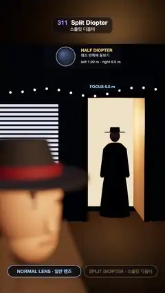

# 311 · Split Diopter · 스플릿 디옵터



**EN** A half-moon diopter slides over the lens: the blurred detective's face in front snaps sharp while the woman in the far doorway stays sharp, with a soft seam.  
**KO** 반달 모양 디옵터가 렌즈 반쪽을 덮으면, 흐렸던 앞쪽 탐정의 얼굴이 또렷해지고 먼 문간의 여자도 그대로 또렷하며, 둘 사이에 부드러운 경계가 생긴다.

[Video (mp4)](https://sueun-dev.github.io/motion-effects/videos/311-split-diopter.mp4) · [Code](../effects/311-split-diopter.js) · Capture & camera rigs · 캡처·촬영 장비

## Prompt (English)

```text
Create a "Split Diopter" motion effect: a noir shot in which a half-moon close-up lens covers the left half of the camera lens, so a face 1 m away and a figure 7.85 m away are both sharp at once, with a soft seam between them (the De Palma look).

Look
- A dark office. Camera at eye height 1.6 m, 40° vertical field of view, looking at (0, 1.52, −3). Background #0C0B10.
- Foreground, left half: a detective's head 1.0 m from the lens at x = −0.15, y = 1.42, turned 0.75 rad (three-quarters, looking off to the right of the lens): skin #D9A27E, a straight nose, small dark eyes, a charcoal fedora #2B2A30 with a red band #7A2E2A, a camel coat #5A4A3A with the collar turned up.
- Background, right half: a woman in a long dark-blue coat #2E3A4A and a red hat standing in a doorway in the back wall (door x 0.1–1.15 m, 2.3 m high, 7.5 m away), lit from behind by a warm hallway #FFC98A, so she reads as a crisp silhouette.
- Back wall #4C5A58 with a window of venetian blinds (bright slats #E8EEF8 on #1C2230) on the left, a string of 17 tiny warm bulbs (#FFB25A, #FFD08A, #FF8A5A, 6× over-bright so they bloom) along the wall at about 2.4 m, a green desk lamp on a table 3.6 m away, plank floor.
- Overlay (below the top 280 px): a lens diagram — a 62 px lens circle seen from the front with a gold half-moon diopter sliding over its left half, "HALF DIOPTER", "렌즈 반쪽에 돋보기", "left 1.02 m · right 6.5 m"; focus tags "FOCUS 1.02 m" left of the seam and "FOCUS 6.5 m" right of it; at the bottom two pills, NORMAL LENS · 일반 렌즈 and SPLIT DIOPTER · 스플릿 디옵터, the active one bright.

Motion (0–5 s)
- 0–1.4 s: the normal lens, focused at 6.5 m: the woman and the back wall sharp, the near face a large soft blur.
- 1.4–2.3 s (ease in-out): the diopter's edge slides in from x = −160 px to x = 600 px. As it passes, the face snaps sharp, and the background left of the seam (bulbs, blinds) melts into round bokeh discs while the right side stays sharp.
- 2.3–4.35 s: both subjects sharp; 4.35–5.3 s the diopter slides back out (crossing the loop point).
- She turns her head ±0.35 rad once per loop; he turns 0.04 rad. Nothing else moves.

Technique
- three.js. Depth of field rendered like a real lens: 72 renders per focus distance, the camera moved over a round aperture of radius 1.1 cm on a Vogel (golden-angle) spiral, each with its frustum sheared so the focus plane stays fixed, plus a sub-pixel jitter for anti-aliasing; the renders are averaged in a 32-bit float target.
- Two accumulations: focused at 6.5 m (the main lens) and at 1.02 m (the diopter half). The final pixel takes the near-focus image left of the seam and the far-focus image right of it, blended over ±70 px (the diopter's edge is far out of focus, so the seam is soft). Skip the near pass while the seam is off screen.
- ACES Filmic tone mapping applied once at the end (an output pass).

Output and rules
- One self-contained HTML file with no external assets (three.js from a CDN is fine if you use it), drawing on a 1080 × 1920 canvas (9:16) scaled to fit the window.
- Write a function renderFrame(t) that draws the frame for time t in seconds, and preview it with requestAnimationFrame. Everything must be a pure function of t and fixed seeds: no Math.random(), Date or state carried between frames, so frame i = renderFrame(i / 30) can be exported to a 30 fps video.
- Loop seamlessly every 5 seconds: renderFrame(5) must look exactly like renderFrame(0).
- No flicker of any kind: no noise or grain that changes from frame to frame, no strobing or blinking, no z-fighting, no shimmering 1 px lines. Any grain or texture stays fixed to the screen or to the object.
- Keep the top 280 px free of important content (a title label goes there) and fill the whole frame with a designed background.
```

## 프롬프트 (한국어)

```text
"스플릿 디옵터" 모션 효과를 만들어 줘: 반달 모양 근접 렌즈가 카메라 렌즈의 왼쪽 반만 덮어, 1m 앞의 얼굴과 7.85m 뒤의 인물이 동시에 또렷하고 둘 사이에 부드러운 경계가 생기는 누아르 장면(드 팔마 룩).

모양
- 어두운 사무실. 카메라는 눈높이 1.6m, 세로 시야각 40°, (0, 1.52, −3)을 본다. 배경 #0C0B10.
- 앞쪽 왼쪽 절반: 렌즈에서 1.0m 떨어진 탐정의 머리, x = −0.15, y = 1.42, 0.75 rad 돌아간 3/4 측면(렌즈 오른쪽을 본다): 피부 #D9A27E, 곧은 코, 작고 짙은 눈, 빨간 띠 #7A2E2A를 두른 짙은 회색 페도라 #2B2A30, 깃을 세운 낙타색 코트 #5A4A3A.
- 뒤쪽 오른쪽 절반: 뒷벽(7.5m)의 문간(x 0.1–1.15m, 높이 2.3m)에 선, 긴 남색 코트 #2E3A4A에 빨간 모자를 쓴 여자. 뒤의 따뜻한 복도 #FFC98A가 비춰 또렷한 실루엣이 된다.
- 뒷벽 #4C5A58: 왼쪽에 블라인드 창(#1C2230 위의 밝은 살 #E8EEF8), 벽을 따라 약 2.4m 높이에 작은 전구 17개(#FFB25A, #FFD08A, #FF8A5A, 6배로 밝게 해서 번지게), 3.6m 앞 탁자 위 초록 스탠드, 판자 바닥.
- 오버레이(위쪽 280px 아래): 렌즈 도해 — 정면에서 본 62px 렌즈 원에 금색 반달 디옵터가 왼쪽 반 위로 미끄러져 들어오고, "HALF DIOPTER", "렌즈 반쪽에 돋보기", "left 1.02 m · right 6.5 m". 경계 왼쪽에 "FOCUS 1.02 m", 오른쪽에 "FOCUS 6.5 m" 태그. 아래에는 NORMAL LENS · 일반 렌즈 와 SPLIT DIOPTER · 스플릿 디옵터 알약 두 개, 지금 상태만 밝게.

움직임 (0–5초)
- 0–1.4초: 6.5m에 초점을 맞춘 일반 렌즈: 여자와 뒷벽은 또렷하고 앞쪽 얼굴은 크게 흐리다.
- 1.4–2.3초(ease in-out): 디옵터 가장자리가 x = −160px에서 600px까지 미끄러져 들어온다. 지나가는 순간 얼굴이 또렷해지고, 경계 왼쪽 배경(전구, 블라인드)은 둥근 보케로 번지며 오른쪽은 또렷하게 남는다.
- 2.3–4.35초: 둘 다 또렷하다. 4.35–5.3초 디옵터가 다시 빠져나간다(루프 지점을 지나며).
- 여자는 루프마다 고개를 ±0.35 rad 돌리고, 남자는 0.04 rad만 움직인다. 나머지는 움직이지 않는다.

기법
- three.js. 실제 렌즈처럼 피사계 심도를 렌더: 초점 거리마다 72번 렌더하며, 반지름 1.1cm 원형 조리개 위의 보겔(황금각) 나선 점으로 카메라를 옮기고 초점면이 고정되도록 프러스텀을 기울이며, 안티에일리어싱용 서브픽셀 지터를 더한다. 32비트 float 타깃에서 평균낸다.
- 누적을 두 번: 6.5m(본 렌즈)와 1.02m(디옵터 반쪽). 최종 픽셀은 경계 왼쪽은 근거리 초점 이미지, 오른쪽은 원거리 초점 이미지를 쓰고 ±70px에 걸쳐 섞는다(디옵터 가장자리는 초점에서 한참 벗어나 있어 경계가 부드럽다). 경계가 화면 밖일 때는 근거리 패스를 건너뛴다.
- ACES Filmic 톤 매핑은 마지막에 한 번(output pass).

출력과 규칙
- 외부 파일 없는 HTML 파일 하나(three.js를 쓴다면 CDN은 괜찮다). 1080 × 1920(9:16) 캔버스에 그리고 창 크기에 맞춰 보이게 한다.
- 시간 t(초)의 프레임을 그리는 renderFrame(t) 함수를 만들고, 미리보기는 requestAnimationFrame으로 돌린다. 모든 것은 t와 고정 시드만으로 정해진다: Math.random(), Date, 프레임 사이에 쌓이는 상태 금지. 그래야 i번째 프레임 = renderFrame(i / 30)으로 30fps 영상을 뽑을 수 있다.
- 5초마다 끊김 없이 반복: renderFrame(5)는 renderFrame(0)과 똑같아 보여야 한다.
- 어떤 깜빡임도 금지: 프레임마다 바뀌는 노이즈·그레인, 번쩍임·깜빡임, z-fighting, 반짝이며 떨리는 1px 선 모두 금지. 그레인·질감은 화면이나 물체에 고정한다.
- 위쪽 280px에는 중요한 내용을 두지 않고(제목 라벨 자리), 화면 전체를 디자인된 배경으로 채운다.
```
