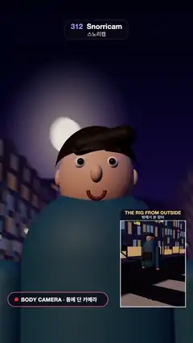

# 312 · Snorricam · 스노리캠



**EN** A camera rigged to a walking man's chest keeps his face locked in the centre while the moonlit street behind him rolls, sways and bobs; an inset shows the rig.  
**KO** 걷는 남자의 가슴에 단 카메라가 그의 얼굴을 화면 한가운데 고정하고, 뒤의 달빛 거리만 기울고 흔들리고 출렁인다. 작은 화면은 그 장비를 밖에서 보여 준다.

[Video (mp4)](https://sueun-dev.github.io/motion-effects/videos/312-snorricam.mp4) · [Code](../effects/312-snorricam.js) · Capture & camera rigs · 캡처·촬영 장비

## Prompt (English)

```text
Create a "Snorricam" motion effect: a camera rigged to an actor's body. He walks down a night street; his head and shoulders stay locked in the middle of the frame while the world behind him lurches, bobs and rolls. An inset shows the rig from outside.

Look
- A stylised man: skin #E9B892, short dark hair #2A1A14, small eyes, a red scarf #C8423A, a teal jacket #2F5D6E, dark trousers, white shoes. He faces the camera.
- The rig: a black harness plate on his chest, a steel rod running forward to a small black camera 1.15 m in front of him with a red tally light, turned back to his face.
- The street repeats every 5 m: a 14 m road (#26232C, a dashed centre line every 2.5 m), raised pavements #4A4652, buildings at x = ±10.7 m (2.4 × 9–15 × 2.45 m) with 3 × 6 large soft windows (#B08A62, #7890A6, #2E2A3A) and lit shop fronts, neon signs (BAR, 24H, 노래방, CAFE in pink, cyan, yellow, green) on alternate sides, lamp posts with glowing globes. Fog #2A1E40 from 18 to 75 m.
- A backdrop 110 m behind him that keeps pace with him (it is at the horizon): a 120 × 80 m picture of a night-sky gradient #0B0D24 → #3A2650, a large moon #FFF0D2 with a soft glow, and a dark skyline #1C1532 with a few warm windows.
- Main view: 46° vertical field of view. Inset: 360 × 480 px at (676, 1236) with a white frame and the caption "THE RIG FROM OUTSIDE / 밖에서 본 장비". A pill at the bottom left: a red REC dot and "BODY CAMERA · 몸에 단 카메라".

Motion (0–5 s), a = 2π · t / 5
- He walks 1 m/s toward +z, exactly one 5 m street module per loop.
- His torso, at height 0.95 + 0.03 · cos(10a) m, sways sideways 0.05 · sin(5a) m, rolls 0.075 · sin(2a) + 0.02 · sin(5a) rad (a slow drunken lean plus the stride), turns 0.06 · sin(2a + 1.2) + 0.02 · sin(5a + 0.5) rad and nods 0.014 · cos(10a) + 0.03 · sin(3a + 0.4) rad. Arms and legs swing with the stride, 0.45 and 0.5 rad.
- The main camera is a child of the torso, so the man never moves in the frame: the moon swings round his head, the buildings tilt and bob. All smooth sines, never shaky.
- The inset camera dollies beside him at (2.5, 1.55, z + 3.1) looking at (0, 1.05, z − 0.1): there the world stays level and he bobs with the rig.

Technique
- three.js. The snorricam is literally parented to the torso: position (0, 0.56, 1.15) in torso space, looking at (0, 0.82, 0). The camera body is on layer 1, seen only by the inset camera.
- Every motion has a whole number of cycles in 5 s and the street repeats every 5 m, so the loop is seamless.
- Motion blur: each frame averages 16 renders spread over the last two frame times (1/15 s); the man, fixed to the camera, stays sharp while the street blurs softly. The inset is rendered once into a small target and drawn on top. ACES Filmic tone mapping at the end.

Output and rules
- One self-contained HTML file with no external assets (three.js from a CDN is fine if you use it), drawing on a 1080 × 1920 canvas (9:16) scaled to fit the window.
- Write a function renderFrame(t) that draws the frame for time t in seconds, and preview it with requestAnimationFrame. Everything must be a pure function of t and fixed seeds: no Math.random(), Date or state carried between frames, so frame i = renderFrame(i / 30) can be exported to a 30 fps video.
- Loop seamlessly every 5 seconds: renderFrame(5) must look exactly like renderFrame(0).
- No flicker of any kind: no noise or grain that changes from frame to frame, no strobing or blinking, no z-fighting, no shimmering 1 px lines. Any grain or texture stays fixed to the screen or to the object.
- Keep the top 280 px free of important content (a title label goes there) and fill the whole frame with a designed background.
```

## 프롬프트 (한국어)

```text
"스노리캠" 모션 효과를 만들어 줘: 배우의 몸에 단 카메라. 밤거리를 걷는 남자의 머리와 어깨는 화면 한가운데 고정되고, 뒤의 세상만 휘청이고 출렁이고 기운다. 작은 화면이 그 장비를 밖에서 보여 준다.

모양
- 양식화된 남자: 피부 #E9B892, 짧은 짙은 머리 #2A1A14, 작은 눈, 빨간 목도리 #C8423A, 청록 재킷 #2F5D6E, 짙은 바지, 흰 신발. 카메라를 마주 본다.
- 장비: 가슴의 검은 하네스 판, 앞으로 뻗은 쇠막대, 그 끝 1.15m 앞에서 얼굴 쪽으로 돌아앉은 작은 검은 카메라와 빨간 탈리 램프.
- 거리는 5m마다 반복: 폭 14m 도로(#26232C, 2.5m마다 끊긴 중앙선), 높은 보도 #4A4652, x = ±10.7m의 건물(2.4 × 9–15 × 2.45m)과 큼직하고 부드러운 3 × 6 창(#B08A62, #7890A6, #2E2A3A), 불 켜진 가게 앞, 양쪽에 번갈아 붙은 네온 간판(BAR, 24H, 노래방, CAFE — 분홍, 청록, 노랑, 초록), 빛나는 가로등. 안개 #2A1E40, 18–75m.
- 남자를 따라오는 110m 뒤의 배경판(지평선에 있으니까): 120 × 80m 그림 — 밤하늘 그라디언트 #0B0D24 → #3A2650, 부드럽게 번지는 큰 달 #FFF0D2, 따뜻한 창 몇 개가 있는 어두운 스카이라인 #1C1532.
- 메인 화면 세로 시야각 46°. 작은 화면: (676, 1236)에 360 × 480px, 흰 테두리, 캡션 "THE RIG FROM OUTSIDE / 밖에서 본 장비". 왼쪽 아래 알약: 빨간 REC 점과 "BODY CAMERA · 몸에 단 카메라".

움직임 (0–5초), a = 2π · t / 5
- 남자는 +z로 초속 1m로 걷는다. 루프마다 정확히 거리 한 칸(5m).
- 몸통: 높이 0.95 + 0.03 · cos(10a)m, 옆으로 0.05 · sin(5a)m, 기울기 0.075 · sin(2a) + 0.02 · sin(5a) rad(느린 취한 휘청임 + 걸음), 비틀기 0.06 · sin(2a + 1.2) + 0.02 · sin(5a + 0.5) rad, 끄덕임 0.014 · cos(10a) + 0.03 · sin(3a + 0.4) rad. 팔과 다리는 걸음에 맞춰 0.45, 0.5 rad 흔들린다.
- 메인 카메라는 몸통의 자식이라 남자는 화면에서 전혀 움직이지 않는다: 달이 그의 머리 둘레를 휘돌고 건물이 기울고 출렁인다. 모두 매끄러운 사인이고, 떨림은 없다.
- 작은 화면의 카메라는 (2.5, 1.55, z + 3.1)에서 나란히 따라가며 (0, 1.05, z − 0.1)을 본다: 거기서는 세상이 수평이고 남자가 장비와 함께 출렁인다.

기법
- three.js. 스노리캠은 말 그대로 몸통에 붙인 자식 객체: 몸통 좌표 (0, 0.56, 1.15)에서 (0, 0.82, 0)을 본다. 카메라 몸체는 레이어 1에 두어 작은 화면 카메라만 본다.
- 모든 움직임이 5초에 정수 번 돌고 거리가 5m마다 반복되므로 루프가 끊기지 않는다.
- 모션 블러: 프레임마다 직전 두 프레임 시간(1/15초)에 걸친 16번의 렌더를 평균낸다. 카메라에 고정된 남자는 또렷하고 거리만 부드럽게 번진다. 작은 화면은 작은 타깃에 한 번 렌더해 위에 그린다. 마지막에 ACES Filmic 톤 매핑.

출력과 규칙
- 외부 파일 없는 HTML 파일 하나(three.js를 쓴다면 CDN은 괜찮다). 1080 × 1920(9:16) 캔버스에 그리고 창 크기에 맞춰 보이게 한다.
- 시간 t(초)의 프레임을 그리는 renderFrame(t) 함수를 만들고, 미리보기는 requestAnimationFrame으로 돌린다. 모든 것은 t와 고정 시드만으로 정해진다: Math.random(), Date, 프레임 사이에 쌓이는 상태 금지. 그래야 i번째 프레임 = renderFrame(i / 30)으로 30fps 영상을 뽑을 수 있다.
- 5초마다 끊김 없이 반복: renderFrame(5)는 renderFrame(0)과 똑같아 보여야 한다.
- 어떤 깜빡임도 금지: 프레임마다 바뀌는 노이즈·그레인, 번쩍임·깜빡임, z-fighting, 반짝이며 떨리는 1px 선 모두 금지. 그레인·질감은 화면이나 물체에 고정한다.
- 위쪽 280px에는 중요한 내용을 두지 않고(제목 라벨 자리), 화면 전체를 디자인된 배경으로 채운다.
```
