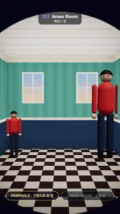

# 313 · Ames Room · 에임스 방



**EN** Through a peephole, identical twins look tiny and giant in a normal checkered room; one walks over and shrinks, then the trapezoid room is revealed.  
**KO** 구멍으로 보면 평범한 체크무늬 방에서 쌍둥이가 하나는 작고 하나는 거인이다. 한 명이 걸어가며 줄어들고, 시야가 닫히면 사다리꼴 방이 드러난다.

[Video (mp4)](https://sueun-dev.github.io/motion-effects/videos/313-ames-room.mp4) · [Code](../effects/313-ames-room.js) · Classic optical illusions · 고전 착시

## Prompt (English)

```text
Create an "Ames Room" motion effect: seen through a peephole, an ordinary room in which identical twins look tiny and giant; one walks across and shrinks to the other's size; then the peephole view closes and a second camera shows the real, distorted room.

Look
- The room as seen from the eye (eye at the origin, looking down −z): 3.2 m wide (x ±1.6), floor y = −1.55, ceiling y = 1.25, back wall z = −5.2.
- Floor: 0.5 m checker, cream #E6D9C2 and dark brown #4D3838. Walls: soft teal stripes every 0.3 m (#4F8A85 / #59968F) above a navy wainscot #33455C with a cream rail at y = −0.62 and a cream cornice. Two windows on the back wall at x = ±0.82 with mullions and a dusk sky. Ceiling boards every 0.45 m. Soft painted shading darkens every corner. The outside of the set is bare plywood boards; the front wall has a brass-ringed peephole.
- Twins: 1.7 m tall, red sweaters #E5533D, navy trousers, black hair, simple faces. A stands at (−1.25, −4.6) as seen, B starts at (1.22, −4.55).
- Peephole camera: 64° vertical field of view, looking at (0, −0.15, −3), with a dark rim toward the edges. Outside camera: 55°, above and in front at (−0.3 + 0.9 · sin a, 8.6, 3.6 + 0.4 · cos a), a = 2π · t / 5, looking at (−0.9, −1.5, −4.5), roof off.
- Overlay: once outside, dashed gold sight lines from the eye to both heads and "EYE · 눈" at the peephole; pills PEEPHOLE · 구멍으로 본 방 and REAL ROOM · 실제 방 at the bottom.

Motion (0–5 s)
- 0.3–1.85 s (ease in-out): B walks left along the back wall to (−0.48, −4.55), shrinking from nearly touching the ceiling to A's size; legs and arms swing with the distance walked.
- 2.25–3.2 s: the peephole view closes like an iris into the peephole: the circle's centre moves from the frame centre to the eye's position in the outside view while it shrinks, uncovering the outside view.
- 3.2–4.25 s: the outside view: a trapezoid room, the left corner 8.7 m from the eye and the right one 3.7 m; B walks back (2.75–4.25 s) toward the near corner at the same real size.
- 4.25–5.2 s the iris opens again (crossing the loop point), and B is a giant again.

Technique
- three.js. Every point of the box room is slid along its line of sight to the eye: P' = P / (1 + 0.25 · x). This projective map keeps planes flat and the picture from the eye unchanged, but pushes the left corner out to 1.67× and pulls the right one in to 0.71×, tilting floor and ceiling. Each wall is a 24 × 24 grid mapped this way.
- The room is painted in the fragment shader from the undistorted coordinates P = P' / (1 − 0.25 · x'), so checks, stripes and windows look square from the eye (anti-aliased with fwidth). Contact shadows are drawn in the floor shader at real size round each pair of feet. The twins are ordinary 1.7 m figures standing on the real, tilted floor.
- Both views are rendered every frame; a full-screen shader mixes them through a circle whose radius is solved each frame so the uncovered share of the frame changes evenly (no burst). ACES Filmic tone mapping at the end.

Output and rules
- One self-contained HTML file with no external assets (three.js from a CDN is fine if you use it), drawing on a 1080 × 1920 canvas (9:16) scaled to fit the window.
- Write a function renderFrame(t) that draws the frame for time t in seconds, and preview it with requestAnimationFrame. Everything must be a pure function of t and fixed seeds: no Math.random(), Date or state carried between frames, so frame i = renderFrame(i / 30) can be exported to a 30 fps video.
- Loop seamlessly every 5 seconds: renderFrame(5) must look exactly like renderFrame(0).
- No flicker of any kind: no noise or grain that changes from frame to frame, no strobing or blinking, no z-fighting, no shimmering 1 px lines. Any grain or texture stays fixed to the screen or to the object.
- Keep the top 280 px free of important content (a title label goes there) and fill the whole frame with a designed background.
```

## 프롬프트 (한국어)

```text
"에임스 방" 모션 효과를 만들어 줘: 구멍으로 보면 평범한 방에서 똑같은 쌍둥이가 하나는 작고 하나는 거인이다. 한 명이 걸어가며 다른 쪽 크기로 줄어들고, 구멍 시야가 닫히면 두 번째 카메라가 실제의 일그러진 방을 보여 준다.

모양
- 눈에서 본 방(눈은 원점, −z를 본다): 폭 3.2m(x ±1.6), 바닥 y = −1.55, 천장 y = 1.25, 뒷벽 z = −5.2.
- 바닥: 0.5m 체크, 크림 #E6D9C2와 짙은 갈색 #4D3838. 벽: 0.3m마다 부드러운 청록 줄무늬(#4F8A85 / #59968F), 그 아래 남색 징두리 #33455C, y = −0.62에 크림색 레일, 크림색 몰딩. 뒷벽 x = ±0.82에 창살과 해 질 녘 하늘이 있는 창 두 개. 0.45m마다 천장 널. 모든 구석은 칠한 그늘로 부드럽게 어둡다. 세트 바깥쪽은 맨 합판이고 앞벽에 놋쇠 테 구멍이 있다.
- 쌍둥이: 키 1.7m, 빨간 스웨터 #E5533D, 남색 바지, 검은 머리, 단순한 얼굴. A는 보이는 좌표 (−1.25, −4.6), B는 (1.22, −4.55)에서 시작.
- 구멍 카메라: 세로 시야각 64°, (0, −0.15, −3)을 보고 가장자리가 어둡다. 바깥 카메라: 55°, 앞쪽 위 (−0.3 + 0.9 · sin a, 8.6, 3.6 + 0.4 · cos a), a = 2π · t / 5, (−0.9, −1.5, −4.5)를 본다. 지붕은 없다.
- 오버레이: 밖에서는 눈에서 두 머리로 가는 금색 점선 시선과 구멍 자리의 "EYE · 눈". 아래에 PEEPHOLE · 구멍으로 본 방 과 REAL ROOM · 실제 방 알약.

움직임 (0–5초)
- 0.3–1.85초(ease in-out): B가 뒷벽을 따라 (−0.48, −4.55)까지 왼쪽으로 걸으며, 천장에 닿을 듯한 크기에서 A만큼 줄어든다. 다리와 팔은 걸은 거리에 맞춰 흔들린다.
- 2.25–3.2초: 구멍 시야가 조리개처럼 구멍 쪽으로 닫힌다: 원의 중심이 화면 가운데에서 바깥 화면 속 눈 위치로 옮겨 가며 줄어들고, 바깥 화면이 드러난다.
- 3.2–4.25초: 바깥 화면: 사다리꼴 방. 왼쪽 구석은 눈에서 8.7m, 오른쪽은 3.7m. B는 실제 크기 그대로 가까운 구석으로 걸어 돌아온다(2.75–4.25초).
- 4.25–5.2초 조리개가 다시 열리고(루프 지점을 지나며) B는 다시 거인이다.

기법
- three.js. 상자 방의 모든 점을 눈으로 가는 시선을 따라 밀거나 당긴다: P' = P / (1 + 0.25 · x). 이 사영 변환은 평면을 평면으로 두고 눈에서 본 그림을 바꾸지 않지만, 왼쪽 구석은 1.67배로 밀어내고 오른쪽은 0.71배로 당겨 바닥과 천장을 기울인다. 벽마다 24 × 24 격자를 이렇게 옮긴다.
- 방의 무늬는 프래그먼트 셰이더에서 되돌린 좌표 P = P' / (1 − 0.25 · x')로 칠하므로 체크·줄무늬·창이 눈에서는 반듯하다(fwidth로 안티에일리어싱). 바닥 셰이더가 발 둘레에 실제 크기의 접촉 그림자를 그린다. 쌍둥이는 실제의 기운 바닥에 선 평범한 1.7m 인형이다.
- 두 화면을 매 프레임 렌더하고, 전체 화면 셰이더가 원으로 둘을 섞는다. 원의 반지름은 프레임마다 풀어서 드러나는 화면 비율이 고르게 바뀌게 한다(갑작스러운 변화 없음). 마지막에 ACES Filmic 톤 매핑.

출력과 규칙
- 외부 파일 없는 HTML 파일 하나(three.js를 쓴다면 CDN은 괜찮다). 1080 × 1920(9:16) 캔버스에 그리고 창 크기에 맞춰 보이게 한다.
- 시간 t(초)의 프레임을 그리는 renderFrame(t) 함수를 만들고, 미리보기는 requestAnimationFrame으로 돌린다. 모든 것은 t와 고정 시드만으로 정해진다: Math.random(), Date, 프레임 사이에 쌓이는 상태 금지. 그래야 i번째 프레임 = renderFrame(i / 30)으로 30fps 영상을 뽑을 수 있다.
- 5초마다 끊김 없이 반복: renderFrame(5)는 renderFrame(0)과 똑같아 보여야 한다.
- 어떤 깜빡임도 금지: 프레임마다 바뀌는 노이즈·그레인, 번쩍임·깜빡임, z-fighting, 반짝이며 떨리는 1px 선 모두 금지. 그레인·질감은 화면이나 물체에 고정한다.
- 위쪽 280px에는 중요한 내용을 두지 않고(제목 라벨 자리), 화면 전체를 디자인된 배경으로 채운다.
```
