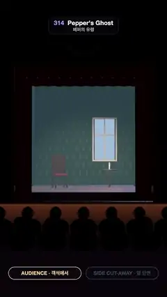

# 314 · Pepper's Ghost · 페퍼의 유령



**EN** A see-through lady in white fades in beside a chair on a moonlit stage; a side cut-away shows the 45° glass and the actor lying lit in the pit below.  
**KO** 달빛 무대의 의자 옆에 비쳐 보이는 흰 옷의 여인이 서서히 나타나고, 옆 단면도가 45° 유리와 무대 아래 구덩이에 누워 조명을 받는 배우를 보여 준다.

[Video (mp4)](https://sueun-dev.github.io/motion-effects/videos/314-peppers-ghost.mp4) · [Code](../effects/314-peppers-ghost.js) · Classic optical illusions · 고전 착시

## Prompt (English)

```text
Create a "Pepper's Ghost" motion effect: a see-through ghost appears on a theatre stage; then a side cut-away shows the angled glass and the hidden, lit actor below the stage.

Look
- A small theatre at night: a gilt proscenium 3.7 × 3.7 m (#C9A04A) with a gilt oval above it, red velvet side curtains and a valance #8E1424, a plum wall #1C0E14. Inside, a parlour set: dark teal damask wallpaper (#2C5250 ovals on #1F3B3A), a moonlit window 0.9 × 1.9 m (#7FA8E8) with cream mullions, a high-backed chair with a red seat, a round table with a candle (static flame #FFD27A and a warm point light), plank floor.
- The stage front: a pit 2.15 m deep and 3.4 m long between the stage lip and the stalls, hidden behind a front wall that glows warm at its top (#6A4028 → #120A0C); two rows of audience heads in black silhouette against it.
- The glass: a 3.7 m wide pane in the plane y = z, leaning out from the stage lip at 45° up to y = z = 3.35 m; nearly invisible from the stalls (4 % opacity), a pale cyan sheet in the cut-away.
- The hidden actor: the same lady lying on her back on a board in the pit at y = −1.6, feet under the stage lip, head toward the audience, lit by a spotlamp at (0.9, −0.5, 2.6) with a faint beam cone.
- The ghost: a lady in a white gown and veil, pale blue-white (0.3, 0.42, 0.58), see-through.
- Overlay in the cut-away: two gold light paths (actor's head and feet → glass → toward the seats, with arrowheads), dashed blue lines from the glass back to where the ghost appears, and labels GLASS 45° · 유리, GHOST APPEARS · 유령, HIDDEN ACTOR · 숨은 배우. Pills AUDIENCE · 객석에서 and SIDE CUT-AWAY · 옆 단면.

Motion (0–5 s), a = 2π · t / 5
- 0–0.35 s: the empty stage. 0.35–1.1 s (ease in-out): the pit lamp comes up and the ghost fades in beside the chair; she sways (0.18 · sin a rad) and slowly lifts her arms.
- 2.1–2.7 s: a dissolve to the side cut-away (smoothstep); 4.15–4.75 s a dissolve back; 4.55–5.0 s the lamp goes down and she fades out.
- The stalls camera drifts slowly: (0.55 · sin a, 1.0 + 0.08 · cos 2a, 15) looking at (0.2 · sin a, 1.55, −1.2), 38° field of view. The side camera, 20 m away at angle π/2 − 0.1 + 0.07 · sin(a + 1) round the stage, height 1.9 + 0.15 · sin 2a, looks at (0, 0.55, 0.5), 36°.

Technique
- three.js. A plane mirror's image is the object reflected through its plane: the reflection in y = z swaps y and z. So the actor in the pit is the standing lady passed through that reflection matrix, and the ghost is the standing lady itself, lit by the lamp's reflection (0.9, 2.6, −0.5).
- The ghost is rendered into its own layer (opaque, depth-tested against itself), kept only where the line from the eye to the point crosses the glass rectangle (soft 3 cm edges), and added onto the stage picture: light reflected by glass adds to what shows through it.
- The cut-away: every theatre mesh is drawn in two halves with clipping planes at x = 0; the side view leaves out the near half (x > 0). Both views are rendered and mixed for the dissolves. ACES Filmic tone mapping at the end.

Output and rules
- One self-contained HTML file with no external assets (three.js from a CDN is fine if you use it), drawing on a 1080 × 1920 canvas (9:16) scaled to fit the window.
- Write a function renderFrame(t) that draws the frame for time t in seconds, and preview it with requestAnimationFrame. Everything must be a pure function of t and fixed seeds: no Math.random(), Date or state carried between frames, so frame i = renderFrame(i / 30) can be exported to a 30 fps video.
- Loop seamlessly every 5 seconds: renderFrame(5) must look exactly like renderFrame(0).
- No flicker of any kind: no noise or grain that changes from frame to frame, no strobing or blinking, no z-fighting, no shimmering 1 px lines. Any grain or texture stays fixed to the screen or to the object.
- Keep the top 280 px free of important content (a title label goes there) and fill the whole frame with a designed background.
```

## 프롬프트 (한국어)

```text
"페퍼의 유령" 모션 효과를 만들어 줘: 극장 무대에 비쳐 보이는 유령이 나타나고, 옆 단면도가 기울어진 유리와 무대 아래 조명을 받는 숨은 배우를 보여 준다.

모양
- 밤의 작은 극장: 3.7 × 3.7m 금빛 프로시니엄(#C9A04A)과 그 위의 금빛 타원 장식, 붉은 벨벳 옆 커튼과 윗단 #8E1424, 자두색 벽 #1C0E14. 안에는 응접실 세트: 짙은 청록 다마스크 벽지(#1F3B3A 위 #2C5250 타원), 크림색 창살의 달빛 창 0.9 × 1.9m(#7FA8E8), 빨간 방석의 등 높은 의자, 촛불이 놓인 둥근 탁자(움직이지 않는 불꽃 #FFD27A와 따뜻한 점광원), 판자 바닥.
- 무대 앞: 무대 끝과 객석 사이, 깊이 2.15m 길이 3.4m의 구덩이. 위쪽이 따뜻하게 빛나는 앞벽(#6A4028 → #120A0C)에 가려 있고, 그 앞에 관객 머리 두 줄이 검은 실루엣으로 보인다.
- 유리: 폭 3.7m 판, 평면 y = z 위에서 무대 끝부터 45°로 객석 쪽으로 기울어 y = z = 3.35m까지. 객석에서는 거의 안 보이고(불투명도 4 %), 단면도에서는 옅은 청록 판.
- 숨은 배우: 같은 여인이 구덩이 y = −1.6의 판 위에 반듯이 누워 발은 무대 끝 아래, 머리는 객석 쪽. (0.9, −0.5, 2.6)의 스포트 램프가 비추고 옅은 빛 원뿔이 보인다.
- 유령: 흰 드레스와 베일의 여인, 옅은 청백색 (0.3, 0.42, 0.58), 비쳐 보인다.
- 단면도 오버레이: 금색 빛 경로 두 개(배우의 머리와 발 → 유리 → 객석, 화살촉), 유리에서 유령이 보이는 곳으로 돌아가는 파란 점선, 라벨 GLASS 45° · 유리, GHOST APPEARS · 유령, HIDDEN ACTOR · 숨은 배우. 알약 AUDIENCE · 객석에서 와 SIDE CUT-AWAY · 옆 단면.

움직임 (0–5초), a = 2π · t / 5
- 0–0.35초: 빈 무대. 0.35–1.1초(ease in-out): 구덩이 램프가 켜지며 의자 옆에 유령이 서서히 나타난다. 몸을 흔들고(0.18 · sin a rad) 팔을 천천히 든다.
- 2.1–2.7초: 옆 단면도로 디졸브(smoothstep). 4.15–4.75초 다시 디졸브. 4.55–5.0초 램프가 꺼지며 유령이 사라진다.
- 객석 카메라는 천천히 흔들린다: (0.55 · sin a, 1.0 + 0.08 · cos 2a, 15)에서 (0.2 · sin a, 1.55, −1.2)를 보고 시야각 38°. 옆 카메라는 20m 떨어져 무대 둘레 각도 π/2 − 0.1 + 0.07 · sin(a + 1), 높이 1.9 + 0.15 · sin 2a에서 (0, 0.55, 0.5)를 보고 시야각 36°.

기법
- three.js. 평면거울의 상은 물체를 그 평면에 대해 뒤집은 것이다: 평면 y = z에 대한 반사는 y와 z를 맞바꾼다. 그래서 구덩이의 배우는 서 있는 여인을 그 반사 행렬로 옮긴 것이고, 유령은 서 있는 여인 그 자체이며 램프의 반사 위치 (0.9, 2.6, −0.5)에서 빛을 받는다.
- 유령은 따로 한 층에 렌더하고(불투명, 자기끼리 깊이 검사), 눈에서 그 점까지의 선이 유리 사각형을 지날 때만 남기며(가장자리 3cm 부드럽게), 무대 그림 위에 더한다: 유리가 반사한 빛은 유리 너머로 보이는 것에 더해진다.
- 단면: 극장의 모든 메시를 x = 0 클리핑 평면으로 두 반쪽으로 그리고, 옆 화면에서는 가까운 반쪽(x > 0)을 뺀다. 두 화면을 다 렌더해 디졸브에 섞는다. 마지막에 ACES Filmic 톤 매핑.

출력과 규칙
- 외부 파일 없는 HTML 파일 하나(three.js를 쓴다면 CDN은 괜찮다). 1080 × 1920(9:16) 캔버스에 그리고 창 크기에 맞춰 보이게 한다.
- 시간 t(초)의 프레임을 그리는 renderFrame(t) 함수를 만들고, 미리보기는 requestAnimationFrame으로 돌린다. 모든 것은 t와 고정 시드만으로 정해진다: Math.random(), Date, 프레임 사이에 쌓이는 상태 금지. 그래야 i번째 프레임 = renderFrame(i / 30)으로 30fps 영상을 뽑을 수 있다.
- 5초마다 끊김 없이 반복: renderFrame(5)는 renderFrame(0)과 똑같아 보여야 한다.
- 어떤 깜빡임도 금지: 프레임마다 바뀌는 노이즈·그레인, 번쩍임·깜빡임, z-fighting, 반짝이며 떨리는 1px 선 모두 금지. 그레인·질감은 화면이나 물체에 고정한다.
- 위쪽 280px에는 중요한 내용을 두지 않고(제목 라벨 자리), 화면 전체를 디자인된 배경으로 채운다.
```
