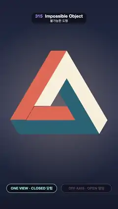

# 315 · Impossible Object · 불가능한 도형



**EN** A coral, cream and teal Penrose triangle hangs closed and impossible; the camera swings off the one true view and its two ends drift metres apart.  
**KO** 산호·크림·청록 펜로즈 삼각형이 불가능하게 닫혀 떠 있다가, 카메라가 단 하나의 시점에서 벗어나자 두 끝이 몇 미터나 떨어져 있음이 드러난다.

[Video (mp4)](https://sueun-dev.github.io/motion-effects/videos/315-impossible-object.mp4) · [Code](../effects/315-impossible-object.js) · Classic optical illusions · 고전 착시

## Prompt (English)

```text
Create an "Impossible Object" motion effect: a real 3D Penrose triangle (tribar) that looks closed from one view; the camera swings off that view and the gap opens.

Look
- Three square beams, 1 unit thick, each 4 units from corner to corner, running along x, then y, then z: P0 → P0 + 4x → + 4y → + 4z. The path is open: its ends P0 and P3 = P0 + 4(1, 1, 1) lie on one line of sight.
- The object is turned so that line (1, 1, 1) points at the camera and the x-beam lies level, so the closed triangle stands on its base.
- Faces are painted flat by their direction, like the classic drawing: x-faces cream #F7EDD9, y-faces coral #E87354, z-faces teal #295E75; the cut faces of the notch a darker brick #80383D.
- Background: a vertical gradient #1A2238 → #2C3552 → #141A2C with a soft warm glow behind the triangle.
- Pills at the bottom: ONE VIEW · CLOSED 닫힘 and OFF AXIS · OPEN 열림, the active one bright. Off axis, a dashed gold line with dots joins the two ends.

Motion (0–5 s)
- 0.15–1.9 s: held exactly still on the magic view: a closed impossible triangle.
- 1.9–3.0 s (ease in-out): the orthographic camera swings 0.9 rad round the vertical and −0.3 rad (to look from below) while zooming out by 1.55×: the bottom-left corner splits and the ends drift apart.
- 3.0–4.12 s: held open; 4.12–5.15 s swings back, closing across the loop point.

Technique
- three.js with an OrthographicCamera (a perspective camera would make the near end bigger than the far one). The x- and y-beams are boxes; the y-beam dips 0.02 into the x-beam so no crack can open.
- The near z-beam is notched so the false corner looks like the real ones: in coordinates (a, b, c) round its end, remove the region {a > b and c > b − 1}, everywhere the far x-beam should pass in front of it. Both cut planes (a = b and c = b − 1) contain the line of sight (1, 1, 1), so they are edge-on in the magic view. Build that beam as one closed mesh of eight flat faces whose edges are all shared whole (no T-junctions, so no pinhole cracks); on the magic view discard the two cut faces so no sliver shows.
- A shader colours each face from its object-space normal (squared components weight the three tones). No lights, no shadows.

Output and rules
- One self-contained HTML file with no external assets (three.js from a CDN is fine if you use it), drawing on a 1080 × 1920 canvas (9:16) scaled to fit the window.
- Write a function renderFrame(t) that draws the frame for time t in seconds, and preview it with requestAnimationFrame. Everything must be a pure function of t and fixed seeds: no Math.random(), Date or state carried between frames, so frame i = renderFrame(i / 30) can be exported to a 30 fps video.
- Loop seamlessly every 5 seconds: renderFrame(5) must look exactly like renderFrame(0).
- No flicker of any kind: no noise or grain that changes from frame to frame, no strobing or blinking, no z-fighting, no shimmering 1 px lines. Any grain or texture stays fixed to the screen or to the object.
- Keep the top 280 px free of important content (a title label goes there) and fill the whole frame with a designed background.
```

## 프롬프트 (한국어)

```text
"불가능한 도형" 모션 효과를 만들어 줘: 한 시점에서는 닫혀 보이는 실제 3D 펜로즈 삼각형(트라이바). 카메라가 그 시점에서 벗어나면 틈이 열린다.

모양
- 두께 1, 모서리에서 모서리까지 4인 네모 막대 셋이 x, y, z 방향으로 차례로 이어진다: P0 → P0 + 4x → + 4y → + 4z. 경로는 열려 있고 두 끝 P0과 P3 = P0 + 4(1, 1, 1)은 한 시선 위에 있다.
- 그 시선 (1, 1, 1)이 카메라를 향하고 x 막대가 수평이 되도록 물체를 돌려, 닫힌 삼각형이 밑변으로 선다.
- 면은 방향에 따라 평평하게 칠한다(고전 그림처럼): x면 크림 #F7EDD9, y면 산호 #E87354, z면 청록 #295E75, 홈의 잘린 면은 더 짙은 벽돌색 #80383D.
- 배경: 세로 그라디언트 #1A2238 → #2C3552 → #141A2C, 삼각형 뒤에 부드럽고 따뜻한 빛.
- 아래 알약: ONE VIEW · CLOSED 닫힘 과 OFF AXIS · OPEN 열림, 지금 상태만 밝게. 시점을 벗어나면 금색 점선과 점이 두 끝을 잇는다.

움직임 (0–5초)
- 0.15–1.9초: 마법의 시점에서 완전히 정지: 닫힌 불가능한 삼각형.
- 1.9–3.0초(ease in-out): 직교 카메라가 수직축으로 0.9 rad, 아래에서 올려다보게 −0.3 rad 돌며 1.55배 줌아웃: 왼쪽 아래 모서리가 갈라지고 두 끝이 멀어진다.
- 3.0–4.12초: 열린 채 정지. 4.12–5.15초 다시 돌아오며 루프 지점을 지나 닫힌다.

기법
- three.js의 OrthographicCamera(원근 카메라면 가까운 끝이 먼 끝보다 커 보인다). x, y 막대는 상자이고, y 막대는 x 막대 안으로 0.02 들어가 틈이 생기지 않는다.
- 가짜 모서리가 진짜 모서리처럼 보이도록 가까운 z 막대에 홈을 판다: 그 끝 둘레 좌표 (a, b, c)에서 {a > b 그리고 c > b − 1} 영역, 즉 먼 x 막대가 앞을 지나가야 할 곳을 모두 지운다. 두 절단면(a = b, c = b − 1)은 시선 (1, 1, 1)을 품으므로 마법의 시점에서는 옆면으로 보여 안 보인다. 이 막대는 모든 모서리를 통째로 공유하는 평면 8개의 닫힌 메시 하나로 만든다(T자 이음이 없어 바늘구멍 틈이 없다). 마법의 시점에서는 두 절단면을 버려 가는 조각도 보이지 않게 한다.
- 셰이더가 물체 공간 법선으로 면 색을 정한다(성분의 제곱이 세 색의 가중치). 조명과 그림자는 없다.

출력과 규칙
- 외부 파일 없는 HTML 파일 하나(three.js를 쓴다면 CDN은 괜찮다). 1080 × 1920(9:16) 캔버스에 그리고 창 크기에 맞춰 보이게 한다.
- 시간 t(초)의 프레임을 그리는 renderFrame(t) 함수를 만들고, 미리보기는 requestAnimationFrame으로 돌린다. 모든 것은 t와 고정 시드만으로 정해진다: Math.random(), Date, 프레임 사이에 쌓이는 상태 금지. 그래야 i번째 프레임 = renderFrame(i / 30)으로 30fps 영상을 뽑을 수 있다.
- 5초마다 끊김 없이 반복: renderFrame(5)는 renderFrame(0)과 똑같아 보여야 한다.
- 어떤 깜빡임도 금지: 프레임마다 바뀌는 노이즈·그레인, 번쩍임·깜빡임, z-fighting, 반짝이며 떨리는 1px 선 모두 금지. 그레인·질감은 화면이나 물체에 고정한다.
- 위쪽 280px에는 중요한 내용을 두지 않고(제목 라벨 자리), 화면 전체를 디자인된 배경으로 채운다.
```
