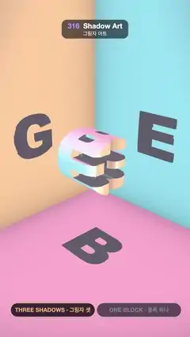

# 316 · Shadow Art · 그림자 아트



**EN** One carved block floats in a room corner and casts a G, an E and a B on three walls; it lifts and turns, the letters melt into blobs, then lock back.  
**KO** 방 구석에 뜬 깎은 블록 하나가 세 벽에 G, E, B 그림자를 드리운다. 블록이 떠올라 돌면 글자가 덩어리로 녹았다가 다시 제자리에 맞춰진다.

[Video (mp4)](https://sueun-dev.github.io/motion-effects/videos/316-shadow-art.mp4) · [Code](../effects/316-shadow-art.js) · Classic optical illusions · 고전 착시

## Prompt (English)

```text
Create a "Shadow Art" motion effect: one carved block hangs in a room corner between three lights and casts three different letters on three walls, G·E·B as on the cover of Gödel, Escher, Bach.

Look
- A room corner: left wall x = 0, back wall z = 0, floor y = 0, fading into darkness away from the corner. Each surface is lit by one coloured directional light straight on: the left wall by amber (1.0, 0.58, 0.24) from +x, the back wall by sky blue (0.22, 0.74, 0.86) from +z, the floor by pink (0.98, 0.36, 0.56) from +y, plus a dim violet ambient. Corners get a soft darkening.
- The block: a 1.4-unit cube centred at (2.35, 2.35, 2.35), off-white (0.93, 0.91, 0.88), lit by all three colours. Its shadows: a G on the left wall, an E on the back wall, a B on the floor (top toward the back wall).
- Camera at (7.4, 5.3, 7.4) looking at (1.5, 1.62, 1.5), focal 3.6 (a narrow lens). Pills: THREE SHADOWS · 그림자 셋 and ONE BLOCK · 블록 하나.

Motion (0–5 s)
- 0.3–2.75 s: still: three crisp letters.
- 2.75–5.3 s (ease in-out, crossing the loop point): the block lifts 0.35 · sin(πk) and turns once round the tilted axis (0.42, 1, 0.3); the shadows slide and melt into abstract blobs, then the block settles back square to the lights and the letters lock into place.

Technique
- A full-screen fragment shader. Each letter (Arial Black) is drawn stretched to fill 86 % of its square both ways; filling the square both ways is what lets the three letters support each other, so each shadow is the whole letter. Each mask is drawn at 1024 × 1024, turned into a signed distance field by an exact Euclidean distance transform, averaged down to 256 × 256 (so the outline is smooth, not a pixel staircase) and stored once as 16-bit values: high bytes in one RGB square, low bytes in the square beside it.
- The block is the intersection of the three letters pushed straight through the cube: SDF = max(box, G(−z, y), E(x, y), B(x, −z)). It is raymarched inside its bounding box; its normal comes from whichever term is outermost (the letter field's 2D gradient, or the box face).
- Walls and floor are hit analytically. A shadow is found by walking 90 even steps from the surface toward the light through the block's box, keeping the closest approach, and turning it into an edge 0.02 wide (smoothstep(−0.006, 0.016, d)), so the letters stay crisp and never jagged. 2 × 2 supersampling.

Output and rules
- One self-contained HTML file with no external assets (three.js from a CDN is fine if you use it), drawing on a 1080 × 1920 canvas (9:16) scaled to fit the window.
- Write a function renderFrame(t) that draws the frame for time t in seconds, and preview it with requestAnimationFrame. Everything must be a pure function of t and fixed seeds: no Math.random(), Date or state carried between frames, so frame i = renderFrame(i / 30) can be exported to a 30 fps video.
- Loop seamlessly every 5 seconds: renderFrame(5) must look exactly like renderFrame(0).
- No flicker of any kind: no noise or grain that changes from frame to frame, no strobing or blinking, no z-fighting, no shimmering 1 px lines. Any grain or texture stays fixed to the screen or to the object.
- Keep the top 280 px free of important content (a title label goes there) and fill the whole frame with a designed background.
```

## 프롬프트 (한국어)

```text
"그림자 아트" 모션 효과를 만들어 줘: 방 구석, 세 조명 사이에 떠 있는 깎은 블록 하나가 세 벽에 서로 다른 글자 그림자를 드리운다 — 『괴델, 에셔, 바흐』 표지처럼 G·E·B.

모양
- 방 구석: 왼쪽 벽 x = 0, 뒷벽 z = 0, 바닥 y = 0, 구석에서 멀어질수록 어둠으로 사라진다. 면마다 정면에서 비추는 색 평행광 하나: 왼쪽 벽은 +x에서 호박색 (1.0, 0.58, 0.24), 뒷벽은 +z에서 하늘색 (0.22, 0.74, 0.86), 바닥은 +y에서 분홍 (0.98, 0.36, 0.56), 그리고 옅은 보라 환경광. 구석은 부드럽게 어둡다.
- 블록: (2.35, 2.35, 2.35)에 놓인 한 변 1.4의 정육면체 크기, 미색 (0.93, 0.91, 0.88), 세 색을 모두 받는다. 그림자: 왼쪽 벽에 G, 뒷벽에 E, 바닥에 B(윗부분이 뒷벽 쪽).
- 카메라 (7.4, 5.3, 7.4)에서 (1.5, 1.62, 1.5)를 보고 초점 3.6(좁은 렌즈). 알약: THREE SHADOWS · 그림자 셋 과 ONE BLOCK · 블록 하나.

움직임 (0–5초)
- 0.3–2.75초: 정지: 또렷한 글자 셋.
- 2.75–5.3초(ease in-out, 루프 지점을 지나며): 블록이 0.35 · sin(πk)만큼 떠오르며 기울어진 축 (0.42, 1, 0.3)으로 한 바퀴 돈다. 그림자가 미끄러지며 추상적인 덩어리로 녹았다가, 블록이 다시 조명에 정렬되면 글자가 제자리에 맞춰진다.

기법
- 전체 화면 프래그먼트 셰이더. 글자(Arial Black)를 정사각형의 86 %를 가로세로 모두 채우게 늘여 그린다. 정사각형을 양방향으로 채워야 세 글자가 서로를 받쳐 주어, 그림자가 글자 전체가 된다. 마스크를 1024 × 1024로 그려 정확한 유클리드 거리 변환으로 부호 거리장을 만들고, 256 × 256으로 평균 내 줄여(윤곽이 픽셀 계단이 아니라 매끄럽게) 16비트로 한 번 담는다: 상위 바이트는 RGB 정사각형 하나에, 하위 바이트는 그 옆 정사각형에.
- 블록은 세 글자를 각 축 방향으로 정육면체에 관통시킨 교집합: SDF = max(box, G(−z, y), E(x, y), B(x, −z)). 경계 상자 안에서 레이마칭하고, 법선은 가장 바깥인 항에서 얻는다(글자 거리장의 2D 기울기나 상자 면).
- 벽과 바닥은 해석적으로 맞힌다. 그림자는 면에서 조명 쪽으로 블록 상자를 90번 고르게 걸으며 가장 가까이 다가간 거리를 구해 폭 0.02의 경계로 바꾼다(smoothstep(−0.006, 0.016, d)). 그래서 글자가 또렷하고 들쭉날쭉하지 않다. 2 × 2 슈퍼샘플링.

출력과 규칙
- 외부 파일 없는 HTML 파일 하나(three.js를 쓴다면 CDN은 괜찮다). 1080 × 1920(9:16) 캔버스에 그리고 창 크기에 맞춰 보이게 한다.
- 시간 t(초)의 프레임을 그리는 renderFrame(t) 함수를 만들고, 미리보기는 requestAnimationFrame으로 돌린다. 모든 것은 t와 고정 시드만으로 정해진다: Math.random(), Date, 프레임 사이에 쌓이는 상태 금지. 그래야 i번째 프레임 = renderFrame(i / 30)으로 30fps 영상을 뽑을 수 있다.
- 5초마다 끊김 없이 반복: renderFrame(5)는 renderFrame(0)과 똑같아 보여야 한다.
- 어떤 깜빡임도 금지: 프레임마다 바뀌는 노이즈·그레인, 번쩍임·깜빡임, z-fighting, 반짝이며 떨리는 1px 선 모두 금지. 그레인·질감은 화면이나 물체에 고정한다.
- 위쪽 280px에는 중요한 내용을 두지 않고(제목 라벨 자리), 화면 전체를 디자인된 배경으로 채운다.
```
